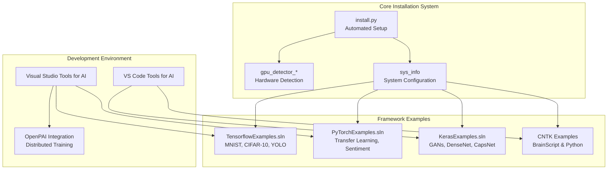
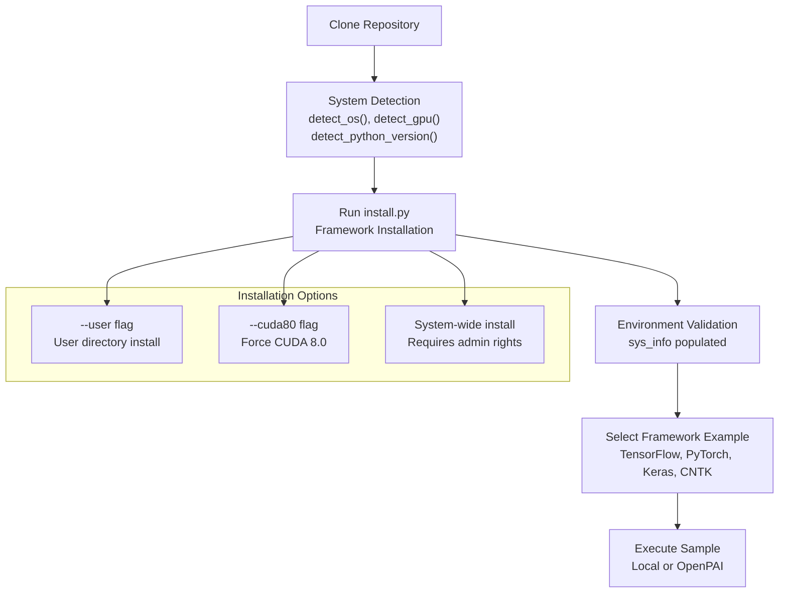
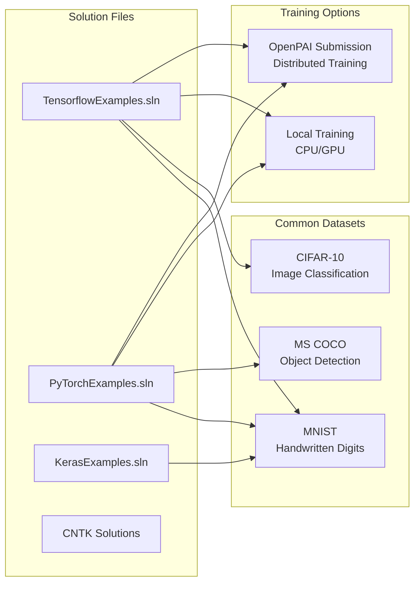

<!-- source: DeepWiki mcp.deepwiki.com · repo microsoft/samples-for-ai · page 2 Getting Started · fetched 2026-10-26 -->

# Getting Started

Relevant source files

The following files were used as context for generating this wiki page:

- [README.md](README.md)
- [docs/download_data.md](docs/download_data.md)
- [docs/local_run.md](docs/local_run.md)
- [docs/prerequisites.md](docs/prerequisites.md)
- [docs/submit_job_to_pai.md](docs/submit_job_to_pai.md)
- [examples/README.md](examples/README.md)
- [installer/gpu_detector_linux](installer/gpu_detector_linux)
- [installer/gpu_detector_mac](installer/gpu_detector_mac)
- [installer/gpu_detector_win.exe](installer/gpu_detector_win.exe)
- [installer/install.py](installer/install.py)
- [projects/StyleTransfer/StyleTransferTraining/src/README.md](projects/StyleTransfer/StyleTransferTraining/src/README.md)
- [zh-hans/README.md](zh-hans/README.md)
- [zh-hant/README.md](zh-hant/README.md)

This page provides an overview of how to set up your development environment and start working with the samples-for-ai repository. It covers the initial setup process, system architecture, and basic workflow to get you running AI/ML examples across multiple frameworks.

For detailed installation procedures and environment configuration, see [Installation and Environment Setup](#2.1). For Visual Studio integration and development tools setup, see [Visual Studio and Development Tools](#2.2). For information about the available framework examples and projects, see [Framework Examples](#3).

## System Overview

The samples-for-ai repository consists of three main components: an automated installer system, framework-specific example collections, and development environment integrations.

Sources: [installer/install.py:16-26](), [README.md:9-24](), [examples/README.md:3-13]()

## Prerequisites Summary

Before using the samples, ensure you have the following baseline requirements:

| Component | Requirement | Detection Function |
|-----------|-------------|-------------------|
| Operating System | 64-bit Windows 10, Linux, or macOS | `detect_os()` |
| Python | Version 3.5 or 3.6 | `detect_python_version()` |
| GPU (Optional) | NVIDIA GPU with CUDA support | `detect_gpu()` |
| CUDA | Version 8.0 or 9.0 (if GPU present) | `detect_cuda_()` |
| Development IDE | Visual Studio 2015/2017 or VS Code | `detect_vs()` |

The installation system automatically detects your hardware and software configuration through the `sys_info` dictionary in [installer/install.py:16-26]().

Sources: [installer/install.py:251-275](), [installer/install.py:315-332](), [installer/install.py:278-294](), [docs/prerequisites.md:20-24]()

## Quick Start Workflow

The typical workflow for getting started involves system detection, automated installation, and running your first example:

Sources: [docs/prerequisites.md:26-47](), [installer/install.py:119-141](), [installer/install.py:629-653]()

## Installation Process Overview

The automated installer ([installer/install.py]()) handles the complete setup process through several key phases:

### System Detection Phase
The installer first detects your system configuration using these functions:
- `detect_os()` - Determines platform (`TOOLSFORAI_OS_WIN`, `TOOLSFORAI_OS_LINUX`, `TOOLSFORAI_OS_MACOS`)
- `detect_gpu()` - Checks for NVIDIA GPU availability using platform-specific detectors
- `detect_python_version()` - Validates Python 3.5/3.6 installation
- `detect_cuda_()` - Identifies CUDA version if GPU is present

### Framework Installation Phase  
Based on the detected configuration, the installer installs appropriate frameworks:
- `pip_install_tensorflow()` - TensorFlow with GPU support if available
- `pip_install_pytorch()` - PyTorch with CUDA bindings
- `pip_install_keras()` - Keras with backend configuration
- `pip_install_cntk()` - Microsoft Cognitive Toolkit

### Environment Configuration
The installer updates system environment variables and validates the installation through the `sys_info` dictionary which tracks:
- OS platform and architecture
- GPU availability and CUDA version
- Installed framework versions
- Python environment details

Sources: [installer/install.py:251-275](), [installer/install.py:692-701](), [installer/install.py:704-725](), [installer/install.py:727-745]()

## Example Structure

Once installation is complete, you can access framework-specific examples organized in Visual Studio solution format:

Sources: [examples/README.md:3-13](), [docs/local_run.md:5-12](), [docs/submit_job_to_pai.md:15-23]()

## Next Steps

After completing the basic setup:

1. **Environment Setup**: Follow the detailed installation guide in [Installation and Environment Setup](#2.1) to run the `install.py` script and configure your development environment.

2. **Development Tools**: Set up Visual Studio or VS Code integration using [Visual Studio and Development Tools](#2.2) for enhanced debugging and project management.

3. **Choose a Framework**: Explore the available examples in [Framework Examples](#3) to find implementations that match your learning objectives or project requirements.

4. **Data Preparation**: Review data download requirements in the framework-specific documentation, as most examples can automatically download datasets but some require manual setup.

5. **Run First Example**: Start with basic examples like MNIST digit recognition to validate your environment before moving to more complex projects.

The automated installer significantly simplifies the traditionally complex process of setting up multiple AI frameworks with proper GPU support and dependency management.

Sources: [README.md:26-38](), [docs/download_data.md:1-9](), [docs/local_run.md:1-17]()

---

