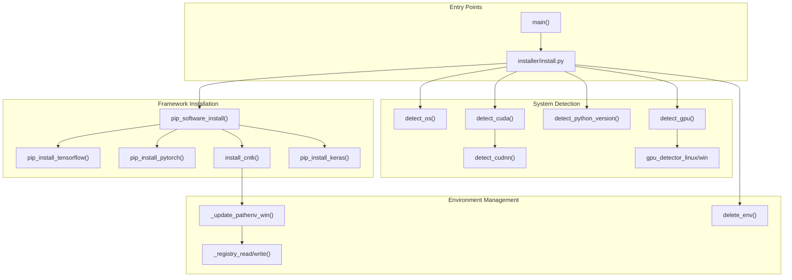
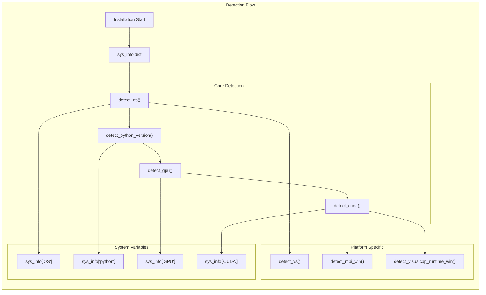
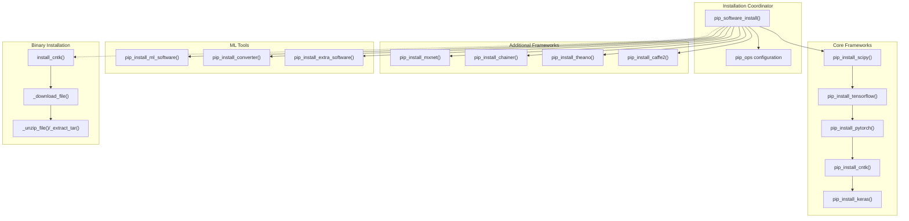
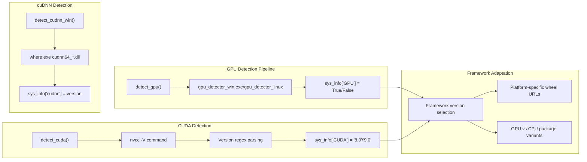
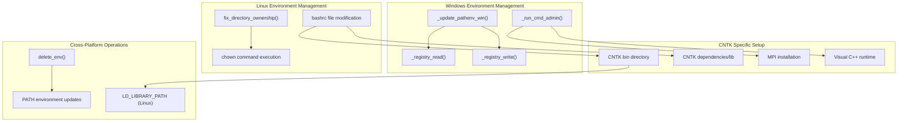
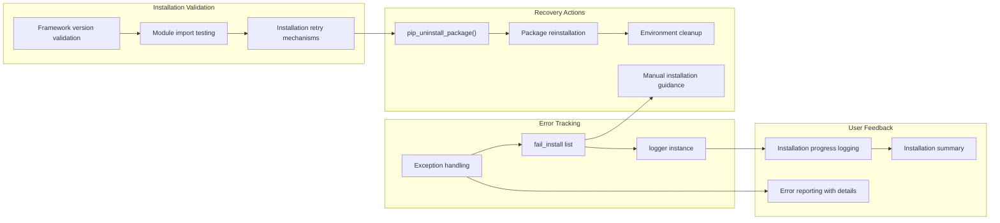

<!-- source: DeepWiki mcp.deepwiki.com · repo microsoft/samples-for-ai · page 2.1 Installation and Environment Setup · fetched 2026-10-26 -->

# Installation and Environment Setup

Relevant source files

The following files were used as context for generating this wiki page:

- [installer/gpu_detector_linux](installer/gpu_detector_linux)
- [installer/gpu_detector_mac](installer/gpu_detector_mac)
- [installer/gpu_detector_win.exe](installer/gpu_detector_win.exe)
- [installer/install.py](installer/install.py)

This document covers the automated installation and environment setup system for AI/ML frameworks provided by the samples-for-ai repository. The installer script provides one-click setup of multiple AI frameworks with automatic system detection, GPU configuration, and dependency management.

For information about specific framework examples after installation, see [Framework Examples](#3). For development tool integration, see [Visual Studio and Development Tools](#2.2).

## System Architecture Overview

The installation system is centered around a comprehensive Python script that detects system capabilities and installs appropriate AI framework versions based on the detected configuration.

Sources: [installer/install.py:1019-1063](), [installer/install.py:251-275](), [installer/install.py:278-294]()

## System Information Detection

The installer performs comprehensive system detection to determine the appropriate framework versions and installation methods.

### System Requirements

| Component | Detection Function | Requirements |
|-----------|-------------------|--------------|
| Operating System | `detect_os()` | Windows 10, Linux, macOS (64-bit only) |
| Python Version | `detect_python_version()` | Python 3.5 or 3.6 (64-bit) |
| GPU Support | `detect_gpu()` | NVIDIA GPU (optional) |
| CUDA Toolkit | `detect_cuda()` | CUDA 8.0 or 9.0 |
| Development Tools | `detect_vs()` | Visual Studio 2015/2017 (Windows) |

Sources: [installer/install.py:251-275](), [installer/install.py:315-332](), [installer/install.py:278-294](), [installer/install.py:354-406]()

## Framework Installation Process

The installation system uses a modular approach where each framework has its own installation function with version-specific logic based on detected system capabilities.

### Framework Version Selection Logic

The installer selects appropriate framework versions based on detected system configuration:

| Framework | Version Selection Logic | Code Location |
|-----------|------------------------|---------------|
| TensorFlow | CUDA 8.0: v1.4.0/1.4.1, CUDA 9.0: v1.5.0 | `pip_install_tensorflow()` |
| PyTorch | Platform-specific wheel URLs based on CUDA version | `pip_install_pytorch()` |
| CNTK | CUDA 8.0: v2.3.1, CUDA 9.0: v2.5.1 | `pip_install_cntk()`, `install_cntk()` |
| Keras | Fixed version 2.1.6 | `pip_install_keras()` |

Sources: [installer/install.py:692-701](), [installer/install.py:704-725](), [installer/install.py:727-745](), [installer/install.py:747-750]()

## GPU and CUDA Configuration

The system includes sophisticated GPU detection and CUDA configuration management to ensure framework compatibility.

### CUDA Version Compatibility Matrix

| CUDA Version | TensorFlow | PyTorch | CNTK | Detection Method |
|--------------|------------|---------|------|------------------|
| 8.0 | 1.4.0/1.4.1 | cu80 wheels | 2.3.1 | `nvcc -V` regex |
| 9.0 | 1.5.0 | cu90 wheels | 2.5.1 | `nvcc -V` regex |
| None | CPU versions | CPU wheels | CPU version | Command execution check |

Sources: [installer/install.py:383-406](), [installer/install.py:408-427](), [installer/install.py:278-294]()

## Environment Configuration

The installer manages system environment variables and registry settings to ensure frameworks are properly configured post-installation.

### Environment Variable Management

| Operation | Windows Implementation | Linux Implementation |
|-----------|----------------------|---------------------|
| PATH updates | Registry modification via `_update_pathenv_win()` | `.bashrc` file editing |
| Library paths | Registry HKEY_CURRENT_USER | `LD_LIBRARY_PATH` export |
| Permissions | Admin command execution | `chown` with real user detection |
| Cleanup | `delete_env()` registry deletion | File-based removal |

Sources: [installer/install.py:231-243](), [installer/install.py:557-576](), [installer/install.py:981-1007](), [installer/install.py:620-627]()

## Error Handling and Recovery

The installation system includes comprehensive error handling with detailed logging and recovery mechanisms.

### Error Categories and Handling

| Error Type | Detection Method | Recovery Action | Code Location |
|------------|-----------------|-----------------|---------------|
| Package installation failure | `pip` return codes | Add to `fail_install` list | `pip_install_package()` |
| System detection failure | Command execution status | Warning logs, continue | `detect_*()` functions |
| Environment setup failure | Registry/file operation status | Admin retry, manual instructions | `_run_cmd_admin()` |
| Dependency conflicts | Import testing | Uninstall/reinstall cycle | `pip_uninstall_package()` |

Sources: [installer/install.py:629-653](), [installer/install.py:656-673](), [installer/install.py:56-66](), [installer/install.py:1054-1059]()

## Installation Command Line Interface

The installer provides several command-line options for customizing the installation process:

| Option | Description | Implementation |
|--------|-------------|----------------|
| `--verbose` | Enable debug logging | Sets logger to DEBUG level |
| `--user` | Install to user directory | Adds `--user` to pip options |
| `--cuda80` | Force CUDA 8.0 packages | Sets `sys_info["cuda80"] = True` |
| `--options` | Custom pip options | Overrides default pip parameters |

The main installation flow begins with argument parsing and system detection, followed by parallel CNTK installation and sequential pip package installation.

Sources: [installer/install.py:1019-1030](), [installer/install.py:1048-1053](), [installer/install.py:955-978]()

---

