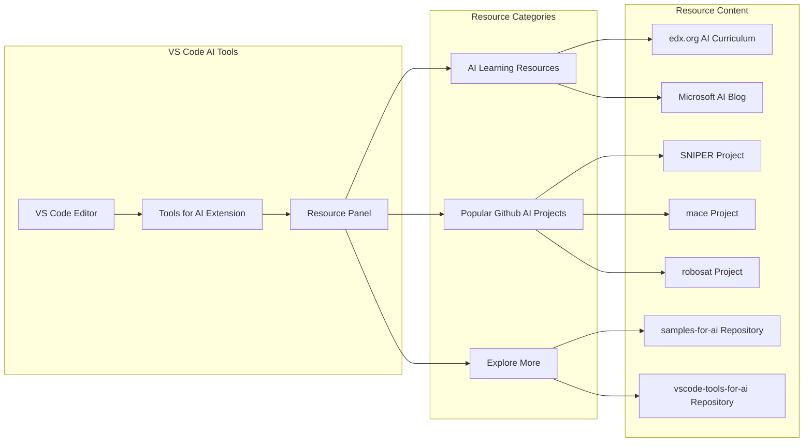
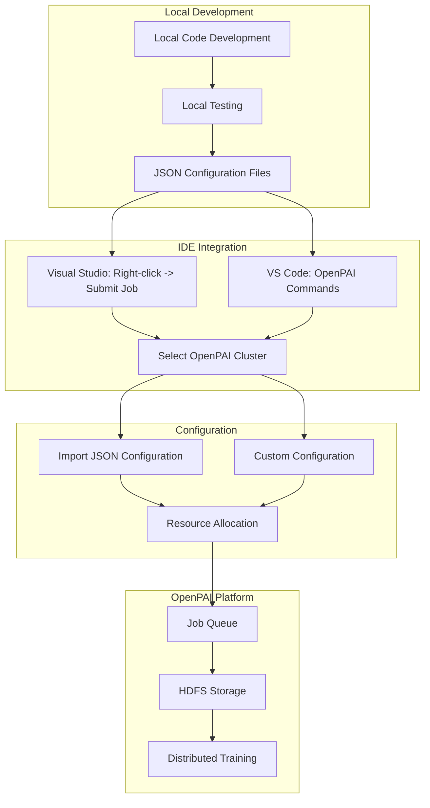

<!-- source: DeepWiki mcp.deepwiki.com · repo microsoft/samples-for-ai · page 2.2 Visual Studio and Development Tools · fetched 2026-10-26 -->

# Visual Studio and Development Tools

Relevant source files

The following files were used as context for generating this wiki page:

- [README.md](README.md)
- [docs/download_data.md](docs/download_data.md)
- [docs/local_run.md](docs/local_run.md)
- [docs/prerequisites.md](docs/prerequisites.md)
- [docs/submit_job_to_pai.md](docs/submit_job_to_pai.md)
- [examples/README.md](examples/README.md)
- [examples/resourcePanel.vscode.json](examples/resourcePanel.vscode.json)
- [examples/resourcePanel.vscode.zh-cn.json](examples/resourcePanel.vscode.zh-cn.json)
- [projects/StyleTransfer/StyleTransferTraining/src/README.md](projects/StyleTransfer/StyleTransferTraining/src/README.md)
- [zh-hans/README.md](zh-hans/README.md)
- [zh-hant/README.md](zh-hant/README.md)

This document covers the setup and usage of Microsoft's AI development tools, specifically Visual Studio Tools for AI and VS Code Tools for AI. These IDEs provide integrated environments for developing, debugging, and deploying AI models across multiple frameworks. For information about the automated framework installation process, see [Installation and Environment Setup](#2.1). For details about OpenPAI distributed training capabilities, see [OpenPAI Integration](#5.2).

## Visual Studio Tools for AI

### Installation and Prerequisites

Visual Studio Tools for AI requires Microsoft Visual Studio 2017 or 2015 as the base IDE. The extension provides comprehensive support for AI development workflows including local debugging, remote training, and cloud deployment.

| Requirement | Version | Purpose |
|-------------|---------|---------|
| Visual Studio | 2017 or 2015 | Base IDE platform |
| Python | 3.5 or 3.6 | Runtime for AI frameworks |
| NVIDIA GPU Driver | Latest | GPU acceleration (optional) |
| CUDA | 9.0 or 8.0 | GPU compute platform |

The installation process involves installing the base Visual Studio IDE followed by the AI Tools extension. The extension integrates with the one-click installer system to automatically configure AI frameworks and dependencies.

**Sources:** [README.md:9-10](), [docs/prerequisites.md:5-7](), [examples/README.md:34-35]()

### Solution Structure and Framework Organization

Visual Studio Tools for AI organizes AI projects using a solution-based structure where each framework has its own solution file containing multiple related projects. This approach provides clear separation between different AI frameworks while maintaining a consistent development experience.

```mermaid
graph TB
    subgraph "Visual Studio Solutions"
        TF_SLN["TensorflowExamples.sln"]
        PYTORCH_SLN["PyTorchExamples.sln"] 
        KERAS_SLN["KerasExamples.sln"]
        CNTK_SLN["CNTKExamples.sln"]
    end
    
    subgraph "TensorFlow Projects"
        TF_MNIST["MNIST Classification"]
        TF_CIFAR["CIFAR-10 Classification"]
        TF_YOLO["YOLO Object Detection"]
        TF_MEMN2N["MemN2N Memory Networks"]
    end
    
    subgraph "PyTorch Projects"
        PT_MNIST["MNIST Classification"]
        PT_CIFAR["CIFAR-10 Classification"]
        PT_TRANSFER["Transfer Learning"]
        PT_SCREENER["ScreenerNet"]
    end
    
    subgraph "Project Types"
        PYTHON_PROJ["Python Projects"]
        BRAINSCRIPT_PROJ["BrainScript Projects"]
    end
    
    TF_SLN --> TF_MNIST
    TF_SLN --> TF_CIFAR
    TF_SLN --> TF_YOLO
    TF_SLN --> TF_MEMN2N
    
    PYTORCH_SLN --> PT_MNIST
    PYTORCH_SLN --> PT_CIFAR
    PYTORCH_SLN --> PT_TRANSFER
    PYTORCH_SLN --> PT_SCREENER
    
    KERAS_SLN --> PYTHON_PROJ
    CNTK_SLN --> PYTHON_PROJ
    CNTK_SLN --> BRAINSCRIPT_PROJ
```

**Sources:** [README.md:15-23](), [examples/README.md:5-13]()

### Development Workflow and Execution

The Visual Studio Tools for AI development workflow supports both local execution and remote job submission. The IDE provides specialized execution contexts for different project types, particularly distinguishing between Python-based projects and CNTK BrainScript projects.

For **Python Projects**:
- Set the startup file in the project
- Use "Start without Debugging" or "Start with Debugging" context menus
- Automatic environment detection and framework loading

For **CNTK BrainScript Projects**:
- Set the project as "Startup Project"  
- Set the script as "Startup File"
- Use "Run CNTK Brain Script" command

The IDE integrates with the automatic installer system to ensure all dependencies are properly configured before execution.

**Sources:** [examples/README.md:75-77](), [docs/local_run.md:5-12]()

## VS Code Tools for AI

### Installation and Configuration

VS Code Tools for AI provides a lightweight alternative to Visual Studio with specialized AI development features. The extension integrates resource discovery, project management, and remote execution capabilities directly into the VS Code environment.

**Sources:** [examples/resourcePanel.vscode.json:1-52](), [docs/submit_job_to_pai.md:28-29]()

### Resource Panel Integration

The VS Code Tools for AI includes a comprehensive resource panel system that provides curated learning materials and project references. The resource panel is configured through JSON files that define categories and external links.

The resource panel structure includes:

| Category | Purpose | Example Resources |
|----------|---------|-------------------|
| AI Learning Resources | Educational content and courses | Microsoft AI curriculum, AI blogs |
| Popular Github AI Projects | Trending open-source AI projects | SNIPER, mace, robosat |
| Explore More | Additional tools and samples | samples-for-ai, vscode-tools-for-ai |

The system supports localization with separate configuration files for different languages, such as Chinese (`resourcePanel.vscode.zh-cn.json`).

**Sources:** [examples/resourcePanel.vscode.json:3-51](), [examples/resourcePanel.vscode.zh-cn.json:3-51]()

## OpenPAI Integration and Job Submission

Both Visual Studio Tools for AI and VS Code Tools for AI provide integrated support for submitting jobs to Microsoft's OpenPAI platform for distributed training. This integration allows seamless transition from local development to cloud-scale training.

### Job Submission Workflow

**Sources:** [docs/submit_job_to_pai.md:15-23](), [docs/submit_job_to_pai.md:32]()

### Configuration Management

Each sample project includes pre-configured JSON files for OpenPAI job submission. These files follow the naming convention `framework_name.sample_name.json` and contain:

- Resource requirements (CPU, memory, GPU)
- Docker image specifications
- Code and data paths on HDFS
- Framework-specific parameters

The IDE tools provide both import functionality for these pre-configured files and manual configuration options for custom setups.

**Sources:** [docs/submit_job_to_pai.md:51](), [docs/submit_job_to_pai.md:19-21]()

## Local Development Features

### Environment Detection and Setup

Both IDE tools integrate with the automated installer system to provide seamless environment setup. The tools can detect:

- Available GPU hardware and drivers
- Installed Python versions and packages  
- Framework installations and compatibility
- CUDA toolkit versions

This integration ensures that the development environment matches the requirements for the selected AI frameworks and samples.

**Sources:** [docs/prerequisites.md:11-14](), [examples/README.md:40-43]()

### Debugging and Execution Support

The IDE tools provide comprehensive debugging support for AI workloads including:

- **Breakpoint debugging** for Python-based models
- **Variable inspection** during training loops
- **GPU memory monitoring** and profiling
- **Tensorboard integration** for visualization
- **Framework-specific tooling** (CNTK BrainScript execution, TensorFlow graph visualization)

The execution environment automatically handles framework initialization, GPU detection, and dependency loading to provide a seamless development experience.

**Sources:** [docs/local_run.md:10-12](), [examples/README.md:75-77]()

---

