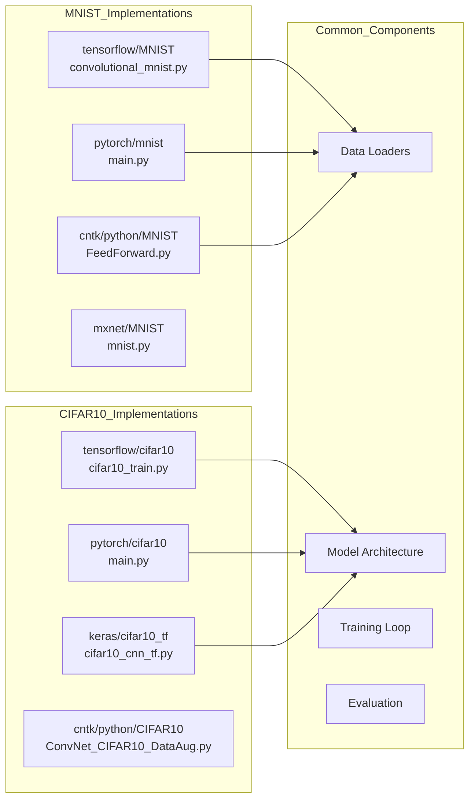
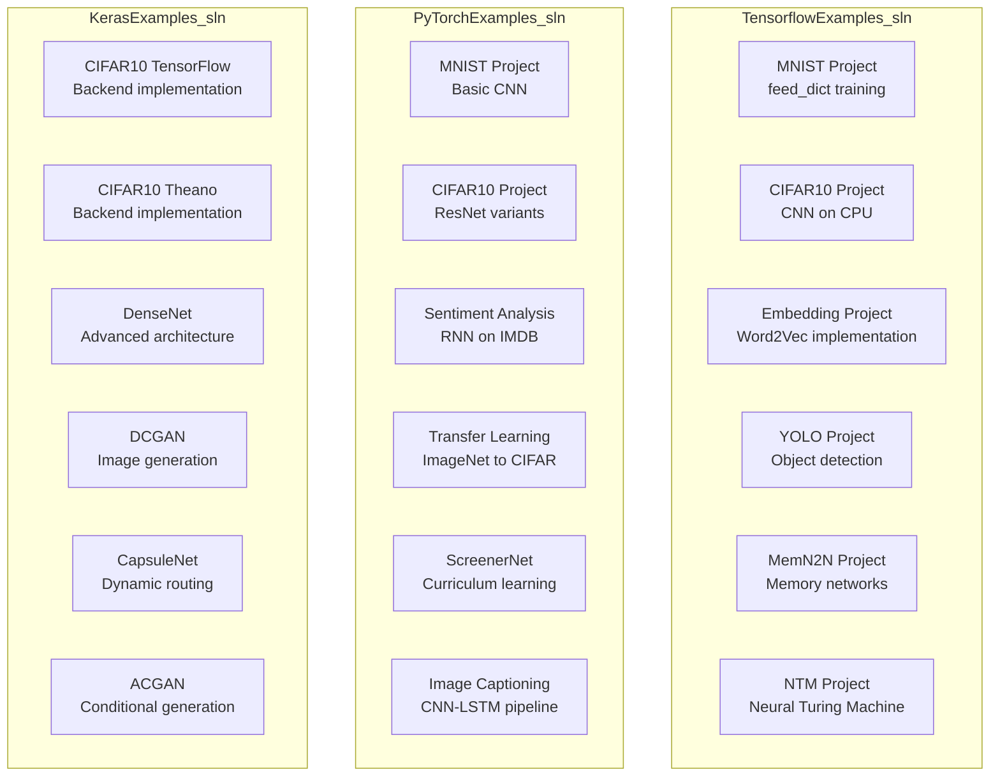
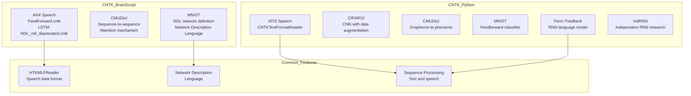
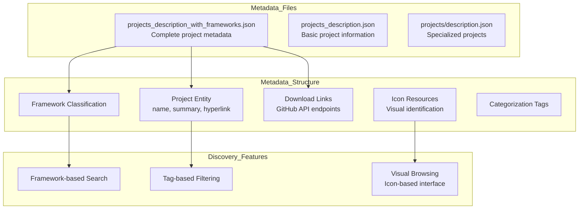

<!-- source: DeepWiki mcp.deepwiki.com · repo microsoft/samples-for-ai · page 3 Framework Examples · fetched 2026-10-26 -->

# Framework Examples

<details>
<summary>Relevant source files</summary>

The following files were used as context for generating this wiki page:

- [examples/cntk/brainscript/README.md](examples/cntk/brainscript/README.md)
- [examples/cntk/python/NumpyExperiment/README.md](examples/cntk/python/NumpyExperiment/README.md)
- [examples/cntk/python/README.md](examples/cntk/python/README.md)
- [examples/keras/README.md](examples/keras/README.md)
- [examples/projects_description.json](examples/projects_description.json)
- [examples/projects_description_with_frameworks.json](examples/projects_description_with_frameworks.json)
- [examples/pytorch/README.md](examples/pytorch/README.md)
- [examples/tensorflow/README.md](examples/tensorflow/README.md)
- [projects/description.json](projects/description.json)

</details>


This document covers the framework-specific AI/ML example collections available in the samples-for-ai repository and provides guidance on selecting appropriate frameworks for different use cases. The examples demonstrate common machine learning tasks implemented across multiple deep learning frameworks to facilitate comparative learning and framework evaluation.

For information about installation and environment setup, see [Installation and Environment Setup](#2.1). For specialized applications and production-ready projects, see [Specialized Projects](#4).

## Supported Frameworks Overview

The repository provides comprehensive examples across eight major deep learning frameworks, organized in framework-specific directories under `examples/`. Each framework includes implementations of common benchmarks and specialized models to demonstrate framework capabilities and programming patterns.

### Framework Categories and Capabilities

```mermaid
graph TB
    subgraph "Primary_Frameworks"
        TF[TensorFlow<br/>"examples/tensorflow/"]
        PT[PyTorch<br/>"examples/pytorch/"]
        KR[Keras<br/>"examples/keras/"]
        CNTK[CNTK<br/>"examples/cntk/"]
    end
    
    subgraph "Additional_Frameworks"
        MX[MXNet<br/>"examples/mxnet/"]
        C2[Caffe2<br/>"examples/caffe2/"]
        TH[Theano<br/>"examples/theano/"]
        CH[Chainer<br/>"examples/chainer/"]
    end
    
    subgraph "Common_Tasks"
        MNIST["MNIST Digit Recognition"]
        CIFAR["CIFAR-10 Image Classification"]
        NLP["Natural Language Processing"]
        GAN["Generative Models"]
        OBJ["Object Detection"]
    end
    
    TF --> MNIST
    TF --> CIFAR
    TF --> NLP
    TF --> OBJ
    
    PT --> MNIST
    PT --> CIFAR
    PT --> NLP
    
    KR --> CIFAR
    KR --> GAN
    
    CNTK --> MNIST
    CNTK --> CIFAR
    CNTK --> NLP
```

**Framework Distribution by Example Count:**

| Framework | Example Projects | Specialization |
|-----------|------------------|----------------|
| TensorFlow | 8 projects | Comprehensive coverage, advanced models |
| Keras | 8 projects | Generative models, high-level APIs |
| CNTK | 9 projects | Speech processing, language modeling |
| PyTorch | 6 projects | Research models, transfer learning |
| Others | 4 projects | Basic implementations |

Sources: [examples/projects_description_with_frameworks.json:1-700](), [examples/tensorflow/README.md:1-95](), [examples/pytorch/README.md:1-63](), [examples/keras/README.md:1-74]()

## Common Example Patterns

### Standard Benchmark Implementations

Most frameworks implement a consistent set of benchmark tasks, enabling direct comparison of framework APIs and performance characteristics. The core examples follow standardized patterns for data loading, model definition, training loops, and evaluation.



**Standard Dataset Integration:**
- **MNIST**: 60,000 training examples, 10,000 test examples for handwritten digit recognition
- **CIFAR-10**: 50,000 training images across 10 classes for image classification benchmarking
- **ImageNet**: Pre-trained model inference and transfer learning demonstrations
- **Penn TreeBank**: Language modeling and sequence prediction tasks

Sources: [examples/tensorflow/README.md:9-24](), [examples/pytorch/README.md:21-34](), [examples/projects_description_with_frameworks.json:16-48]()

### Advanced Model Architectures

The repository includes implementations of cutting-edge research models demonstrating advanced techniques across different domains.

**TensorFlow Advanced Models:**
- **MemN2N**: End-to-End Memory Networks for language modeling using Penn TreeBank dataset
- **NTM**: Neural Turing Machine with LSTM controller supporting multiple read/write heads
- **YOLO**: Real-time object detection system trained on Pascal VOC 2007 data
- **DCGAN**: Deep Convolutional Generative Adversarial Networks for image generation

**PyTorch Research Implementations:**
- **ScreenerNet**: Self-paced curriculum learning architecture for improved training efficiency
- **Image Captioning**: CNN-LSTM system for generating natural language descriptions of images
- **Transfer Learning**: ResNet-based transfer learning from ImageNet to CIFAR-10

**Keras Generative Models:**
- **DCGAN, ACGAN, InfoGAN, WGAN**: Comprehensive GAN implementation suite
- **CapsuleNet**: Dynamic routing between capsules for advanced feature learning
- **DenseNet**: Densely connected convolutional networks with bottleneck compression

Sources: [examples/tensorflow/README.md:49-67](), [examples/pytorch/README.md:9-34](), [examples/keras/README.md:18-44]()

## Framework Organization Structure

### Visual Studio Solution Architecture

Each framework organizes its examples within Visual Studio solution files (`.sln`) that provide integrated development and debugging capabilities through VS Tools for AI.



**Project Structure Conventions:**
- Each project contains a `README.md` with implementation details and references
- Training scripts follow naming patterns: `main.py`, `train.py`, or framework-specific conventions
- Data preprocessing and model definition are typically separated into distinct modules
- Configuration files specify hyperparameters and training settings

Sources: [examples/tensorflow/README.md:69-78](), [examples/pytorch/README.md:41-49](), [examples/keras/README.md:46-54]()

### CNTK Dual Implementation Strategy

CNTK provides examples in two distinct programming paradigms to demonstrate different levels of abstraction and control.



Sources: [examples/cntk/brainscript/README.md:1-34](), [examples/cntk/python/README.md:1-55]()

## Project Discovery and Metadata System

### Structured Project Catalog

The repository implements a comprehensive metadata system for project discovery and categorization through JSON configuration files that enable programmatic access to example information.



**Metadata Schema Structure:**
```json
{
  "framework": "TensorFlow|PyTorch|Keras|CNTK-Python|CNTK-BrainScript",
  "entity": {
    "name": "Example display name",
    "summary": "Detailed description with technical context",
    "hyperlink": {
      "address": "GitHub directory path",
      "service_type": "GitHub"
    },
    "download_link": "GitHub API content endpoint",
    "image_url": "Icon resource path",
    "entity_type": "Training Project|Inference Project"
  }
}
```

Sources: [examples/projects_description_with_frameworks.json:1-50](), [examples/projects_description.json:1-30](), [projects/description.json:1-20]()

### Framework-Specific Example Categories

The metadata system categorizes examples by framework capabilities and intended use cases, enabling targeted discovery of relevant implementations.

| Framework Category | Example Count | Primary Focus Areas |
|-------------------|---------------|-------------------|
| TensorFlow | 6 core examples | Production deployment, advanced models |
| PyTorch | 6 research examples | Research prototyping, experimental architectures |
| CNTK-Python | 6 examples | Speech/NLP processing, enterprise scenarios |
| CNTK-BrainScript | 3 examples | High-performance training, declarative definitions |
| Keras | 8 examples | Generative models, rapid prototyping |
| Additional Frameworks | 4 examples | Framework comparison, migration examples |

**Discovery Integration Points:**
- VS Code resource panels display categorized examples with visual icons
- GitHub API endpoints enable automated project synchronization
- Tag-based filtering supports skill-level and domain-specific discovery
- Framework classification enables comparative analysis workflows

Sources: [examples/projects_description_with_frameworks.json:130-256](), [examples/projects_description_with_frameworks.json:324-447](), [examples/projects_description_with_frameworks.json:476-639]()

## Getting Started with Framework Examples

### Example Selection Strategy

Choose frameworks based on your specific requirements and experience level. The examples are designed to demonstrate equivalent functionality across frameworks, enabling direct comparison of programming approaches and performance characteristics.

**Recommended Starting Points:**
- **Beginners**: Start with Keras CIFAR-10 examples for high-level API familiarity
- **Researchers**: Explore PyTorch implementations for flexible experimentation
- **Production**: Examine TensorFlow examples for deployment-ready patterns
- **Speech/NLP**: Focus on CNTK examples for specialized domain applications

**Cross-Framework Learning Path:**
1. Implement MNIST across 2-3 frameworks to understand API differences
2. Compare CIFAR-10 implementations to see architecture variations
3. Explore advanced models in your preferred framework
4. Study specialized examples relevant to your domain

Each framework directory contains a comprehensive `README.md` with setup instructions, project descriptions, and execution guidance specific to that framework's development workflow.

Sources: [examples/tensorflow/README.md:69-78](), [examples/pytorch/README.md:41-49](), [examples/keras/README.md:46-54](), [examples/cntk/python/README.md:37-46]()

---

