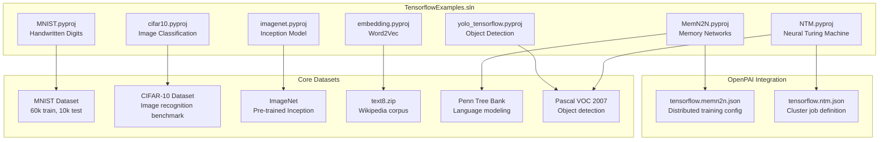
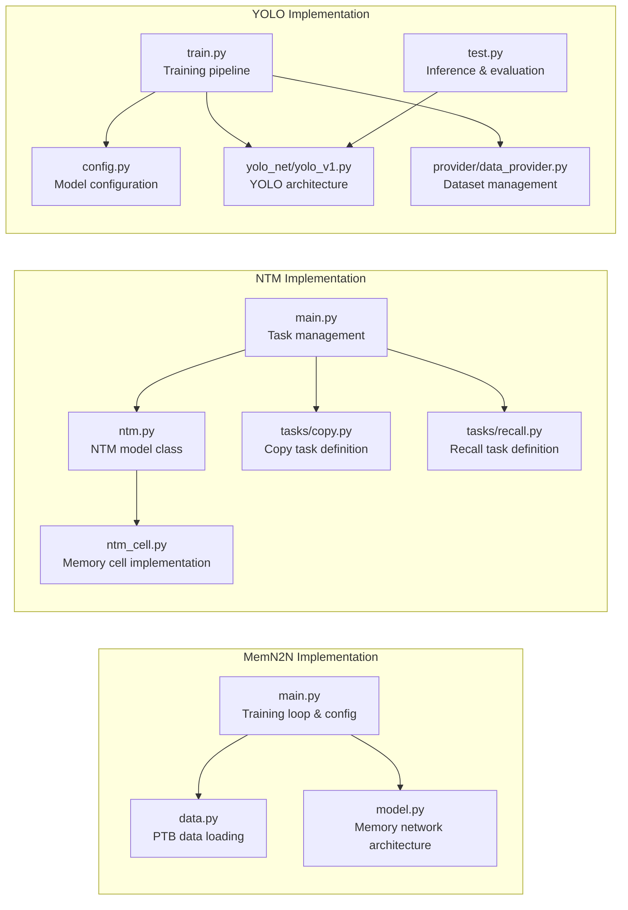
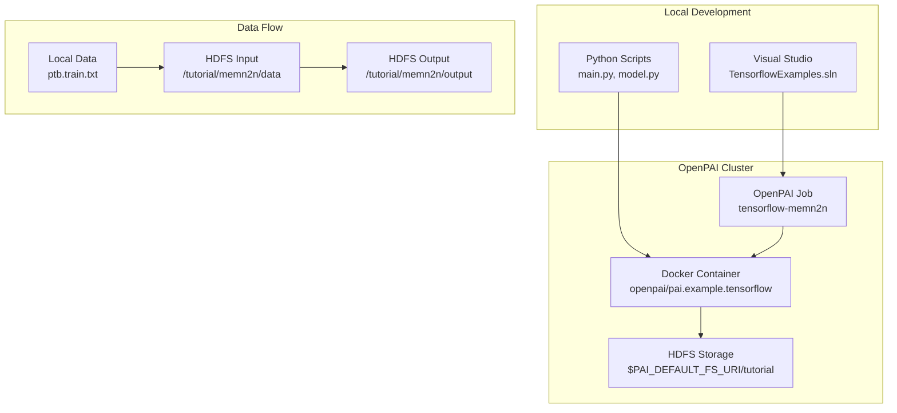

<!-- source: DeepWiki mcp.deepwiki.com · repo microsoft/samples-for-ai · page 3.1 TensorFlow Examples · fetched 2026-10-26 -->

# TensorFlow Examples

<details>
<summary>Relevant source files</summary>

The following files were used as context for generating this wiki page:

- [examples/cntk/brainscript/README.md](examples/cntk/brainscript/README.md)
- [examples/cntk/python/NumpyExperiment/README.md](examples/cntk/python/NumpyExperiment/README.md)
- [examples/cntk/python/README.md](examples/cntk/python/README.md)
- [examples/keras/README.md](examples/keras/README.md)
- [examples/pytorch/README.md](examples/pytorch/README.md)
- [examples/tensorflow/MemN2N/MemN2N.pyproj](examples/tensorflow/MemN2N/MemN2N.pyproj)
- [examples/tensorflow/MemN2N/data.py](examples/tensorflow/MemN2N/data.py)
- [examples/tensorflow/MemN2N/main.py](examples/tensorflow/MemN2N/main.py)
- [examples/tensorflow/MemN2N/tensorflow.memn2n.json](examples/tensorflow/MemN2N/tensorflow.memn2n.json)
- [examples/tensorflow/NTM/NTM.pyproj](examples/tensorflow/NTM/NTM.pyproj)
- [examples/tensorflow/NTM/copydata.sh](examples/tensorflow/NTM/copydata.sh)
- [examples/tensorflow/NTM/main.py](examples/tensorflow/NTM/main.py)
- [examples/tensorflow/NTM/ntm.py](examples/tensorflow/NTM/ntm.py)
- [examples/tensorflow/NTM/tasks/copy.py](examples/tensorflow/NTM/tasks/copy.py)
- [examples/tensorflow/NTM/tensorflow.ntm.json](examples/tensorflow/NTM/tensorflow.ntm.json)
- [examples/tensorflow/README.md](examples/tensorflow/README.md)
- [examples/tensorflow/TensorflowExamples.sln](examples/tensorflow/TensorflowExamples.sln)
- [examples/tensorflow/yolo_tensorflow/yolo_tensorflow.pyproj](examples/tensorflow/yolo_tensorflow/yolo_tensorflow.pyproj)

</details>


This document covers the comprehensive collection of TensorFlow examples in the samples-for-ai repository, focusing on practical implementations of machine learning models ranging from basic neural networks to advanced architectures like Memory Networks and YOLO object detection. The examples are organized as Visual Studio projects with integrated OpenPAI support for distributed training.

For PyTorch implementations of similar algorithms, see [PyTorch Examples](#3.2). For Keras-based examples including GANs, see [Keras Examples](#3.3).

## Overview and Architecture

The TensorFlow examples are organized in a Visual Studio solution structure that includes eight core projects covering fundamental machine learning tasks, computer vision applications, and advanced neural architectures. Each project demonstrates different aspects of TensorFlow development from basic feed-forward networks to complex memory-augmented models.



Sources: [examples/tensorflow/README.md:1-95](), [examples/tensorflow/TensorflowExamples.sln:1-47]()

## Project Categories and Implementation Structure

The TensorFlow examples are organized into three main categories based on complexity and application domain:

| Category | Projects | Key Features |
|----------|----------|--------------|
| **Basic Models** | MNIST, cifar10 | Feed-forward networks, CNNs, standard datasets |
| **Advanced Architectures** | MemN2N, NTM | Memory-augmented networks, external memory access |
| **Computer Vision** | imagenet, yolo_tensorflow, DCGAN | Pre-trained models, object detection, generative models |
| **NLP/Embeddings** | embedding | Word2Vec, text processing, vector representations |

### Core Implementation Components



Sources: [examples/tensorflow/MemN2N/main.py:1-67](), [examples/tensorflow/NTM/main.py:1-108](), [examples/tensorflow/yolo_tensorflow/yolo_tensorflow.pyproj:1-41]()

## Advanced Model Implementations

### Memory Networks (MemN2N)

The MemN2N implementation provides an End-to-End Memory Network for language modeling using the Penn Tree Bank dataset. The `MemN2N` class in [examples/tensorflow/MemN2N/model.py]() implements the core memory network architecture with configurable parameters for memory size, number of hops, and embedding dimensions.

Key configuration parameters from [examples/tensorflow/MemN2N/main.py:13-28]():
- `edim`: Internal state dimension (150)
- `nhop`: Number of memory hops (6) 
- `mem_size`: Memory size (100)
- `batch_size`: Training batch size (128)

The data loading pipeline in [examples/tensorflow/MemN2N/data.py:26-58]() handles PTB text processing, building word vocabularies, and converting text to index sequences.

### Neural Turing Machine (NTM)

The NTM implementation features a complete Neural Turing Machine with LSTM controller and external memory. The `NTMCell` class provides the core memory access mechanisms, while the `NTM` class in [examples/tensorflow/NTM/ntm.py:18-280]() manages training and inference.

The implementation supports multiple tasks through the task system:
- Copy task: [examples/tensorflow/NTM/tasks/copy.py:12-110]()
- Recall task: [examples/tensorflow/NTM/tasks/recall.py]()

Key NTM parameters from [examples/tensorflow/NTM/main.py:16-26]():
- `controller_dim`: LSTM controller dimension (100)
- `write_head_size`: Number of write heads (1)
- `read_head_size`: Number of read heads (1)
- `test_max_length`: Maximum test sequence length (120)

Sources: [examples/tensorflow/MemN2N/main.py:36-64](), [examples/tensorflow/NTM/ntm.py:18-84](), [examples/tensorflow/NTM/tasks/copy.py:58-104]()

## OpenPAI Distributed Training Integration

The TensorFlow examples include built-in support for Microsoft's OpenPAI platform through JSON configuration files that define distributed training jobs.

### MemN2N OpenPAI Configuration

The [examples/tensorflow/MemN2N/tensorflow.memn2n.json:1-22]() file defines a distributed training job with:
- Docker image: `openpai/pai.example.tensorflow`
- Resource allocation: 8 CPUs, 32GB memory
- Command: `pip --quiet install future && cd code && python main.py`

### NTM OpenPAI Configuration  

The [examples/tensorflow/NTM/tensorflow.ntm.json:1-22]() configuration includes:
- Data copying via `copydata.sh` script
- Resource requirements: 1 CPU, 32GB memory
- Command pipeline: `chmod +x code/copydata.sh && ./code/copydata.sh $PAI_DATA_DIR && cd code && python main.py`



Sources: [examples/tensorflow/MemN2N/tensorflow.memn2n.json:1-22](), [examples/tensorflow/NTM/tensorflow.ntm.json:1-22](), [examples/tensorflow/NTM/copydata.sh:1-2]()

## Running the Examples

### Visual Studio Workflow

1. Open [examples/tensorflow/TensorflowExamples.sln:1-47]()
2. Set target project as "Startup Project" 
3. Configure startup file (e.g., `main.py`)
4. Execute via "Start without Debugging"

### Command Line Execution

For MemN2N training:
```bash
cd examples/tensorflow/MemN2N
python main.py --data_name ptb --nepoch 100 --batch_size 128
```

For NTM copy task:
```bash
cd examples/tensorflow/NTM  
python main.py --task copy --is_train True --epoch 100000
```

### Project Contributors

The advanced models include contributions from university students:

| Project | Contributors | Institution |
|---------|-------------|-------------|
| MemN2N, NTM | Tian-You Gao, Xiang Li | Nanjing University of Aeronautics and Astronautics |
| DCGAN | pr0crustes | - |
| yolo-tensorflow | Wayfear | - |

Sources: [examples/tensorflow/README.md:69-95](), [examples/tensorflow/MemN2N/main.py:1-67](), [examples/tensorflow/NTM/main.py:75-108]()

---

