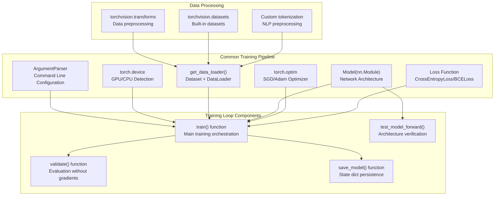
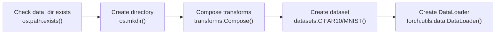

<!-- source: DeepWiki mcp.deepwiki.com · repo microsoft/samples-for-ai · page 3.2 PyTorch Examples · fetched 2026-10-26 -->

# PyTorch Examples

Relevant source files

The following files were used as context for generating this wiki page:

- [examples/cntk/brainscript/README.md](examples/cntk/brainscript/README.md)
- [examples/cntk/python/NumpyExperiment/README.md](examples/cntk/python/NumpyExperiment/README.md)
- [examples/cntk/python/README.md](examples/cntk/python/README.md)
- [examples/keras/README.md](examples/keras/README.md)
- [examples/pytorch/PyTorchExamples.sln](examples/pytorch/PyTorchExamples.sln)
- [examples/pytorch/README.md](examples/pytorch/README.md)
- [examples/pytorch/cifar10/cifar10.py](examples/pytorch/cifar10/cifar10.py)
- [examples/pytorch/cifar10/cifar10.pyproj](examples/pytorch/cifar10/cifar10.pyproj)
- [examples/pytorch/mnist/mnist.py](examples/pytorch/mnist/mnist.py)
- [examples/pytorch/mnist/mnist.pyproj](examples/pytorch/mnist/mnist.pyproj)
- [examples/pytorch/sentiment_analysis/sentiment_analysis.py](examples/pytorch/sentiment_analysis/sentiment_analysis.py)
- [examples/pytorch/sentiment_analysis/sentiment_analysis.pyproj](examples/pytorch/sentiment_analysis/sentiment_analysis.pyproj)
- [examples/pytorch/transfer_learning/transfer_learning.py](examples/pytorch/transfer_learning/transfer_learning.py)
- [examples/pytorch/transfer_learning/transfer_learning.pyproj](examples/pytorch/transfer_learning/transfer_learning.pyproj)
- [examples/tensorflow/README.md](examples/tensorflow/README.md)

This document covers the PyTorch implementation examples in the samples-for-ai repository, providing practical demonstrations of PyTorch's capabilities across computer vision, natural language processing, and advanced machine learning techniques. The examples range from fundamental tasks like MNIST digit recognition to sophisticated approaches like self-paced curriculum learning.

For TensorFlow implementations of similar tasks, see [TensorFlow Examples](#3.1). For high-level Keras examples, see [Keras Examples](#3.3).

## Overview

The PyTorch examples are organized as a Visual Studio solution containing five distinct projects that demonstrate core PyTorch patterns and best practices. Each project includes complete training pipelines with data loading, model definition, training loops, validation, and model persistence.

```mermaid
graph TB
    subgraph "PyTorchExamples.sln"
        MNIST["mnist<br/>Basic CNN Classification"]
        CIFAR10["cifar10<br/>Deep CNN with Blocks"]
        TRANSFER["transfer_learning<br/>ResNet-34 Fine-tuning"]
        SENTIMENT["sentiment_analysis<br/>RNN with Attention"]
        SCREENER["ScreenerNet<br/>Self-paced Learning"]
    end
    
    subgraph "Common Datasets"
        MNIST_DS["MNIST Dataset<br/>28x28 Handwritten Digits"]
        CIFAR_DS["CIFAR-10 Dataset<br/>32x32 Color Images"]
        IMDB_DS["IMDB Dataset<br/>Movie Reviews"]
        IMAGENET_DS["ImageNet Pretrained<br/>ResNet-34 Weights"]
    end
    
    subgraph "PyTorch Core Components"
        TORCH_NN["torch.nn<br/>Neural Network Modules"]
        TORCH_OPT["torch.optim<br/>Optimizers"]
        TORCH_DATA["torch.utils.data<br/>DataLoaders"]
        TORCHVISION["torchvision<br/>Transforms & Models"]
        TORCHTEXT["torchtext<br/>NLP Data Processing"]
    end
    
    MNIST --> MNIST_DS
    CIFAR10 --> CIFAR_DS
    TRANSFER --> CIFAR_DS
    TRANSFER --> IMAGENET_DS
    SENTIMENT --> IMDB_DS
    
    MNIST --> TORCH_NN
    CIFAR10 --> TORCH_NN
    TRANSFER --> TORCHVISION
    SENTIMENT --> TORCHTEXT
    
    MNIST --> TORCH_OPT
    CIFAR10 --> TORCH_OPT
    TRANSFER --> TORCH_OPT
    SENTIMENT --> TORCH_OPT
    
    MNIST --> TORCH_DATA
    CIFAR10 --> TORCH_DATA
    TRANSFER --> TORCH_DATA
    SENTIMENT --> TORCH_DATA
```

Sources: [examples/pytorch/PyTorchExamples.sln:1-39](), [examples/pytorch/README.md:1-63]()

## Project Architecture

Each PyTorch example follows a consistent architectural pattern with standardized components for data handling, model definition, training, and evaluation.

Sources: [examples/pytorch/mnist/mnist.py:114-124](), [examples/pytorch/cifar10/cifar10.py:126-136](), [examples/pytorch/transfer_learning/transfer_learning.py:100-110]()

## Individual Projects

### MNIST Classification

The MNIST project implements a convolutional neural network for handwritten digit recognition using a straightforward CNN architecture with batch normalization and dropout.

**Key Components:**
- `Model` class with two convolutional layers and two fully connected layers
- Batch normalization via `nn.BatchNorm2d` and `nn.BatchNorm1d`
- LeakyReLU activation and dropout regularization
- SGD optimizer with momentum

The model architecture processes 28x28 grayscale images through convolutional features extraction followed by classification layers.

Sources: [examples/pytorch/mnist/mnist.py:30-47](), [examples/pytorch/mnist/mnist.py:82-112]()

### CIFAR-10 Classification

The CIFAR-10 project demonstrates a deeper CNN architecture using modular convolutional blocks for 32x32 color image classification across 10 categories.

**Key Components:**
- `make_conv_block()` function creating standardized conv-relu-batchnorm-conv-relu-batchnorm-maxpool sequences
- `Model` class with three progressive convolutional blocks (32→64→128 channels)
- Dropout2d for spatial regularization
- Adam optimizer for adaptive learning rates

The block-based design allows for easy architecture experimentation and demonstrates modern CNN design patterns.

Sources: [examples/pytorch/cifar10/cifar10.py:28-59](), [examples/pytorch/cifar10/cifar10.py:94-124]()

### Transfer Learning

The transfer learning project showcases fine-tuning a pre-trained ResNet-34 model for CIFAR-10 classification, demonstrating how to leverage ImageNet-trained features.

**Key Components:**
- `create_resnet()` function loading pre-trained `models.resnet34`
- Custom final layer replacement: `model.fc = nn.Linear(model.fc.in_features, 10)`
- Image resizing to 200x200 to match ResNet input requirements
- Lower learning rate (0.001) suitable for fine-tuning

This approach significantly reduces training time while achieving high accuracy by building on established feature representations.

Sources: [examples/pytorch/transfer_learning/transfer_learning.py:34-39](), [examples/pytorch/transfer_learning/transfer_learning.py:68-98]()

### Sentiment Analysis

The sentiment analysis project implements a bidirectional GRU with attention mechanism for binary sentiment classification on IMDB movie reviews.

**Key Components:**
- `Model` class with embedding layer, bidirectional GRU, and attention mechanism
- `tokenize_line_en()` function for text preprocessing with regex-based tokenization
- `torchtext` integration for IMDB dataset handling and vocabulary building
- Attention weights computed via `att = nn.Linear(hdim * ndirections + idim, 1)`
- BCELoss for binary classification

The attention mechanism allows the model to focus on relevant parts of input sequences for improved classification performance.

Sources: [examples/pytorch/sentiment_analysis/sentiment_analysis.py:33-61](), [examples/pytorch/sentiment_analysis/sentiment_analysis.py:78-91](), [examples/pytorch/sentiment_analysis/sentiment_analysis.py:133-171]()

### ScreenerNet

The ScreenerNet project implements self-paced curriculum learning, automatically determining training sample difficulty to improve learning efficiency. This represents advanced research in curriculum learning strategies.

Sources: [examples/pytorch/README.md:9-11]()

## Common Patterns and Utilities

### Data Loading Pattern

All projects follow a consistent data loading pattern with automatic dataset downloading and preprocessing:

**Standard transforms:**
- `transforms.ToTensor()` for tensor conversion and [0,1] scaling
- `transforms.Normalize()` with dataset-specific mean/std values
- `transforms.Resize()` for input size compatibility

Sources: [examples/pytorch/mnist/mnist.py:56-62](), [examples/pytorch/cifar10/cifar10.py:68-74]()

### Training and Validation Loop

The training infrastructure implements consistent patterns across all projects:

| Component | MNIST | CIFAR-10 | Transfer Learning | Sentiment Analysis |
|-----------|--------|----------|-------------------|-------------------|
| **Optimizer** | SGD + momentum | Adam | Adam | Adam |
| **Loss Function** | CrossEntropyLoss | CrossEntropyLoss | CrossEntropyLoss | BCELoss |
| **Device Selection** | `torch.cuda.is_available()` | `torch.cuda.is_available()` | `torch.cuda.is_available()` | Hard-coded CUDA |
| **Model Persistence** | Best validation accuracy | Best validation accuracy | Best validation accuracy | Best validation accuracy |
| **Validation Strategy** | No-gradient context | No-gradient context | No-gradient context | No-gradient context |

The validation function signature is standardized: `validate(model, device, val_loader, criterion)` returning loss, correct predictions, and total samples.

Sources: [examples/pytorch/mnist/mnist.py:69-80](), [examples/pytorch/cifar10/cifar10.py:81-92](), [examples/pytorch/sentiment_analysis/sentiment_analysis.py:98-112]()

### Model Persistence

All projects implement consistent model saving with state dictionary persistence:

- Directory creation: `os.path.exists(args.model_dir)` and `os.mkdir(args.model_dir)`
- State dict saving: `torch.save(model.state_dict(), path)`
- Best model tracking based on validation performance

Sources: [examples/pytorch/mnist/mnist.py:64-67](), [examples/pytorch/cifar10/cifar10.py:76-79]()

## Usage Instructions

### Running Individual Projects

1. **Open Visual Studio Solution**: Load `PyTorchExamples.sln` in Visual Studio 2017+
2. **Set Startup Project**: Right-click desired project and select "Set as Startup Project"
3. **Configure Startup File**: Right-click the main Python file and select "Set as Startup File"
4. **Execute**: Right-click script and select "Start without Debugging"

### Command Line Arguments

Each project accepts standardized command line arguments:

| Argument | Default | Purpose |
|----------|---------|---------|
| `--lr` | 0.01-0.002 | Learning rate |
| `--batch_size` | 128-1000 | Training batch size |
| `--epochs` | 20 | Number of training epochs |
| `--data_dir` | 'data' | Dataset storage directory |
| `--model_dir` | 'model' | Model checkpoint directory |

### GPU Requirements

- **MNIST/CIFAR-10**: Can run on CPU or GPU
- **Transfer Learning**: GPU recommended due to ResNet-34 complexity
- **Sentiment Analysis**: GPU required for reasonable training time
- **ScreenerNet**: GPU recommended for curriculum learning overhead

Sources: [examples/pytorch/README.md:41-49](), [examples/pytorch/transfer_learning/transfer_learning.py:29-30]()

---

