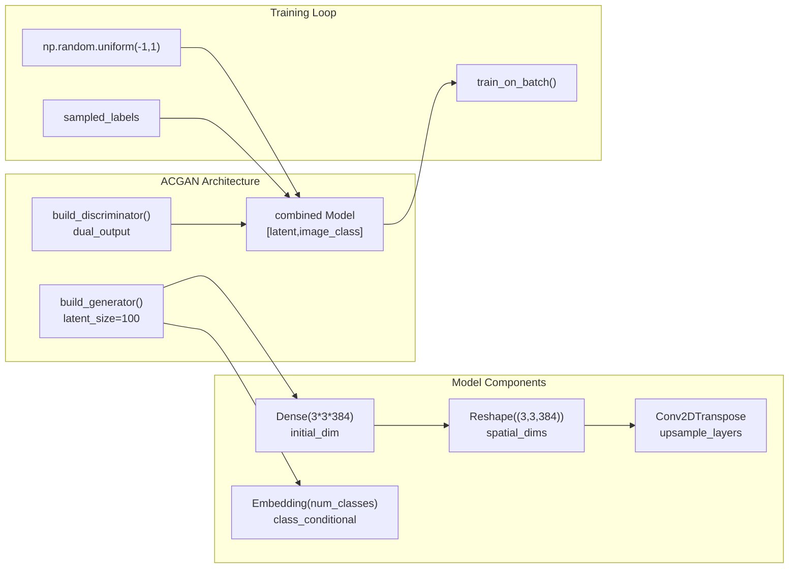
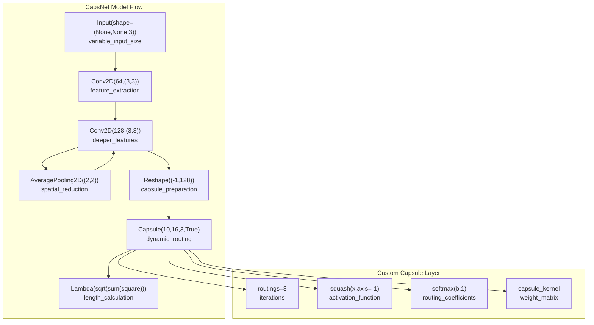
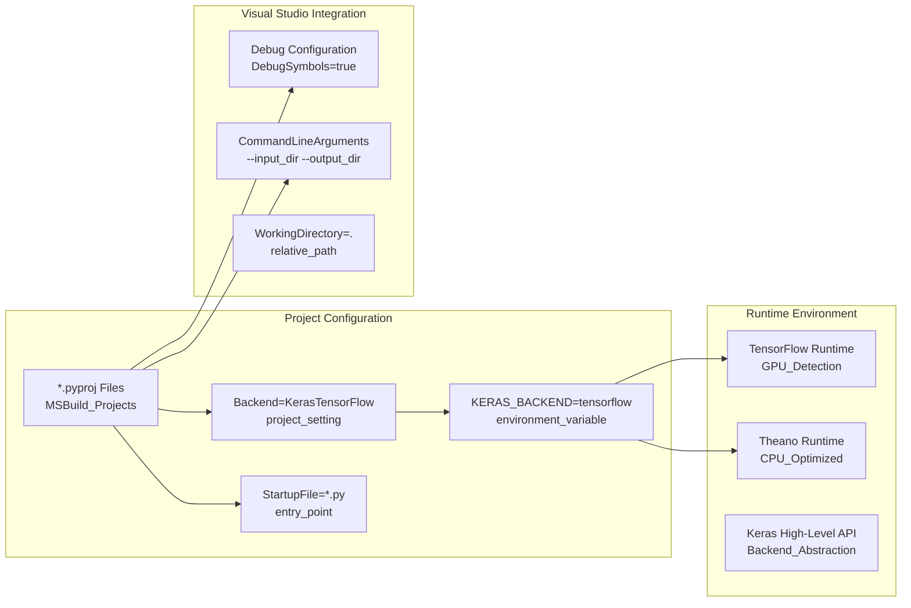

<!-- source: DeepWiki mcp.deepwiki.com · repo microsoft/samples-for-ai · page 3.3 Keras Examples · fetched 2026-10-26 -->

# Keras Examples

Relevant source files

The following files were used as context for generating this wiki page:

- [examples/cntk/brainscript/README.md](examples/cntk/brainscript/README.md)
- [examples/cntk/python/NumpyExperiment/README.md](examples/cntk/python/NumpyExperiment/README.md)
- [examples/cntk/python/README.md](examples/cntk/python/README.md)
- [examples/keras/KerasExamples.sln](examples/keras/KerasExamples.sln)
- [examples/keras/README.md](examples/keras/README.md)
- [examples/keras/acgan_tf/acgan_mnist.py](examples/keras/acgan_tf/acgan_mnist.py)
- [examples/keras/acgan_tf/acgan_tf.pyproj](examples/keras/acgan_tf/acgan_tf.pyproj)
- [examples/keras/capsnet_tf/capsnet_cifar10.py](examples/keras/capsnet_tf/capsnet_cifar10.py)
- [examples/keras/capsnet_tf/capsnet_tf.pyproj](examples/keras/capsnet_tf/capsnet_tf.pyproj)
- [examples/pytorch/README.md](examples/pytorch/README.md)
- [examples/tensorflow/README.md](examples/tensorflow/README.md)

This document covers the Keras examples collection in the samples-for-ai repository, which demonstrates high-level neural network APIs through implementations of generative adversarial networks (GANs) and advanced architectures. The examples focus on cutting-edge research implementations using Keras with both TensorFlow and Theano backends.

For basic framework examples like MNIST and CIFAR-10 classification, see [TensorFlow Examples](#3.1) and [PyTorch Examples](#3.2). For generative model implementations specifically, see [Generative Adversarial Networks](#3.3.1).

## Solution Structure

The Keras examples are organized in a Visual Studio solution containing eight distinct projects, each demonstrating different aspects of modern deep learning architectures.

```mermaid
graph TB
    subgraph "KerasExamples.sln"
        CIFAR_TF["cifar10_tf<br/>TensorFlow Backend"]
        CIFAR_TH["cifar10_th<br/>Theano Backend"]
        DCGAN["dcgan_tf<br/>Deep Convolutional GAN"]
        ACGAN["acgan_tf<br/>Auxiliary Classifier GAN"]
        WGAN["wgan_tf<br/>Wasserstein GAN"]
        INFOGAN["infogan_tf<br/>Information GAN"]
        CAPSNET["capsnet_tf<br/>Capsule Networks"]
        DENSENET["DenseNet<br/>Dense Connections"]
        CAPTIONING["Image_Captioning<br/>CNN-LSTM Architecture"]
    end
    
    subgraph "Dataset Integration"
        MNIST["MNIST Dataset<br/>Handwritten Digits"]
        CIFAR10["CIFAR-10 Dataset<br/>Small Images"]
    end
    
    subgraph "Backend Systems"
        TF_BACKEND["TensorFlow Backend<br/>KERAS_BACKEND=tensorflow"]
        TH_BACKEND["Theano Backend<br/>KERAS_BACKEND=theano"]
    end
    
    CIFAR_TF --> TF_BACKEND
    CIFAR_TH --> TH_BACKEND
    DCGAN --> TF_BACKEND
    ACGAN --> TF_BACKEND
    WGAN --> TF_BACKEND
    INFOGAN --> TF_BACKEND
    CAPSNET --> TF_BACKEND
    
    DCGAN --> MNIST
    ACGAN --> MNIST
    WGAN --> MNIST
    INFOGAN --> MNIST
    CIFAR_TF --> CIFAR10
    CIFAR_TH --> CIFAR10
    CAPSNET --> CIFAR10
    DENSENET --> CIFAR10
```

**Sources:** [examples/keras/KerasExamples.sln:1-55](), [examples/keras/README.md:1-74]()

## Example Categories

The Keras examples are organized into three main categories based on their technical focus and architectural complexity.

| Category | Examples | Primary Focus |
|----------|----------|---------------|
| **Generative Models** | `dcgan_tf`, `acgan_tf`, `wgan_tf`, `infogan_tf` | GAN architectures and variants |
| **Advanced Architectures** | `capsnet_tf`, `DenseNet` | Novel network designs |
| **Backend Comparison** | `cifar10_tf`, `cifar10_th` | Framework backend differences |
| **Multimodal** | `Image_Captioning` | CNN-LSTM integration |

**Sources:** [examples/keras/README.md:7-44]()

## Generative Adversarial Networks Implementation

The GAN examples demonstrate different variants of adversarial training, each implementing the core `Generator` and `Discriminator` pattern with specific architectural improvements.

**Sources:** [examples/keras/acgan_tf/acgan_mnist.py:38-116]()

### ACGAN Implementation Details

The Auxiliary Classifier GAN implements class-conditional generation through the `build_generator()` and `build_discriminator()` functions with specific architectural patterns:

- **Generator Architecture**: Uses `Conv2DTranspose` layers for upsampling from `(3,3,384)` to `(28,28,1)` with `BatchNormalization` between layers [examples/keras/acgan_tf/acgan_mnist.py:43-61]()
- **Class Conditioning**: Implements `Embedding(num_classes, latent_size)` with hadamard product multiplication [examples/keras/acgan_tf/acgan_mnist.py:69-73]()
- **Dual Output Discriminator**: Returns both `fake` classification and `auxiliary` class prediction [examples/keras/acgan_tf/acgan_mnist.py:112-113]()

**Sources:** [examples/keras/acgan_tf/acgan_mnist.py:1-335]()

## Capsule Networks Architecture

The CapsNet implementation demonstrates dynamic routing between capsules using a custom `Capsule` layer that extends Keras' base `Layer` class.

**Sources:** [examples/keras/capsnet_tf/capsnet_cifar10.py:51-142](), [examples/keras/capsnet_tf/capsnet_cifar10.py:156-177]()

### Dynamic Routing Implementation

The `Capsule` class implements the routing algorithm with specific mathematical operations:

- **Squashing Function**: `K.sqrt(s_squared_norm) / (0.5 + s_squared_norm)` for vector normalization [examples/keras/capsnet_tf/capsnet_cifar10.py:31-34]()
- **Routing Algorithm**: Iterative updates using `K.batch_dot(outputs, hat_inputs, [2, 3])` for coefficient calculation [examples/keras/capsnet_tf/capsnet_cifar10.py:128-134]()
- **Margin Loss**: Custom loss function `K.sum(y_true * K.square(K.relu(1 - margin - y_pred)))` for capsule training [examples/keras/capsnet_tf/capsnet_cifar10.py:45-48]()

**Sources:** [examples/keras/capsnet_tf/capsnet_cifar10.py:26-49](), [examples/keras/capsnet_tf/capsnet_cifar10.py:102-138]()

## Backend Configuration and Environment

The Keras examples support multiple backend configurations through environment variables and project settings, allowing comparison between different computational backends.

**Sources:** [examples/keras/acgan_tf/acgan_tf.pyproj:14-16](), [examples/keras/capsnet_tf/capsnet_tf.pyproj:14-16]()

## Execution and Development Workflow

The examples follow a standardized execution pattern through Visual Studio integration with specific project configuration requirements.

### Project Setup Pattern

Each Keras project follows the same `.pyproj` structure:
- **Backend Specification**: `<Backend>KerasTensorFlow</Backend>` for framework selection [examples/keras/acgan_tf/acgan_tf.pyproj:14]()
- **Environment Variables**: `<Environment>KERAS_BACKEND=tensorflow</Environment>` for runtime configuration [examples/keras/acgan_tf/acgan_tf.pyproj:15]()
- **Command Arguments**: `<CommandLineArguments>--input_dir . --output_dir .</CommandLineArguments>` for I/O paths [examples/keras/acgan_tf/acgan_tf.pyproj:16]()

### Running Examples

1. **Solution Loading**: Open `KerasExamples.sln` in Visual Studio 2017+ [examples/keras/README.md:48]()
2. **Project Selection**: Set desired project as "Startup Project" via right-click [examples/keras/README.md:50]()
3. **Script Selection**: Set target `.py` file as "Startup File" [examples/keras/README.md:52]()
4. **Execution**: Use "Start without Debugging" for model training [examples/keras/README.md:54]()

**Sources:** [examples/keras/README.md:46-54](), [examples/keras/acgan_tf/acgan_tf.pyproj:1-40]()

---

