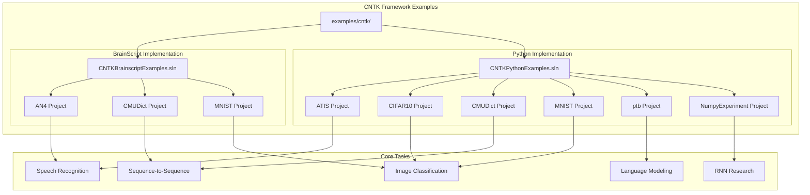
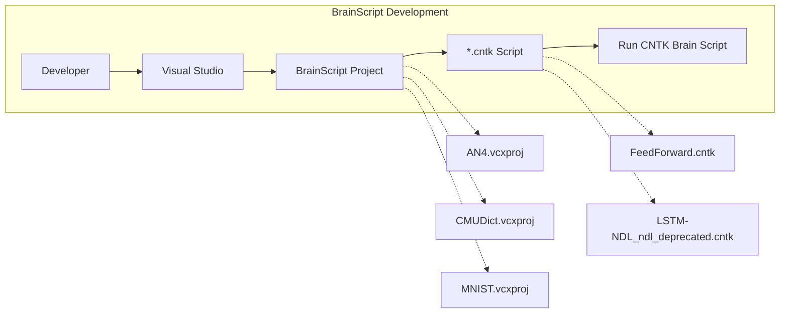
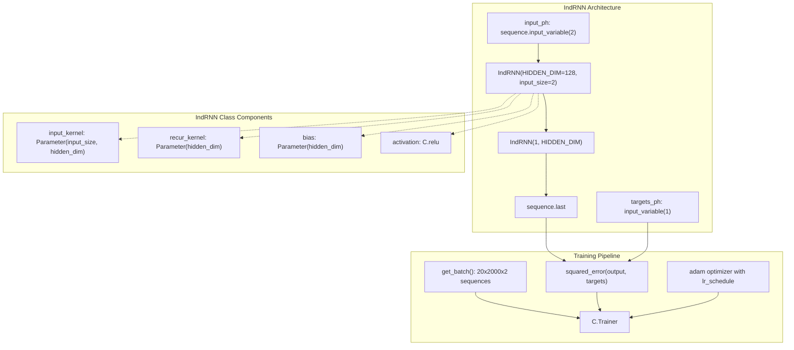

<!-- source: DeepWiki mcp.deepwiki.com · repo microsoft/samples-for-ai · page 3.4 CNTK Examples · fetched 2026-10-26 -->

# CNTK Examples

Relevant source files

The following files were used as context for generating this wiki page:

- [examples/caffe2/README.md](examples/caffe2/README.md)
- [examples/chainer/README.md](examples/chainer/README.md)
- [examples/chainer/mnist/mnist.pyproj](examples/chainer/mnist/mnist.pyproj)
- [examples/cntk/README.md](examples/cntk/README.md)
- [examples/cntk/brainscript/README.md](examples/cntk/brainscript/README.md)
- [examples/cntk/python/CNTKPythonExamples.sln](examples/cntk/python/CNTKPythonExamples.sln)
- [examples/cntk/python/NumpyExperiment/IndRNN.py](examples/cntk/python/NumpyExperiment/IndRNN.py)
- [examples/cntk/python/NumpyExperiment/NumpyExperiment.pyproj](examples/cntk/python/NumpyExperiment/NumpyExperiment.pyproj)
- [examples/cntk/python/NumpyExperiment/README.md](examples/cntk/python/NumpyExperiment/README.md)
- [examples/cntk/python/README.md](examples/cntk/python/README.md)
- [examples/keras/README.md](examples/keras/README.md)
- [examples/mxnet/MNIST/MNIST.pyproj](examples/mxnet/MNIST/MNIST.pyproj)
- [examples/mxnet/README.md](examples/mxnet/README.md)
- [examples/pytorch/README.md](examples/pytorch/README.md)
- [examples/tensorflow/README.md](examples/tensorflow/README.md)
- [examples/theano/README.md](examples/theano/README.md)
- [projects/StyleTransfer/StyleTransferTraining/data/vgg/readme.md](projects/StyleTransfer/StyleTransferTraining/data/vgg/readme.md)

This document covers the Microsoft Cognitive Toolkit (CNTK) examples within the samples-for-ai repository. These examples demonstrate CNTK's capabilities through both BrainScript language implementations and Python API bindings, covering fundamental machine learning tasks including speech recognition, image classification, and natural language processing.

For TensorFlow examples, see [TensorFlow Examples](#3.1). For PyTorch implementations, see [PyTorch Examples](#3.2). For Keras examples, see [Keras Examples](#3.3).

## Overview

CNTK examples are organized into two distinct development approaches, each with separate Visual Studio solutions and project structures:

| Approach | Solution File | Language | Primary Use Cases |
|----------|---------------|----------|-------------------|
| BrainScript | `CNTKBrainscriptExamples.sln` | BrainScript DSL | Network definition, speech recognition |
| Python API | `CNTKPythonExamples.sln` | Python | Research experiments, integration projects |

### CNTK Example Architecture

Sources: [examples/cntk/README.md:1-30](), [examples/cntk/brainscript/README.md:1-34](), [examples/cntk/python/README.md:1-46]()

## BrainScript Examples

BrainScript examples utilize CNTK's domain-specific language for network definition and are organized under the `CNTKBrainscriptExamples.sln` solution.

### Project Structure

| Project | Purpose | Key Files |
|---------|---------|-----------|
| **AN4** | Speech recognition with feed-forward and LSTM networks | `FeedForward.cntk`, `LSTM-NDL_ndl_deprecated.cntk` |
| **CMUDict** | Grapheme-to-phoneme conversion using sequence-to-sequence with attention | BrainScript configuration files |
| **MNIST** | Network definition using NDL (Network Description Language) | NDL configuration files |

### AN4 Speech Recognition

The AN4 project demonstrates speech data processing using both feed-forward and LSTM architectures. It utilizes a modified version of the AN4 dataset from CMU audio databases, preprocessed for CNTK's `HTKMLFReader`.

**Execution workflow:**
1. Run `FeedForward.cntk` for feed-forward network training
2. Run `LSTM-NDL_ndl_deprecated.cntk` for LSTM-based training
3. Data format complies with HTKMLFReader requirements

### Development Workflow

Sources: [examples/cntk/brainscript/README.md:7-34](), [examples/cntk/README.md:10-18]()

## Python Examples

Python examples leverage CNTK's Python API and are managed through the `CNTKPythonExamples.sln` solution, providing six distinct projects covering various machine learning domains.

### Core Projects

| Project | Implementation | Key Components |
|---------|----------------|-----------------|
| **ATIS** | Speech data processing | Word indexing, label ID conversion, CNTKTextFormatReader |
| **CIFAR10** | CNN image classification | 4 conv layers, 3 dense layers, max pooling, dropout |
| **CMUDict** | Sequence-to-sequence modeling | Grapheme-to-phoneme conversion |
| **MNIST** | Feedforward classification | Basic digit recognition |
| **ptb** | RNN language modeling | Penn Tree Bank subset |
| **NumpyExperiment** | IndRNN research implementation | Independent RNN architecture |

### NumpyExperiment: IndRNN Implementation

The `NumpyExperiment` project implements the "Independently Recurrent Neural Network (IndRNN)" architecture, demonstrating advanced RNN research capabilities.

**Core implementation in `IndRNN.py`:**

**Key implementation details:**
- Sequence length: 2000 timesteps for long-term dependency testing
- Architecture: `C.layers.Sequential` with `C.layers.Recurrence` wrappers
- Learning rate schedule: `[(1,0.02),(300,0.002),(600,0.0001)]`
- Comparison benchmark: Standard LSTM implementation included

Sources: [examples/cntk/python/NumpyExperiment/IndRNN.py:12-102](), [examples/cntk/python/NumpyExperiment/README.md:1-14](), [examples/cntk/python/NumpyExperiment/NumpyExperiment.pyproj:13-19]()

### Python Project Configuration

Each Python project utilizes Visual Studio's Python project format (`.pyproj`) with standardized configuration:

| Configuration Element | Purpose |
|----------------------|---------|
| `StartupFile` | Entry point script (e.g., `IndRNN.py`) |
| `CommandLineArguments` | Runtime parameters |
| `ProjectTypeGuids` | Python project identification |
| `WorkingDirectory` | Execution context |

**Example project structure from CIFAR10:**
- CNN with 4 convolutional layers and 3 dense layers
- Max pooling applied every two convolution layers  
- Dropout after first two dense layers
- Data augmentation during training

Sources: [examples/cntk/python/README.md:14-18](), [examples/cntk/python/CNTKPythonExamples.sln:6-16]()

## Development Integration

### Visual Studio Integration

Both BrainScript and Python examples integrate with Visual Studio through solution files and project configurations:

**BrainScript workflow:**
1. Open `CNTKBrainscriptExamples.sln`
2. Set target project as "Startup Project"
3. Set target script as "Startup File"  
4. Execute via "Run CNTK Brain Script"

**Python workflow:**
1. Open `CNTKPythonExamples.sln`
2. Set target project as "Startup Project"
3. Set target script as "Startup File"
4. Execute via "Start without Debugging"

### Project Contributors

Several projects originated from Microsoft Student Club collaborations:

| Project | Contributors | Institution |
|---------|-------------|-------------|
| NumpyExperiment | XiaoXi Wang (TuXiangXiaoBai Team) | Sun Yat-sen University |

Sources: [examples/cntk/README.md:8-29](), [examples/cntk/python/README.md:48-55]()

---

