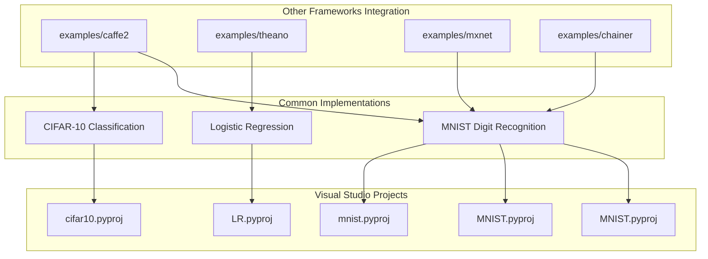
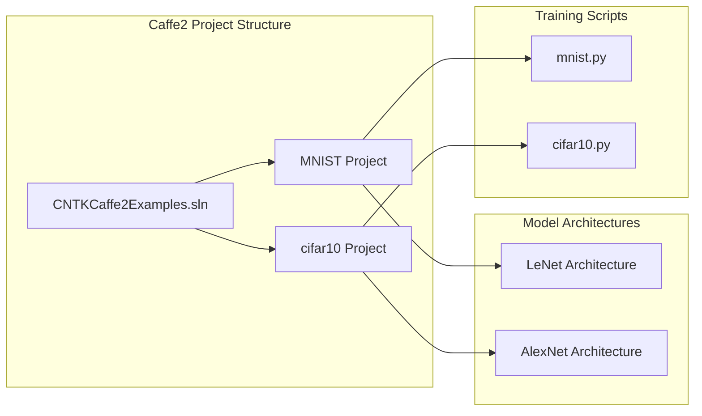
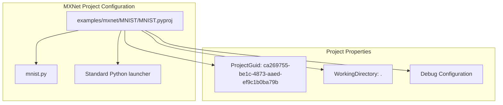
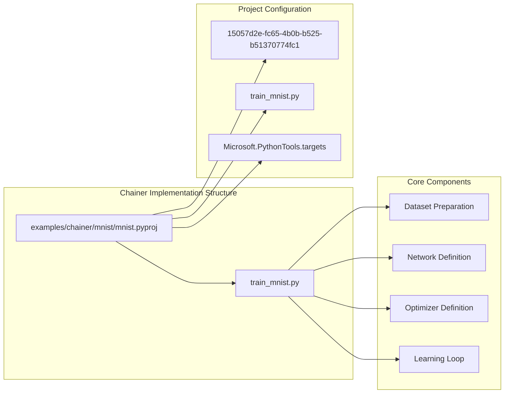
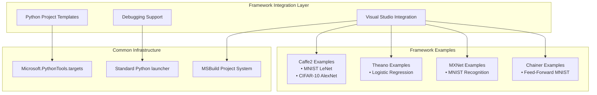

<!-- source: DeepWiki mcp.deepwiki.com · repo microsoft/samples-for-ai · page 3.5 Other Frameworks · fetched 2026-10-26 -->

# Other Frameworks

Relevant source files

The following files were used as context for generating this wiki page:

- [examples/caffe2/README.md](examples/caffe2/README.md)
- [examples/chainer/README.md](examples/chainer/README.md)
- [examples/chainer/mnist/mnist.pyproj](examples/chainer/mnist/mnist.pyproj)
- [examples/cntk/README.md](examples/cntk/README.md)
- [examples/mxnet/MNIST/MNIST.pyproj](examples/mxnet/MNIST/MNIST.pyproj)
- [examples/mxnet/README.md](examples/mxnet/README.md)
- [examples/theano/README.md](examples/theano/README.md)
- [projects/StyleTransfer/StyleTransferTraining/data/vgg/readme.md](projects/StyleTransfer/StyleTransferTraining/data/vgg/readme.md)

This document covers examples for additional deep learning frameworks beyond the primary frameworks (TensorFlow, PyTorch, Keras, and CNTK) covered in sections [3.1](#3.1) through [3.4](#3.4). These examples demonstrate how to implement common machine learning tasks using Caffe2, Theano, MXNet, and Chainer within the Visual Studio development environment.

The frameworks covered here represent alternative deep learning libraries that were popular during different periods of AI development or serve specific use cases. For comprehensive coverage of the main production frameworks, see [Framework Examples](#3).

## Framework Overview

The repository includes examples for four additional frameworks, each demonstrating fundamental machine learning concepts through practical implementations:

Sources: [examples/caffe2/README.md:1-29](), [examples/theano/README.md:1-17](), [examples/mxnet/README.md:1-17](), [examples/chainer/README.md:1-18]()

## Framework-Specific Implementations

### Caffe2 Examples

Caffe2 provides two complete examples covering fundamental computer vision tasks:

| Project | Model Architecture | Dataset | Purpose |
|---------|-------------------|---------|---------|
| MNIST | LeNet | MNIST digits | Handwritten digit recognition |
| CIFAR-10 | AlexNet | CIFAR-10 images | Object classification |

The Caffe2 examples are derived from the official Caffe2 repository version 0.8.1 and maintain the BSD 2-Clause license. These implementations demonstrate classical convolutional neural network architectures applied to standard benchmarking datasets.

Sources: [examples/caffe2/README.md:5-15]()

### Theano Implementation

The Theano example focuses on fundamental machine learning concepts with a logistic regression implementation. This example serves as an educational tool for understanding basic optimization and gradient computation using symbolic differentiation.

The implementation follows the tutorial pattern from `deeplearning.net` and uses randomly generated data for training, making it completely self-contained for learning purposes.

Sources: [examples/theano/README.md:5-7]()

### MXNet Integration

MXNet provides a streamlined implementation of MNIST digit recognition, leveraging Apache MXNet's flexible programming model. The example demonstrates the framework's approach to neural network construction and training.

The implementation includes the standard Visual Studio project structure:

Sources: [examples/mxnet/MNIST/MNIST.pyproj:1-41](), [examples/mxnet/README.md:5-7]()

### Chainer Framework

Chainer offers a define-by-run approach to neural networks, demonstrated through an MNIST classification example using a feed-forward architecture. The implementation is structured around three core components:

1. **Dataset Preparation**: MNIST data loading and preprocessing
2. **Network Definition**: Feed-forward neural network architecture
3. **Learning Loop**: Training iteration and optimization

Sources: [examples/chainer/README.md:5-8](), [examples/chainer/mnist/mnist.pyproj:1-41]()

## Development Workflow

All framework examples follow the same Visual Studio integration pattern, providing consistent development experience across different deep learning libraries:

### Standard Execution Steps

1. **Solution Loading**: Open the framework-specific Visual Studio solution
2. **Project Selection**: Set the desired project as "Startup Project" via right-click context menu
3. **Script Configuration**: Set the target Python script as "Startup File" 
4. **Execution**: Launch via "Start without Debugging" option

### Project Structure Consistency

Each framework example maintains the same Visual Studio project file structure:

| Component | Purpose | Configuration |
|-----------|---------|---------------|
| `ProjectGuid` | Unique project identifier | Auto-generated GUID |
| `StartupFile` | Entry point script | Framework-specific training script |
| `LaunchProvider` | Execution environment | Standard Python launcher |
| `DebugSymbols` | Development support | Enabled for both Debug/Release |

Sources: [examples/caffe2/README.md:19-25](), [examples/theano/README.md:11-17](), [examples/mxnet/README.md:11-17](), [examples/chainer/README.md:12-18]()

## Integration Architecture

The other frameworks integrate seamlessly with the broader samples-for-ai ecosystem through standardized Visual Studio project templates and consistent development workflows:

Sources: [examples/mxnet/MNIST/MNIST.pyproj:32](), [examples/chainer/mnist/mnist.pyproj:32]()

---

