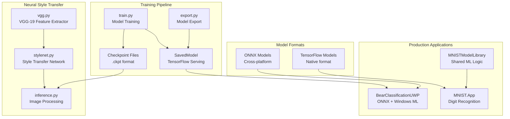
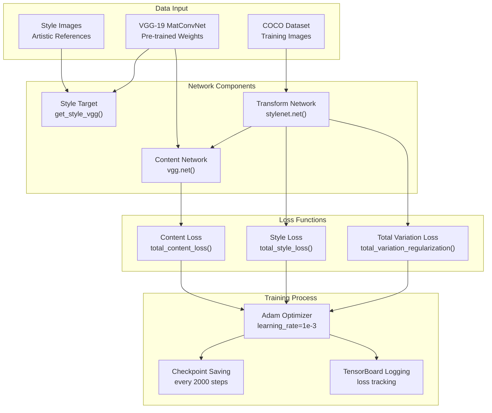
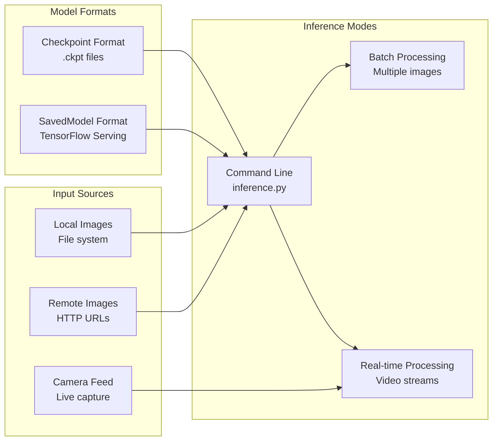
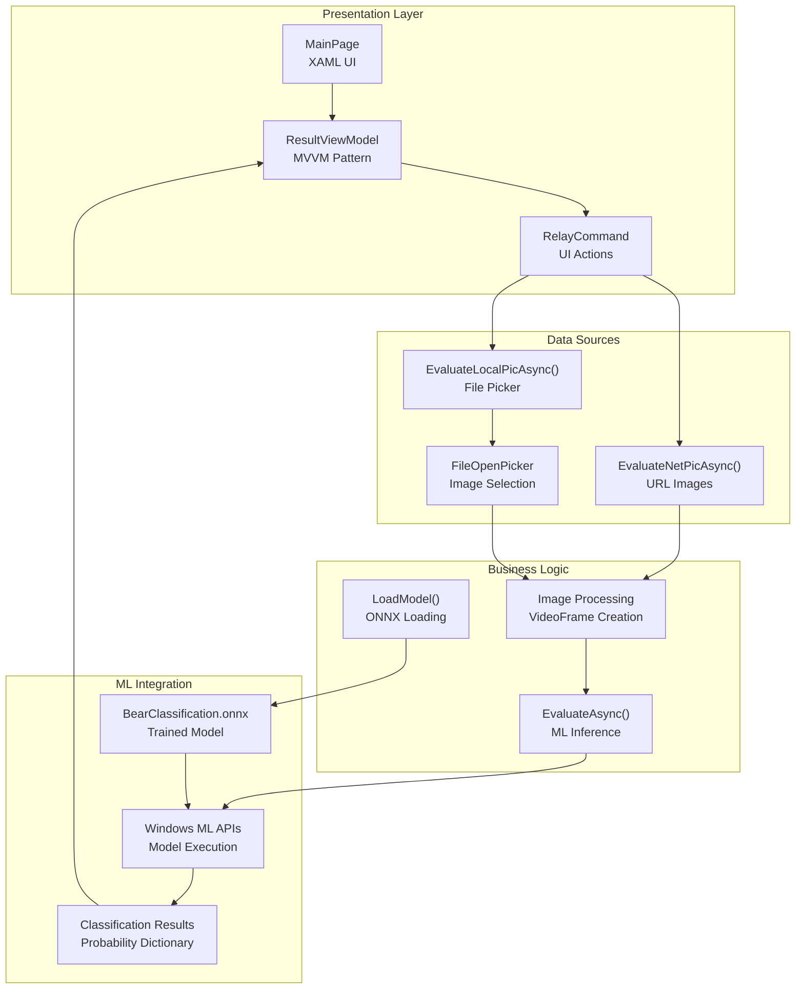
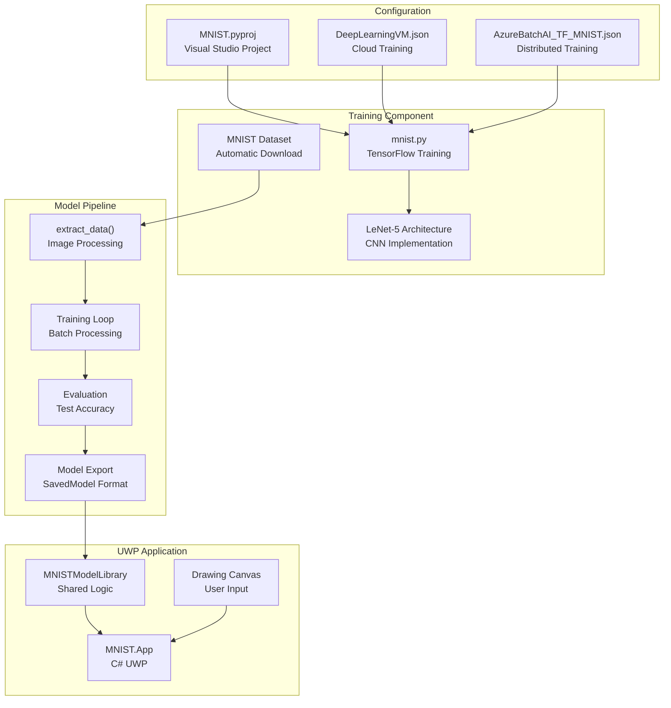
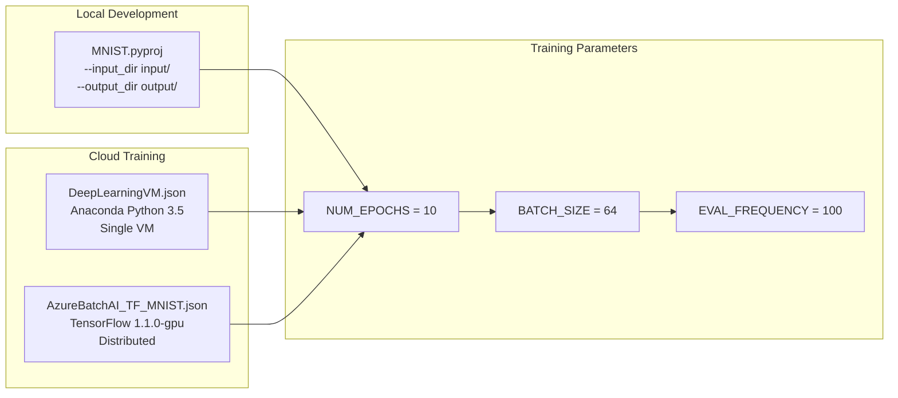
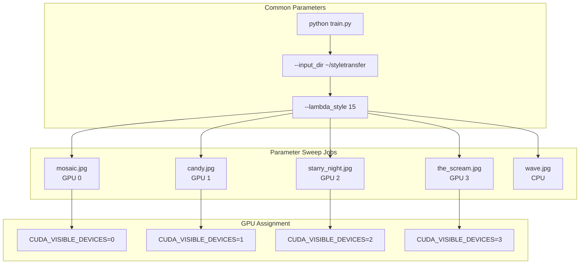

<!-- source: DeepWiki mcp.deepwiki.com · repo microsoft/samples-for-ai · page 4 Specialized Projects · fetched 2026-10-26 -->

# Specialized Projects

Relevant source files

The following files were used as context for generating this wiki page:

- [projects/BearClassificationUWPDemo/BearClassificationUWP.App/ViewModel/ResultViewModel.cs](projects/BearClassificationUWPDemo/BearClassificationUWP.App/ViewModel/ResultViewModel.cs)
- [projects/BearClassificationUWPDemo/BearClassificationUWPDemo.sln](projects/BearClassificationUWPDemo/BearClassificationUWPDemo.sln)
- [projects/MnistDemo/MNIST/AzureBatchAI_TF_MNIST.json](projects/MnistDemo/MNIST/AzureBatchAI_TF_MNIST.json)
- [projects/MnistDemo/MNIST/DeepLearningVM.json](projects/MnistDemo/MNIST/DeepLearningVM.json)
- [projects/MnistDemo/MNIST/MNIST.pyproj](projects/MnistDemo/MNIST/MNIST.pyproj)
- [projects/MnistDemo/MNIST/mnist.py](projects/MnistDemo/MNIST/mnist.py)
- [projects/MnistDemo/MnistDemo.sln](projects/MnistDemo/MnistDemo.sln)
- [projects/StyleTransfer/StyleTransferTraining/StyleTransferTraining.pyproj](projects/StyleTransfer/StyleTransferTraining/StyleTransferTraining.pyproj)
- [projects/StyleTransfer/StyleTransferTraining/data/test/COCO_test2014_000000000001.jpg](projects/StyleTransfer/StyleTransferTraining/data/test/COCO_test2014_000000000001.jpg)
- [projects/StyleTransfer/StyleTransferTraining/data/test/COCO_test2014_000000000014.jpg](projects/StyleTransfer/StyleTransferTraining/data/test/COCO_test2014_000000000014.jpg)
- [projects/StyleTransfer/StyleTransferTraining/data/test/COCO_test2014_000000000016.jpg](projects/StyleTransfer/StyleTransferTraining/data/test/COCO_test2014_000000000016.jpg)
- [projects/StyleTransfer/StyleTransferTraining/data/train/readme.md](projects/StyleTransfer/StyleTransferTraining/data/train/readme.md)
- [projects/StyleTransfer/StyleTransferTraining/src/Parameter Sweep.json](projects/StyleTransfer/StyleTransferTraining/src/Parameter Sweep.json)
- [projects/StyleTransfer/StyleTransferTraining/src/dlvm.json](projects/StyleTransfer/StyleTransferTraining/src/dlvm.json)
- [projects/StyleTransfer/StyleTransferTraining/src/export.py](projects/StyleTransfer/StyleTransferTraining/src/export.py)
- [projects/StyleTransfer/StyleTransferTraining/src/inference.py](projects/StyleTransfer/StyleTransferTraining/src/inference.py)
- [projects/StyleTransfer/StyleTransferTraining/src/stylenet.py](projects/StyleTransfer/StyleTransferTraining/src/stylenet.py)
- [projects/StyleTransfer/StyleTransferTraining/src/train.py](projects/StyleTransfer/StyleTransferTraining/src/train.py)
- [projects/StyleTransfer/StyleTransferTraining/src/utils.py](projects/StyleTransfer/StyleTransferTraining/src/utils.py)
- [projects/StyleTransfer/StyleTransferTraining/src/vgg.py](projects/StyleTransfer/StyleTransferTraining/src/vgg.py)

This section covers production-ready applications and research projects that demonstrate real-world AI implementations beyond basic framework examples. These projects showcase complete end-to-end machine learning workflows, from training to deployment, and include mobile/desktop applications that integrate trained models for practical use cases.

For basic framework examples and tutorials, see [Framework Examples](#3). For advanced research topics and distributed training, see [Advanced Topics](#5).

## Architecture Overview

The specialized projects demonstrate different deployment patterns and application architectures for machine learning models:

Sources: [projects/StyleTransfer/StyleTransferTraining/src/train.py:1-234](), [projects/StyleTransfer/StyleTransferTraining/src/inference.py:1-65](), [projects/BearClassificationUWPDemo/BearClassificationUWP.App/ViewModel/ResultViewModel.cs:1-244](), [projects/MnistDemo/MnistDemo.sln:1-41]()

## Neural Style Transfer Implementation

The neural style transfer project demonstrates real-time artistic style transfer using deep learning, implementing the approach from Gatys et al. with optimizations for faster inference.

### Training Architecture

Sources: [projects/StyleTransfer/StyleTransferTraining/src/train.py:142-234](), [projects/StyleTransfer/StyleTransferTraining/src/vgg.py:67-111](), [projects/StyleTransfer/StyleTransferTraining/src/stylenet.py:49-77]()

### Core Implementation Details

The style transfer implementation consists of several key components:

| Component | File | Function | Purpose |
|-----------|------|----------|---------|
| Style Network | `stylenet.py` | `net()` | Transform input images with artistic style |
| VGG Feature Extractor | `vgg.py` | `net()`, `get_style_vgg()` | Extract content and style features |
| Training Loop | `train.py` | `main()` | Orchestrate training process |
| Inference Engine | `inference.py` | Image processing | Apply trained models to new images |
| Model Export | `export.py` | `export()` | Convert checkpoints to SavedModel |

The training process uses three loss components:
- **Content Loss** (`lambda_feat=7.5`): Preserves content structure using VGG `relu4_2` features
- **Style Loss** (`lambda_style=15`): Matches style characteristics using Gram matrices from multiple VGG layers
- **Total Variation Loss** (`lambda_tv=10e-4`): Reduces noise and ensures spatial smoothness

Sources: [projects/StyleTransfer/StyleTransferTraining/src/train.py:23-26](), [projects/StyleTransfer/StyleTransferTraining/src/train.py:158-168](), [projects/StyleTransfer/StyleTransferTraining/src/vgg.py:88-111]()

### Deployment and Inference

The trained models support multiple deployment scenarios:

Sources: [projects/StyleTransfer/StyleTransferTraining/src/inference.py:23-65](), [projects/StyleTransfer/StyleTransferTraining/src/export.py:12-48]()

## UWP Bear Classification Demo

The bear classification demo showcases Windows ML integration with a UWP application, demonstrating how to deploy ONNX models in production Windows applications.

### Application Architecture

Sources: [projects/BearClassificationUWPDemo/BearClassificationUWP.App/ViewModel/ResultViewModel.cs:19-244]()

### Model Integration Implementation

The `ResultViewModel` class demonstrates best practices for integrating machine learning models in UWP applications:

| Method | Purpose | Key Implementation |
|--------|---------|-------------------|
| `LoadModel()` | Initialize ONNX model | `BearClassificationModel.CreateBearClassificationModel()` |
| `EvaluateNetPicAsync()` | Process web images | HTTP download → `VideoFrame` → inference |
| `EvaluateLocalPicAsync()` | Process local files | File picker → stream → `VideoFrame` → inference |
| `EvaluateAsync()` | Run inference | Model evaluation → probability ranking → UI update |
| `DescribResult()` | Format output | Confidence levels → localized text |

The implementation handles multiple confidence levels:
- **High confidence** (`>= 0.8`): "must be" classification
- **Medium confidence** (`0.5-0.8`): "may be" classification  
- **Low confidence** (`< 0.5`): "might be" classification

Sources: [projects/BearClassificationUWPDemo/BearClassificationUWP.App/ViewModel/ResultViewModel.cs:115-243]()

## MNIST Demo Suite

The MNIST demo provides a complete example of training, model creation, and deployment across multiple platforms, demonstrating the full machine learning lifecycle.

### Multi-Component Architecture

Sources: [projects/MnistDemo/MNIST/mnist.py:1-379](), [projects/MnistDemo/MnistDemo.sln:1-41](), [projects/MnistDemo/MNIST/MNIST.pyproj:1-38]()

### Training Implementation

The MNIST training script implements a complete LeNet-5-like convolutional neural network:

| Layer Type | Implementation | Configuration |
|------------|----------------|---------------|
| Input | 28×28×1 images | Normalized to [-0.5, 0.5] |
| Conv1 | `conv2d()` | 5×5 kernels, 32 features |
| Pool1 | `max_pool_2x2()` | 2×2 pooling |
| Conv2 | `conv2d()` | 5×5 kernels, 64 features |
| Pool2 | `max_pool_2x2()` | 2×2 pooling |
| FC1 | Fully connected | 512 units + dropout |
| Output | Softmax | 10 classes (digits 0-9) |

The training process includes:
- Automatic dataset download from `http://yann.lecun.com/exdb/mnist/`
- Validation set management (5000 images)
- Batch processing with configurable batch sizes
- Regular evaluation and checkpoint saving
- Support for both CPU and GPU training

Sources: [projects/MnistDemo/MNIST/mnist.py:42-54](), [projects/MnistDemo/MNIST/mnist.py:64-99](), [projects/MnistDemo/MNIST/mnist.py:204-280]()

### Cloud Training Configuration

The project includes multiple configuration files for different training environments:

Sources: [projects/MnistDemo/MNIST/MNIST.pyproj:14](), [projects/MnistDemo/MNIST/DeepLearningVM.json:1-10](), [projects/MnistDemo/MNIST/AzureBatchAI_TF_MNIST.json:1]()

## Distributed Training Integration

The specialized projects demonstrate integration with Microsoft's distributed training platforms through configuration files and parameter sweeps.

### Parameter Sweep Configuration

The style transfer project includes sophisticated parameter sweep capabilities for training multiple models simultaneously:

Sources: [projects/StyleTransfer/StyleTransferTraining/src/Parameter Sweep.json:1-33](), [projects/StyleTransfer/StyleTransferTraining/src/dlvm.json:1-11]()

This architecture enables efficient multi-style training across multiple GPUs, with each job producing a specialized model for a specific artistic style. The configuration supports both concurrent execution (`EnableConcurrency: true`) and isolated single-model training for debugging purposes.

---

