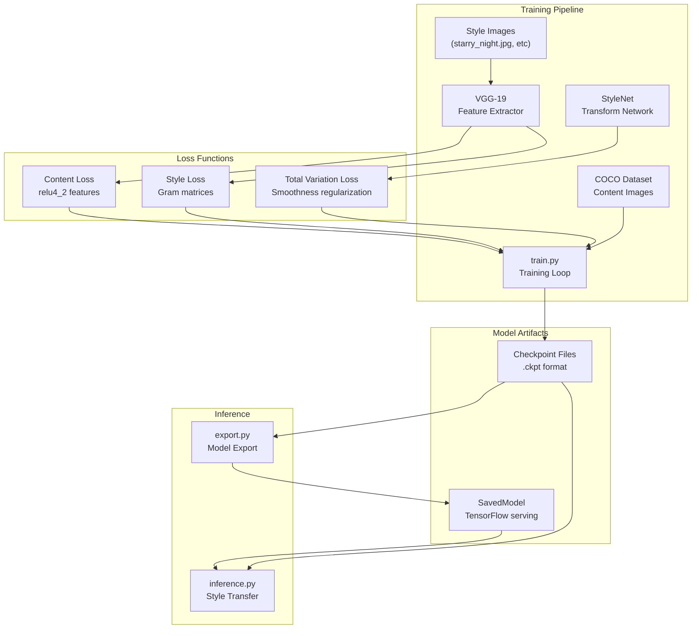
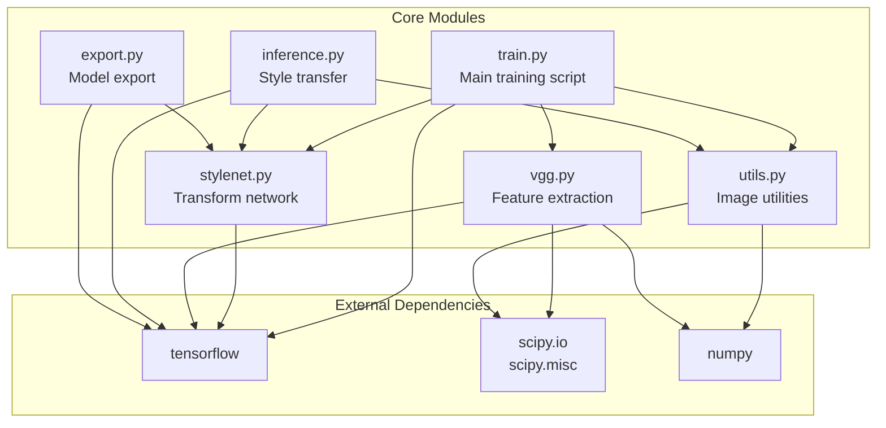
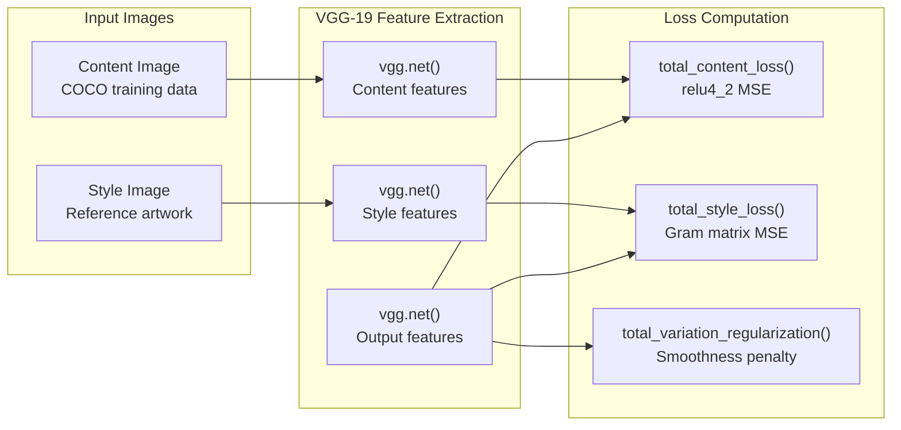
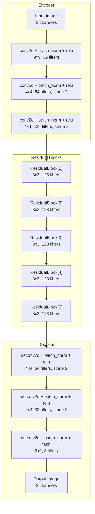
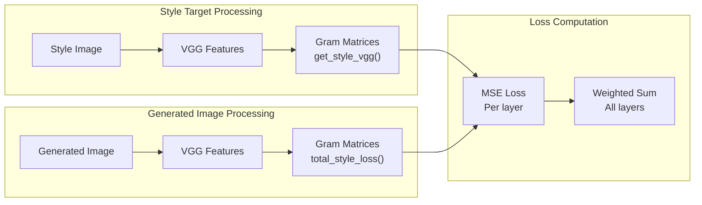
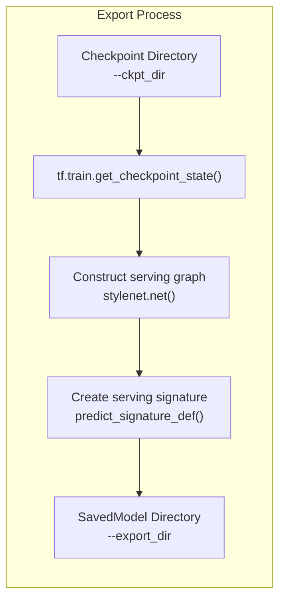

<!-- source: DeepWiki mcp.deepwiki.com · repo microsoft/samples-for-ai · page 4.1 Neural Style Transfer · fetched 2026-10-26 -->

# Neural Style Transfer

<details>
<summary>Relevant source files</summary>

The following files were used as context for generating this wiki page:

- [projects/StyleTransfer/StyleTransferTraining/StyleTransferTraining.pyproj](projects/StyleTransfer/StyleTransferTraining/StyleTransferTraining.pyproj)
- [projects/StyleTransfer/StyleTransferTraining/data/test/COCO_test2014_000000000001.jpg](projects/StyleTransfer/StyleTransferTraining/data/test/COCO_test2014_000000000001.jpg)
- [projects/StyleTransfer/StyleTransferTraining/data/test/COCO_test2014_000000000014.jpg](projects/StyleTransfer/StyleTransferTraining/data/test/COCO_test2014_000000000014.jpg)
- [projects/StyleTransfer/StyleTransferTraining/data/test/COCO_test2014_000000000016.jpg](projects/StyleTransfer/StyleTransferTraining/data/test/COCO_test2014_000000000016.jpg)
- [projects/StyleTransfer/StyleTransferTraining/data/train/readme.md](projects/StyleTransfer/StyleTransferTraining/data/train/readme.md)
- [projects/StyleTransfer/StyleTransferTraining/src/Parameter Sweep.json](projects/StyleTransfer/StyleTransferTraining/src/Parameter Sweep.json)
- [projects/StyleTransfer/StyleTransferTraining/src/dlvm.json](projects/StyleTransfer/StyleTransferTraining/src/dlvm.json)
- [projects/StyleTransfer/StyleTransferTraining/src/export.py](projects/StyleTransfer/StyleTransferTraining/src/export.py)
- [projects/StyleTransfer/StyleTransferTraining/src/inference.py](projects/StyleTransfer/StyleTransferTraining/src/inference.py)
- [projects/StyleTransfer/StyleTransferTraining/src/stylenet.py](projects/StyleTransfer/StyleTransferTraining/src/stylenet.py)
- [projects/StyleTransfer/StyleTransferTraining/src/train.py](projects/StyleTransfer/StyleTransferTraining/src/train.py)
- [projects/StyleTransfer/StyleTransferTraining/src/utils.py](projects/StyleTransfer/StyleTransferTraining/src/utils.py)
- [projects/StyleTransfer/StyleTransferTraining/src/vgg.py](projects/StyleTransfer/StyleTransferTraining/src/vgg.py)

</details>


This document covers the real-time neural style transfer implementation within the samples-for-ai repository. This system demonstrates how to train and deploy deep learning models that can transfer artistic styles from reference images to content images in real-time. The implementation uses TensorFlow and follows the approach described in "Perceptual Losses for Real-Time Style Transfer and Super-Resolution" by Johnson et al.

For distributed training examples, see [OpenPAI Integration](#5.2). For other specialized computer vision projects, see [Demo Applications](#4.2).

## System Architecture

The neural style transfer system consists of several interconnected components that handle training, inference, and model deployment.

### High-Level System Overview



Sources: [projects/StyleTransfer/StyleTransferTraining/src/train.py:1-234](), [projects/StyleTransfer/StyleTransferTraining/src/inference.py:1-65](), [projects/StyleTransfer/StyleTransferTraining/src/export.py:1-59]()

### Core Module Dependencies



Sources: [projects/StyleTransfer/StyleTransferTraining/src/train.py:46-49](), [projects/StyleTransfer/StyleTransferTraining/src/stylenet.py:1](), [projects/StyleTransfer/StyleTransferTraining/src/vgg.py:3-6](), [projects/StyleTransfer/StyleTransferTraining/src/utils.py:1-6]()

## Training Pipeline

The training system implements fast neural style transfer using a feed-forward network trained with perceptual losses.

### Training Configuration

The `parse_arguments()` function in `train.py` defines the key training parameters:

| Parameter | Default | Purpose |
|-----------|---------|---------|
| `input_dir` | - | Directory containing COCO training images and VGG model |
| `output_dir` | - | Directory for checkpoints and SavedModel output |
| `style_image` | `starry_night.jpg` | Reference style image |
| `batch_size` | 1 | Training batch size (paper uses 16) |
| `epoch` | 2 | Number of training epochs |
| `lambda_tv` | 10e-4 | Total variation loss weight |
| `lambda_feat` | 7.5e0 | Content loss weight |
| `lambda_style` | 15 | Style loss weight |
| `lr` | 1e-3 | Learning rate for Adam optimizer |

Sources: [projects/StyleTransfer/StyleTransferTraining/src/train.py:12-31]()

### Loss Function Implementation

The training combines three loss functions computed using VGG-19 features:



Sources: [projects/StyleTransfer/StyleTransferTraining/src/train.py:158-168](), [projects/StyleTransfer/StyleTransferTraining/src/vgg.py:88-106]()

### StyleNet Architecture

The `stylenet.py` module implements the transform network using an encoder-decoder architecture:



Sources: [projects/StyleTransfer/StyleTransferTraining/src/stylenet.py:49-76](), [projects/StyleTransfer/StyleTransferTraining/src/stylenet.py:38-45]()

## Feature Extraction and Loss Computation

The VGG-19 network serves as a feature extractor for computing perceptual losses.

### VGG Network Implementation

The `vgg.py` module loads a pre-trained VGG-19 model and extracts features from specific layers:

| Layer | Purpose |
|-------|---------|
| `relu1_1` | Style features (shallow) |
| `relu2_1` | Style features |
| `relu3_1` | Style features |
| `relu4_1` | Style features |
| `relu4_2` | Content features |
| `relu5_1` | Style features (deep) |

The network expects the VGG model file at `input_dir/vgg/imagenet-vgg-verydeep-19.mat`.

Sources: [projects/StyleTransfer/StyleTransferTraining/src/vgg.py:10-11](), [projects/StyleTransfer/StyleTransferTraining/src/vgg.py:13-45](), [projects/StyleTransfer/StyleTransferTraining/src/train.py:62-68]()

### Style Loss via Gram Matrices

Style loss is computed by comparing Gram matrices of feature maps:



Sources: [projects/StyleTransfer/StyleTransferTraining/src/vgg.py:67-74](), [projects/StyleTransfer/StyleTransferTraining/src/vgg.py:88-99]()

## Model Deployment and Inference

The system supports both checkpoint-based and SavedModel-based inference.

### Inference Modes

The `inference.py` script supports two inference modes:

| Mode | Input Parameter | Model Format | Use Case |
|------|----------------|--------------|----------|
| Checkpoint | `--ckpt` | `.ckpt` files | Development/debugging |
| SavedModel | `--mdl` | TensorFlow SavedModel | Production serving |

### SavedModel Export Process

The `export.py` script converts checkpoints to SavedModel format:



The export process creates a serving signature named `'Transfer'` with:
- Input: `PREDICT_INPUTS` tensor
- Output: `PREDICT_OUTPUTS` tensor

Sources: [projects/StyleTransfer/StyleTransferTraining/src/export.py:12-47](), [projects/StyleTransfer/StyleTransferTraining/src/inference.py:23-62]()

## Training Data and Prerequisites

### Required Data Files

The training system expects specific data organization:

```
input_dir/
├── vgg/
│   └── imagenet-vgg-verydeep-19.mat
├── train/
│   └── [COCO 2014 training images]
└── style_images/
    ├── starry_night.jpg
    ├── mosaic.jpg
    ├── candy.jpg
    └── [other style images]
```

### Data Sources

- **VGG Model**: Download from `http://www.vlfeat.org/matconvnet/models/beta16/imagenet-vgg-verydeep-19.mat`
- **COCO Training Data**: Download from `http://images.cocodataset.org/zips/train2014.zip`

Sources: [projects/StyleTransfer/StyleTransferTraining/src/train.py:62-71](), [projects/StyleTransfer/StyleTransferTraining/data/train/readme.md:1]()

## Distributed Training Configuration

The system includes configuration files for distributed training scenarios:

### Parameter Sweep Configuration

The `Parameter Sweep.json` file defines multi-GPU training for different style images:

| Job ID | Style Image | GPU Assignment |
|--------|-------------|----------------|
| `mosaic` | `mosaic.jpg` | GPU 0 |
| `candy` | `candy.jpg` | GPU 1 |
| `starry_night` | `starry_night.jpg` | GPU 2 |
| `the_scream` | `the_scream.jpg` | GPU 3 |
| `wave` | `wave.jpg` | Automatic |

### DLVM Configuration

The `dlvm.json` file provides single-job configuration for distributed learning virtual machines with parameters:
- `StartupProgram`: `"python"`
- `ExtraParameter`: Includes style image, input/output directories, and hyperparameters

Sources: [projects/StyleTransfer/StyleTransferTraining/src/Parameter Sweep.json:1-33](), [projects/StyleTransfer/StyleTransferTraining/src/dlvm.json:1-12]()

## Visual Studio Integration

The project includes Visual Studio project configuration for integrated development:

- **Startup File**: `src\train.py`
- **Project Type**: Python with AI tools support
- **Content Files**: Configuration files, documentation, and licenses
- **Source Files**: All Python modules for training and inference

Sources: [projects/StyleTransfer/StyleTransferTraining/StyleTransferTraining.pyproj:1-39]()

---

