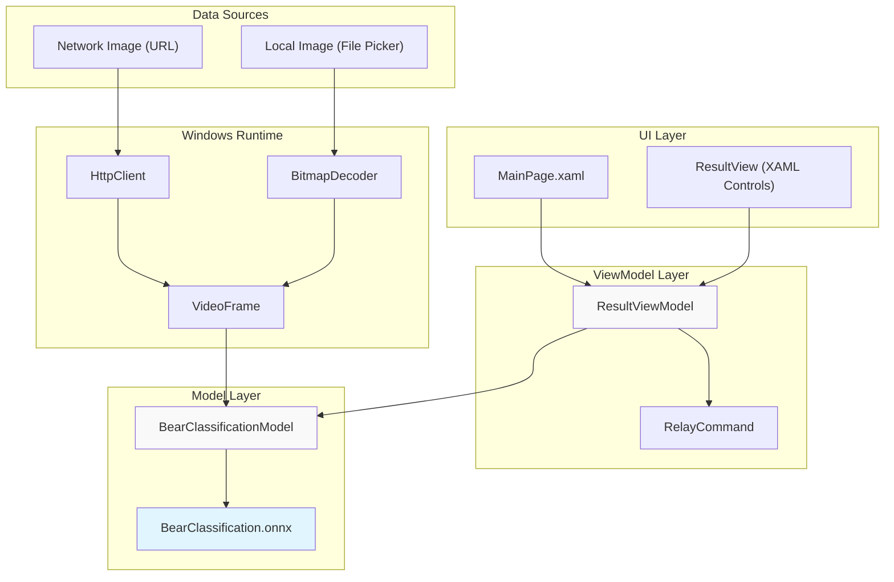
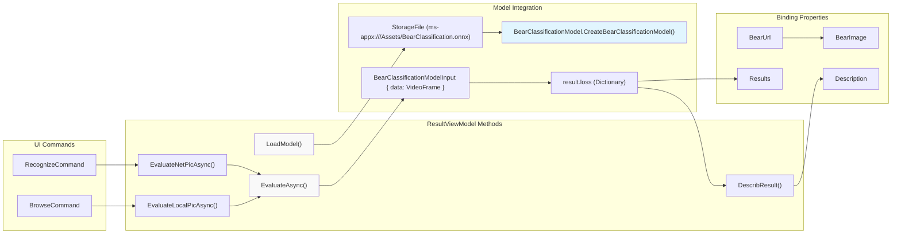
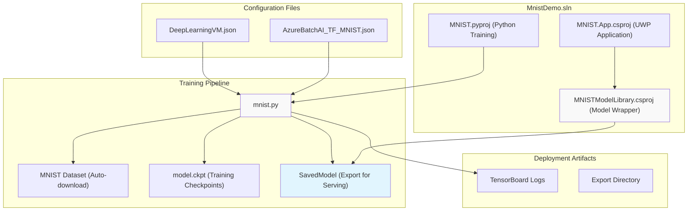
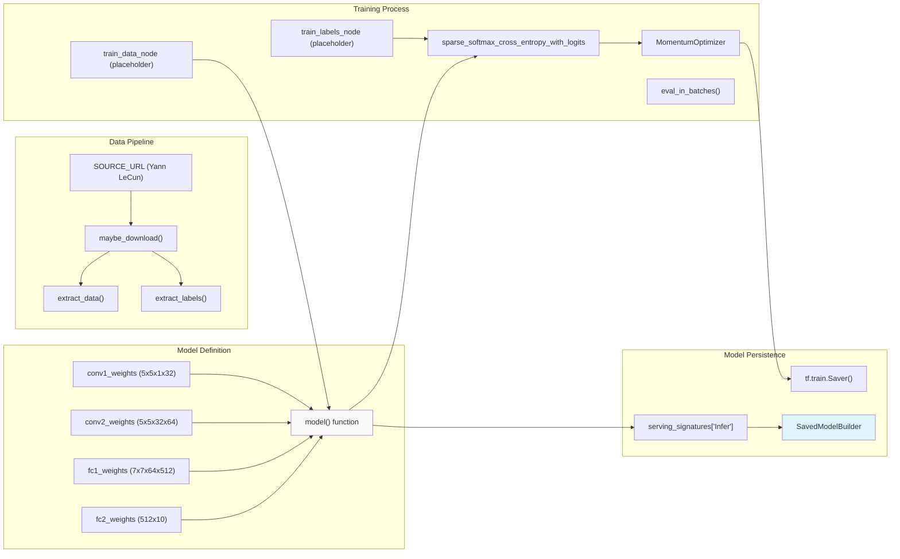

<!-- source: DeepWiki mcp.deepwiki.com · repo microsoft/samples-for-ai · page 4.2 Demo Applications · fetched 2026-10-26 -->

# Demo Applications

Relevant source files

The following files were used as context for generating this wiki page:

- [projects/BearClassificationUWPDemo/BearClassificationUWP.App/ViewModel/ResultViewModel.cs](projects/BearClassificationUWPDemo/BearClassificationUWP.App/ViewModel/ResultViewModel.cs)
- [projects/BearClassificationUWPDemo/BearClassificationUWPDemo.sln](projects/BearClassificationUWPDemo/BearClassificationUWPDemo.sln)
- [projects/MnistDemo/MNIST/AzureBatchAI_TF_MNIST.json](projects/MnistDemo/MNIST/AzureBatchAI_TF_MNIST.json)
- [projects/MnistDemo/MNIST/DeepLearningVM.json](projects/MnistDemo/MNIST/DeepLearningVM.json)
- [projects/MnistDemo/MNIST/MNIST.pyproj](projects/MnistDemo/MNIST/MNIST.pyproj)
- [projects/MnistDemo/MNIST/mnist.py](projects/MnistDemo/MNIST/mnist.py)
- [projects/MnistDemo/MnistDemo.sln](projects/MnistDemo/MnistDemo.sln)

This document covers the production-ready demo applications included in the samples-for-ai repository that showcase real-world deployment of trained AI models in user-facing applications. These demos bridge the gap between model training examples and production deployment patterns.

For information about neural style transfer applications, see [Neural Style Transfer](#4.1). For framework-specific training examples, see [Framework Examples](#3).

## Overview

The demo applications demonstrate two key deployment scenarios:

| Application | Platform | Model Format | Use Case |
|-------------|----------|--------------|----------|
| Bear Classification UWP | Universal Windows Platform | ONNX | Image classification in desktop/mobile apps |
| MNIST Demo | Cross-platform | TensorFlow SavedModel | Digit recognition with training pipeline |

## Bear Classification UWP Demo

The Bear Classification UWP application demonstrates how to integrate a pre-trained ONNX model into a Windows Universal Platform application for real-time image classification.

### Application Architecture

Sources: [projects/BearClassificationUWPDemo/BearClassificationUWP.App/ViewModel/ResultViewModel.cs:1-244](), [projects/BearClassificationUWPDemo/BearClassificationUWPDemo.sln:1-48]()

### Core Components and Data Flow

Sources: [projects/BearClassificationUWPDemo/BearClassificationUWP.App/ViewModel/ResultViewModel.cs:118-122](), [projects/BearClassificationUWPDemo/BearClassificationUWP.App/ViewModel/ResultViewModel.cs:192-206]()

### Key Implementation Details

The `ResultViewModel` class implements the MVVM pattern with the following core functionality:

**Model Loading**: The ONNX model is loaded asynchronously from the application assets:
[projects/BearClassificationUWPDemo/BearClassificationUWP.App/ViewModel/ResultViewModel.cs:118-122]()

**Image Processing**: Two input methods are supported:
- Network images via `EvaluateNetPicAsync()` using `HttpClient`
- Local images via `EvaluateLocalPicAsync()` using `FileOpenPicker`

**Model Inference**: The `EvaluateAsync()` method handles the core inference pipeline:
[projects/BearClassificationUWPDemo/BearClassificationUWP.App/ViewModel/ResultViewModel.cs:192-206]()

**Result Processing**: Confidence scoring and localized descriptions are generated in `DescribResult()`:
[projects/BearClassificationUWPDemo/BearClassificationUWP.App/ViewModel/ResultViewModel.cs:214-242]()

Sources: [projects/BearClassificationUWPDemo/BearClassificationUWP.App/ViewModel/ResultViewModel.cs:127-148](), [projects/BearClassificationUWPDemo/BearClassificationUWP.App/ViewModel/ResultViewModel.cs:153-184]()

## MNIST Demo

The MNIST Demo provides a complete end-to-end pipeline from model training to deployment, demonstrating TensorFlow integration with Visual Studio tooling.

### Solution Structure

Sources: [projects/MnistDemo/MnistDemo.sln:1-40](), [projects/MnistDemo/MNIST/MNIST.pyproj:1-38]()

### Training Pipeline Implementation

The `mnist.py` script implements a complete CNN training pipeline with the following architecture:

**Model Architecture**: LeNet-5-like convolutional network defined in the `model()` function:
[projects/MnistDemo/MNIST/mnist.py:191-230]()

**Training Loop**: Implements batch training with checkpointing and TensorBoard logging:
[projects/MnistDemo/MNIST/mnist.py:322-355]()

**Model Export**: Saves both training checkpoints and production-ready SavedModel:
[projects/MnistDemo/MNIST/mnist.py:358-369]()

Sources: [projects/MnistDemo/MNIST/mnist.py:64-99](), [projects/MnistDemo/MNIST/mnist.py:167-187](), [projects/MnistDemo/MNIST/mnist.py:293-298]()

### Cloud Training Configuration

The demo includes configuration files for distributed training:

**Azure Batch AI Integration**: [projects/MnistDemo/MNIST/AzureBatchAI_TF_MNIST.json:1-1]()
- Supports TensorFlow distributed training
- Configurable GPU instances and Docker containers

**Deep Learning VM Setup**: [projects/MnistDemo/MNIST/DeepLearningVM.json:1-10]()
- Anaconda Python environment configuration
- Automated startup scripts for cloud deployment

Sources: [projects/MnistDemo/MNIST/AzureBatchAI_TF_MNIST.json:1-1](), [projects/MnistDemo/MNIST/DeepLearningVM.json:1-10]()

## Common Deployment Patterns

Both demo applications showcase key production deployment patterns:

| Pattern | Bear Classification UWP | MNIST Demo |
|---------|------------------------|------------|
| **Model Format** | ONNX (`BearClassification.onnx`) | TensorFlow SavedModel |
| **Input Processing** | `VideoFrame` from images | Tensor from pixel arrays |
| **Async Inference** | `await model.EvaluateAsync()` | Batch evaluation |
| **Error Handling** | Try-catch with localized messages | Validation and self-testing |
| **Result Confidence** | Probability scoring with thresholds | Error rate calculation |
| **Model Loading** | Runtime from application assets | Checkpoint restoration |

These patterns demonstrate the transition from training-focused examples to production-ready applications with proper error handling, user interfaces, and deployment configurations.

Sources: [projects/BearClassificationUWPDemo/BearClassificationUWP.App/ViewModel/ResultViewModel.cs:194-195](), [projects/MnistDemo/MNIST/mnist.py:268-285]()

---

