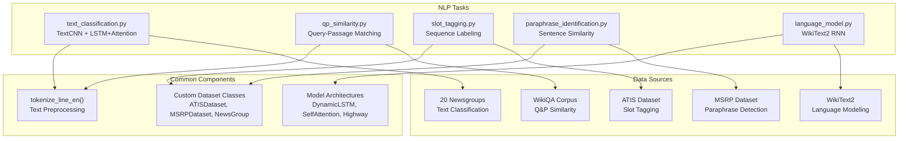
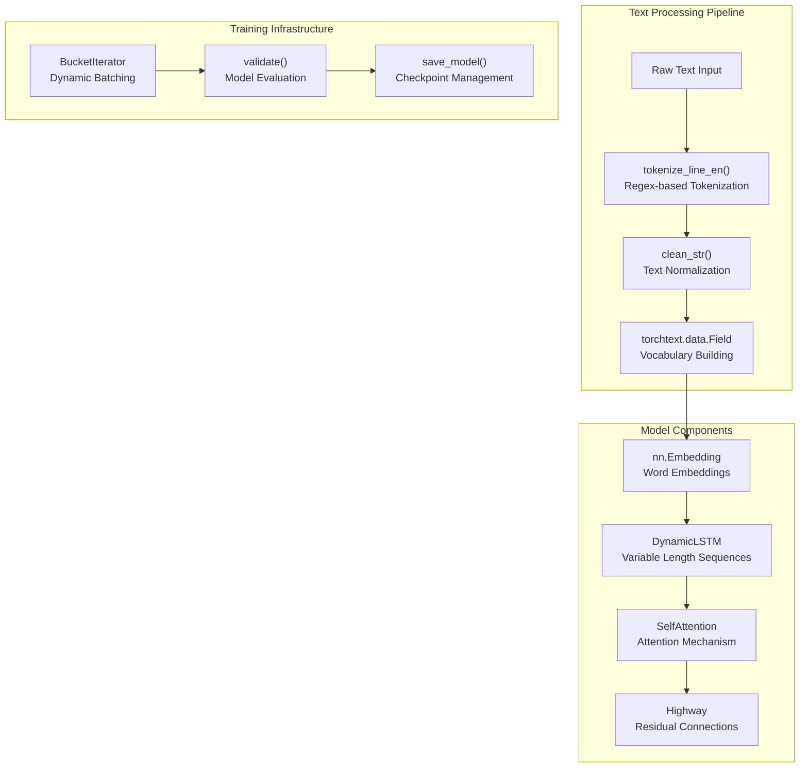
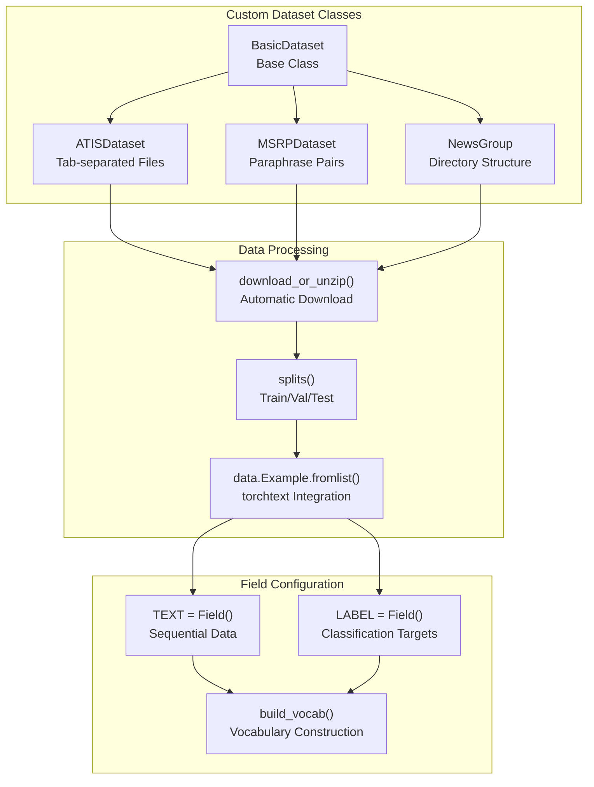
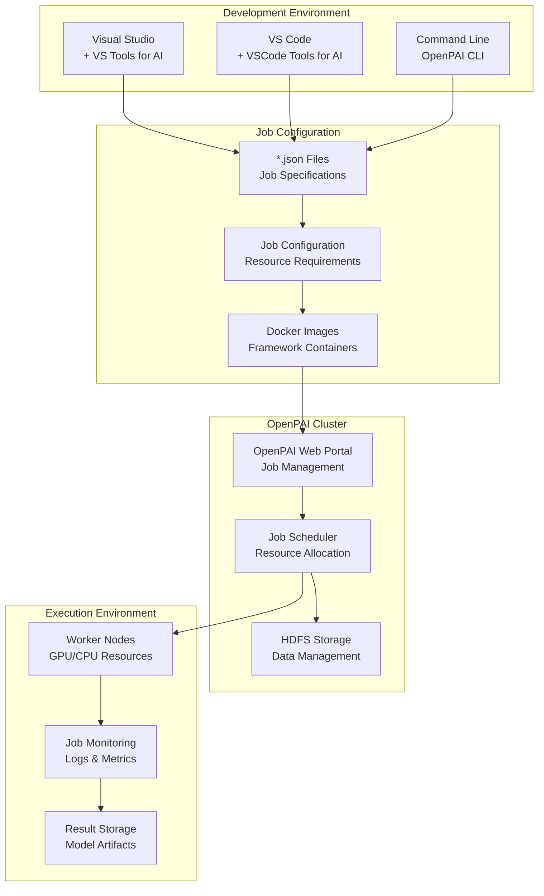
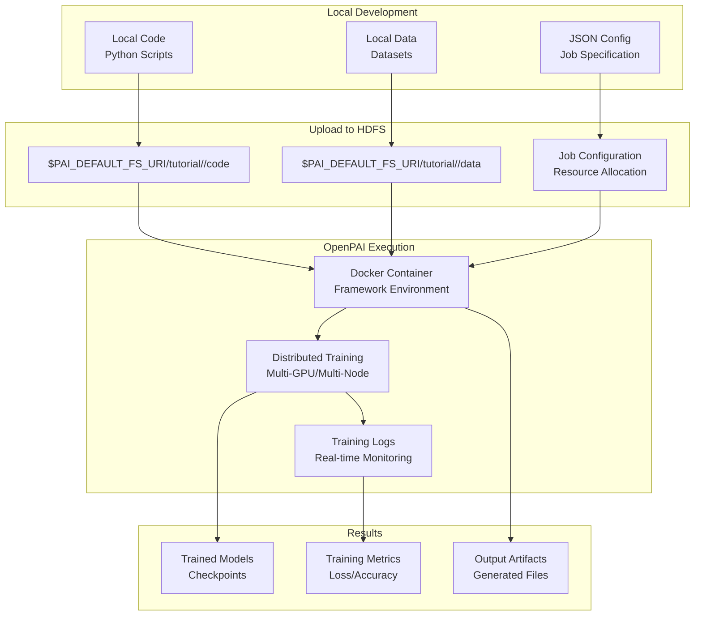
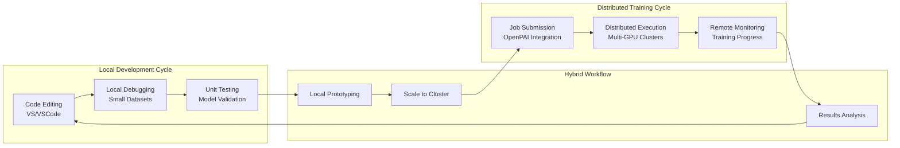

<!-- source: DeepWiki mcp.deepwiki.com · repo microsoft/samples-for-ai · page 5 Advanced Topics · fetched 2026-10-26 -->

# Advanced Topics

<details>
<summary>Relevant source files</summary>

The following files were used as context for generating this wiki page:

- [README.md](README.md)
- [docs/download_data.md](docs/download_data.md)
- [docs/local_run.md](docs/local_run.md)
- [docs/prerequisites.md](docs/prerequisites.md)
- [docs/submit_job_to_pai.md](docs/submit_job_to_pai.md)
- [examples/NLPTutorials/language_model/README.md](examples/NLPTutorials/language_model/README.md)
- [examples/NLPTutorials/language_model/language_model.py](examples/NLPTutorials/language_model/language_model.py)
- [examples/NLPTutorials/paraphrase_identification/README.md](examples/NLPTutorials/paraphrase_identification/README.md)
- [examples/NLPTutorials/paraphrase_identification/paraphrase_identification.py](examples/NLPTutorials/paraphrase_identification/paraphrase_identification.py)
- [examples/NLPTutorials/qp_similarity/README.md](examples/NLPTutorials/qp_similarity/README.md)
- [examples/NLPTutorials/qp_similarity/qp_similarity.py](examples/NLPTutorials/qp_similarity/qp_similarity.py)
- [examples/NLPTutorials/slot_tagging/README.md](examples/NLPTutorials/slot_tagging/README.md)
- [examples/NLPTutorials/slot_tagging/slot_tagging.py](examples/NLPTutorials/slot_tagging/slot_tagging.py)
- [examples/NLPTutorials/text_classification/README.md](examples/NLPTutorials/text_classification/README.md)
- [examples/NLPTutorials/text_classification/text_classification.py](examples/NLPTutorials/text_classification/text_classification.py)
- [examples/README.md](examples/README.md)
- [projects/StyleTransfer/StyleTransferTraining/src/README.md](projects/StyleTransfer/StyleTransferTraining/src/README.md)
- [zh-hans/README.md](zh-hans/README.md)
- [zh-hant/README.md](zh-hant/README.md)

</details>


This document covers specialized areas of the samples-for-ai repository that go beyond basic framework examples. It focuses on natural language processing implementations, distributed training capabilities, and research-oriented projects that demonstrate advanced AI techniques.

For basic framework usage and simple model examples, see [Framework Examples](#3). For production deployment patterns, see [Specialized Projects](#4).

## Natural Language Processing Tutorials

The repository includes a comprehensive collection of NLP implementations in the `examples/NLPTutorials/` directory, demonstrating modern techniques for various language processing tasks using PyTorch.

### NLP Tutorial Architecture



**Sources:** [examples/NLPTutorials/text_classification/text_classification.py:1-422](), [examples/NLPTutorials/qp_similarity/qp_similarity.py:1-182](), [examples/NLPTutorials/slot_tagging/slot_tagging.py:1-240]()

### Core NLP Model Implementations

The NLP tutorials implement several sophisticated architectures:

| Model Class | Architecture | Task | Key Features |
|-------------|-------------|------|--------------|
| `TextCNN` | Convolutional Neural Network | Text Classification | Multiple kernel sizes, max pooling |
| `LSTMSelfAttentionHighway` | LSTM + Attention + Highway | Text Classification | Self-attention mechanism, highway connections |
| `Model` (QP Similarity) | Bidirectional GRU | Query-Passage Matching | GRU-based encoder, concatenated representations |
| `Model` (Slot Tagging) | Bidirectional LSTM | Sequence Labeling | Character-level and word-level features |
| `RNNModel` | LSTM/GRU Language Model | Text Generation | Tied embeddings, dropout regularization |

### Advanced NLP Components



**Sources:** [examples/NLPTutorials/text_classification/text_classification.py:59-172](), [examples/NLPTutorials/text_classification/text_classification.py:103-135](), [examples/NLPTutorials/qp_similarity/qp_similarity.py:40-51]()

#### Dynamic LSTM Implementation

The `DynamicLSTM` class handles variable-length sequences efficiently:

- **Sorting**: Sequences sorted by length for efficient packing ([examples/NLPTutorials/text_classification/text_classification.py:77-80]())
- **Packing**: Uses `pack_padded_sequence` for memory efficiency ([examples/NLPTutorials/text_classification/text_classification.py:83-85]())
- **Unsorting**: Restores original order after processing ([examples/NLPTutorials/text_classification/text_classification.py:94-100]())

#### Self-Attention Mechanism

The `SelfAttention` class implements attention for sequence representation:

- **Energy Computation**: Linear projection to scalar attention weights ([examples/NLPTutorials/text_classification/text_classification.py:110]())
- **Softmax Normalization**: Attention weight normalization ([examples/NLPTutorials/text_classification/text_classification.py:111]())
- **Weighted Aggregation**: Context-aware sequence representation ([examples/NLPTutorials/text_classification/text_classification.py:114]())

**Sources:** [examples/NLPTutorials/text_classification/text_classification.py:103-115]()

### Dataset Integration Patterns

The NLP tutorials demonstrate sophisticated dataset handling patterns:



**Sources:** [examples/NLPTutorials/text_classification/text_classification.py:268-329](), [examples/NLPTutorials/slot_tagging/slot_tagging.py:40-81](), [examples/NLPTutorials/paraphrase_identification/paraphrase_identification.py:41-82]()

## OpenPAI Integration

The repository provides comprehensive integration with Microsoft's OpenPAI platform for distributed AI training, enabling scalable model training across clusters.

### OpenPAI Job Submission Architecture



**Sources:** [docs/submit_job_to_pai.md:1-52](), [examples/README.md:80-92]()

### Job Submission Methods

The repository supports multiple methods for submitting jobs to OpenPAI:

#### Visual Studio Tools for AI
- **Cluster Configuration**: Add OpenPAI clusters through VS Tools for AI ([docs/submit_job_to_pai.md:13]())
- **Job Submission**: Right-click project → "Submit Job..." ([docs/submit_job_to_pai.md:17]())
- **Configuration Import**: Import JSON configuration files ([docs/submit_job_to_pai.md:20]())

#### VS Code Tools for AI  
- **Unified Interface**: Same workflow as Visual Studio ([docs/submit_job_to_pai.md:26-32]())
- **Integrated Management**: Cluster and job management from editor ([docs/submit_job_to_pai.md:32]())

#### Web Portal Submission
- **Manual Upload**: Code and data upload to HDFS ([docs/submit_job_to_pai.md:36-43]())
- **Direct Submission**: Submit through OpenPAI web interface ([docs/submit_job_to_pai.md:47-51]())

**Sources:** [docs/submit_job_to_pai.md:5-52]()

### Distributed Training Data Flow



**Sources:** [docs/submit_job_to_pai.md:36-44](), [examples/README.md:82-92]()

### Configuration Management

OpenPAI job configurations are specified in JSON format with framework-specific naming:

- **Naming Convention**: `framework_name.sample_name.json` ([docs/submit_job_to_pai.md:51]())
- **Resource Specification**: CPU, GPU, memory requirements
- **Data Paths**: Input and output data locations on HDFS
- **Container Images**: Framework-specific Docker images

Example configuration structure for distributed training:

```json
{
  "jobName": "framework_sample",
  "image": "openpai/framework:latest", 
  "dataDir": "$PAI_DEFAULT_FS_URI/tutorial/sample/data",
  "outputDir": "$PAI_DEFAULT_FS_URI/tutorial/sample/output",
  "codeDir": "$PAI_DEFAULT_FS_URI/tutorial/sample/code"
}
```

**Sources:** [docs/submit_job_to_pai.md:42-51](), [README.md:37]()

## Advanced Research Projects

### Neural Style Transfer Implementation

The repository includes a production-ready style transfer implementation demonstrating advanced computer vision techniques:

- **Real-time Processing**: Optimized for real-time style transfer ([projects/StyleTransfer/StyleTransferTraining/src/README.md:3]())
- **Perceptual Loss Functions**: Based on VGG-19 features ([projects/StyleTransfer/StyleTransferTraining/src/README.md:10]())
- **Pre-trained Models**: Integration with VGG-19 Mat models ([projects/StyleTransfer/StyleTransferTraining/src/README.md:7]())

**Sources:** [projects/StyleTransfer/StyleTransferTraining/src/README.md:1-15]()

## Development Workflow Integration

### Local Development vs Distributed Training



**Sources:** [docs/local_run.md:1-17](), [docs/submit_job_to_pai.md:1-52](), [examples/README.md:68-92]()

The advanced topics demonstrate the repository's capability to bridge research prototyping with production-scale training, providing both sophisticated NLP implementations and enterprise-grade distributed training infrastructure.

---

