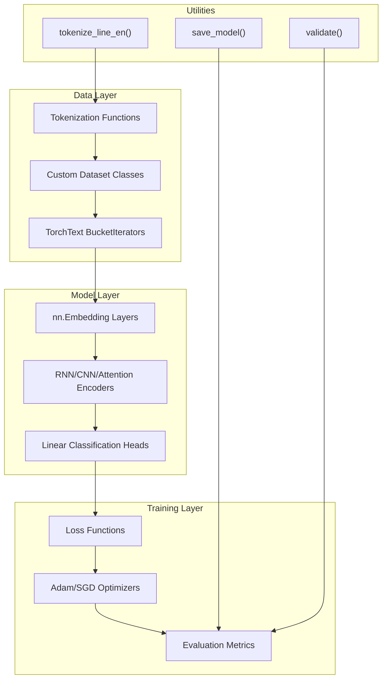
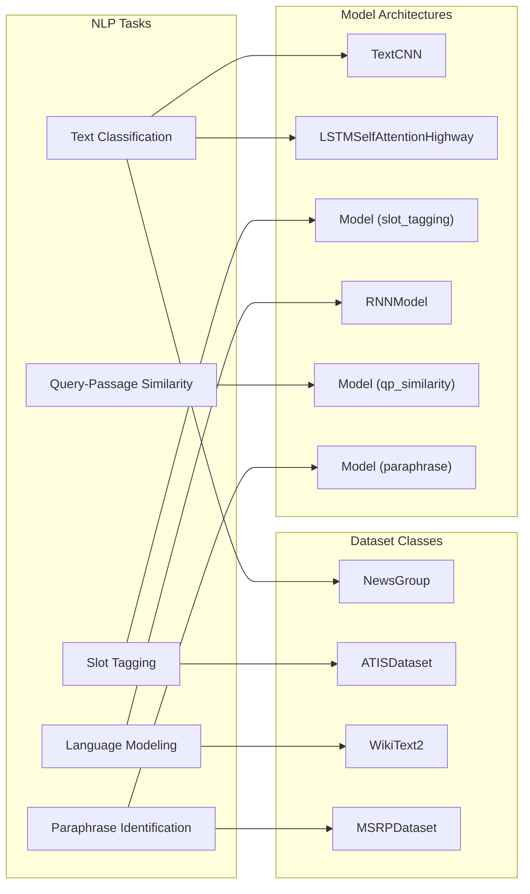
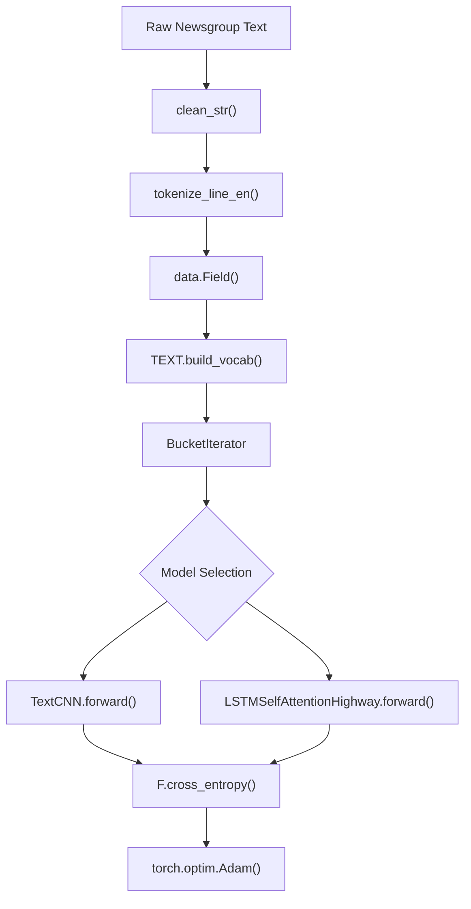
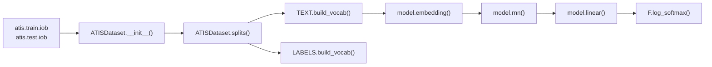
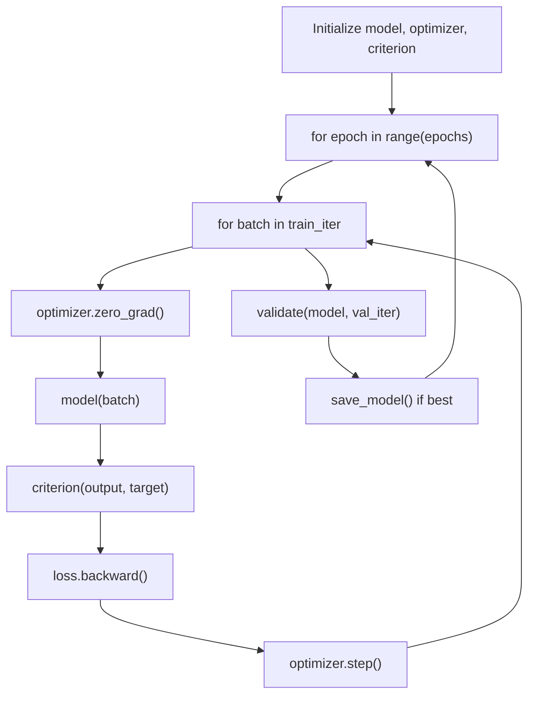

<!-- source: DeepWiki mcp.deepwiki.com · repo microsoft/samples-for-ai · page 5.1 NLP Tutorials · fetched 2026-10-26 -->

# NLP Tutorials

<details>
<summary>Relevant source files</summary>

The following files were used as context for generating this wiki page:

- [examples/NLPTutorials/language_model/README.md](examples/NLPTutorials/language_model/README.md)
- [examples/NLPTutorials/language_model/language_model.py](examples/NLPTutorials/language_model/language_model.py)
- [examples/NLPTutorials/paraphrase_identification/README.md](examples/NLPTutorials/paraphrase_identification/README.md)
- [examples/NLPTutorials/paraphrase_identification/paraphrase_identification.py](examples/NLPTutorials/paraphrase_identification/paraphrase_identification.py)
- [examples/NLPTutorials/qp_similarity/README.md](examples/NLPTutorials/qp_similarity/README.md)
- [examples/NLPTutorials/qp_similarity/qp_similarity.py](examples/NLPTutorials/qp_similarity/qp_similarity.py)
- [examples/NLPTutorials/slot_tagging/README.md](examples/NLPTutorials/slot_tagging/README.md)
- [examples/NLPTutorials/slot_tagging/slot_tagging.py](examples/NLPTutorials/slot_tagging/slot_tagging.py)
- [examples/NLPTutorials/text_classification/README.md](examples/NLPTutorials/text_classification/README.md)
- [examples/NLPTutorials/text_classification/text_classification.py](examples/NLPTutorials/text_classification/text_classification.py)

</details>


This document covers the Natural Language Processing (NLP) tutorial collection within the samples-for-ai repository. These tutorials provide PyTorch-based implementations of fundamental NLP tasks including text classification, sequence labeling, language modeling, and text similarity measurement.

The tutorials are designed as standalone educational examples that demonstrate both core NLP concepts and practical PyTorch implementation patterns. Each tutorial includes complete data loading pipelines, model architectures, training loops, and evaluation metrics.

For general framework examples across multiple deep learning frameworks, see [Framework Examples](#3). For distributed training capabilities, see [OpenPAI Integration](#5.2).

## Architecture Overview

The NLP tutorials follow a consistent architectural pattern that separates data processing, model definition, training, and evaluation into distinct components:



**NLP Task to Code Entity Mapping**



Sources: [examples/NLPTutorials/text_classification/text_classification.py:268-329](), [examples/NLPTutorials/slot_tagging/slot_tagging.py:40-81](), [examples/NLPTutorials/language_model/language_model.py:30-74]()

## Tutorial Components

### Text Classification

The text classification tutorial implements document categorization using the 20 Newsgroups dataset. It provides two neural architectures for comparison:

| Component | Implementation | Key Features |
|-----------|----------------|--------------|
| `TextCNN` | [examples/NLPTutorials/text_classification/text_classification.py:174-201]() | Multi-kernel CNN with max-pooling |
| `LSTMSelfAttentionHighway` | [examples/NLPTutorials/text_classification/text_classification.py:137-172]() | Bidirectional LSTM + self-attention + highway networks |
| `NewsGroup` | [examples/NLPTutorials/text_classification/text_classification.py:296-328]() | Custom dataset class for 20 newsgroups data |

The `TextCNN` class uses multiple convolutional kernels with sizes specified by `kernel_sizes` parameter to capture n-gram features of different lengths. The `LSTMSelfAttentionHighway` combines three advanced techniques: bidirectional LSTM encoding via `DynamicLSTM`, attention weighting via `SelfAttention`, and feature transformation via `Highway` networks.

**Text Classification Pipeline**



Sources: [examples/NLPTutorials/text_classification/text_classification.py:174-201](), [examples/NLPTutorials/text_classification/text_classification.py:137-172](), [examples/NLPTutorials/text_classification/README.md:1-152]()

### Slot Tagging

Slot tagging performs sequence labeling on the ATIS (Airline Travel Information Service) dataset to identify semantic slots in spoken language understanding tasks.

The `Model` class in [examples/NLPTutorials/slot_tagging/slot_tagging.py:83-100]() implements a bidirectional LSTM architecture:
- `nn.Embedding` layer for word representations
- `nn.LSTM` with `bidirectional=True` for sequence encoding  
- `nn.Linear` layer for slot classification at each time step
- `F.log_softmax` for probability distribution over slot labels

The `ATISDataset` class handles data loading from tab-separated files where each line contains space-separated words and their corresponding slot labels.

**Slot Tagging Data Flow**



Sources: [examples/NLPTutorials/slot_tagging/slot_tagging.py:40-81](), [examples/NLPTutorials/slot_tagging/slot_tagging.py:83-100](), [examples/NLPTutorials/slot_tagging/README.md:1-50]()

### Language Modeling

The language modeling tutorial trains character-level models on WikiText2 to predict next words in sequences. The `RNNModel` class supports multiple RNN architectures:

| Parameter | Options | Default |
|-----------|---------|---------|
| `rnn_type` | 'LSTM', 'GRU', 'RNN_TANH', 'RNN_RELU' | 'LSTM' |
| `ntoken` | Vocabulary size | Computed from dataset |
| `ninp` | Embedding dimension | 600 |
| `nhid` | Hidden dimension | 600 |
| `nlayers` | Number of layers | 2 |

The model includes optional weight tying between encoder and decoder matrices when `tie_weights=True` and embedding/hidden dimensions match.

Text generation is implemented in the `generate()` function using multinomial sampling from the output probability distribution.

Sources: [examples/NLPTutorials/language_model/language_model.py:30-74](), [examples/NLPTutorials/language_model/language_model.py:106-123](), [examples/NLPTutorials/language_model/README.md:1-61]()

### Query-Passage Similarity

This tutorial addresses answer selection in question answering by computing similarity between queries and candidate passages using the WikiQA corpus.

The `Model` class in [examples/NLPTutorials/qp_similarity/qp_similarity.py:53-81]() implements:
- Pre-trained GloVe embeddings with `embedding.weight.requires_grad = False`
- Separate GRU encoding for questions and sentences
- Feature concatenation of final hidden states
- Two-layer MLP classifier with Tanh activation

The training uses weighted cross-entropy loss to handle class imbalance between positive and negative answer pairs.

Sources: [examples/NLPTutorials/qp_similarity/qp_similarity.py:53-81](), [examples/NLPTutorials/qp_similarity/README.md:1-53]()

### Paraphrase Identification

Paraphrase identification determines semantic equivalence between sentence pairs using the Microsoft Research Paraphrase Corpus (MSRP).

The `Model` class computes sentence representations using bidirectional LSTM and measures similarity through absolute difference: 
- `torch.max(rnn_out.permute([1, 0, 2]), 1)[0]` for max-pooling over sequence length
- `torch.abs(representation1 - representation2)` for feature difference
- Final classification via linear layer and log-softmax

Sources: [examples/NLPTutorials/paraphrase_identification/paraphrase_identification.py:84-105](), [examples/NLPTutorials/paraphrase_identification/README.md:1-52]()

## Common Patterns and Utilities

### Shared Tokenization

All tutorials use the same `tokenize_line_en()` function with consistent preprocessing:

```python
def tokenize_line_en(line):
   line = re.sub(r"\t", "", line)
   line = re.sub(r"^\s+", "", line)
   line = re.sub(r"\s+$", "", line)
   line = re.sub(r"<br />", "", line)
   line = re.sub(r"(?P<m>\W)", replace, line)
   line = re.sub(r"\s+", " ", line)
   return line.split()
```

### Model Persistence

All tutorials implement consistent model saving via `save_model()` and loading patterns using `torch.save()` and `torch.load()` with state dictionaries.

### Evaluation Framework

The `validate()` functions across tutorials follow similar patterns:
- Model set to evaluation mode with `model.eval()`
- Gradient computation disabled with `torch.no_grad()`
- Metrics computed at batch level and aggregated
- Model returned to training mode with `model.train()`

**Common Training Loop Pattern**



Sources: [examples/NLPTutorials/text_classification/text_classification.py:356-384](), [examples/NLPTutorials/slot_tagging/slot_tagging.py:177-223](), [examples/NLPTutorials/language_model/language_model.py:125-173]()

---

