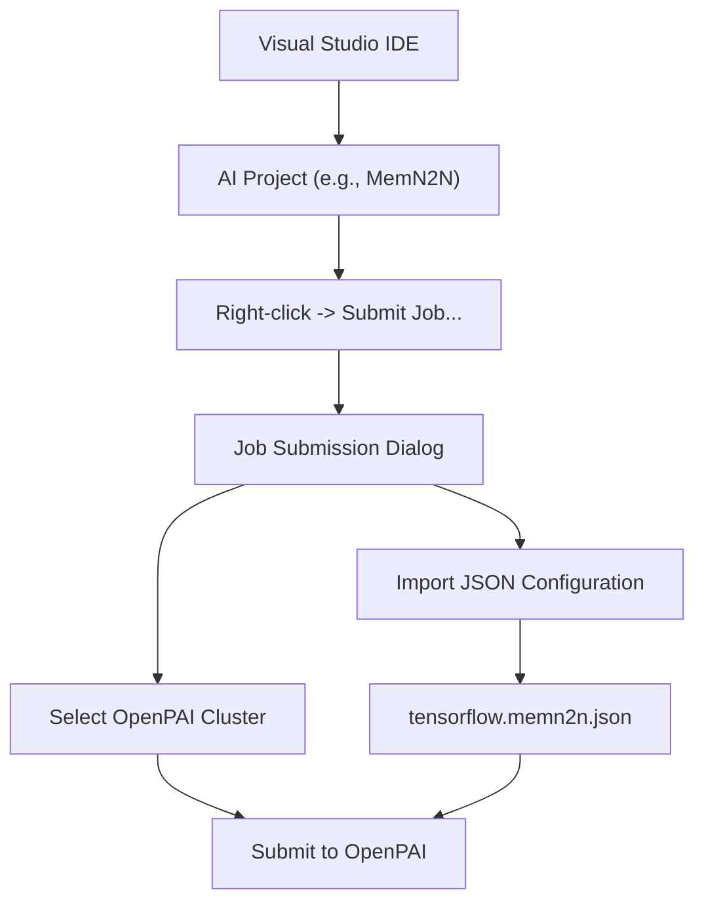
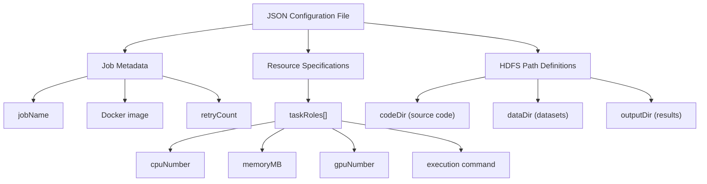
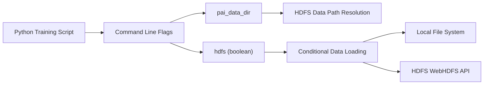
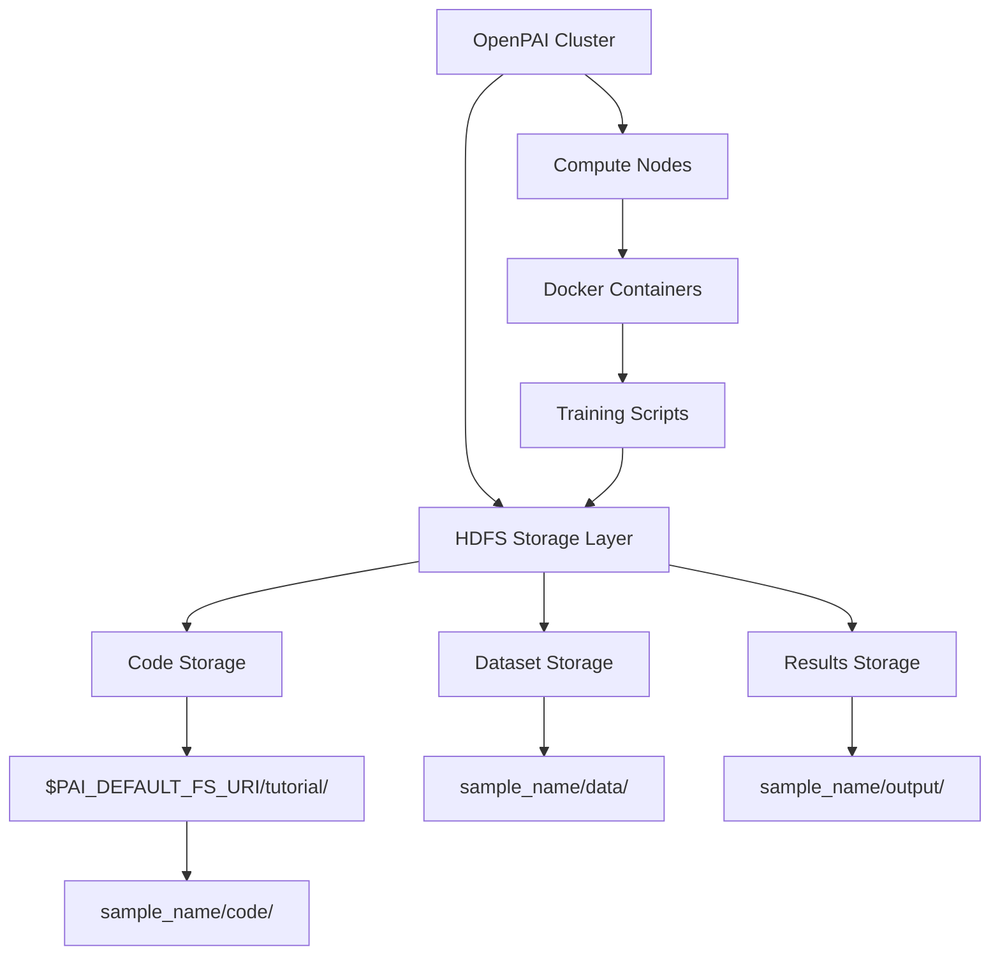

<!-- source: DeepWiki mcp.deepwiki.com · repo microsoft/samples-for-ai · page 5.2 OpenPAI Integration · fetched 2026-10-26 -->

# OpenPAI Integration

<details>
<summary>Relevant source files</summary>

The following files were used as context for generating this wiki page:

- [README.md](README.md)
- [docs/download_data.md](docs/download_data.md)
- [docs/local_run.md](docs/local_run.md)
- [docs/prerequisites.md](docs/prerequisites.md)
- [docs/submit_job_to_pai.md](docs/submit_job_to_pai.md)
- [examples/README.md](examples/README.md)
- [examples/tensorflow/MemN2N/MemN2N.pyproj](examples/tensorflow/MemN2N/MemN2N.pyproj)
- [examples/tensorflow/MemN2N/data.py](examples/tensorflow/MemN2N/data.py)
- [examples/tensorflow/MemN2N/main.py](examples/tensorflow/MemN2N/main.py)
- [examples/tensorflow/MemN2N/tensorflow.memn2n.json](examples/tensorflow/MemN2N/tensorflow.memn2n.json)
- [examples/tensorflow/NTM/NTM.pyproj](examples/tensorflow/NTM/NTM.pyproj)
- [examples/tensorflow/NTM/copydata.sh](examples/tensorflow/NTM/copydata.sh)
- [examples/tensorflow/NTM/main.py](examples/tensorflow/NTM/main.py)
- [examples/tensorflow/NTM/ntm.py](examples/tensorflow/NTM/ntm.py)
- [examples/tensorflow/NTM/tasks/copy.py](examples/tensorflow/NTM/tasks/copy.py)
- [examples/tensorflow/NTM/tensorflow.ntm.json](examples/tensorflow/NTM/tensorflow.ntm.json)
- [projects/StyleTransfer/StyleTransferTraining/src/README.md](projects/StyleTransfer/StyleTransferTraining/src/README.md)
- [zh-hans/README.md](zh-hans/README.md)
- [zh-hant/README.md](zh-hant/README.md)

</details>


This document covers the integration between the samples-for-ai repository and Microsoft's OpenPAI (Open Platform for AI) distributed computing platform. OpenPAI integration enables submitting training jobs from local development environments to scalable cloud clusters for distributed AI model training.

For information about local development and framework setup, see [Getting Started](#2). For details about specific framework examples that can be submitted to OpenPAI, see [Framework Examples](#3).

## Overview

OpenPAI integration provides three primary submission methods for running AI training jobs on distributed clusters: Visual Studio Tools for AI, VS Code Tools for AI, and the OpenPAI web portal. Each framework example in the repository includes pre-configured JSON files that define the computational resources, Docker environments, and execution commands required for cluster deployment.

## Job Submission Methods

### Visual Studio Tools for AI Submission

The primary integration method uses Visual Studio Tools for AI to submit jobs directly from the IDE. Users can right-click any project and select "Submit Job..." to launch the submission dialog.



The submission process involves selecting the target OpenPAI cluster and importing the project's JSON configuration file. Each project directory contains framework-specific JSON files following the naming pattern `framework.sample.json`.

Sources: [docs/submit_job_to_pai.md:15-23](), [examples/README.md:85-91]()

### VS Code Tools for AI Submission

VS Code provides similar functionality through the VS Code Tools for AI extension, offering a lightweight alternative to the full Visual Studio IDE experience.

Sources: [docs/submit_job_to_pai.md:26-32]()

### Web Portal Submission

Direct submission through the OpenPAI web portal requires manual upload of code and data to HDFS storage before job submission. This method provides the most control over the deployment process but requires additional manual steps.

The workflow involves uploading code to `$PAI_DEFAULT_FS_URI/tutorial/sample_name/code` and datasets to `$PAI_DEFAULT_FS_URI/tutorial/sample_name/data` directories in HDFS storage.

Sources: [docs/submit_job_to_pai.md:34-51]()

## Configuration Structure

### JSON Job Specifications

OpenPAI jobs are defined using JSON configuration files that specify computational resources, Docker environments, and execution commands. The configuration structure includes several key sections:

| Field | Purpose | Example Value |
|-------|---------|---------------|
| `jobName` | Unique identifier for the job | `"tensorflow-memn2n"` |
| `image` | Docker container image | `"openpai/pai.example.tensorflow"` |
| `codeDir` | HDFS path containing source code | `"$PAI_DEFAULT_FS_URI/tutorial/memn2n/code"` |
| `dataDir` | HDFS path containing training data | `"$PAI_DEFAULT_FS_URI/tutorial/memn2n/data"` |
| `outputDir` | HDFS path for job outputs | `"$PAI_DEFAULT_FS_URI/tutorial/memn2n/output"` |
| `taskRoles` | Resource and execution specifications | Array of task role objects |



Sources: [examples/tensorflow/MemN2N/tensorflow.memn2n.json:1-22](), [examples/tensorflow/NTM/tensorflow.ntm.json:1-22]()

### Task Role Specifications

The `taskRoles` array defines computational requirements and execution commands for distributed training. Each task role specifies CPU cores, memory allocation, GPU requirements, and the command sequence for job execution.

For example, the MemN2N configuration allocates 8 CPU cores, 32GB memory, and executes `pip --quiet install future && cd code && python main.py` within the container environment.

Sources: [examples/tensorflow/MemN2N/tensorflow.memn2n.json:10-21]()

## Code Integration Patterns

### HDFS Integration Flags

Framework examples include command-line flags to support HDFS data access and PAI-specific execution environments. The integration pattern involves conditional data loading based on the execution context.



The MemN2N example demonstrates this pattern with `pai_data_dir` and `hdfs` flags that modify data loading behavior for distributed execution.

Sources: [examples/tensorflow/MemN2N/main.py:29-33](), [examples/tensorflow/NTM/main.py:30-34]()

### Data Access Patterns

Code examples include helper functions for converting HDFS URLs to WebHDFS format and managing data transfer between distributed storage and local execution environments. The pattern involves URL transformation from `hdfs://` to `webhdfs://` with appropriate port changes.

```python
# URL conversion pattern from HDFS to WebHDFS
regex = re.compile('^hdfs://')
webhdfs = hdfspath.replace('hdfs', 'webhdfs', 1).replace(':9000', ':50070', 1)
```

Sources: [examples/tensorflow/MemN2N/data.py:7-12](), [examples/tensorflow/NTM/main.py:53-57]()

## Resource Management

### Docker Environment Specifications

OpenPAI jobs execute within pre-configured Docker containers that include framework dependencies and CUDA support. The standard TensorFlow image `openpai/pai.example.tensorflow` provides TensorFlow with GPU acceleration capabilities.

### HDFS Storage Integration

The platform uses Hadoop Distributed File System (HDFS) for scalable data storage and retrieval. Training scripts access datasets through the `$PAI_DEFAULT_FS_URI` environment variable, which resolves to the cluster's distributed storage endpoint.



Sources: [docs/submit_job_to_pai.md:42](), [examples/tensorflow/MemN2N/tensorflow.memn2n.json:4-7]()

## Deployment Workflow

### Code Upload and Execution

The deployment process involves uploading local source code to HDFS storage, configuring job parameters through JSON specifications, and submitting execution requests to the OpenPAI scheduler. The platform manages resource allocation, container orchestration, and job monitoring.

Training scripts execute within isolated Docker environments with access to distributed storage and allocated computational resources. Output artifacts, including model checkpoints and training logs, are stored in designated HDFS output directories for retrieval after job completion.

Sources: [docs/submit_job_to_pai.md:36-44](), [examples/README.md:81-91]()

---

