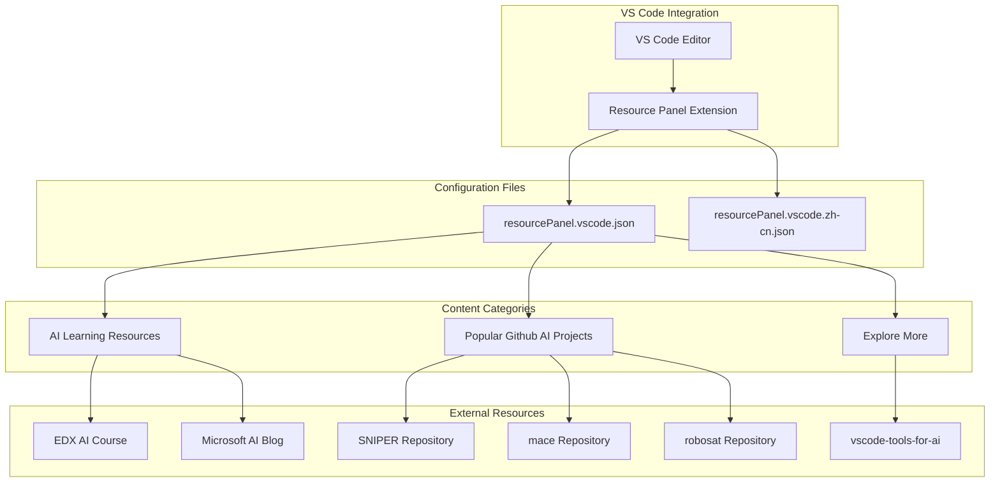
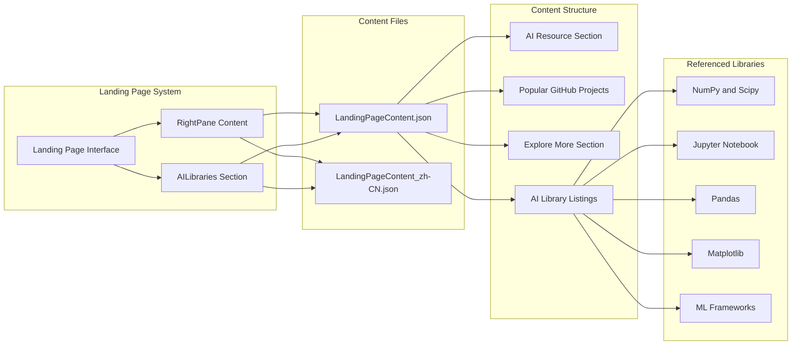
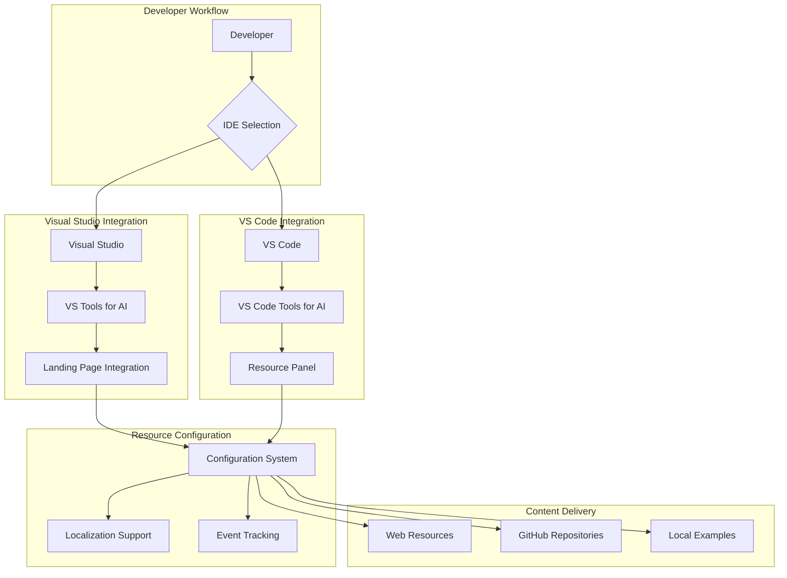
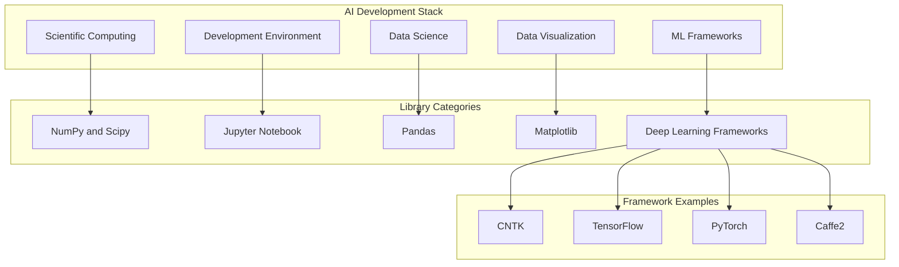

<!-- source: DeepWiki mcp.deepwiki.com · repo microsoft/samples-for-ai · page 6 Development Tools and Resources · fetched 2026-10-26 -->

# Development Tools and Resources

Relevant source files

The following files were used as context for generating this wiki page:

- [examples/LandingPageContent.json](examples/LandingPageContent.json)
- [examples/LandingPageContent_zh-CN.json](examples/LandingPageContent_zh-CN.json)
- [examples/resourcePanel.vscode.json](examples/resourcePanel.vscode.json)
- [examples/resourcePanel.vscode.zh-cn.json](examples/resourcePanel.vscode.zh-cn.json)

## Purpose and Scope

This document covers the tools, integrations, and resource discovery systems that support the AI development workflow in the samples-for-ai repository. This includes the resource panel configurations for IDE integration, content management systems for developer resources, and mechanisms for discovering AI learning materials and popular projects.

For information about the automated installation and environment setup tools, see [Installation and Environment Setup](#2.1). For details about Visual Studio integration and development workflow, see [Visual Studio and Development Tools](#2.2). For information about the project metadata and categorization system, see [Project Catalog and Discovery](#6.1).

## Resource Panel System Architecture

The repository implements a resource panel system that provides curated AI learning resources directly within development environments. The system uses JSON-based configuration files to manage content across different IDEs and localization requirements.

The resource panel system uses a structured JSON format with event tracking capabilities. Each resource entry includes a `name`, `url`, and `event` field for analytics tracking:

| Field | Purpose | Example Value |
|-------|---------|---------------|
| `name` | Display text for the resource | "Curriculum about AI" |
| `url` | Target URL for the resource | "https://www.edx.org/microsoft-professional-program-artificial-intelligence" |
| `event` | Analytics event identifier | "homepage/openAICourse" |

**Sources:** [examples/resourcePanel.vscode.json:1-52](), [examples/resourcePanel.vscode.zh-cn.json:1-52]()

## Landing Page Content Management

The landing page content system provides a more comprehensive resource discovery interface with additional categorization and AI library listings. This system supports both the main landing page and localized versions.

The landing page content system organizes resources into distinct sections within the `RightPane` array structure. The `AILibraries` section specifically lists essential Python libraries and ML frameworks that developers need for AI development.

**Sources:** [examples/LandingPageContent.json:1-76](), [examples/LandingPageContent_zh-CN.json:1-82]()

## Resource Discovery and Navigation

The resource discovery system provides structured pathways for developers to access learning materials, explore popular projects, and dive deeper into specific AI technologies. The system implements a hierarchical navigation structure with consistent URL patterns.

### Learning Resource Categories

| Category | Description | Key Resources |
|----------|-------------|---------------|
| **AI Learning Resources** | Educational content and courses | EDX AI Program, Microsoft AI Blog |
| **Popular GitHub Projects** | Trending AI repositories | SNIPER, mace, robosat |
| **Exploration Paths** | Entry points to examples | First AI model tutorial, samples-for-ai repository |

The exploration section provides direct links to key starting points within the repository:

- First AI model training: [examples/tensorflow/MNIST]()
- Complete examples collection: [examples/]()
- Tools for AI documentation: Links to Visual Studio and VS Code extensions

**Sources:** [examples/LandingPageContent.json:39-57](), [examples/resourcePanel.vscode.json:37-51]()

## IDE Integration Architecture

The development tools system integrates with both Visual Studio and VS Code through dedicated extensions that provide contextual access to AI resources and examples.

### Event Tracking Implementation

The resource panel system implements analytics tracking through standardized event names:

| Event Pattern | Purpose | Example |
|---------------|---------|---------|
| `homepage/openAICourse` | Track course access | EDX AI curriculum clicks |
| `homepage/openAIBlog` | Track blog visits | Microsoft AI blog access |
| `homepage/openGithubProject` | Track project exploration | SNIPER, mace, robosat clicks |
| `homepage/openSamples4AIGithub` | Track samples repository access | samples-for-ai navigation |
| `homepage/openTools4AIGithub` | Track tools documentation access | Tools for AI repository visits |

**Sources:** [examples/resourcePanel.vscode.json:8-48](), [examples/resourcePanel.vscode.zh-cn.json:8-48]()

## Localization and International Support

The system provides comprehensive localization support with separate configuration files for different languages. The Chinese localization includes region-specific resources and culturally relevant content.

### Localization Differences

| Aspect | English Version | Chinese Version |
|--------|----------------|-----------------|
| **AI Courses** | EDX Microsoft Professional Program | Microsoft AI Course on Azure School (school.azure.cn) |
| **Video Resources** | Not specified | Bilibili video tutorials |
| **Blog Content** | Microsoft AI Blog | CNBlogs technical articles |
| **Resource Titles** | "AI Learning Resources" | "AI 学习资源" |

The Chinese version includes additional resources such as:
- Bilibili video tutorial: "AI 应用开发入门视频：看图识熊" 
- CNBlogs technical blog: "AI 应用开发入门博客：手写识别"

**Sources:** [examples/LandingPageContent_zh-CN.json:1-82](), [examples/resourcePanel.vscode.zh-cn.json:1-52]()

## AI Library and Framework Listings

The system maintains curated lists of essential AI development libraries and frameworks that developers should be familiar with. This serves both as a reference and as a checklist for environment setup.

### Core Libraries Categorization

The `AILibraries` section provides a comprehensive overview of the development stack, from foundational scientific computing libraries to advanced deep learning frameworks. This aligns with the automated installation capabilities documented in the installer system.

**Sources:** [examples/LandingPageContent.json:59-75](), [examples/LandingPageContent_zh-CN.json:65-81]()

---

