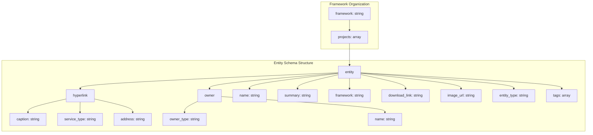
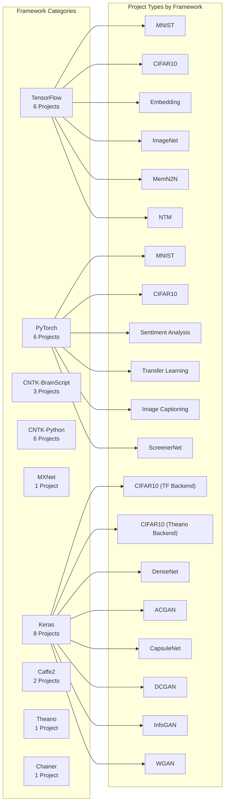
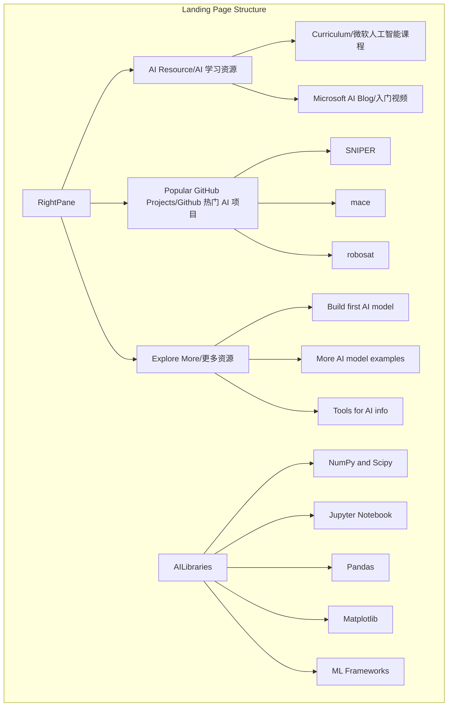
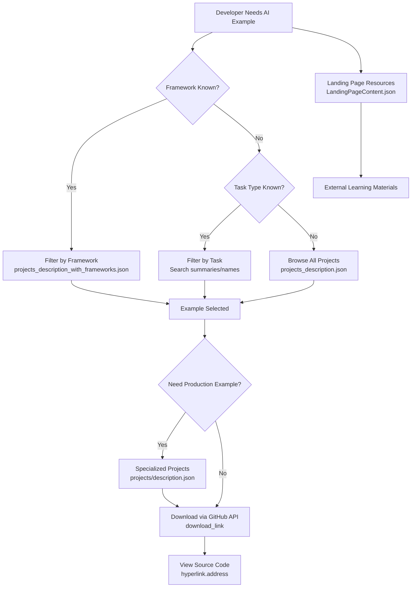
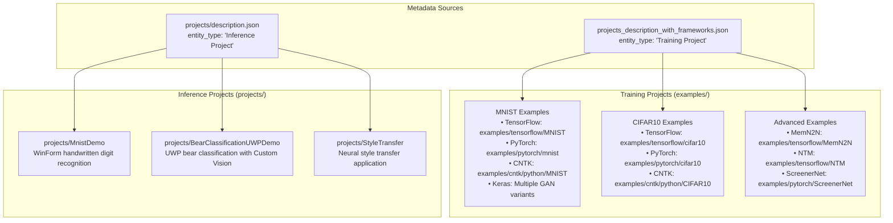
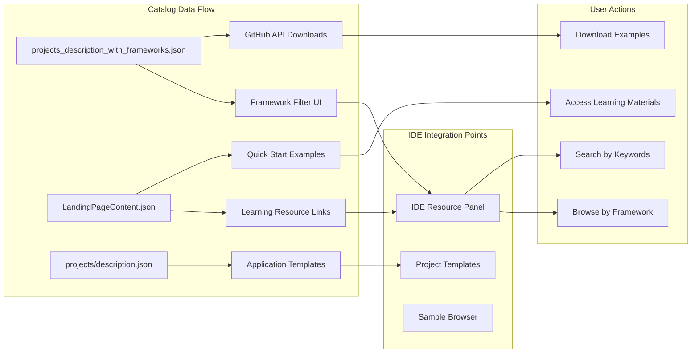

<!-- source: DeepWiki mcp.deepwiki.com · repo microsoft/samples-for-ai · page 6.1 Project Catalog and Discovery · fetched 2026-10-26 -->

# Project Catalog and Discovery

Relevant source files

The following files were used as context for generating this wiki page:

- [examples/LandingPageContent.json](examples/LandingPageContent.json)
- [examples/LandingPageContent_zh-CN.json](examples/LandingPageContent_zh-CN.json)
- [examples/projects_description.json](examples/projects_description.json)
- [examples/projects_description_with_frameworks.json](examples/projects_description_with_frameworks.json)
- [projects/description.json](projects/description.json)

This document describes the project catalog and discovery system used to organize, categorize, and present AI/ML examples and projects within the samples-for-ai repository. The system provides structured metadata for framework examples, specialized projects, and learning resources to enable both programmatic access and user-friendly discovery through development tools.

For information about the actual example implementations, see [Framework Examples](#3). For IDE integration details, see [IDE Integration and Resources](#6.2).

## Overview and Architecture

The Project Catalog and Discovery system consists of JSON-based metadata files that organize AI/ML examples into searchable, categorized collections. The system supports both framework-specific training examples and specialized inference projects, with content organized for consumption by Visual Studio Tools for AI and other development environments.

```mermaid
graph TB
    subgraph "Project Catalog System"
        CATALOG_FRAMEWORKS["projects_description_with_frameworks.json<br/>Framework-Organized Catalog"]
        CATALOG_SIMPLE["projects_description.json<br/>Flat Project List"]
        PROJECTS_CATALOG["projects/description.json<br/>Specialized Projects"]
    end
    
    subgraph "Content Discovery"
        LANDING_EN["LandingPageContent.json<br/>English Learning Resources"]
        LANDING_CN["LandingPageContent_zh-CN.json<br/>Chinese Learning Resources"]
    end
    
    subgraph "Framework Examples"
        TF_EXAMPLES["examples/tensorflow/*<br/>TensorFlow Projects"]
        PYTORCH_EXAMPLES["examples/pytorch/*<br/>PyTorch Projects"]
        KERAS_EXAMPLES["examples/keras/*<br/>Keras Projects"]
        CNTK_EXAMPLES["examples/cntk/*<br/>CNTK Projects"]
        OTHER_FRAMEWORKS["examples/mxnet/*<br/>examples/caffe2/*<br/>Other Frameworks"]
    end
    
    subgraph "Specialized Projects"
        MNIST_DEMO["projects/MnistDemo<br/>WinForm Application"]
        BEAR_CLASSIFICATION["projects/BearClassificationUWPDemo<br/>UWP Application"]
        STYLE_TRANSFER["projects/StyleTransfer<br/>Neural Style Transfer"]
    end
    
    subgraph "Development Tools"
        VS_TOOLS["Visual Studio Tools for AI"]
        VSCODE_TOOLS["VS Code Extensions"]
        RESOURCE_PANELS["IDE Resource Panels"]
    end
    
    CATALOG_FRAMEWORKS --> TF_EXAMPLES
    CATALOG_FRAMEWORKS --> PYTORCH_EXAMPLES
    CATALOG_FRAMEWORKS --> KERAS_EXAMPLES
    CATALOG_FRAMEWORKS --> CNTK_EXAMPLES
    CATALOG_FRAMEWORKS --> OTHER_FRAMEWORKS
    
    CATALOG_SIMPLE --> TF_EXAMPLES
    CATALOG_SIMPLE --> PYTORCH_EXAMPLES
    
    PROJECTS_CATALOG --> MNIST_DEMO
    PROJECTS_CATALOG --> BEAR_CLASSIFICATION
    PROJECTS_CATALOG --> STYLE_TRANSFER
    
    LANDING_EN --> VS_TOOLS
    LANDING_CN --> VS_TOOLS
    LANDING_EN --> VSCODE_TOOLS
    LANDING_CN --> VSCODE_TOOLS
    
    CATALOG_FRAMEWORKS --> RESOURCE_PANELS
    PROJECTS_CATALOG --> RESOURCE_PANELS
    LANDING_EN --> RESOURCE_PANELS
```

**Sources:** [examples/projects_description_with_frameworks.json:1-8](), [examples/projects_description.json:1-8](), [projects/description.json:1-8](), [examples/LandingPageContent.json:1-8]()

## Project Metadata Schema

The catalog system uses a standardized metadata schema to describe each AI/ML project, enabling consistent discovery and presentation across different development tools.

### Core Entity Structure

Each project in the catalog follows a consistent entity structure:

| Field | Type | Description | Example |
|-------|------|-------------|---------|
| `name` | string | Display name of the project | "MNIST using TensorFlow" |
| `summary` | string | Detailed description of the project | "Training & evaluating the MNIST network..." |
| `framework` | string | AI framework used | "TensorFlow", "PyTorch", "Keras" |
| `hyperlink` | object | GitHub repository link | Contains `caption`, `service_type`, `address` |
| `download_link` | string | GitHub API download URL | GitHub contents API endpoint |
| `image_url` | string | Project icon/thumbnail | Raw GitHub URL to icon file |
| `entity_type` | string | Project category | "Training Project", "Inference Project" |
| `tags` | array | Categorization tags | Currently empty arrays |
| `owner` | object | Project ownership | Microsoft company ownership |

**Sources:** [examples/projects_description_with_frameworks.json:5-27](), [examples/projects_description.json:4-22]()

### Framework-Based Organization

The `projects_description_with_frameworks.json` organizes projects by AI framework, enabling framework-specific discovery and filtering:

**Sources:** [examples/projects_description_with_frameworks.json:5-8](), [examples/projects_description_with_frameworks.json:131-134](), [examples/projects_description_with_frameworks.json:257-260]()

## Content Discovery Mechanisms

### Landing Page Resources

The landing page content files provide curated learning resources and discovery entry points for users:

| Resource Category | Purpose | Content Type |
|-------------------|---------|--------------|
| AI Learning Resources | Educational content and courses | External links to courses, videos, blogs |
| Popular GitHub Projects | Trending AI/ML repositories | Links to notable open source projects |
| Explore More | Direct links to examples | Repository links to start coding |
| AI Libraries | Development environment setup | List of required libraries and frameworks |

**Sources:** [examples/LandingPageContent.json:2-17](), [examples/LandingPageContent_zh-CN.json:2-23](), [examples/LandingPageContent.json:59-75]()

### Project Discovery Workflow

The discovery system supports multiple access patterns for finding relevant AI/ML examples:

**Sources:** [examples/projects_description_with_frameworks.json:1-8](), [examples/projects_description.json:1-8](), [projects/description.json:1-8]()

## Specialized Project Categories

The system distinguishes between framework training examples and production-ready specialized projects:

### Training Projects vs Inference Projects

| Project Type | Location | Purpose | Examples |
|--------------|----------|---------|----------|
| Training Project | `examples/` | Learning AI frameworks | MNIST, CIFAR10, GANs |
| Inference Project | `projects/` | Production applications | UWP apps, WinForm demos |

**Sources:** [examples/projects_description_with_frameworks.json:21](), [projects/description.json:16](), [projects/description.json:36](), [projects/description.json:56]()

## Integration with Development Tools

The catalog system is designed for consumption by Visual Studio Tools for AI and other development environments:

### IDE Resource Panel Integration

The structured metadata enables IDE extensions to present organized project catalogs:

| Integration Point | Data Source | Purpose |
|-------------------|-------------|---------|
| Framework Examples | `projects_description_with_frameworks.json` | Framework-filtered project browsing |
| Quick Start | `LandingPageContent.json` "Explore More" | Direct links to beginner examples |
| Learning Resources | `LandingPageContent.json` "RightPane" | Educational content discovery |
| Specialized Projects | `projects/description.json` | Production-ready application examples |

**Sources:** [examples/LandingPageContent.json:40-55](), [examples/projects_description_with_frameworks.json:14-19](), [projects/description.json:9-14]()

---

