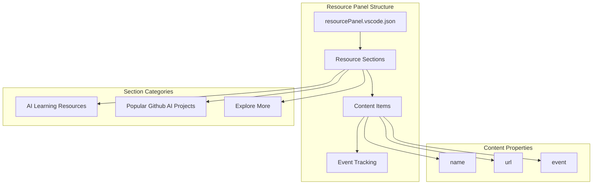
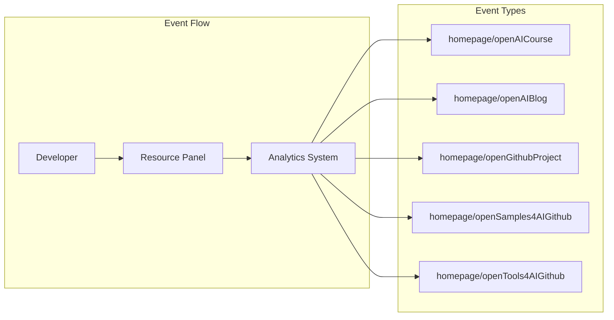
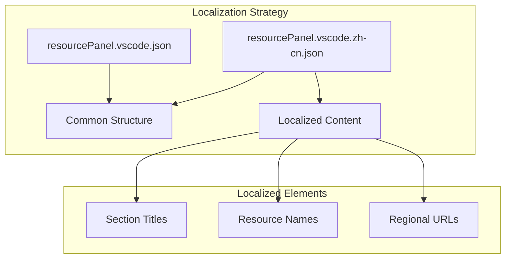

<!-- source: DeepWiki mcp.deepwiki.com · repo microsoft/samples-for-ai · page 6.2 IDE Integration and Resources · fetched 2026-10-26 -->

# IDE Integration and Resources

Relevant source files

The following files were used as context for generating this wiki page:

- [examples/resourcePanel.vscode.json](examples/resourcePanel.vscode.json)
- [examples/resourcePanel.vscode.zh-cn.json](examples/resourcePanel.vscode.zh-cn.json)

## Purpose and Scope

This section covers the IDE integration capabilities and developer resource management systems within the samples-for-ai repository. The focus is on VS Code resource panels, developer resource discovery, and integration with the broader development workflow. For information about the automated development environment setup, see [Installation and Environment Setup](#2.1). For details about project metadata and cataloging systems, see [Project Catalog and Discovery](#6.1).

The IDE integration system provides curated AI learning resources, popular GitHub projects, and development tools directly within the IDE interface, streamlining the developer experience and reducing context switching during AI development workflows.

## VS Code Resource Panel System

The repository implements a resource panel system specifically designed for VS Code integration through the `resourcePanel.vscode.json` configuration files. This system provides developers with immediate access to relevant AI resources without leaving their development environment.

### Resource Panel Configuration Structure

The resource panel system uses a hierarchical JSON structure to organize content into logical categories:

**Resource Panel Architecture**

Sources: [examples/resourcePanel.vscode.json:1-52]()

Each resource section follows a consistent structure with three main components:

| Property | Purpose | Example Values |
|----------|---------|----------------|
| `title` | Section header displayed in IDE | "AI Learning Resources", "Popular Github AI Projects" |
| `content` | Array of resource items | Array of resource objects |
| `name` | Display name for resource link | "Curriculum about AI", "SNIPER" |
| `url` | Target URL for resource | External links to documentation, projects |
| `event` | Analytics tracking identifier | "homepage/openAICourse", "homepage/openGithubProject" |

### Resource Categories and Content

The resource panel system organizes content into three primary categories:

#### AI Learning Resources
This section provides educational content and formal learning paths:
- Microsoft AI curriculum and professional programs
- Microsoft AI blog for latest developments and insights

#### Popular GitHub AI Projects  
Curated selection of notable open-source AI projects:
- SNIPER (efficient multi-scale object detection)
- MACE (mobile AI compute engine)
- RoboSat (semantic segmentation for aerial imagery)

#### Explore More
Additional resources and tools for extended development:
- Links to the samples-for-ai repository for more examples
- VS Code Tools for AI extension information

Sources: [examples/resourcePanel.vscode.json:3-51]()

## Event Tracking and Analytics Integration

The resource panel system includes built-in event tracking capabilities for understanding developer engagement patterns:

**Event Tracking System**

The event tracking system uses consistent naming conventions:
- `homepage/openAICourse` for educational resource access
- `homepage/openAIBlog` for blog content engagement  
- `homepage/openGithubProject` for external project exploration
- `homepage/openSamples4AIGithub` for additional sample discovery
- `homepage/openTools4AIGithub` for tooling information access

Sources: [examples/resourcePanel.vscode.json:8-49]()

## Localization and Internationalization

The resource panel system supports multiple languages through localized configuration files:

### Chinese Localization Support

The system includes comprehensive Chinese language support through `resourcePanel.vscode.zh-cn.json`, providing:
- Localized section titles ("AI 学习资源", "Github 热门 AI 项目", "更多资源")
- Region-specific educational resources (Azure China school curriculum)
- Culturally appropriate resource descriptions

The localization maintains the same structural format while adapting content for regional relevance:

**Localization Architecture**

Sources: [examples/resourcePanel.vscode.zh-cn.json:1-52]()

## Integration with Development Workflow

The resource panel system integrates seamlessly with the overall development workflow by providing contextual access to resources during different phases of AI development:

### Workflow Integration Points

| Development Phase | Relevant Resources | Panel Section |
|-------------------|-------------------|---------------|
| Learning & Skill Development | Educational courses, blogs | AI Learning Resources |
| Research & Architecture | Open-source projects, implementations | Popular Github AI Projects |
| Implementation & Extension | Additional samples, tooling | Explore More |

The resource panel serves as a bridge between the local development environment and the broader AI development ecosystem, reducing friction in accessing relevant external resources while maintaining focus on the current development task.

Sources: [examples/resourcePanel.vscode.json:1-52](), [examples/resourcePanel.vscode.zh-cn.json:1-52]()