# Page: Overview

# Overview

<details>
<summary>Relevant source files</summary>

The following files were used as context for generating this wiki page:

- [README.md](README.md)
- [docs/download_data.md](docs/download_data.md)
- [docs/local_run.md](docs/local_run.md)
- [docs/prerequisites.md](docs/prerequisites.md)
- [docs/submit_job_to_pai.md](docs/submit_job_to_pai.md)
- [examples/README.md](examples/README.md)
- [examples/projects_description.json](examples/projects_description.json)
- [examples/projects_description_with_frameworks.json](examples/projects_description_with_frameworks.json)
- [projects/StyleTransfer/StyleTransferTraining/src/README.md](projects/StyleTransfer/StyleTransferTraining/src/README.md)
- [projects/description.json](projects/description.json)
- [zh-hans/README.md](zh-hans/README.md)
- [zh-hant/README.md](zh-hant/README.md)

</details>


This document provides a comprehensive overview of the Microsoft Samples for AI repository, which serves as a deep learning samples and projects collection designed to help developers get started with AI/ML development across multiple frameworks. The repository contains classic deep learning algorithms, applications, development tools, and infrastructure for both local development and distributed training.

For detailed setup instructions, see [Installation and Environment Setup](#2.1). For framework-specific examples, see [Framework Examples](#3). For production applications, see [Specialized Projects](#4).

## Repository Architecture

The samples-for-ai repository is organized around several core systems that work together to provide a complete AI development experience:

```mermaid
graph TB
    subgraph "Core Infrastructure"
        INSTALLER["installer/install.py<br/>One-Click Framework Setup"]
        README["README.md<br/>Main Documentation"]
    end
    
    subgraph "Framework Examples"
        TF_EXAMPLES["examples/tensorflow/<br/>TensorFlow Projects"]
        PYTORCH_EXAMPLES["examples/pytorch/<br/>PyTorch Projects"] 
        KERAS_EXAMPLES["examples/keras/<br/>Keras Projects"]
        CNTK_EXAMPLES["examples/cntk/<br/>CNTK Projects"]
        OTHER_FRAMEWORKS["examples/{mxnet,caffe2,theano,chainer}/<br/>Additional Frameworks"]
    end
    
    subgraph "Project Discovery"
        PROJECT_CATALOG["examples/projects_description*.json<br/>Project Metadata"]
        LANDING_CONTENT["examples/LandingPageContent*.json<br/>UI Content"]
    end
    
    subgraph "Production Applications"
        STYLE_TRANSFER["projects/StyleTransfer/<br/>Neural Style Transfer"]
        BEAR_CLASSIFICATION["projects/BearClassificationUWPDemo/<br/>UWP Application"]
        MNIST_DEMO["projects/MnistDemo/<br/>WinForm Application"]
    end
    
    subgraph "Development Tools"
        VS_INTEGRATION["Visual Studio Tools for AI"]
        OPENPAI_INTEGRATION["OpenPAI Distributed Training"]
    end
    
    INSTALLER --> TF_EXAMPLES
    INSTALLER --> PYTORCH_EXAMPLES
    INSTALLER --> KERAS_EXAMPLES
    INSTALLER --> CNTK_EXAMPLES
    INSTALLER --> OTHER_FRAMEWORKS
    
    PROJECT_CATALOG --> TF_EXAMPLES
    PROJECT_CATALOG --> PYTORCH_EXAMPLES
    PROJECT_CATALOG --> STYLE_TRANSFER
    
    VS_INTEGRATION --> TF_EXAMPLES
    VS_INTEGRATION --> PYTORCH_EXAMPLES
    VS_INTEGRATION --> OPENPAI_INTEGRATION
    
    README --> INSTALLER
    README --> OPENPAI_INTEGRATION
```

**Sources:** [README.md:1-83](), [examples/projects_description_with_frameworks.json:1-50](), [projects/description.json:1-65]()

## Framework Examples Ecosystem

The repository provides implementations of common AI tasks across multiple deep learning frameworks, enabling comparative learning and framework evaluation:

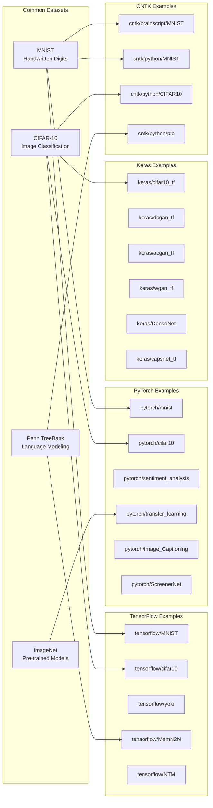

**Sources:** [examples/projects_description_with_frameworks.json:8-130](), [examples/projects_description.json:4-243]()

## Development Workflow Integration

The repository integrates with Microsoft's AI development ecosystem to provide seamless workflows from local development to distributed training:

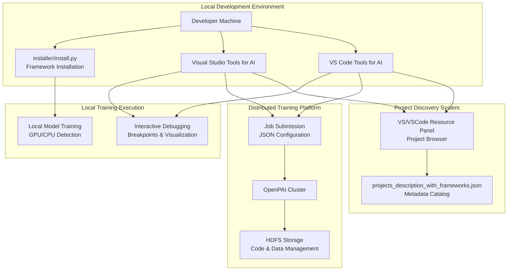

**Sources:** [docs/submit_job_to_pai.md:1-52](), [examples/README.md:45-66](), [docs/prerequisites.md:18-47]()

## Core Components

### One-Click Installer System
The `installer/install.py` script provides automated setup of deep learning frameworks with GPU detection and dependency management. It supports Windows, macOS, and Linux platforms and automatically configures CUDA environments.

**Key Features:**
- NVIDIA GPU detection and CUDA setup
- Multi-platform Python environment configuration  
- Framework installation: TensorFlow, PyTorch, Keras, CNTK, MXNet, Caffe2, Theano, Chainer
- User directory installation support with `--user` flag
- CUDA version selection with `--cuda80` flag

**Sources:** [README.md:28-29](), [docs/prerequisites.md:18-47](), [examples/README.md:45-66]()

### Framework Examples Collection
Organized under `examples/` directory by framework, each containing Visual Studio solution files (`.sln`) and project configurations for integrated development experience.

| Framework | Example Count | Key Projects |
|-----------|---------------|--------------|
| TensorFlow | 6+ | MNIST, CIFAR-10, YOLO, MemN2N, NTM |
| PyTorch | 6+ | MNIST, CIFAR-10, Sentiment Analysis, Transfer Learning, Image Captioning, ScreenerNet |
| Keras | 8+ | CIFAR-10, DCGAN, ACGAN, WGAN, InfoGAN, DenseNet, CapsNet |
| CNTK | 6+ | BrainScript and Python versions of MNIST, CIFAR-10, Speech Recognition |
| Other | 4+ | MXNet, Caffe2, Theano, Chainer implementations |

**Sources:** [examples/projects_description_with_frameworks.json:6-640](), [examples/README.md:5-13]()

### Project Catalog System
JSON-based metadata system for project discovery and categorization:

- `examples/projects_description_with_frameworks.json` - Comprehensive project metadata with framework organization
- `examples/projects_description.json` - Simplified project catalog
- `projects/description.json` - Production application metadata

Each entry contains hyperlinks, summaries, framework information, download links, and ownership details.

**Sources:** [examples/projects_description_with_frameworks.json:1-10](), [examples/projects_description.json:1-10](), [projects/description.json:1-10]()

### OpenPAI Integration
Distributed training support through Microsoft's OpenPAI platform with JSON job configuration files provided for each sample project.

**Configuration Format:** `framework_name.sample_name.json` files containing:
- Resource allocation specifications
- HDFS storage paths for code and data
- Container and runtime configurations
- Multi-GPU and distributed training parameters

**Sources:** [docs/submit_job_to_pai.md:1-52](), [examples/README.md:80-92]()

### Production Applications
The `projects/` directory contains deployment-ready applications demonstrating real-world AI implementations:

- **StyleTransfer** - Real-time neural style transfer with TensorFlow backend and VGG-19 feature extraction
- **BearClassificationUWPDemo** - Universal Windows Platform app using Custom Vision and Windows ML
- **MnistDemo** - WinForms application for handwritten digit recognition

**Sources:** [projects/description.json:4-63](), [projects/StyleTransfer/StyleTransferTraining/src/README.md:1-15]()

## Getting Started

To begin using the samples-for-ai repository:

1. **Environment Setup**: Use the one-click installer at [Installation and Environment Setup](#2.1)
2. **Choose Framework**: Browse framework-specific examples at [Framework Examples](#3) 
3. **Run Locally**: Follow local execution guides at [Getting Started](#2)
4. **Scale to Cloud**: Deploy to OpenPAI using [OpenPAI Integration](#5.2)
5. **Explore Applications**: Study production examples in [Specialized Projects](#4)

The repository serves as both a learning resource for AI/ML concepts and a practical toolkit for developing and deploying deep learning applications across Microsoft's AI ecosystem.

**Sources:** [README.md:26-38](), [examples/README.md:31-92]()

---

# Page: Getting Started

# Getting Started

<details>
<summary>Relevant source files</summary>

The following files were used as context for generating this wiki page:

- [README.md](README.md)
- [docs/download_data.md](docs/download_data.md)
- [docs/local_run.md](docs/local_run.md)
- [docs/prerequisites.md](docs/prerequisites.md)
- [docs/submit_job_to_pai.md](docs/submit_job_to_pai.md)
- [examples/README.md](examples/README.md)
- [installer/gpu_detector_linux](installer/gpu_detector_linux)
- [installer/gpu_detector_mac](installer/gpu_detector_mac)
- [installer/gpu_detector_win.exe](installer/gpu_detector_win.exe)
- [installer/install.py](installer/install.py)
- [projects/StyleTransfer/StyleTransferTraining/src/README.md](projects/StyleTransfer/StyleTransferTraining/src/README.md)
- [zh-hans/README.md](zh-hans/README.md)
- [zh-hant/README.md](zh-hant/README.md)

</details>


This page provides an overview of how to set up your development environment and start working with the samples-for-ai repository. It covers the initial setup process, system architecture, and basic workflow to get you running AI/ML examples across multiple frameworks.

For detailed installation procedures and environment configuration, see [Installation and Environment Setup](#2.1). For Visual Studio integration and development tools setup, see [Visual Studio and Development Tools](#2.2). For information about the available framework examples and projects, see [Framework Examples](#3).

## System Overview

The samples-for-ai repository consists of three main components: an automated installer system, framework-specific example collections, and development environment integrations.

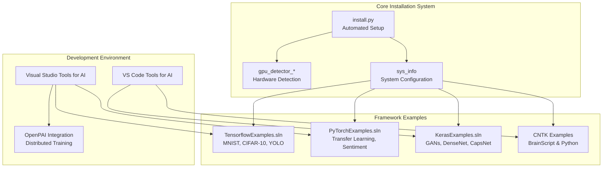

Sources: [installer/install.py:16-26](), [README.md:9-24](), [examples/README.md:3-13]()

## Prerequisites Summary

Before using the samples, ensure you have the following baseline requirements:

| Component | Requirement | Detection Function |
|-----------|-------------|-------------------|
| Operating System | 64-bit Windows 10, Linux, or macOS | `detect_os()` |
| Python | Version 3.5 or 3.6 | `detect_python_version()` |
| GPU (Optional) | NVIDIA GPU with CUDA support | `detect_gpu()` |
| CUDA | Version 8.0 or 9.0 (if GPU present) | `detect_cuda_()` |
| Development IDE | Visual Studio 2015/2017 or VS Code | `detect_vs()` |

The installation system automatically detects your hardware and software configuration through the `sys_info` dictionary in [installer/install.py:16-26]().

Sources: [installer/install.py:251-275](), [installer/install.py:315-332](), [installer/install.py:278-294](), [docs/prerequisites.md:20-24]()

## Quick Start Workflow

The typical workflow for getting started involves system detection, automated installation, and running your first example:

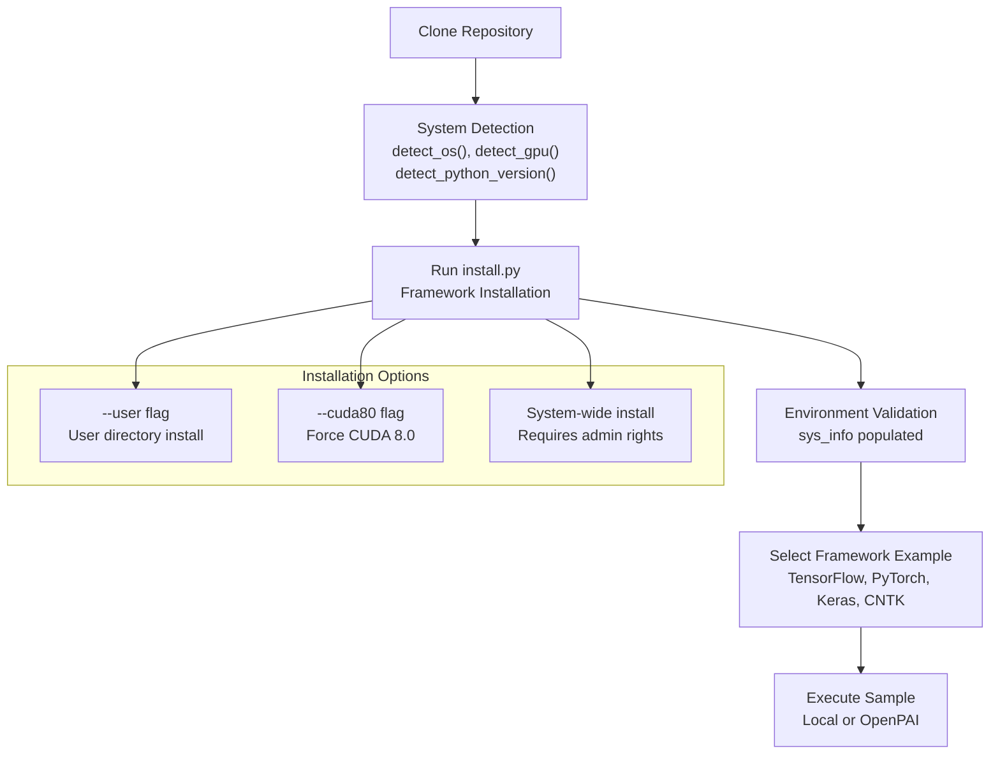

Sources: [docs/prerequisites.md:26-47](), [installer/install.py:119-141](), [installer/install.py:629-653]()

## Installation Process Overview

The automated installer ([installer/install.py]()) handles the complete setup process through several key phases:

### System Detection Phase
The installer first detects your system configuration using these functions:
- `detect_os()` - Determines platform (`TOOLSFORAI_OS_WIN`, `TOOLSFORAI_OS_LINUX`, `TOOLSFORAI_OS_MACOS`)
- `detect_gpu()` - Checks for NVIDIA GPU availability using platform-specific detectors
- `detect_python_version()` - Validates Python 3.5/3.6 installation
- `detect_cuda_()` - Identifies CUDA version if GPU is present

### Framework Installation Phase  
Based on the detected configuration, the installer installs appropriate frameworks:
- `pip_install_tensorflow()` - TensorFlow with GPU support if available
- `pip_install_pytorch()` - PyTorch with CUDA bindings
- `pip_install_keras()` - Keras with backend configuration
- `pip_install_cntk()` - Microsoft Cognitive Toolkit

### Environment Configuration
The installer updates system environment variables and validates the installation through the `sys_info` dictionary which tracks:
- OS platform and architecture
- GPU availability and CUDA version
- Installed framework versions
- Python environment details

Sources: [installer/install.py:251-275](), [installer/install.py:692-701](), [installer/install.py:704-725](), [installer/install.py:727-745]()

## Example Structure

Once installation is complete, you can access framework-specific examples organized in Visual Studio solution format:

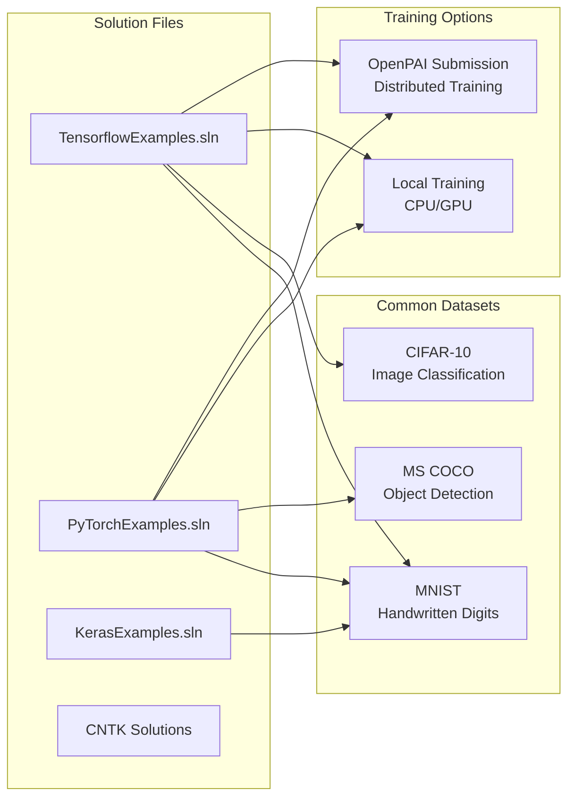

Sources: [examples/README.md:3-13](), [docs/local_run.md:5-12](), [docs/submit_job_to_pai.md:15-23]()

## Next Steps

After completing the basic setup:

1. **Environment Setup**: Follow the detailed installation guide in [Installation and Environment Setup](#2.1) to run the `install.py` script and configure your development environment.

2. **Development Tools**: Set up Visual Studio or VS Code integration using [Visual Studio and Development Tools](#2.2) for enhanced debugging and project management.

3. **Choose a Framework**: Explore the available examples in [Framework Examples](#3) to find implementations that match your learning objectives or project requirements.

4. **Data Preparation**: Review data download requirements in the framework-specific documentation, as most examples can automatically download datasets but some require manual setup.

5. **Run First Example**: Start with basic examples like MNIST digit recognition to validate your environment before moving to more complex projects.

The automated installer significantly simplifies the traditionally complex process of setting up multiple AI frameworks with proper GPU support and dependency management.

Sources: [README.md:26-38](), [docs/download_data.md:1-9](), [docs/local_run.md:1-17]()

---

# Page: Installation and Environment Setup

# Installation and Environment Setup

<details>
<summary>Relevant source files</summary>

The following files were used as context for generating this wiki page:

- [installer/gpu_detector_linux](installer/gpu_detector_linux)
- [installer/gpu_detector_mac](installer/gpu_detector_mac)
- [installer/gpu_detector_win.exe](installer/gpu_detector_win.exe)
- [installer/install.py](installer/install.py)

</details>


This document covers the automated installation and environment setup system for AI/ML frameworks provided by the samples-for-ai repository. The installer script provides one-click setup of multiple AI frameworks with automatic system detection, GPU configuration, and dependency management.

For information about specific framework examples after installation, see [Framework Examples](#3). For development tool integration, see [Visual Studio and Development Tools](#2.2).

## System Architecture Overview

The installation system is centered around a comprehensive Python script that detects system capabilities and installs appropriate AI framework versions based on the detected configuration.

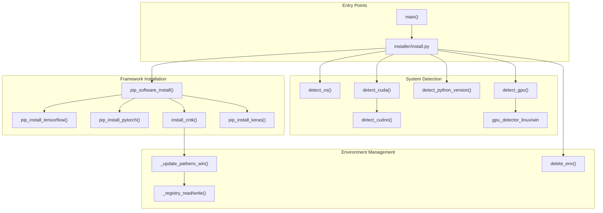

Sources: [installer/install.py:1019-1063](), [installer/install.py:251-275](), [installer/install.py:278-294]()

## System Information Detection

The installer performs comprehensive system detection to determine the appropriate framework versions and installation methods.

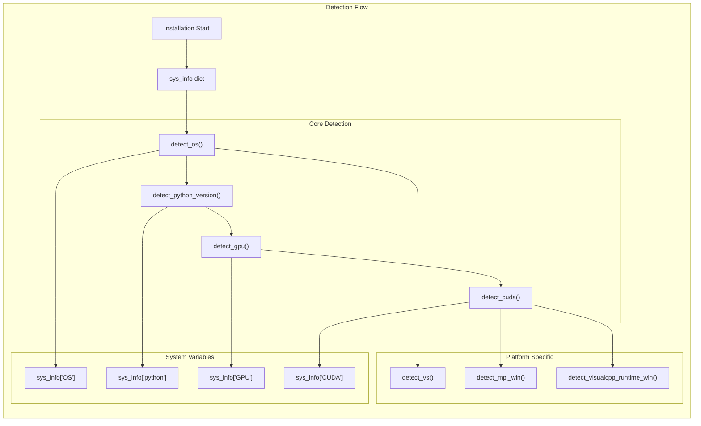

### System Requirements

| Component | Detection Function | Requirements |
|-----------|-------------------|--------------|
| Operating System | `detect_os()` | Windows 10, Linux, macOS (64-bit only) |
| Python Version | `detect_python_version()` | Python 3.5 or 3.6 (64-bit) |
| GPU Support | `detect_gpu()` | NVIDIA GPU (optional) |
| CUDA Toolkit | `detect_cuda()` | CUDA 8.0 or 9.0 |
| Development Tools | `detect_vs()` | Visual Studio 2015/2017 (Windows) |

Sources: [installer/install.py:251-275](), [installer/install.py:315-332](), [installer/install.py:278-294](), [installer/install.py:354-406]()

## Framework Installation Process

The installation system uses a modular approach where each framework has its own installation function with version-specific logic based on detected system capabilities.

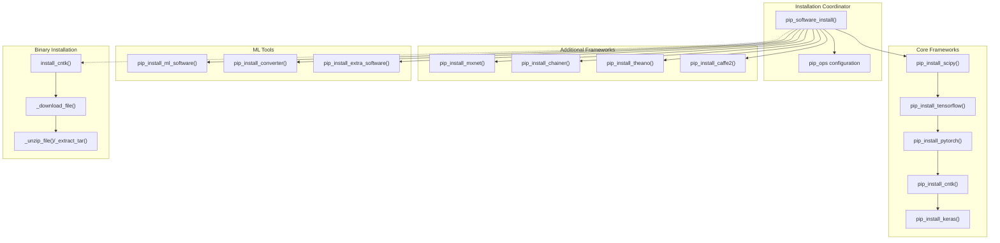

### Framework Version Selection Logic

The installer selects appropriate framework versions based on detected system configuration:

| Framework | Version Selection Logic | Code Location |
|-----------|------------------------|---------------|
| TensorFlow | CUDA 8.0: v1.4.0/1.4.1, CUDA 9.0: v1.5.0 | `pip_install_tensorflow()` |
| PyTorch | Platform-specific wheel URLs based on CUDA version | `pip_install_pytorch()` |
| CNTK | CUDA 8.0: v2.3.1, CUDA 9.0: v2.5.1 | `pip_install_cntk()`, `install_cntk()` |
| Keras | Fixed version 2.1.6 | `pip_install_keras()` |

Sources: [installer/install.py:692-701](), [installer/install.py:704-725](), [installer/install.py:727-745](), [installer/install.py:747-750]()

## GPU and CUDA Configuration

The system includes sophisticated GPU detection and CUDA configuration management to ensure framework compatibility.

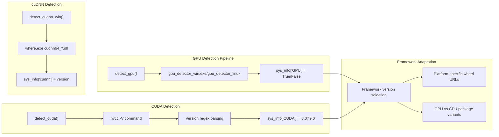

### CUDA Version Compatibility Matrix

| CUDA Version | TensorFlow | PyTorch | CNTK | Detection Method |
|--------------|------------|---------|------|------------------|
| 8.0 | 1.4.0/1.4.1 | cu80 wheels | 2.3.1 | `nvcc -V` regex |
| 9.0 | 1.5.0 | cu90 wheels | 2.5.1 | `nvcc -V` regex |
| None | CPU versions | CPU wheels | CPU version | Command execution check |

Sources: [installer/install.py:383-406](), [installer/install.py:408-427](), [installer/install.py:278-294]()

## Environment Configuration

The installer manages system environment variables and registry settings to ensure frameworks are properly configured post-installation.

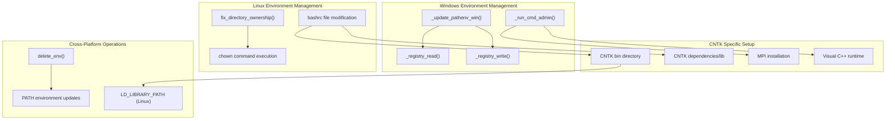

### Environment Variable Management

| Operation | Windows Implementation | Linux Implementation |
|-----------|----------------------|---------------------|
| PATH updates | Registry modification via `_update_pathenv_win()` | `.bashrc` file editing |
| Library paths | Registry HKEY_CURRENT_USER | `LD_LIBRARY_PATH` export |
| Permissions | Admin command execution | `chown` with real user detection |
| Cleanup | `delete_env()` registry deletion | File-based removal |

Sources: [installer/install.py:231-243](), [installer/install.py:557-576](), [installer/install.py:981-1007](), [installer/install.py:620-627]()

## Error Handling and Recovery

The installation system includes comprehensive error handling with detailed logging and recovery mechanisms.

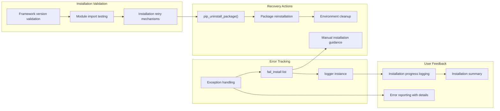

### Error Categories and Handling

| Error Type | Detection Method | Recovery Action | Code Location |
|------------|-----------------|-----------------|---------------|
| Package installation failure | `pip` return codes | Add to `fail_install` list | `pip_install_package()` |
| System detection failure | Command execution status | Warning logs, continue | `detect_*()` functions |
| Environment setup failure | Registry/file operation status | Admin retry, manual instructions | `_run_cmd_admin()` |
| Dependency conflicts | Import testing | Uninstall/reinstall cycle | `pip_uninstall_package()` |

Sources: [installer/install.py:629-653](), [installer/install.py:656-673](), [installer/install.py:56-66](), [installer/install.py:1054-1059]()

## Installation Command Line Interface

The installer provides several command-line options for customizing the installation process:

| Option | Description | Implementation |
|--------|-------------|----------------|
| `--verbose` | Enable debug logging | Sets logger to DEBUG level |
| `--user` | Install to user directory | Adds `--user` to pip options |
| `--cuda80` | Force CUDA 8.0 packages | Sets `sys_info["cuda80"] = True` |
| `--options` | Custom pip options | Overrides default pip parameters |

The main installation flow begins with argument parsing and system detection, followed by parallel CNTK installation and sequential pip package installation.

Sources: [installer/install.py:1019-1030](), [installer/install.py:1048-1053](), [installer/install.py:955-978]()

---

# Page: Visual Studio and Development Tools

# Visual Studio and Development Tools

<details>
<summary>Relevant source files</summary>

The following files were used as context for generating this wiki page:

- [README.md](README.md)
- [docs/download_data.md](docs/download_data.md)
- [docs/local_run.md](docs/local_run.md)
- [docs/prerequisites.md](docs/prerequisites.md)
- [docs/submit_job_to_pai.md](docs/submit_job_to_pai.md)
- [examples/README.md](examples/README.md)
- [examples/resourcePanel.vscode.json](examples/resourcePanel.vscode.json)
- [examples/resourcePanel.vscode.zh-cn.json](examples/resourcePanel.vscode.zh-cn.json)
- [projects/StyleTransfer/StyleTransferTraining/src/README.md](projects/StyleTransfer/StyleTransferTraining/src/README.md)
- [zh-hans/README.md](zh-hans/README.md)
- [zh-hant/README.md](zh-hant/README.md)

</details>


This document covers the setup and usage of Microsoft's AI development tools, specifically Visual Studio Tools for AI and VS Code Tools for AI. These IDEs provide integrated environments for developing, debugging, and deploying AI models across multiple frameworks. For information about the automated framework installation process, see [Installation and Environment Setup](#2.1). For details about OpenPAI distributed training capabilities, see [OpenPAI Integration](#5.2).

## Visual Studio Tools for AI

### Installation and Prerequisites

Visual Studio Tools for AI requires Microsoft Visual Studio 2017 or 2015 as the base IDE. The extension provides comprehensive support for AI development workflows including local debugging, remote training, and cloud deployment.

| Requirement | Version | Purpose |
|-------------|---------|---------|
| Visual Studio | 2017 or 2015 | Base IDE platform |
| Python | 3.5 or 3.6 | Runtime for AI frameworks |
| NVIDIA GPU Driver | Latest | GPU acceleration (optional) |
| CUDA | 9.0 or 8.0 | GPU compute platform |

The installation process involves installing the base Visual Studio IDE followed by the AI Tools extension. The extension integrates with the one-click installer system to automatically configure AI frameworks and dependencies.

**Sources:** [README.md:9-10](), [docs/prerequisites.md:5-7](), [examples/README.md:34-35]()

### Solution Structure and Framework Organization

Visual Studio Tools for AI organizes AI projects using a solution-based structure where each framework has its own solution file containing multiple related projects. This approach provides clear separation between different AI frameworks while maintaining a consistent development experience.

```mermaid
graph TB
    subgraph "Visual Studio Solutions"
        TF_SLN["TensorflowExamples.sln"]
        PYTORCH_SLN["PyTorchExamples.sln"] 
        KERAS_SLN["KerasExamples.sln"]
        CNTK_SLN["CNTKExamples.sln"]
    end
    
    subgraph "TensorFlow Projects"
        TF_MNIST["MNIST Classification"]
        TF_CIFAR["CIFAR-10 Classification"]
        TF_YOLO["YOLO Object Detection"]
        TF_MEMN2N["MemN2N Memory Networks"]
    end
    
    subgraph "PyTorch Projects"
        PT_MNIST["MNIST Classification"]
        PT_CIFAR["CIFAR-10 Classification"]
        PT_TRANSFER["Transfer Learning"]
        PT_SCREENER["ScreenerNet"]
    end
    
    subgraph "Project Types"
        PYTHON_PROJ["Python Projects"]
        BRAINSCRIPT_PROJ["BrainScript Projects"]
    end
    
    TF_SLN --> TF_MNIST
    TF_SLN --> TF_CIFAR
    TF_SLN --> TF_YOLO
    TF_SLN --> TF_MEMN2N
    
    PYTORCH_SLN --> PT_MNIST
    PYTORCH_SLN --> PT_CIFAR
    PYTORCH_SLN --> PT_TRANSFER
    PYTORCH_SLN --> PT_SCREENER
    
    KERAS_SLN --> PYTHON_PROJ
    CNTK_SLN --> PYTHON_PROJ
    CNTK_SLN --> BRAINSCRIPT_PROJ
```

**Sources:** [README.md:15-23](), [examples/README.md:5-13]()

### Development Workflow and Execution

The Visual Studio Tools for AI development workflow supports both local execution and remote job submission. The IDE provides specialized execution contexts for different project types, particularly distinguishing between Python-based projects and CNTK BrainScript projects.

For **Python Projects**:
- Set the startup file in the project
- Use "Start without Debugging" or "Start with Debugging" context menus
- Automatic environment detection and framework loading

For **CNTK BrainScript Projects**:
- Set the project as "Startup Project"  
- Set the script as "Startup File"
- Use "Run CNTK Brain Script" command

The IDE integrates with the automatic installer system to ensure all dependencies are properly configured before execution.

**Sources:** [examples/README.md:75-77](), [docs/local_run.md:5-12]()

## VS Code Tools for AI

### Installation and Configuration

VS Code Tools for AI provides a lightweight alternative to Visual Studio with specialized AI development features. The extension integrates resource discovery, project management, and remote execution capabilities directly into the VS Code environment.

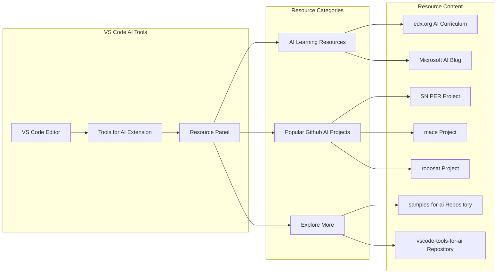

**Sources:** [examples/resourcePanel.vscode.json:1-52](), [docs/submit_job_to_pai.md:28-29]()

### Resource Panel Integration

The VS Code Tools for AI includes a comprehensive resource panel system that provides curated learning materials and project references. The resource panel is configured through JSON files that define categories and external links.

The resource panel structure includes:

| Category | Purpose | Example Resources |
|----------|---------|-------------------|
| AI Learning Resources | Educational content and courses | Microsoft AI curriculum, AI blogs |
| Popular Github AI Projects | Trending open-source AI projects | SNIPER, mace, robosat |
| Explore More | Additional tools and samples | samples-for-ai, vscode-tools-for-ai |

The system supports localization with separate configuration files for different languages, such as Chinese (`resourcePanel.vscode.zh-cn.json`).

**Sources:** [examples/resourcePanel.vscode.json:3-51](), [examples/resourcePanel.vscode.zh-cn.json:3-51]()

## OpenPAI Integration and Job Submission

Both Visual Studio Tools for AI and VS Code Tools for AI provide integrated support for submitting jobs to Microsoft's OpenPAI platform for distributed training. This integration allows seamless transition from local development to cloud-scale training.

### Job Submission Workflow

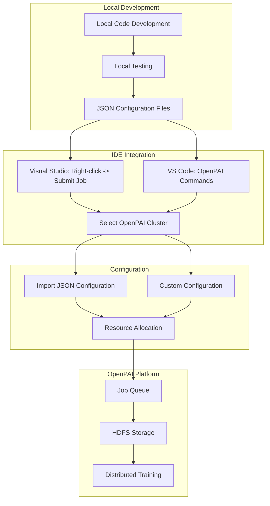

**Sources:** [docs/submit_job_to_pai.md:15-23](), [docs/submit_job_to_pai.md:32]()

### Configuration Management

Each sample project includes pre-configured JSON files for OpenPAI job submission. These files follow the naming convention `framework_name.sample_name.json` and contain:

- Resource requirements (CPU, memory, GPU)
- Docker image specifications
- Code and data paths on HDFS
- Framework-specific parameters

The IDE tools provide both import functionality for these pre-configured files and manual configuration options for custom setups.

**Sources:** [docs/submit_job_to_pai.md:51](), [docs/submit_job_to_pai.md:19-21]()

## Local Development Features

### Environment Detection and Setup

Both IDE tools integrate with the automated installer system to provide seamless environment setup. The tools can detect:

- Available GPU hardware and drivers
- Installed Python versions and packages  
- Framework installations and compatibility
- CUDA toolkit versions

This integration ensures that the development environment matches the requirements for the selected AI frameworks and samples.

**Sources:** [docs/prerequisites.md:11-14](), [examples/README.md:40-43]()

### Debugging and Execution Support

The IDE tools provide comprehensive debugging support for AI workloads including:

- **Breakpoint debugging** for Python-based models
- **Variable inspection** during training loops
- **GPU memory monitoring** and profiling
- **Tensorboard integration** for visualization
- **Framework-specific tooling** (CNTK BrainScript execution, TensorFlow graph visualization)

The execution environment automatically handles framework initialization, GPU detection, and dependency loading to provide a seamless development experience.

**Sources:** [docs/local_run.md:10-12](), [examples/README.md:75-77]()

---

# Page: Framework Examples

# Framework Examples

<details>
<summary>Relevant source files</summary>

The following files were used as context for generating this wiki page:

- [examples/cntk/brainscript/README.md](examples/cntk/brainscript/README.md)
- [examples/cntk/python/NumpyExperiment/README.md](examples/cntk/python/NumpyExperiment/README.md)
- [examples/cntk/python/README.md](examples/cntk/python/README.md)
- [examples/keras/README.md](examples/keras/README.md)
- [examples/projects_description.json](examples/projects_description.json)
- [examples/projects_description_with_frameworks.json](examples/projects_description_with_frameworks.json)
- [examples/pytorch/README.md](examples/pytorch/README.md)
- [examples/tensorflow/README.md](examples/tensorflow/README.md)
- [projects/description.json](projects/description.json)

</details>


This document covers the framework-specific AI/ML example collections available in the samples-for-ai repository and provides guidance on selecting appropriate frameworks for different use cases. The examples demonstrate common machine learning tasks implemented across multiple deep learning frameworks to facilitate comparative learning and framework evaluation.

For information about installation and environment setup, see [Installation and Environment Setup](#2.1). For specialized applications and production-ready projects, see [Specialized Projects](#4).

## Supported Frameworks Overview

The repository provides comprehensive examples across eight major deep learning frameworks, organized in framework-specific directories under `examples/`. Each framework includes implementations of common benchmarks and specialized models to demonstrate framework capabilities and programming patterns.

### Framework Categories and Capabilities

```mermaid
graph TB
    subgraph "Primary_Frameworks"
        TF[TensorFlow<br/>"examples/tensorflow/"]
        PT[PyTorch<br/>"examples/pytorch/"]
        KR[Keras<br/>"examples/keras/"]
        CNTK[CNTK<br/>"examples/cntk/"]
    end
    
    subgraph "Additional_Frameworks"
        MX[MXNet<br/>"examples/mxnet/"]
        C2[Caffe2<br/>"examples/caffe2/"]
        TH[Theano<br/>"examples/theano/"]
        CH[Chainer<br/>"examples/chainer/"]
    end
    
    subgraph "Common_Tasks"
        MNIST["MNIST Digit Recognition"]
        CIFAR["CIFAR-10 Image Classification"]
        NLP["Natural Language Processing"]
        GAN["Generative Models"]
        OBJ["Object Detection"]
    end
    
    TF --> MNIST
    TF --> CIFAR
    TF --> NLP
    TF --> OBJ
    
    PT --> MNIST
    PT --> CIFAR
    PT --> NLP
    
    KR --> CIFAR
    KR --> GAN
    
    CNTK --> MNIST
    CNTK --> CIFAR
    CNTK --> NLP
```

**Framework Distribution by Example Count:**

| Framework | Example Projects | Specialization |
|-----------|------------------|----------------|
| TensorFlow | 8 projects | Comprehensive coverage, advanced models |
| Keras | 8 projects | Generative models, high-level APIs |
| CNTK | 9 projects | Speech processing, language modeling |
| PyTorch | 6 projects | Research models, transfer learning |
| Others | 4 projects | Basic implementations |

Sources: [examples/projects_description_with_frameworks.json:1-700](), [examples/tensorflow/README.md:1-95](), [examples/pytorch/README.md:1-63](), [examples/keras/README.md:1-74]()

## Common Example Patterns

### Standard Benchmark Implementations

Most frameworks implement a consistent set of benchmark tasks, enabling direct comparison of framework APIs and performance characteristics. The core examples follow standardized patterns for data loading, model definition, training loops, and evaluation.

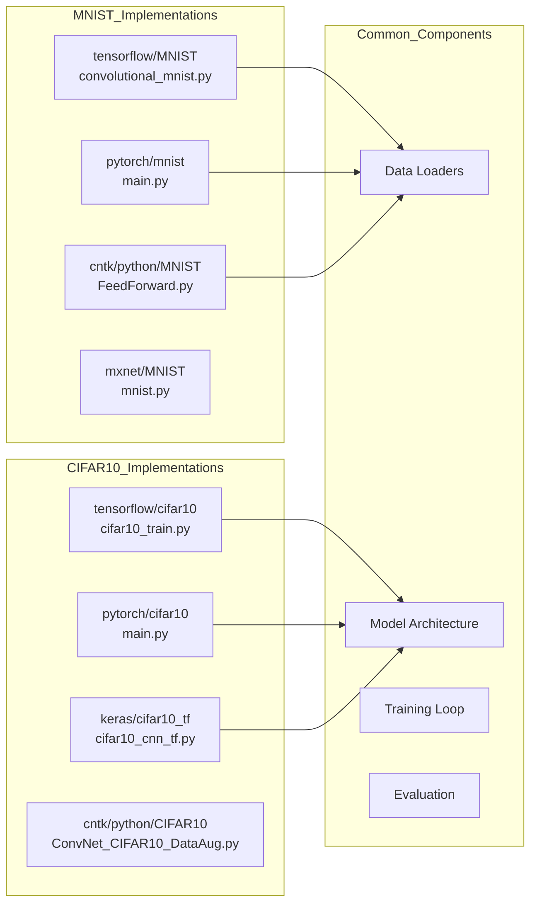

**Standard Dataset Integration:**
- **MNIST**: 60,000 training examples, 10,000 test examples for handwritten digit recognition
- **CIFAR-10**: 50,000 training images across 10 classes for image classification benchmarking
- **ImageNet**: Pre-trained model inference and transfer learning demonstrations
- **Penn TreeBank**: Language modeling and sequence prediction tasks

Sources: [examples/tensorflow/README.md:9-24](), [examples/pytorch/README.md:21-34](), [examples/projects_description_with_frameworks.json:16-48]()

### Advanced Model Architectures

The repository includes implementations of cutting-edge research models demonstrating advanced techniques across different domains.

**TensorFlow Advanced Models:**
- **MemN2N**: End-to-End Memory Networks for language modeling using Penn TreeBank dataset
- **NTM**: Neural Turing Machine with LSTM controller supporting multiple read/write heads
- **YOLO**: Real-time object detection system trained on Pascal VOC 2007 data
- **DCGAN**: Deep Convolutional Generative Adversarial Networks for image generation

**PyTorch Research Implementations:**
- **ScreenerNet**: Self-paced curriculum learning architecture for improved training efficiency
- **Image Captioning**: CNN-LSTM system for generating natural language descriptions of images
- **Transfer Learning**: ResNet-based transfer learning from ImageNet to CIFAR-10

**Keras Generative Models:**
- **DCGAN, ACGAN, InfoGAN, WGAN**: Comprehensive GAN implementation suite
- **CapsuleNet**: Dynamic routing between capsules for advanced feature learning
- **DenseNet**: Densely connected convolutional networks with bottleneck compression

Sources: [examples/tensorflow/README.md:49-67](), [examples/pytorch/README.md:9-34](), [examples/keras/README.md:18-44]()

## Framework Organization Structure

### Visual Studio Solution Architecture

Each framework organizes its examples within Visual Studio solution files (`.sln`) that provide integrated development and debugging capabilities through VS Tools for AI.

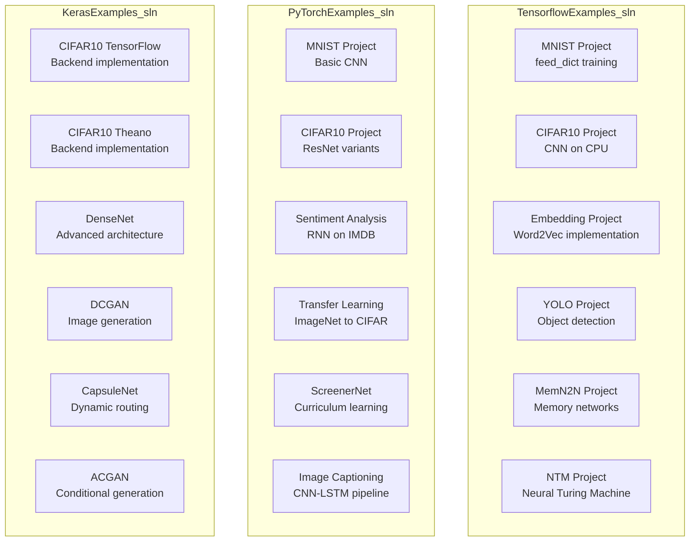

**Project Structure Conventions:**
- Each project contains a `README.md` with implementation details and references
- Training scripts follow naming patterns: `main.py`, `train.py`, or framework-specific conventions
- Data preprocessing and model definition are typically separated into distinct modules
- Configuration files specify hyperparameters and training settings

Sources: [examples/tensorflow/README.md:69-78](), [examples/pytorch/README.md:41-49](), [examples/keras/README.md:46-54]()

### CNTK Dual Implementation Strategy

CNTK provides examples in two distinct programming paradigms to demonstrate different levels of abstraction and control.

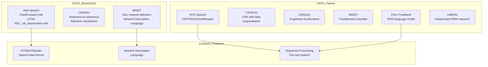

Sources: [examples/cntk/brainscript/README.md:1-34](), [examples/cntk/python/README.md:1-55]()

## Project Discovery and Metadata System

### Structured Project Catalog

The repository implements a comprehensive metadata system for project discovery and categorization through JSON configuration files that enable programmatic access to example information.

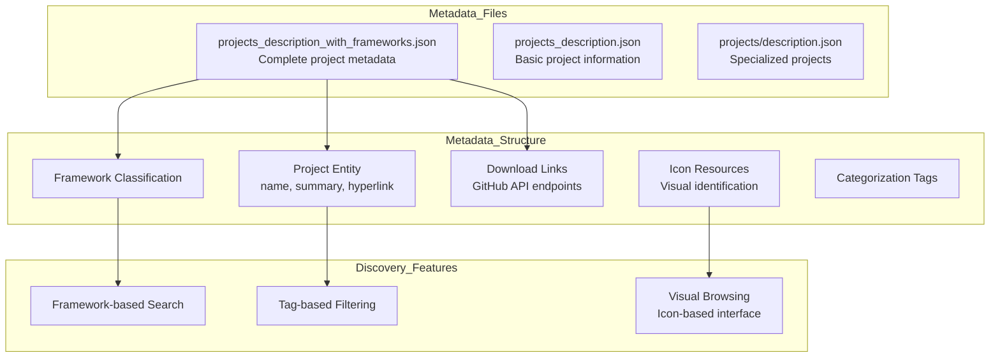

**Metadata Schema Structure:**
```json
{
  "framework": "TensorFlow|PyTorch|Keras|CNTK-Python|CNTK-BrainScript",
  "entity": {
    "name": "Example display name",
    "summary": "Detailed description with technical context",
    "hyperlink": {
      "address": "GitHub directory path",
      "service_type": "GitHub"
    },
    "download_link": "GitHub API content endpoint",
    "image_url": "Icon resource path",
    "entity_type": "Training Project|Inference Project"
  }
}
```

Sources: [examples/projects_description_with_frameworks.json:1-50](), [examples/projects_description.json:1-30](), [projects/description.json:1-20]()

### Framework-Specific Example Categories

The metadata system categorizes examples by framework capabilities and intended use cases, enabling targeted discovery of relevant implementations.

| Framework Category | Example Count | Primary Focus Areas |
|-------------------|---------------|-------------------|
| TensorFlow | 6 core examples | Production deployment, advanced models |
| PyTorch | 6 research examples | Research prototyping, experimental architectures |
| CNTK-Python | 6 examples | Speech/NLP processing, enterprise scenarios |
| CNTK-BrainScript | 3 examples | High-performance training, declarative definitions |
| Keras | 8 examples | Generative models, rapid prototyping |
| Additional Frameworks | 4 examples | Framework comparison, migration examples |

**Discovery Integration Points:**
- VS Code resource panels display categorized examples with visual icons
- GitHub API endpoints enable automated project synchronization
- Tag-based filtering supports skill-level and domain-specific discovery
- Framework classification enables comparative analysis workflows

Sources: [examples/projects_description_with_frameworks.json:130-256](), [examples/projects_description_with_frameworks.json:324-447](), [examples/projects_description_with_frameworks.json:476-639]()

## Getting Started with Framework Examples

### Example Selection Strategy

Choose frameworks based on your specific requirements and experience level. The examples are designed to demonstrate equivalent functionality across frameworks, enabling direct comparison of programming approaches and performance characteristics.

**Recommended Starting Points:**
- **Beginners**: Start with Keras CIFAR-10 examples for high-level API familiarity
- **Researchers**: Explore PyTorch implementations for flexible experimentation
- **Production**: Examine TensorFlow examples for deployment-ready patterns
- **Speech/NLP**: Focus on CNTK examples for specialized domain applications

**Cross-Framework Learning Path:**
1. Implement MNIST across 2-3 frameworks to understand API differences
2. Compare CIFAR-10 implementations to see architecture variations
3. Explore advanced models in your preferred framework
4. Study specialized examples relevant to your domain

Each framework directory contains a comprehensive `README.md` with setup instructions, project descriptions, and execution guidance specific to that framework's development workflow.

Sources: [examples/tensorflow/README.md:69-78](), [examples/pytorch/README.md:41-49](), [examples/keras/README.md:46-54](), [examples/cntk/python/README.md:37-46]()

---

# Page: TensorFlow Examples

# TensorFlow Examples

<details>
<summary>Relevant source files</summary>

The following files were used as context for generating this wiki page:

- [examples/cntk/brainscript/README.md](examples/cntk/brainscript/README.md)
- [examples/cntk/python/NumpyExperiment/README.md](examples/cntk/python/NumpyExperiment/README.md)
- [examples/cntk/python/README.md](examples/cntk/python/README.md)
- [examples/keras/README.md](examples/keras/README.md)
- [examples/pytorch/README.md](examples/pytorch/README.md)
- [examples/tensorflow/MemN2N/MemN2N.pyproj](examples/tensorflow/MemN2N/MemN2N.pyproj)
- [examples/tensorflow/MemN2N/data.py](examples/tensorflow/MemN2N/data.py)
- [examples/tensorflow/MemN2N/main.py](examples/tensorflow/MemN2N/main.py)
- [examples/tensorflow/MemN2N/tensorflow.memn2n.json](examples/tensorflow/MemN2N/tensorflow.memn2n.json)
- [examples/tensorflow/NTM/NTM.pyproj](examples/tensorflow/NTM/NTM.pyproj)
- [examples/tensorflow/NTM/copydata.sh](examples/tensorflow/NTM/copydata.sh)
- [examples/tensorflow/NTM/main.py](examples/tensorflow/NTM/main.py)
- [examples/tensorflow/NTM/ntm.py](examples/tensorflow/NTM/ntm.py)
- [examples/tensorflow/NTM/tasks/copy.py](examples/tensorflow/NTM/tasks/copy.py)
- [examples/tensorflow/NTM/tensorflow.ntm.json](examples/tensorflow/NTM/tensorflow.ntm.json)
- [examples/tensorflow/README.md](examples/tensorflow/README.md)
- [examples/tensorflow/TensorflowExamples.sln](examples/tensorflow/TensorflowExamples.sln)
- [examples/tensorflow/yolo_tensorflow/yolo_tensorflow.pyproj](examples/tensorflow/yolo_tensorflow/yolo_tensorflow.pyproj)

</details>


This document covers the comprehensive collection of TensorFlow examples in the samples-for-ai repository, focusing on practical implementations of machine learning models ranging from basic neural networks to advanced architectures like Memory Networks and YOLO object detection. The examples are organized as Visual Studio projects with integrated OpenPAI support for distributed training.

For PyTorch implementations of similar algorithms, see [PyTorch Examples](#3.2). For Keras-based examples including GANs, see [Keras Examples](#3.3).

## Overview and Architecture

The TensorFlow examples are organized in a Visual Studio solution structure that includes eight core projects covering fundamental machine learning tasks, computer vision applications, and advanced neural architectures. Each project demonstrates different aspects of TensorFlow development from basic feed-forward networks to complex memory-augmented models.

```mermaid
graph TB
    subgraph "TensorflowExamples.sln"
        MNIST["MNIST.pyproj<br/>Handwritten Digits"]
        CIFAR10["cifar10.pyproj<br/>Image Classification"]
        IMAGENET["imagenet.pyproj<br/>Inception Model"]
        EMBEDDING["embedding.pyproj<br/>Word2Vec"]
        MEMN2N["MemN2N.pyproj<br/>Memory Networks"]
        NTM["NTM.pyproj<br/>Neural Turing Machine"]
        YOLO["yolo_tensorflow.pyproj<br/>Object Detection"]
    end
    
    subgraph "Core Datasets"
        MNIST_DATA["MNIST Dataset<br/>60k train, 10k test"]
        CIFAR_DATA["CIFAR-10 Dataset<br/>Image recognition benchmark"]
        IMAGENET_DATA["ImageNet<br/>Pre-trained Inception"]
        TEXT8["text8.zip<br/>Wikipedia corpus"]
        PTB["Penn Tree Bank<br/>Language modeling"]
        PASCAL["Pascal VOC 2007<br/>Object detection"]
    end
    
    subgraph "OpenPAI Integration"
        MEMN2N_JSON["tensorflow.memn2n.json<br/>Distributed training config"]
        NTM_JSON["tensorflow.ntm.json<br/>Cluster job definition"]
    end
    
    MNIST --> MNIST_DATA
    CIFAR10 --> CIFAR_DATA
    IMAGENET --> IMAGENET_DATA
    EMBEDDING --> TEXT8
    MEMN2N --> PTB
    NTM --> PASCAL
    YOLO --> PASCAL
    
    MEMN2N --> MEMN2N_JSON
    NTM --> NTM_JSON
```

Sources: [examples/tensorflow/README.md:1-95](), [examples/tensorflow/TensorflowExamples.sln:1-47]()

## Project Categories and Implementation Structure

The TensorFlow examples are organized into three main categories based on complexity and application domain:

| Category | Projects | Key Features |
|----------|----------|--------------|
| **Basic Models** | MNIST, cifar10 | Feed-forward networks, CNNs, standard datasets |
| **Advanced Architectures** | MemN2N, NTM | Memory-augmented networks, external memory access |
| **Computer Vision** | imagenet, yolo_tensorflow, DCGAN | Pre-trained models, object detection, generative models |
| **NLP/Embeddings** | embedding | Word2Vec, text processing, vector representations |

### Core Implementation Components

```mermaid
graph LR
    subgraph "MemN2N Implementation"
        MEMN2N_MAIN["main.py<br/>Training loop & config"]
        MEMN2N_DATA["data.py<br/>PTB data loading"]
        MEMN2N_MODEL["model.py<br/>Memory network architecture"]
    end
    
    subgraph "NTM Implementation"
        NTM_MAIN["main.py<br/>Task management"]
        NTM_CORE["ntm.py<br/>NTM model class"]
        NTM_CELL["ntm_cell.py<br/>Memory cell implementation"]
        COPY_TASK["tasks/copy.py<br/>Copy task definition"]
        RECALL_TASK["tasks/recall.py<br/>Recall task definition"]
    end
    
    subgraph "YOLO Implementation"
        YOLO_TRAIN["train.py<br/>Training pipeline"]
        YOLO_TEST["test.py<br/>Inference & evaluation"]
        YOLO_CONFIG["config.py<br/>Model configuration"]
        YOLO_NET["yolo_net/yolo_v1.py<br/>YOLO architecture"]
        DATA_PROVIDER["provider/data_provider.py<br/>Dataset management"]
    end
    
    MEMN2N_MAIN --> MEMN2N_DATA
    MEMN2N_MAIN --> MEMN2N_MODEL
    
    NTM_MAIN --> NTM_CORE
    NTM_CORE --> NTM_CELL
    NTM_MAIN --> COPY_TASK
    NTM_MAIN --> RECALL_TASK
    
    YOLO_TRAIN --> YOLO_CONFIG
    YOLO_TRAIN --> YOLO_NET
    YOLO_TRAIN --> DATA_PROVIDER
    YOLO_TEST --> YOLO_NET
```

Sources: [examples/tensorflow/MemN2N/main.py:1-67](), [examples/tensorflow/NTM/main.py:1-108](), [examples/tensorflow/yolo_tensorflow/yolo_tensorflow.pyproj:1-41]()

## Advanced Model Implementations

### Memory Networks (MemN2N)

The MemN2N implementation provides an End-to-End Memory Network for language modeling using the Penn Tree Bank dataset. The `MemN2N` class in [examples/tensorflow/MemN2N/model.py]() implements the core memory network architecture with configurable parameters for memory size, number of hops, and embedding dimensions.

Key configuration parameters from [examples/tensorflow/MemN2N/main.py:13-28]():
- `edim`: Internal state dimension (150)
- `nhop`: Number of memory hops (6) 
- `mem_size`: Memory size (100)
- `batch_size`: Training batch size (128)

The data loading pipeline in [examples/tensorflow/MemN2N/data.py:26-58]() handles PTB text processing, building word vocabularies, and converting text to index sequences.

### Neural Turing Machine (NTM)

The NTM implementation features a complete Neural Turing Machine with LSTM controller and external memory. The `NTMCell` class provides the core memory access mechanisms, while the `NTM` class in [examples/tensorflow/NTM/ntm.py:18-280]() manages training and inference.

The implementation supports multiple tasks through the task system:
- Copy task: [examples/tensorflow/NTM/tasks/copy.py:12-110]()
- Recall task: [examples/tensorflow/NTM/tasks/recall.py]()

Key NTM parameters from [examples/tensorflow/NTM/main.py:16-26]():
- `controller_dim`: LSTM controller dimension (100)
- `write_head_size`: Number of write heads (1)
- `read_head_size`: Number of read heads (1)
- `test_max_length`: Maximum test sequence length (120)

Sources: [examples/tensorflow/MemN2N/main.py:36-64](), [examples/tensorflow/NTM/ntm.py:18-84](), [examples/tensorflow/NTM/tasks/copy.py:58-104]()

## OpenPAI Distributed Training Integration

The TensorFlow examples include built-in support for Microsoft's OpenPAI platform through JSON configuration files that define distributed training jobs.

### MemN2N OpenPAI Configuration

The [examples/tensorflow/MemN2N/tensorflow.memn2n.json:1-22]() file defines a distributed training job with:
- Docker image: `openpai/pai.example.tensorflow`
- Resource allocation: 8 CPUs, 32GB memory
- Command: `pip --quiet install future && cd code && python main.py`

### NTM OpenPAI Configuration  

The [examples/tensorflow/NTM/tensorflow.ntm.json:1-22]() configuration includes:
- Data copying via `copydata.sh` script
- Resource requirements: 1 CPU, 32GB memory
- Command pipeline: `chmod +x code/copydata.sh && ./code/copydata.sh $PAI_DATA_DIR && cd code && python main.py`

```mermaid
graph TB
    subgraph "Local Development"
        VS["Visual Studio<br/>TensorflowExamples.sln"]
        PYTHON_FILES["Python Scripts<br/>main.py, model.py"]
    end
    
    subgraph "OpenPAI Cluster"
        PAI_JOB["OpenPAI Job<br/>tensorflow-memn2n"]
        DOCKER["Docker Container<br/>openpai/pai.example.tensorflow"]
        HDFS_DATA["HDFS Storage<br/>$PAI_DEFAULT_FS_URI/tutorial"]
    end
    
    subgraph "Data Flow"
        LOCAL_DATA["Local Data<br/>ptb.train.txt"]
        HDFS_INPUT["HDFS Input<br/>/tutorial/memn2n/data"]
        HDFS_OUTPUT["HDFS Output<br/>/tutorial/memn2n/output"]
    end
    
    VS --> PAI_JOB
    PYTHON_FILES --> DOCKER
    LOCAL_DATA --> HDFS_INPUT
    PAI_JOB --> DOCKER
    DOCKER --> HDFS_DATA
    HDFS_INPUT --> HDFS_OUTPUT
```

Sources: [examples/tensorflow/MemN2N/tensorflow.memn2n.json:1-22](), [examples/tensorflow/NTM/tensorflow.ntm.json:1-22](), [examples/tensorflow/NTM/copydata.sh:1-2]()

## Running the Examples

### Visual Studio Workflow

1. Open [examples/tensorflow/TensorflowExamples.sln:1-47]()
2. Set target project as "Startup Project" 
3. Configure startup file (e.g., `main.py`)
4. Execute via "Start without Debugging"

### Command Line Execution

For MemN2N training:
```bash
cd examples/tensorflow/MemN2N
python main.py --data_name ptb --nepoch 100 --batch_size 128
```

For NTM copy task:
```bash
cd examples/tensorflow/NTM  
python main.py --task copy --is_train True --epoch 100000
```

### Project Contributors

The advanced models include contributions from university students:

| Project | Contributors | Institution |
|---------|-------------|-------------|
| MemN2N, NTM | Tian-You Gao, Xiang Li | Nanjing University of Aeronautics and Astronautics |
| DCGAN | pr0crustes | - |
| yolo-tensorflow | Wayfear | - |

Sources: [examples/tensorflow/README.md:69-95](), [examples/tensorflow/MemN2N/main.py:1-67](), [examples/tensorflow/NTM/main.py:75-108]()

---

# Page: Basic TensorFlow Models

# Basic TensorFlow Models

<details>
<summary>Relevant source files</summary>

The following files were used as context for generating this wiki page:

- [examples/cntk/brainscript/README.md](examples/cntk/brainscript/README.md)
- [examples/cntk/python/NumpyExperiment/README.md](examples/cntk/python/NumpyExperiment/README.md)
- [examples/cntk/python/README.md](examples/cntk/python/README.md)
- [examples/keras/README.md](examples/keras/README.md)
- [examples/pytorch/README.md](examples/pytorch/README.md)
- [examples/tensorflow/MNIST/MNIST.pyproj](examples/tensorflow/MNIST/MNIST.pyproj)
- [examples/tensorflow/MNIST/mnist.py](examples/tensorflow/MNIST/mnist.py)
- [examples/tensorflow/README.md](examples/tensorflow/README.md)

</details>


## Purpose and Scope

This document covers the basic TensorFlow model implementations in the samples-for-ai repository, specifically focusing on MNIST digit recognition and CIFAR-10 image classification examples. These implementations serve as foundational examples for learning TensorFlow's core concepts including model definition, training loops, and model persistence.

For advanced TensorFlow models like memory networks and object detection, see [Advanced Models (MemN2N, NTM)](#3.1.3) and [Object Detection with YOLO](#3.1.2).

## Model Overview

The basic TensorFlow examples demonstrate two fundamental computer vision tasks using convolutional neural networks:

| Model | Dataset | Task | Architecture | Input Size | Classes |
|-------|---------|------|--------------|------------|---------|
| MNIST CNN | MNIST | Digit Recognition | LeNet-5-like CNN | 28x28x1 | 10 |
| CIFAR-10 CNN | CIFAR-10 | Image Classification | Multi-layer CNN | 32x32x3 | 10 |

Sources: [examples/tensorflow/README.md:1-95]()

## MNIST Model Architecture

### Model Definition

The MNIST implementation uses a LeNet-5-inspired architecture defined in the `model` function. The network consists of two convolutional layers followed by two fully connected layers:

```mermaid
graph TD
    input["Input Image<br/>28x28x1"] --> conv1["Conv1<br/>5x5 filters, 32 depth"]
    conv1 --> relu1["ReLU + MaxPool<br/>2x2 stride"]
    relu1 --> conv2["Conv2<br/>5x5 filters, 64 depth"] 
    conv2 --> relu2["ReLU + MaxPool<br/>2x2 stride"]
    relu2 --> reshape["Reshape<br/>7x7x64 -> 3136"]
    reshape --> fc1["FC1<br/>3136 -> 512"]
    fc1 --> dropout["Dropout (0.5)<br/>Training only"]
    dropout --> fc2["FC2<br/>512 -> 10"]
    fc2 --> output["Output Logits<br/>10 classes"]
```

### Key Model Components

The model implementation defines several critical variables and operations:

- **Convolutional Layers**: `conv1_weights`, `conv1_biases`, `conv2_weights`, `conv2_biases`
- **Fully Connected Layers**: `fc1_weights`, `fc1_biases`, `fc2_weights`, `fc2_biases`  
- **Model Function**: `model(data, train=False)` with conditional dropout
- **Loss Function**: `tf.nn.sparse_softmax_cross_entropy_with_logits` with L2 regularization

Sources: [examples/tensorflow/MNIST/mnist.py:167-231]()

### Training Configuration

The training setup uses several key hyperparameters and configurations:

| Parameter | Value | Variable |
|-----------|-------|----------|
| Batch Size | 64 | `BATCH_SIZE` |
| Learning Rate | 0.01 (exponential decay) | `learning_rate` |
| Epochs | 10 | `NUM_EPOCHS` |
| Optimizer | Momentum (0.9) | `tf.train.MomentumOptimizer` |
| Regularization | L2 (5e-4) | Applied to FC layers |

Sources: [examples/tensorflow/MNIST/mnist.py:48-53](), [examples/tensorflow/MNIST/mnist.py:248-257]()

## Data Pipeline and Preprocessing

### Data Loading Workflow

```mermaid
graph LR
    download["maybe_download()<br/>Download MNIST files"] --> extract_data["extract_data()<br/>Extract images"]
    download --> extract_labels["extract_labels()<br/>Extract labels"]
    extract_data --> preprocess["Normalize to [-0.5, 0.5]<br/>Reshape to 4D tensor"]
    extract_labels --> split["Split train/validation<br/>5000 validation samples"]
    preprocess --> split
    split --> training["Training Pipeline<br/>Batch feeding"]
```

### Key Data Functions

The data pipeline implements several utility functions:

- **`maybe_download(filename)`**: Downloads MNIST data from Yann LeCun's website
- **`extract_data(filename, num_images)`**: Extracts and normalizes image data to 4D tensors
- **`extract_labels(filename, num_images)`**: Extracts label data as int64 vectors
- **`fake_data(num_images)`**: Generates synthetic data for self-testing

Sources: [examples/tensorflow/MNIST/mnist.py:64-112]()

## Training and Evaluation Loop

### Training Workflow

The training process follows TensorFlow 1.x session-based execution:

```mermaid
graph TD
    init["tf.global_variables_initializer()"] --> load_ckpt["Load checkpoint<br/>if available"]
    load_ckpt --> train_loop["Training Loop<br/>epochs * train_size / batch_size"]
    train_loop --> batch_data["Get batch data<br/>offset-based sampling"]
    batch_data --> feed_dict["Create feed_dict<br/>train_data_node, train_labels_node"]
    feed_dict --> optimize["sess.run(optimizer)<br/>Update weights"]
    optimize --> eval_check{"Step % EVAL_FREQUENCY == 0"}
    eval_check -->|Yes| evaluate["Evaluate on validation<br/>Log metrics to TensorBoard"]
    eval_check -->|No| train_loop
    evaluate --> save_ckpt["Save checkpoint<br/>every 10 eval steps"]
    save_ckpt --> train_loop
    train_loop --> save_model["Save final model<br/>SavedModel format"]
```

### Key Training Functions

- **`eval_in_batches(data, sess)`**: Evaluates model on large datasets by batching
- **`error_rate(predictions, labels)`**: Computes classification error percentage
- **Session management**: Uses `tf.Session` with device placement logging disabled

Sources: [examples/tensorflow/MNIST/mnist.py:268-377]()

## Model Persistence and Export

### Checkpoint and SavedModel Export

The implementation includes comprehensive model saving capabilities:

```mermaid
graph LR
    training["Training Session"] --> checkpoint["Checkpoint Saving<br/>model.ckpt files"]
    training --> tensorboard["TensorBoard Logs<br/>Scalar summaries"]
    training --> savedmodel["SavedModel Export<br/>Serving ready format"]
    
    checkpoint --> model_dir["FLAGS.model_dir<br/>Local checkpoint storage"]
    tensorboard --> log_dir["model_dir/log<br/>Summary logs"]
    savedmodel --> export_dir["FLAGS.export_dir<br/>Production serving"]
```

### Export Configuration

The model export uses TensorFlow's SavedModel format with serving signatures:

- **Input Signature**: `train_data_node` placeholder for image input
- **Output Signature**: `predict_op` for class predictions  
- **Serving Signature**: Named "Infer" for inference serving
- **Assets**: Includes asset file paths for complete model export

Sources: [examples/tensorflow/MNIST/mnist.py:288-369]()

## CIFAR-10 Implementation

While the CIFAR-10 implementation follows similar patterns to MNIST, it addresses the increased complexity of natural image classification:

### Key Differences

| Aspect | MNIST | CIFAR-10 |
|--------|-------|----------|
| Input Size | 28x28x1 (grayscale) | 32x32x3 (RGB) |
| Complexity | Handwritten digits | Natural images |
| Architecture | 2 conv + 2 FC layers | Deeper CNN architecture |
| Training | CPU-optimized | GPU-recommended |

The CIFAR-10 example demonstrates convolutional neural network training on a more challenging computer vision benchmark, serving as a stepping stone to more complex image recognition tasks.

Sources: [examples/tensorflow/README.md:16-22]()

## Project Structure and Integration

### Visual Studio Integration

The TensorFlow examples are organized as Visual Studio projects with specific configurations:

- **Project File**: `MNIST.pyproj` defines the Visual Studio Python project
- **Startup File**: `mnist.py` set as the main execution script
- **Command Line Args**: Pre-configured with `--input_dir input/ --output_dir output/`
- **Working Directory**: Set to project root for relative path resolution

Sources: [examples/tensorflow/MNIST/MNIST.pyproj:1-38]()

### Framework Integration

These basic models serve as building blocks for the broader TensorFlow ecosystem in the repository, providing foundational patterns for data loading, model definition, training loops, and model export that are extended in more advanced examples.

Sources: [examples/tensorflow/README.md:1-95]()

---

# Page: Object Detection with YOLO

# Object Detection with YOLO

<details>
<summary>Relevant source files</summary>

The following files were used as context for generating this wiki page:

- [LICENSE](LICENSE)
- [examples/tensorflow/TensorflowExamples.sln](examples/tensorflow/TensorflowExamples.sln)
- [examples/tensorflow/yolo_tensorflow/config.py](examples/tensorflow/yolo_tensorflow/config.py)
- [examples/tensorflow/yolo_tensorflow/gallery/demo1.png](examples/tensorflow/yolo_tensorflow/gallery/demo1.png)
- [examples/tensorflow/yolo_tensorflow/gallery/demo2.png](examples/tensorflow/yolo_tensorflow/gallery/demo2.png)
- [examples/tensorflow/yolo_tensorflow/gallery/loss.png](examples/tensorflow/yolo_tensorflow/gallery/loss.png)
- [examples/tensorflow/yolo_tensorflow/provider/__init__.py](examples/tensorflow/yolo_tensorflow/provider/__init__.py)
- [examples/tensorflow/yolo_tensorflow/provider/data_provider.py](examples/tensorflow/yolo_tensorflow/provider/data_provider.py)
- [examples/tensorflow/yolo_tensorflow/readme.md](examples/tensorflow/yolo_tensorflow/readme.md)
- [examples/tensorflow/yolo_tensorflow/test.jpg](examples/tensorflow/yolo_tensorflow/test.jpg)
- [examples/tensorflow/yolo_tensorflow/test.py](examples/tensorflow/yolo_tensorflow/test.py)
- [examples/tensorflow/yolo_tensorflow/train.py](examples/tensorflow/yolo_tensorflow/train.py)
- [examples/tensorflow/yolo_tensorflow/yolo_tensorflow.pyproj](examples/tensorflow/yolo_tensorflow/yolo_tensorflow.pyproj)

</details>


This document covers the YOLO (You Only Look Once) object detection implementation in TensorFlow, providing real-time object detection capabilities using the Pascal VOC dataset. This implementation demonstrates the complete training and inference pipeline for YOLO v1 architecture.

For basic TensorFlow models and MNIST examples, see [Basic TensorFlow Models](#3.1.1). For advanced memory-augmented networks, see [Advanced Models (MemN2N, NTM)](#3.1.3).

## System Architecture

The YOLO implementation consists of several interconnected components handling data processing, model training, and inference:

```mermaid
graph TD
    CONFIG["config.py<br/>Configuration"]
    DATAPROVIDER["DataProvider<br/>provider/data_provider.py"]
    YOLOMODEL["Yolo<br/>yolo_net/yolo_v1.py"]
    TRAINSCRIPT["train.py<br/>Training Pipeline"]
    TESTSCRIPT["test.py<br/>Inference Pipeline"]
    VOCDATA["Pascal VOC 2007<br/>Dataset"]
    
    CONFIG --> DATAPROVIDER
    CONFIG --> YOLOMODEL
    CONFIG --> TRAINSCRIPT
    CONFIG --> TESTSCRIPT
    
    VOCDATA --> DATAPROVIDER
    DATAPROVIDER --> TRAINSCRIPT
    YOLOMODEL --> TRAINSCRIPT
    YOLOMODEL --> TESTSCRIPT
    
    TRAINSCRIPT --> CHECKPOINTS["Model Checkpoints<br/>checkpoint/"]
    CHECKPOINTS --> TESTSCRIPT
    TRAINSCRIPT --> TENSORBOARD["TensorBoard Logs<br/>logs/"]
```

**Sources:** [examples/tensorflow/yolo_tensorflow/train.py:1-101](), [examples/tensorflow/yolo_tensorflow/test.py:1-83](), [examples/tensorflow/yolo_tensorflow/config.py:1-48]()

## Configuration Management

The system uses a centralized configuration approach through the `config.py` module:

| Parameter | Value | Purpose |
|-----------|-------|---------|
| `DATA_PATH` | 'VOCdevkit/VOC2007/' | Dataset root directory |
| `CLASSES` | 20 Pascal VOC classes | Object class definitions |
| `IMAGE_SIZE` | 448 | Input image dimensions |
| `CELL_SIZE` | 7 | Grid cell count (7x7) |
| `BOX_PER_CELL` | 2 | Bounding boxes per cell |
| `LEARNING_RATE` | 0.0001 | Initial learning rate |
| `MAX_ITER` | 50000 | Maximum training iterations |

**Sources:** [examples/tensorflow/yolo_tensorflow/config.py:23-48]()

## Data Processing Pipeline

The `DataProvider` class handles Pascal VOC dataset loading and preprocessing:

```mermaid
graph LR
    JPEGDIR["JPEGImages/<br/>Raw Images"]
    ANNOTDIR["Annotations/<br/>XML Labels"]
    DATAPROVIDER["DataProvider"]
    BATCHDATA["Batch Data<br/>(images, labels)"]
    
    JPEGDIR --> DATAPROVIDER
    ANNOTDIR --> DATAPROVIDER
    DATAPROVIDER --> BATCHDATA
    
    subgraph "DataProvider Methods"
        INITDATA["_init_data()"]
        GETDATA["get_data()"]
        READXML["_read_xml()"]
        PREPROCESS["_preprocess()"]
    end
    
    DATAPROVIDER --> INITDATA
    DATAPROVIDER --> GETDATA
    DATAPROVIDER --> READXML
    DATAPROVIDER --> PREPROCESS
```

The `DataProvider` class manages:
- Image loading from JPEG files
- XML annotation parsing for bounding boxes and class labels
- Data augmentation and preprocessing
- Batch generation for training

**Sources:** [examples/tensorflow/yolo_tensorflow/provider/data_provider.py:35-47]()

## Training Pipeline

The training process implements the standard supervised learning workflow with TensorFlow:

```mermaid
graph TD
    DATAPROV["DataProvider<br/>get_data()"]
    YOLOMODEL["Yolo Model<br/>yolo.net, yolo.loss"]
    OPTIMIZER["Adam Optimizer<br/>exponential_decay"]
    TRAINOP["slim.learning.create_train_op"]
    SAVER["tf.train.Saver<br/>max_to_keep=5"]
    SUMMARY["TensorBoard<br/>tf.summary"]
    
    DATAPROV --> FEEDDICT["Feed Dictionary<br/>{yolo.images: images,<br/>yolo.labels: labels}"]
    FEEDDICT --> YOLOMODEL
    YOLOMODEL --> OPTIMIZER
    OPTIMIZER --> TRAINOP
    
    TRAINOP --> LOSS["Loss Calculation"]
    TRAINOP --> SAVER
    TRAINOP --> SUMMARY
    
    SAVER --> CHECKPOINTS["checkpoint/<br/>Model Saves"]
    SUMMARY --> TENSORBOARD["logs/<br/>Training Metrics"]
```

Key training components:
- **Learning Rate Decay**: Exponential decay with rate 0.1 every 10,000 steps
- **Checkpointing**: Model saved every 1,000 iterations to `checkpoint/yolo`
- **Monitoring**: Loss and metrics logged to TensorBoard every iteration

**Sources:** [examples/tensorflow/yolo_tensorflow/train.py:34-101]()

## Model Architecture

The YOLO v1 model processes images through the following stages:

```mermaid
graph LR
    INPUT["Input Image<br/>448x448x3"]
    BACKBONE["CNN Backbone<br/>Feature Extraction"]
    GRID["Grid Division<br/>7x7 cells"]
    PREDICTION["Predictions<br/>7x7x30 tensor"]
    POSTPROCESS["Post-processing<br/>NMS & Thresholding"]
    OUTPUT["Bounding Boxes<br/>+ Class Labels"]
    
    INPUT --> BACKBONE
    BACKBONE --> GRID
    GRID --> PREDICTION
    PREDICTION --> POSTPROCESS
    POSTPROCESS --> OUTPUT
    
    subgraph "Prediction Tensor Structure"
        BBOX1["2 Bounding Boxes<br/>(x,y,w,h,confidence)"]
        CLASSES["20 Class Probabilities"]
        TOTAL["= 2×5 + 20 = 30 channels"]
    end
    
    PREDICTION --> BBOX1
    PREDICTION --> CLASSES
    BBOX1 --> TOTAL
    CLASSES --> TOTAL
```

**Sources:** [examples/tensorflow/yolo_tensorflow/train.py:28-30](), [examples/tensorflow/yolo_tensorflow/config.py:25-31]()

## Inference Pipeline

The testing script demonstrates real-time object detection on single images:

```mermaid
graph TD
    TESTIMG["test.jpg<br/>Input Image"]
    RESIZE["cv2.resize<br/>to IMAGE_SIZE"]
    EXPAND["np.expand_dims<br/>Add batch dimension"]
    MODEL["Yolo Model<br/>sess.run(yolo.net)"]
    DECODE["Prediction Decoding<br/>Grid cell processing"]
    THRESHOLD["Confidence Filtering<br/>p >= THRESHOLD"]
    NMS["Non-Maximum Suppression<br/>Bounding box filtering"]
    VISUALIZE["cv2.rectangle<br/>cv2.putText"]
    DISPLAY["cv2.imshow<br/>Final Result"]
    
    TESTIMG --> RESIZE
    RESIZE --> EXPAND
    EXPAND --> MODEL
    MODEL --> DECODE
    DECODE --> THRESHOLD
    THRESHOLD --> NMS
    NMS --> VISUALIZE
    VISUALIZE --> DISPLAY
```

The inference process includes:
- **Image Preprocessing**: Resize to 448×448 pixels
- **Model Forward Pass**: Generate 7×7×30 prediction tensor
- **Decoding**: Convert grid predictions to bounding boxes
- **Filtering**: Apply confidence threshold and class-specific NMS
- **Visualization**: Draw bounding boxes and class labels

**Sources:** [examples/tensorflow/yolo_tensorflow/test.py:30-83]()

## Pascal VOC Integration

The system integrates with Pascal VOC 2007 dataset structure:

| Directory | Contents | Format |
|-----------|----------|---------|
| `JPEGImages/` | Training images | `.jpg` files |
| `Annotations/` | Object labels | XML format |
| `ImageSets/` | Train/val splits | Text file lists |

The XML annotations contain:
- Bounding box coordinates (`<bndbox>`)
- Object class names (`<name>`)
- Difficulty flags (`<difficult>`)

**Sources:** [examples/tensorflow/yolo_tensorflow/readme.md:9-18](), [examples/tensorflow/yolo_tensorflow/config.py:23-30]()

## Project Structure

The YOLO implementation is organized as a Visual Studio project:

```mermaid
graph TD
    YOLOPROJ["yolo_tensorflow.pyproj<br/>Visual Studio Project"]
    
    subgraph "Python Modules"
        TRAINPY["train.py<br/>Training Script"]
        TESTPY["test.py<br/>Inference Script"] 
        CONFIGPY["config.py<br/>Configuration"]
    end
    
    subgraph "Provider Package"
        PROVIDERINIT["provider/__init__.py"]
        DATAPROVIDER["provider/data_provider.py"]
    end
    
    subgraph "Model Package"
        YOLONETINIT["yolo_net/__init__.py"]
        YOLOV1["yolo_net/yolo_v1.py"]
    end
    
    subgraph "Assets"
        TESTJPG["test.jpg<br/>Sample Image"]
        DEMO1["gallery/demo1.png"]
        DEMO2["gallery/demo2.png"] 
        LOSS["gallery/loss.png"]
    end
    
    YOLOPROJ --> TRAINPY
    YOLOPROJ --> TESTPY
    YOLOPROJ --> CONFIGPY
    YOLOPROJ --> PROVIDERINIT
    YOLOPROJ --> DATAPROVIDER
    YOLOPROJ --> YOLONETINIT
    YOLOPROJ --> YOLOV1
    YOLOPROJ --> TESTJPG
    YOLOPROJ --> DEMO1
    YOLOPROJ --> DEMO2
    YOLOPROJ --> LOSS
```

**Sources:** [examples/tensorflow/yolo_tensorflow/yolo_tensorflow.pyproj:21-40](), [examples/tensorflow/TensorflowExamples.sln:18-18]()

## Usage Instructions

### Dependencies Installation
```bash
pip install tensorflow-gpu opencv-python
```

### Dataset Download
Download Pascal VOC 2007 training data:
```bash
# Linux
wget http://host.robots.ox.ac.uk/pascal/VOC/voc2007/VOCtrainval_06-Nov-2007.tar
tar xvf VOCtrainval_06-Nov-2007.tar

# Windows: Download from website and extract
```

### Training
```bash
python3 train.py
```

### Testing
```bash
python3 test.py
```

**Sources:** [examples/tensorflow/yolo_tensorflow/readme.md:3-31]()

---

# Page: Advanced Models (MemN2N, NTM)

# Advanced Models (MemN2N, NTM)

<details>
<summary>Relevant source files</summary>

The following files were used as context for generating this wiki page:

- [examples/tensorflow/MemN2N/MemN2N.pyproj](examples/tensorflow/MemN2N/MemN2N.pyproj)
- [examples/tensorflow/MemN2N/data.py](examples/tensorflow/MemN2N/data.py)
- [examples/tensorflow/MemN2N/main.py](examples/tensorflow/MemN2N/main.py)
- [examples/tensorflow/MemN2N/tensorflow.memn2n.json](examples/tensorflow/MemN2N/tensorflow.memn2n.json)
- [examples/tensorflow/NTM/NTM.pyproj](examples/tensorflow/NTM/NTM.pyproj)
- [examples/tensorflow/NTM/README.md](examples/tensorflow/NTM/README.md)
- [examples/tensorflow/NTM/copydata.sh](examples/tensorflow/NTM/copydata.sh)
- [examples/tensorflow/NTM/main.py](examples/tensorflow/NTM/main.py)
- [examples/tensorflow/NTM/ntm.py](examples/tensorflow/NTM/ntm.py)
- [examples/tensorflow/NTM/tasks/copy.py](examples/tensorflow/NTM/tasks/copy.py)
- [examples/tensorflow/NTM/tensorflow.ntm.json](examples/tensorflow/NTM/tensorflow.ntm.json)

</details>


This document covers the implementation of advanced memory-augmented neural network architectures in the TensorFlow examples collection. Specifically, it details Memory Networks (MemN2N) and Neural Turing Machines (NTM), which represent sophisticated approaches to incorporating external memory mechanisms into neural networks for tasks requiring long-term memory and reasoning capabilities.

For basic TensorFlow model implementations, see [Basic TensorFlow Models](#3.1.1). For object detection models, see [Object Detection with YOLO](#3.1.2).

## Memory Networks (MemN2N) Architecture

Memory Networks provide a framework for neural networks to reason over a collection of facts or memories. The implementation follows the End-To-End Memory Networks approach, which allows for differentiable memory access patterns.

### MemN2N System Components

```mermaid
graph TB
    MainPy["main.py"] --> ModelPy["model.py"]
    MainPy --> DataPy["data.py"]
    MainPy --> MemN2N["MemN2N class"]
    
    DataPy --> ReadData["read_data()"]
    ReadData --> PTBData["PTB Dataset"]
    PTBData --> TrainData["ptb.train.txt"]
    PTBData --> ValidData["ptb.valid.txt"] 
    PTBData --> TestData["ptb.test.txt"]
    
    MemN2N --> BuildModel["build_model()"]
    BuildModel --> EmbeddingA["Embedding A"]
    BuildModel --> EmbeddingC["Embedding C"]
    BuildModel --> MemoryHops["Memory Hops"]
    
    MainPy --> TrainingLoop["Training Loop"]
    TrainingLoop --> BatchSize["batch_size: 128"]
    TrainingLoop --> Epochs["nepoch: 100"]
    TrainingLoop --> HopCount["nhop: 6"]
    
    OpenPAI["tensorflow.memn2n.json"] --> PaiConfig["OpenPAI Configuration"]
    PaiConfig --> CodeDir["codeDir"]
    PaiConfig --> DataDir["dataDir"]
    PaiConfig --> OutputDir["outputDir"]
```

Sources: [examples/tensorflow/MemN2N/main.py:1-68](), [examples/tensorflow/MemN2N/data.py:26-59](), [examples/tensorflow/MemN2N/tensorflow.memn2n.json:1-22](), [examples/tensorflow/MemN2N/MemN2N.pyproj:25-29]()

### MemN2N Training Configuration

The MemN2N implementation uses a comprehensive set of hyperparameters and training configurations:

| Parameter | Default Value | Description |
|-----------|---------------|-------------|
| `edim` | 150 | Internal state dimension |
| `lindim` | 75 | Linear part of the state |
| `nhop` | 6 | Number of memory hops |
| `mem_size` | 100 | Memory size |
| `batch_size` | 128 | Training batch size |
| `nepoch` | 100 | Number of training epochs |
| `init_lr` | 0.01 | Initial learning rate |
| `max_grad_norm` | 50 | Gradient clipping threshold |

Sources: [examples/tensorflow/MemN2N/main.py:13-25]()

## Neural Turing Machine (NTM) Architecture

The Neural Turing Machine extends neural networks with an external memory matrix that can be read from and written to via attention mechanisms, enabling more sophisticated algorithmic reasoning.

### NTM System Architecture

```mermaid
graph TB
    NTMMain["main.py"] --> CreateNTM["create_ntm()"]
    CreateNTM --> NTMCell["NTMCell"]
    CreateNTM --> NTMClass["NTM class"]
    
    NTMCell --> InputDim["input_dim: 10"]
    NTMCell --> OutputDim["output_dim: 10"]
    NTMCell --> ControllerDim["controller_dim: 100"]
    NTMCell --> WriteHeads["write_head_size: 1"]
    NTMCell --> ReadHeads["read_head_size: 1"]
    
    NTMClass --> BuildModel["build_model()"]
    BuildModel --> StartSymbol["start_symbol"]
    BuildModel --> EndSymbol["end_symbol"]
    BuildModel --> SequenceLength["sequence_length"]
    
    Tasks["tasks/"] --> CopyTask["copy.py"]
    Tasks --> RecallTask["recall.py"]
    
    CopyTask --> GenerateSequence["generate_copy_sequence()"]
    CopyTask --> TrainFunction["train()"]
    CopyTask --> RunFunction["run()"]
    
    NTMClass --> SaveLoad["save()/load()"]
    SaveLoad --> CheckpointDir["checkpoint_dir"]
```

Sources: [examples/tensorflow/NTM/main.py:38-50](), [examples/tensorflow/NTM/ntm.py:18-84](), [examples/tensorflow/NTM/tasks/copy.py:1-111](), [examples/tensorflow/NTM/NTM.pyproj:24-34]()

### NTM Memory Mechanism

```mermaid
graph LR
    Controller["LSTM Controller"] --> WriteHead["Write Head"]
    Controller --> ReadHead["Read Head"]
    
    WriteHead --> AddVector["Add Vector"]
    WriteHead --> EraseVector["Erase Vector"]
    WriteHead --> WriteWeights["Write Weights"]
    
    ReadHead --> ReadWeights["Read Weights"]
    
    ExternalMemory["External Memory Matrix"] --> ReadWeights
    WriteWeights --> ExternalMemory
    AddVector --> ExternalMemory
    EraseVector --> ExternalMemory
    
    ReadWeights --> ReadVector["Read Vector"]
    ReadVector --> Controller
    
    AddressGeneration["Address Generation"] --> ContentBased["Content-based"]
    AddressGeneration --> LocationBased["Location-based"]
    ContentBased --> WriteWeights
    ContentBased --> ReadWeights
    LocationBased --> WriteWeights
    LocationBased --> ReadWeights
```

Sources: [examples/tensorflow/NTM/ntm_cell.py](), [examples/tensorflow/NTM/ntm.py:85-175]()

## Task Implementations

### Copy Task

The copy task serves as a fundamental benchmark for testing the NTM's ability to store and retrieve arbitrary sequences. The task requires the network to read an input sequence, store it in external memory, and then reproduce it exactly.

```mermaid
graph TD
    InputPhase["Input Phase"] --> StartSymbol["Start Symbol (bit 0)"]
    StartSymbol --> InputSequence["Input Sequence"]
    InputSequence --> EndSymbol["End Symbol (bit 1)"]
    
    EndSymbol --> OutputPhase["Output Phase"]
    OutputPhase --> ZeroInput["Zero Input Vector"]
    ZeroInput --> PredictedOutput["Predicted Output"]
    
    GenerateSequence["generate_copy_sequence()"] --> SeqLength["Random length 1-10"]
    GenerateSequence --> RandomBits["Random bit patterns"]
    
    Training["Training Loop"] --> RandomLength["Random seq_length"]
    Training --> FeedDict["feed_dict construction"]
    Training --> OptimStep["Optimizer step"]
    Training --> LossCalculation["Loss calculation"]
```

Sources: [examples/tensorflow/NTM/tasks/copy.py:106-111](), [examples/tensorflow/NTM/tasks/copy.py:58-104](), [examples/tensorflow/NTM/main.py:75-105]()

### Training and Evaluation Pipeline

The NTM training pipeline supports both training and testing modes with different sequence lengths:

| Training Parameter | Value | Purpose |
|-------------------|-------|---------|
| `min_length` | 1 | Minimum sequence length |
| `max_length` | 10 | Maximum training sequence length |
| `test_max_length` | 120 | Maximum testing sequence length |
| `epoch` | 100,000 | Training iterations |
| `controller_layer_size` | 1 | LSTM controller layers |

Sources: [examples/tensorflow/NTM/main.py:16-26]()

## Model Training and Optimization

### MemN2N Training Process

The MemN2N model uses the Penn TreeBank dataset for language modeling tasks. The training process involves:

1. Data preprocessing with `read_data()` function
2. Word-to-index mapping creation
3. Batch processing with configurable batch sizes
4. Memory hop optimization across multiple epochs

Sources: [examples/tensorflow/MemN2N/main.py:36-67](), [examples/tensorflow/MemN2N/data.py:26-59]()

### NTM Training Process

The NTM training focuses on algorithmic tasks:

1. Task-specific sequence generation
2. Dynamic sequence length training
3. Gradient clipping for stability
4. Checkpoint saving every 100 iterations

The training loop in `train()` function handles variable sequence lengths and provides detailed progress reporting.

Sources: [examples/tensorflow/NTM/tasks/copy.py:58-104](), [examples/tensorflow/NTM/ntm.py:148-169]()

## OpenPAI Integration

Both models include OpenPAI configuration files for distributed training:

### MemN2N OpenPAI Configuration
- Job name: `tensorflow-memn2n`
- Resource allocation: 8 CPUs, 32GB memory
- Command: `pip --quiet install future && cd code && python main.py`

### NTM OpenPAI Configuration  
- Job name: `tensorflow-ntm`
- Resource allocation: 1 CPU, 32GB memory
- Command includes data copying: `chmod +x code/copydata.sh && ./code/copydata.sh $PAI_DATA_DIR && cd code && python main.py`

Sources: [examples/tensorflow/MemN2N/tensorflow.memn2n.json:1-22](), [examples/tensorflow/NTM/tensorflow.ntm.json:1-22](), [examples/tensorflow/NTM/copydata.sh:1-2]()

## Visual Studio Integration

Both projects are integrated into Visual Studio through `.pyproj` files:

- **MemN2N Project**: Includes `main.py`, `data.py`, `model.py`, and `utils.py`
- **NTM Project**: Includes `main.py`, `ntm.py`, `ntm_cell.py`, `ops.py`, and task modules

The project configurations specify Python launcher settings and include data files for local development.

Sources: [examples/tensorflow/MemN2N/MemN2N.pyproj:1-41](), [examples/tensorflow/NTM/NTM.pyproj:1-42]()

---

# Page: PyTorch Examples

# PyTorch Examples

<details>
<summary>Relevant source files</summary>

The following files were used as context for generating this wiki page:

- [examples/cntk/brainscript/README.md](examples/cntk/brainscript/README.md)
- [examples/cntk/python/NumpyExperiment/README.md](examples/cntk/python/NumpyExperiment/README.md)
- [examples/cntk/python/README.md](examples/cntk/python/README.md)
- [examples/keras/README.md](examples/keras/README.md)
- [examples/pytorch/PyTorchExamples.sln](examples/pytorch/PyTorchExamples.sln)
- [examples/pytorch/README.md](examples/pytorch/README.md)
- [examples/pytorch/cifar10/cifar10.py](examples/pytorch/cifar10/cifar10.py)
- [examples/pytorch/cifar10/cifar10.pyproj](examples/pytorch/cifar10/cifar10.pyproj)
- [examples/pytorch/mnist/mnist.py](examples/pytorch/mnist/mnist.py)
- [examples/pytorch/mnist/mnist.pyproj](examples/pytorch/mnist/mnist.pyproj)
- [examples/pytorch/sentiment_analysis/sentiment_analysis.py](examples/pytorch/sentiment_analysis/sentiment_analysis.py)
- [examples/pytorch/sentiment_analysis/sentiment_analysis.pyproj](examples/pytorch/sentiment_analysis/sentiment_analysis.pyproj)
- [examples/pytorch/transfer_learning/transfer_learning.py](examples/pytorch/transfer_learning/transfer_learning.py)
- [examples/pytorch/transfer_learning/transfer_learning.pyproj](examples/pytorch/transfer_learning/transfer_learning.pyproj)
- [examples/tensorflow/README.md](examples/tensorflow/README.md)

</details>


This document covers the PyTorch implementation examples in the samples-for-ai repository, providing practical demonstrations of PyTorch's capabilities across computer vision, natural language processing, and advanced machine learning techniques. The examples range from fundamental tasks like MNIST digit recognition to sophisticated approaches like self-paced curriculum learning.

For TensorFlow implementations of similar tasks, see [TensorFlow Examples](#3.1). For high-level Keras examples, see [Keras Examples](#3.3).

## Overview

The PyTorch examples are organized as a Visual Studio solution containing five distinct projects that demonstrate core PyTorch patterns and best practices. Each project includes complete training pipelines with data loading, model definition, training loops, validation, and model persistence.

```mermaid
graph TB
    subgraph "PyTorchExamples.sln"
        MNIST["mnist<br/>Basic CNN Classification"]
        CIFAR10["cifar10<br/>Deep CNN with Blocks"]
        TRANSFER["transfer_learning<br/>ResNet-34 Fine-tuning"]
        SENTIMENT["sentiment_analysis<br/>RNN with Attention"]
        SCREENER["ScreenerNet<br/>Self-paced Learning"]
    end
    
    subgraph "Common Datasets"
        MNIST_DS["MNIST Dataset<br/>28x28 Handwritten Digits"]
        CIFAR_DS["CIFAR-10 Dataset<br/>32x32 Color Images"]
        IMDB_DS["IMDB Dataset<br/>Movie Reviews"]
        IMAGENET_DS["ImageNet Pretrained<br/>ResNet-34 Weights"]
    end
    
    subgraph "PyTorch Core Components"
        TORCH_NN["torch.nn<br/>Neural Network Modules"]
        TORCH_OPT["torch.optim<br/>Optimizers"]
        TORCH_DATA["torch.utils.data<br/>DataLoaders"]
        TORCHVISION["torchvision<br/>Transforms & Models"]
        TORCHTEXT["torchtext<br/>NLP Data Processing"]
    end
    
    MNIST --> MNIST_DS
    CIFAR10 --> CIFAR_DS
    TRANSFER --> CIFAR_DS
    TRANSFER --> IMAGENET_DS
    SENTIMENT --> IMDB_DS
    
    MNIST --> TORCH_NN
    CIFAR10 --> TORCH_NN
    TRANSFER --> TORCHVISION
    SENTIMENT --> TORCHTEXT
    
    MNIST --> TORCH_OPT
    CIFAR10 --> TORCH_OPT
    TRANSFER --> TORCH_OPT
    SENTIMENT --> TORCH_OPT
    
    MNIST --> TORCH_DATA
    CIFAR10 --> TORCH_DATA
    TRANSFER --> TORCH_DATA
    SENTIMENT --> TORCH_DATA
```

Sources: [examples/pytorch/PyTorchExamples.sln:1-39](), [examples/pytorch/README.md:1-63]()

## Project Architecture

Each PyTorch example follows a consistent architectural pattern with standardized components for data handling, model definition, training, and evaluation.

```mermaid
graph TB
    subgraph "Common Training Pipeline"
        ARGS["ArgumentParser<br/>Command Line Configuration"]
        DEVICE["torch.device<br/>GPU/CPU Detection"]
        DATA_LOADER["get_data_loader()<br/>Dataset + DataLoader"]
        MODEL_DEF["Model(nn.Module)<br/>Network Architecture"]
        OPTIMIZER["torch.optim<br/>SGD/Adam Optimizer"]
        CRITERION["Loss Function<br/>CrossEntropyLoss/BCELoss"]
    end
    
    subgraph "Training Loop Components"
        TRAIN_FN["train() function<br/>Main training orchestration"]
        VALIDATE_FN["validate() function<br/>Evaluation without gradients"]
        SAVE_MODEL["save_model() function<br/>State dict persistence"]
        FORWARD_TEST["test_model_forward()<br/>Architecture verification"]
    end
    
    subgraph "Data Processing"
        TRANSFORMS["torchvision.transforms<br/>Data preprocessing"]
        DATASETS["torchvision.datasets<br/>Built-in datasets"]
        CUSTOM_TOKENIZE["Custom tokenization<br/>NLP preprocessing"]
    end
    
    ARGS --> TRAIN_FN
    DEVICE --> TRAIN_FN
    DATA_LOADER --> TRAIN_FN
    MODEL_DEF --> TRAIN_FN
    OPTIMIZER --> TRAIN_FN
    CRITERION --> TRAIN_FN
    
    TRAIN_FN --> VALIDATE_FN
    TRAIN_FN --> SAVE_MODEL
    
    TRANSFORMS --> DATA_LOADER
    DATASETS --> DATA_LOADER
    CUSTOM_TOKENIZE --> DATA_LOADER
    
    MODEL_DEF --> FORWARD_TEST
```

Sources: [examples/pytorch/mnist/mnist.py:114-124](), [examples/pytorch/cifar10/cifar10.py:126-136](), [examples/pytorch/transfer_learning/transfer_learning.py:100-110]()

## Individual Projects

### MNIST Classification

The MNIST project implements a convolutional neural network for handwritten digit recognition using a straightforward CNN architecture with batch normalization and dropout.

**Key Components:**
- `Model` class with two convolutional layers and two fully connected layers
- Batch normalization via `nn.BatchNorm2d` and `nn.BatchNorm1d`
- LeakyReLU activation and dropout regularization
- SGD optimizer with momentum

The model architecture processes 28x28 grayscale images through convolutional features extraction followed by classification layers.

Sources: [examples/pytorch/mnist/mnist.py:30-47](), [examples/pytorch/mnist/mnist.py:82-112]()

### CIFAR-10 Classification

The CIFAR-10 project demonstrates a deeper CNN architecture using modular convolutional blocks for 32x32 color image classification across 10 categories.

**Key Components:**
- `make_conv_block()` function creating standardized conv-relu-batchnorm-conv-relu-batchnorm-maxpool sequences
- `Model` class with three progressive convolutional blocks (32→64→128 channels)
- Dropout2d for spatial regularization
- Adam optimizer for adaptive learning rates

The block-based design allows for easy architecture experimentation and demonstrates modern CNN design patterns.

Sources: [examples/pytorch/cifar10/cifar10.py:28-59](), [examples/pytorch/cifar10/cifar10.py:94-124]()

### Transfer Learning

The transfer learning project showcases fine-tuning a pre-trained ResNet-34 model for CIFAR-10 classification, demonstrating how to leverage ImageNet-trained features.

**Key Components:**
- `create_resnet()` function loading pre-trained `models.resnet34`
- Custom final layer replacement: `model.fc = nn.Linear(model.fc.in_features, 10)`
- Image resizing to 200x200 to match ResNet input requirements
- Lower learning rate (0.001) suitable for fine-tuning

This approach significantly reduces training time while achieving high accuracy by building on established feature representations.

Sources: [examples/pytorch/transfer_learning/transfer_learning.py:34-39](), [examples/pytorch/transfer_learning/transfer_learning.py:68-98]()

### Sentiment Analysis

The sentiment analysis project implements a bidirectional GRU with attention mechanism for binary sentiment classification on IMDB movie reviews.

**Key Components:**
- `Model` class with embedding layer, bidirectional GRU, and attention mechanism
- `tokenize_line_en()` function for text preprocessing with regex-based tokenization
- `torchtext` integration for IMDB dataset handling and vocabulary building
- Attention weights computed via `att = nn.Linear(hdim * ndirections + idim, 1)`
- BCELoss for binary classification

The attention mechanism allows the model to focus on relevant parts of input sequences for improved classification performance.

Sources: [examples/pytorch/sentiment_analysis/sentiment_analysis.py:33-61](), [examples/pytorch/sentiment_analysis/sentiment_analysis.py:78-91](), [examples/pytorch/sentiment_analysis/sentiment_analysis.py:133-171]()

### ScreenerNet

The ScreenerNet project implements self-paced curriculum learning, automatically determining training sample difficulty to improve learning efficiency. This represents advanced research in curriculum learning strategies.

Sources: [examples/pytorch/README.md:9-11]()

## Common Patterns and Utilities

### Data Loading Pattern

All projects follow a consistent data loading pattern with automatic dataset downloading and preprocessing:

```mermaid
graph LR
    CHECK_DIR["Check data_dir exists<br/>os.path.exists()"] 
    CREATE_DIR["Create directory<br/>os.mkdir()"]
    COMPOSE_TRANSFORMS["Compose transforms<br/>transforms.Compose()"]
    CREATE_DATASET["Create dataset<br/>datasets.CIFAR10/MNIST()"]
    CREATE_DATALOADER["Create DataLoader<br/>torch.utils.data.DataLoader()"]
    
    CHECK_DIR --> CREATE_DIR
    CREATE_DIR --> COMPOSE_TRANSFORMS
    COMPOSE_TRANSFORMS --> CREATE_DATASET
    CREATE_DATASET --> CREATE_DATALOADER
```

**Standard transforms:**
- `transforms.ToTensor()` for tensor conversion and [0,1] scaling
- `transforms.Normalize()` with dataset-specific mean/std values
- `transforms.Resize()` for input size compatibility

Sources: [examples/pytorch/mnist/mnist.py:56-62](), [examples/pytorch/cifar10/cifar10.py:68-74]()

### Training and Validation Loop

The training infrastructure implements consistent patterns across all projects:

| Component | MNIST | CIFAR-10 | Transfer Learning | Sentiment Analysis |
|-----------|--------|----------|-------------------|-------------------|
| **Optimizer** | SGD + momentum | Adam | Adam | Adam |
| **Loss Function** | CrossEntropyLoss | CrossEntropyLoss | CrossEntropyLoss | BCELoss |
| **Device Selection** | `torch.cuda.is_available()` | `torch.cuda.is_available()` | `torch.cuda.is_available()` | Hard-coded CUDA |
| **Model Persistence** | Best validation accuracy | Best validation accuracy | Best validation accuracy | Best validation accuracy |
| **Validation Strategy** | No-gradient context | No-gradient context | No-gradient context | No-gradient context |

The validation function signature is standardized: `validate(model, device, val_loader, criterion)` returning loss, correct predictions, and total samples.

Sources: [examples/pytorch/mnist/mnist.py:69-80](), [examples/pytorch/cifar10/cifar10.py:81-92](), [examples/pytorch/sentiment_analysis/sentiment_analysis.py:98-112]()

### Model Persistence

All projects implement consistent model saving with state dictionary persistence:

- Directory creation: `os.path.exists(args.model_dir)` and `os.mkdir(args.model_dir)`
- State dict saving: `torch.save(model.state_dict(), path)`
- Best model tracking based on validation performance

Sources: [examples/pytorch/mnist/mnist.py:64-67](), [examples/pytorch/cifar10/cifar10.py:76-79]()

## Usage Instructions

### Running Individual Projects

1. **Open Visual Studio Solution**: Load `PyTorchExamples.sln` in Visual Studio 2017+
2. **Set Startup Project**: Right-click desired project and select "Set as Startup Project"
3. **Configure Startup File**: Right-click the main Python file and select "Set as Startup File"
4. **Execute**: Right-click script and select "Start without Debugging"

### Command Line Arguments

Each project accepts standardized command line arguments:

| Argument | Default | Purpose |
|----------|---------|---------|
| `--lr` | 0.01-0.002 | Learning rate |
| `--batch_size` | 128-1000 | Training batch size |
| `--epochs` | 20 | Number of training epochs |
| `--data_dir` | 'data' | Dataset storage directory |
| `--model_dir` | 'model' | Model checkpoint directory |

### GPU Requirements

- **MNIST/CIFAR-10**: Can run on CPU or GPU
- **Transfer Learning**: GPU recommended due to ResNet-34 complexity
- **Sentiment Analysis**: GPU required for reasonable training time
- **ScreenerNet**: GPU recommended for curriculum learning overhead

Sources: [examples/pytorch/README.md:41-49](), [examples/pytorch/transfer_learning/transfer_learning.py:29-30]()

---

# Page: PyTorch Fundamentals

# PyTorch Fundamentals

<details>
<summary>Relevant source files</summary>

The following files were used as context for generating this wiki page:

- [examples/pytorch/PyTorchExamples.sln](examples/pytorch/PyTorchExamples.sln)
- [examples/pytorch/cifar10/cifar10.py](examples/pytorch/cifar10/cifar10.py)
- [examples/pytorch/cifar10/cifar10.pyproj](examples/pytorch/cifar10/cifar10.pyproj)
- [examples/pytorch/mnist/mnist.py](examples/pytorch/mnist/mnist.py)
- [examples/pytorch/mnist/mnist.pyproj](examples/pytorch/mnist/mnist.pyproj)
- [examples/pytorch/sentiment_analysis/sentiment_analysis.py](examples/pytorch/sentiment_analysis/sentiment_analysis.py)
- [examples/pytorch/sentiment_analysis/sentiment_analysis.pyproj](examples/pytorch/sentiment_analysis/sentiment_analysis.pyproj)
- [examples/pytorch/transfer_learning/transfer_learning.py](examples/pytorch/transfer_learning/transfer_learning.py)
- [examples/pytorch/transfer_learning/transfer_learning.pyproj](examples/pytorch/transfer_learning/transfer_learning.pyproj)

</details>


This document covers the fundamental PyTorch examples that demonstrate core deep learning concepts including image classification (MNIST, CIFAR-10), transfer learning, and natural language processing (sentiment analysis). These examples provide a foundation for understanding PyTorch's programming model, training workflows, and neural network architectures.

For advanced PyTorch implementations including ScreenerNet curriculum learning, see [ScreenerNet Implementation](#3.2.2). For neural image captioning systems, see [Image Captioning](#3.2.3).

## Project Structure

The PyTorch fundamentals are organized as a Visual Studio solution containing four core example projects that demonstrate different aspects of deep learning with PyTorch.

```mermaid
graph TB
    subgraph "PyTorchExamples.sln"
        MNIST["mnist.pyproj<br/>MNIST Digit Classification"]
        CIFAR10["cifar10.pyproj<br/>CIFAR-10 Image Classification"]
        TRANSFER["transfer_learning.pyproj<br/>ResNet34 Transfer Learning"]
        SENTIMENT["sentiment_analysis.pyproj<br/>IMDB Sentiment Analysis"]
    end
    
    subgraph "Computer Vision"
        MNIST_DATA["MNIST Dataset<br/>28x28 Grayscale Images"]
        CIFAR_DATA["CIFAR-10 Dataset<br/>32x32 Color Images"]
        IMAGENET["ImageNet Pretrained<br/>ResNet34 Weights"]
    end
    
    subgraph "Natural Language Processing"
        IMDB_DATA["IMDB Dataset<br/>Movie Reviews"]
        TORCHTEXT["torchtext.datasets<br/>Text Processing"]
    end
    
    MNIST --> MNIST_DATA
    CIFAR10 --> CIFAR_DATA
    TRANSFER --> CIFAR_DATA
    TRANSFER --> IMAGENET
    SENTIMENT --> IMDB_DATA
    SENTIMENT --> TORCHTEXT
```

Sources: [examples/pytorch/PyTorchExamples.sln:1-39]()

## Training Pipeline Architecture

All fundamental examples follow a consistent training pipeline pattern with standardized function signatures and workflow components.

```mermaid
graph TD
    subgraph "Common Functions"
        GET_DATA["get_data_loader(args, train, shuffle)"]
        VALIDATE_FUNC["validate(model, device, val_loader, criterion)"]
        SAVE_MODEL["save_model(args, model, filename)"]
        TRAIN_FUNC["train(args)"]
    end
    
    subgraph "Training Loop Components"
        DEVICE["torch.device('cuda' if available else 'cpu')"]
        MODEL_INIT["Model().to(device)"]
        CRITERION["nn.CrossEntropyLoss() / nn.BCELoss()"]
        OPTIMIZER["optim.Adam() / optim.SGD()"]
    end
    
    subgraph "Training Process"
        FORWARD["model(inputs)"]
        LOSS_CALC["criterion(output, labels)"]
        BACKWARD["loss.backward()"]
        STEP["optimizer.step()"]
    end
    
    GET_DATA --> TRAIN_FUNC
    VALIDATE_FUNC --> TRAIN_FUNC
    SAVE_MODEL --> TRAIN_FUNC
    
    TRAIN_FUNC --> DEVICE
    TRAIN_FUNC --> MODEL_INIT
    TRAIN_FUNC --> CRITERION
    TRAIN_FUNC --> OPTIMIZER
    
    MODEL_INIT --> FORWARD
    CRITERION --> LOSS_CALC
    LOSS_CALC --> BACKWARD
    BACKWARD --> STEP
```

Sources: [examples/pytorch/mnist/mnist.py:82-124](), [examples/pytorch/cifar10/cifar10.py:94-136](), [examples/pytorch/transfer_learning/transfer_learning.py:68-110]()

## Computer Vision Examples

### MNIST Digit Classification

The MNIST example demonstrates basic convolutional neural network architecture for grayscale image classification using the `Model` class with two convolutional layers followed by fully connected layers.

| Component | Implementation | Details |
|-----------|---------------|---------|
| Model Architecture | `Model(nn.Module)` | Conv2D → BatchNorm → LeakyReLU → MaxPool |
| Input Processing | `transforms.Normalize((0.13,), (0.31,))` | Grayscale normalization |
| Optimizer | `optim.SGD(lr=0.01, momentum=0.6)` | Stochastic gradient descent |
| Loss Function | `nn.CrossEntropyLoss()` | Multi-class classification |

```mermaid
graph LR
    subgraph "Model Architecture"
        INPUT["Input<br/>1x28x28"]
        CONV1["conv1<br/>nn.Conv2d(1,32,3,padding=1)"]
        BN1["bn1<br/>nn.BatchNorm2d(32)"]
        POOL1["MaxPool2d(2)<br/>32x14x14"]
        CONV2["conv2<br/>nn.Conv2d(32,16,3,padding=1)"]
        BN2["bn2<br/>nn.BatchNorm2d(16)"]
        POOL2["MaxPool2d(2)<br/>16x7x7"]
        FC1["fc1<br/>nn.Linear(784,100)"]
        FC2["fc2<br/>nn.Linear(100,10)"]
        OUTPUT["Output<br/>10 classes"]
    end
    
    INPUT --> CONV1
    CONV1 --> BN1
    BN1 --> POOL1
    POOL1 --> CONV2
    CONV2 --> BN2
    BN2 --> POOL2
    POOL2 --> FC1
    FC1 --> FC2
    FC2 --> OUTPUT
```

Sources: [examples/pytorch/mnist/mnist.py:30-47]()

### CIFAR-10 Image Classification

The CIFAR-10 example implements a deeper convolutional network for color image classification using the `make_conv_block` function to create modular convolutional blocks.

```mermaid
graph TB
    subgraph "Model Components"
        MAKE_CONV["make_conv_block(in_channels, out_channels)"]
        CONV_SEQ["Conv2d → ReLU → BatchNorm2d → Conv2d → ReLU → BatchNorm2d → MaxPool2d"]
    end
    
    subgraph "Architecture Flow"
        INPUT_32["Input 3x32x32"]
        BLOCK1["make_conv_block(3, 32)"]
        BLOCK2["make_conv_block(32, 64)"]
        BLOCK3["make_conv_block(64, 128)"]
        DROPOUT["Dropout2d(0.5)"]
        FC_LAYERS["Linear(2048,100) → Linear(100,10)"]
        OUTPUT_10["Output 10 classes"]
    end
    
    MAKE_CONV --> CONV_SEQ
    
    INPUT_32 --> BLOCK1
    BLOCK1 --> BLOCK2
    BLOCK2 --> BLOCK3
    BLOCK3 --> DROPOUT
    DROPOUT --> FC_LAYERS
    FC_LAYERS --> OUTPUT_10
```

Sources: [examples/pytorch/cifar10/cifar10.py:28-59]()

## Transfer Learning Implementation

The transfer learning example demonstrates how to adapt pre-trained models using `models.resnet34(pretrained=True)` with custom classification heads via the `create_resnet` function.

| Component | Implementation | Purpose |
|-----------|---------------|---------|
| Base Model | `models.resnet34(pretrained=True)` | ImageNet pre-trained features |
| Custom Head | `model.fc = nn.Linear(model.fc.in_features, 10)` | CIFAR-10 classification |
| Input Resize | `transforms.Resize((200, 200))` | Match ImageNet input size |
| Optimizer | `optim.Adam(lr=0.001)` | Lower learning rate for fine-tuning |

```mermaid
graph LR
    subgraph "Transfer Learning Pipeline"
        PRETRAINED["models.resnet34(pretrained=True)"]
        FROZEN["Frozen Feature Extractor<br/>ImageNet Weights"]
        CUSTOM_FC["model.fc = nn.Linear(in_features, 10)"]
        CIFAR_CLASSES["CIFAR-10 Classes"]
    end
    
    subgraph "Data Processing"
        RESIZE["transforms.Resize((200,200))"]
        NORMALIZE["transforms.Normalize((0.5,0.5,0.5), (0.5,0.5,0.5))"]
    end
    
    PRETRAINED --> FROZEN
    FROZEN --> CUSTOM_FC
    CUSTOM_FC --> CIFAR_CLASSES
    
    RESIZE --> NORMALIZE
```

Sources: [examples/pytorch/transfer_learning/transfer_learning.py:34-39](), [examples/pytorch/transfer_learning/transfer_learning.py:44-47]()

## Natural Language Processing

### Sentiment Analysis with Attention

The sentiment analysis example implements a bidirectional GRU with attention mechanism for binary classification of movie reviews using the `Model` class with embedding, recurrent, and attention layers.

| Component | Implementation | Details |
|-----------|---------------|---------|
| Embeddings | `nn.Embedding(vocab_size, idim, padding_idx=1)` | Word vector representations |
| Recurrent Layer | `nn.GRU(bidirectional=True, dropout=0.5)` | Bidirectional sequence processing |
| Attention | `nn.Linear(hdim * ndirections + idim, 1)` | Attention weight computation |
| Classification | `nn.Linear(hdim * ndirections, 100)` | Binary sentiment prediction |

```mermaid
graph TD
    subgraph "NLP Pipeline Components"
        TOKENIZE["tokenize_line_en(line)"]
        PREPROCESS["preprocessing(x)"]
        VOCAB_BUILD["TEXT.build_vocab(train)"]
        BUCKET_ITER["data.BucketIterator.splits()"]
    end
    
    subgraph "Model Architecture"
        EMBEDS["embeds<br/>nn.Embedding(vocab_size, 20)"]
        GRU["gru<br/>nn.GRU(bidirectional=True)"]
        ATT["att<br/>Attention Mechanism"]
        FC_ATT["fc_att<br/>Binary Classification"]
    end
    
    subgraph "Data Flow"
        IMDB["IMDB Dataset"]
        TOKENS["Tokenized Text"]
        SEQUENCES["Padded Sequences"]
        PREDICTIONS["Sentiment Predictions"]
    end
    
    IMDB --> TOKENIZE
    TOKENIZE --> PREPROCESS
    PREPROCESS --> VOCAB_BUILD
    VOCAB_BUILD --> BUCKET_ITER
    
    BUCKET_ITER --> EMBEDS
    EMBEDS --> GRU
    GRU --> ATT
    ATT --> FC_ATT
    FC_ATT --> PREDICTIONS
```

Sources: [examples/pytorch/sentiment_analysis/sentiment_analysis.py:33-61](), [examples/pytorch/sentiment_analysis/sentiment_analysis.py:78-91]()

## Common Design Patterns

### Argument Parsing and Configuration

All examples use consistent argument parsing patterns with `argparse.ArgumentParser()` for hyperparameter configuration:

| Parameter | MNIST Default | CIFAR-10 Default | Transfer Learning | Sentiment Analysis |
|-----------|---------------|------------------|-------------------|-------------------|
| Learning Rate | 0.01 | 0.01 | 0.001 | 0.002 |
| Batch Size | 1000 | 256 | 128 | 128 |
| Epochs | 20 | 20 | 20 | 20 |
| Data Directory | 'data' | 'data' | 'data' | 'data' |
| Model Directory | 'model' | 'model' | 'model' | 'model' |

Sources: [examples/pytorch/mnist/mnist.py:114-122](), [examples/pytorch/cifar10/cifar10.py:127-133](), [examples/pytorch/transfer_learning/transfer_learning.py:100-107](), [examples/pytorch/sentiment_analysis/sentiment_analysis.py:173-181]()

### Model Validation and Checkpointing

The `validate` function implements consistent evaluation logic across all examples using `model.eval()` and `torch.no_grad()` context managers. Best model checkpointing uses the `save_model` function with `torch.save(model.state_dict())` for state persistence.

```mermaid
graph LR
    subgraph "Validation Pattern"
        MODEL_EVAL["model.eval()"]
        NO_GRAD["torch.no_grad()"]
        COMPUTE_LOSS["criterion(output, label)"]
        COMPUTE_ACC["preds.eq(label).sum()"]
    end
    
    subgraph "Checkpointing Pattern"
        BEST_CHECK["if corrects > best_corrects"]
        SAVE_CALL["save_model(args, model, filename)"]
        TORCH_SAVE["torch.save(model.state_dict())"]
    end
    
    MODEL_EVAL --> NO_GRAD
    NO_GRAD --> COMPUTE_LOSS
    COMPUTE_LOSS --> COMPUTE_ACC
    
    COMPUTE_ACC --> BEST_CHECK
    BEST_CHECK --> SAVE_CALL
    SAVE_CALL --> TORCH_SAVE
```

Sources: [examples/pytorch/mnist/mnist.py:69-80](), [examples/pytorch/cifar10/cifar10.py:81-92](), [examples/pytorch/sentiment_analysis/sentiment_analysis.py:98-112]()

---

# Page: ScreenerNet Implementation

# ScreenerNet Implementation

<details>
<summary>Relevant source files</summary>

The following files were used as context for generating this wiki page:

- [examples/pytorch/ScreenerNet/Readme.md](examples/pytorch/ScreenerNet/Readme.md)
- [examples/pytorch/ScreenerNet/helpers.py](examples/pytorch/ScreenerNet/helpers.py)
- [examples/pytorch/ScreenerNet/snet.py](examples/pytorch/ScreenerNet/snet.py)
- [examples/pytorch/ScreenerNet/snet_cifar.py](examples/pytorch/ScreenerNet/snet_cifar.py)
- [examples/pytorch/ScreenerNet/snet_mnist.py](examples/pytorch/ScreenerNet/snet_mnist.py)
- [examples/pytorch/ScreenerNet/snet_voc.py](examples/pytorch/ScreenerNet/snet_voc.py)

</details>


## Purpose and Scope

This page documents the PyTorch implementation of ScreenerNet, a self-paced curriculum learning system that automatically determines training sample difficulty to improve neural network training efficiency. The implementation supports MNIST digit recognition, CIFAR-10 image classification, and Pascal VOC multi-label classification tasks.

For other PyTorch examples including basic models and transfer learning, see [PyTorch Fundamentals](#3.2.1). For image captioning implementations, see [Image Captioning](#3.2.3).

## Architecture Overview

ScreenerNet employs a dual-network architecture consisting of a base classifier network and a screening network that learns to weight training samples based on their difficulty.

```mermaid
graph TB
    subgraph "ScreenerNet Architecture"
        INPUT["Input Image"]
        BASENET["BaseNet"]
        SNET["SNet (Screener)"]
        WEIGHTS["Sample Weights"]
        PREDICTIONS["Class Predictions"]
        LOSS_F["Classification Loss"]
        LOSS_S["Screening Loss"]
        
        INPUT --> BASENET
        INPUT --> SNET
        BASENET --> PREDICTIONS
        SNET --> WEIGHTS
        PREDICTIONS --> LOSS_F
        WEIGHTS --> LOSS_S
        LOSS_F --> LOSS_S
    end
    
    subgraph "Training Updates"
        OPT_F["optimizer_f (SGD)"]
        OPT_S["optimizer_s (Adam)"] 
        LOSS_F --> OPT_F
        LOSS_S --> OPT_S
        OPT_F --> BASENET
        OPT_S --> SNET
    end
```

Sources: [examples/pytorch/ScreenerNet/snet.py:52-141]()

## Core Components

### Base Network (BaseNet)

The `BaseNet` class implements the primary classification network, with dataset-specific architectures:

| Dataset | Architecture | Output Classes |
|---------|-------------|----------------|
| MNIST | CNN with 2 conv layers + 2 FC layers | 10 |
| CIFAR-10 | CNN with 2 conv layers + 2 FC layers | 10 |
| Pascal VOC | VGG19-BN backbone + custom classifier | 20 |

### Screening Network (SNet/Screener)

The screening network outputs sample weights between 0 and 1, indicating training difficulty:

```mermaid
graph LR
    subgraph "SNet Architecture"
        IMG["Input Image"] --> BACKBONE["Feature Extractor"]
        BACKBONE --> FC["Linear Layer(s)"]
        FC --> SIGMOID["Sigmoid Activation"]
        SIGMOID --> WEIGHT["Sample Weight [0,1]"]
    end
    
    subgraph "Weight Interpretation"
        WEIGHT --> EASY["Weight ≈ 1: Easy Sample"]
        WEIGHT --> HARD["Weight ≈ 0: Hard Sample"]
    end
```

Sources: [examples/pytorch/ScreenerNet/snet_mnist.py:46-60](), [examples/pytorch/ScreenerNet/snet_cifar.py:42-45](), [examples/pytorch/ScreenerNet/snet_voc.py:79-99]()

### Screening Loss Function

The `snet_loss()` function implements the self-paced learning objective:

```python
def snet_loss(snet_out, cls_err, variables, M, alpha):
    # L1 regularization on screener parameters
    l1 = F.l1_loss(w, torch.zeros_like(w))
    
    # Self-paced learning loss
    loss = torch.pow((1-snet_out),2) * cls_err
    loss = loss + torch.pow(snet_out,2) * torch.clamp(M-cls_err, min=0)
    
    return torch.sum(loss) + alpha*l1
```

Where:
- `M`: Difficulty threshold parameter
- `alpha`: L1 regularization weight
- `snet_out`: Screening network output weights
- `cls_err`: Per-sample classification errors

Sources: [examples/pytorch/ScreenerNet/snet.py:14-23]()

## Dataset-Specific Implementations

### Configuration Parameters

| Dataset | M (Threshold) | Alpha (L1 Weight) | Optimizer Settings |
|---------|---------------|-------------------|-------------------|
| MNIST | 1.0 | 0.01 | BaseNet: SGD(lr=0.01), SNet: Adam(lr=0.0001) |
| CIFAR-10 | 10.0 | 0.01 | BaseNet: SGD(lr=0.01), SNet: Adam(lr=0.001) |
| Pascal VOC | 1.0 | 0.001 | BaseNet: SGD(lr=0.001), SNet: Adam(lr=0.0025) |

### MNIST Implementation

```mermaid
graph TB
    subgraph "MNIST Networks"
        MNIST_BASE["BaseNet: Conv2d(1,10,5) → MaxPool → Conv2d(10,20,5) → Linear(320,50) → Linear(50,10)"]
        MNIST_SCREEN["Screener: Conv2d(1,4,3) → Conv2d(4,8,3) → Conv2d(8,16,3) → Conv2d(16,32,3) → Linear(12800,1) → Sigmoid"]
    end
    
    subgraph "Data Pipeline"
        MNIST_LOADER["MNIST Dataset"] --> TRANSFORM["ToTensor()"]
        TRANSFORM --> BATCH["Batch Size: 64"]
    end
```

Sources: [examples/pytorch/ScreenerNet/snet_mnist.py:13-25](), [examples/pytorch/ScreenerNet/snet_mnist.py:27-60]()

### Pascal VOC Implementation

```mermaid
graph TB
    subgraph "VOC Networks"
        VOC_BASE["BaseNet: VGG19-BN(pretrained) → Linear(4096,128) → Linear(128,20)"]
        VOC_SCREEN["SNet: VGG19-BN(pretrained) → Linear(4096,64) → Linear(64,1) → Sigmoid"]
    end
    
    subgraph "VOC Data Pipeline"
        VOC_XML["XML Annotations"] --> PARSER["PascalVoc Dataset"]
        VOC_IMAGES["JPEG Images"] --> PARSER
        PARSER --> VOC_TRANSFORM["RandomHorizontalFlip + RandomRotation + Resize(224,224) + Normalize"]
        VOC_TRANSFORM --> VOC_BATCH["Batch Size: 32"]
    end
    
    subgraph "Multi-label Setup"
        VOC_CLASSES["20 Classes: aeroplane, bicycle, bird, ..."]
        VOC_LOSS["multilabel_soft_margin_loss"]
    end
```

Sources: [examples/pytorch/ScreenerNet/snet_voc.py:16-57](), [examples/pytorch/ScreenerNet/snet_voc.py:60-99](), [examples/pytorch/ScreenerNet/snet_voc.py:117-134]()

## Training Process

### Dual-Network Training Loop

The training alternates between updating the base network and screening network:

```mermaid
graph TD
    START["Start Training"] --> BATCH["Load Batch"]
    BATCH --> FORWARD_BASE["Forward Pass: BaseNet"]
    FORWARD_BASE --> CALC_LOSS["Calculate Classification Loss"]
    CALC_LOSS --> FORWARD_SCREEN["Forward Pass: SNet"]
    FORWARD_SCREEN --> WEIGHT_LOSS["Weight Classification Loss"]
    WEIGHT_LOSS --> UPDATE_BASE["Update BaseNet Parameters"]
    UPDATE_BASE --> CALC_SCREEN_LOSS["Calculate snet_loss()"]
    CALC_SCREEN_LOSS --> UPDATE_SCREEN["Update SNet Parameters"]
    UPDATE_SCREEN --> CHECK_EPOCH["End of Epoch?"]
    CHECK_EPOCH -->|No| BATCH
    CHECK_EPOCH -->|Yes| CHECKPOINT["Save Checkpoints"]
    CHECKPOINT --> DONE["Training Complete"]
```

### Training Function Flow

The `train()` function coordinates the dual-network training:

1. **Initialization**: Load dataset-specific models and optimizers
2. **Forward Pass**: Compute base network predictions and screening weights  
3. **Base Network Update**: Weighted loss backpropagation using `loss_w = torch.mean(loss*x_w)`
4. **Screening Network Update**: Custom `snet_loss()` optimization
5. **Checkpointing**: Save models every 10,000 epochs

Sources: [examples/pytorch/ScreenerNet/snet.py:52-141](), [examples/pytorch/ScreenerNet/snet.py:84-140]()

## Usage Examples

### Command Line Interface

The implementation provides a command-line interface supporting training and testing:

```bash
# Training examples
python snet.py train mnist --max_epoch 100 --gpu
python snet.py train cifar --download --gpu --max_epoch 200
python snet.py train voc --modelpath ./models --max_epoch 50

# Testing examples  
python snet.py test mnist --modelname mnist_net.pm
python snet.py test voc --modelname voc_model.pm --gpu

# Training without screening network (baseline)
python snet.py train mnist --no_snet --max_epoch 100
```

### Programmatic Usage

```python
# Import dataset-specific module
modellib = importlib.import_module('snet_mnist')
net, snet = modellib.create_net()
trainloader = modellib.getLoader('train', download=True)

# Training configuration
M = modellib.M          # Difficulty threshold
alpha = modellib.alpha  # L1 regularization weight
optimizer_f = optim.SGD(net.parameters(), lr=0.01, momentum=0.9)
optimizer_s = optim.Adam(snet.parameters(), lr=0.0001)
```

### Evaluation Metrics

| Dataset | Metric | Implementation |
|---------|--------|----------------|
| MNIST/CIFAR-10 | Accuracy | Top-1 classification accuracy |
| Pascal VOC | mAP | Mean Average Precision across 20 classes |

Sources: [examples/pytorch/ScreenerNet/snet.py:225-249](), [examples/pytorch/ScreenerNet/snet.py:142-219]()

---

# Page: Image Captioning

# Image Captioning

<details>
<summary>Relevant source files</summary>

The following files were used as context for generating this wiki page:

- [examples/keras/Image_Captioning/Image_Captioning.py](examples/keras/Image_Captioning/Image_Captioning.py)
- [examples/keras/Image_Captioning/Image_Captioning.pyproj](examples/keras/Image_Captioning/Image_Captioning.pyproj)
- [examples/keras/Image_Captioning/README.md](examples/keras/Image_Captioning/README.md)
- [examples/pytorch/ScreenerNet/ScreenerNet.pyproj](examples/pytorch/ScreenerNet/ScreenerNet.pyproj)

</details>


This document covers the neural image captioning system implementation that combines CNN-based image feature extraction with LSTM-based sequence generation to automatically generate natural language descriptions of images. The system uses InceptionV3 for visual encoding and bidirectional LSTM networks for caption generation, trained on the Flickr8k dataset.

For other PyTorch examples including ScreenerNet, see [ScreenerNet Implementation](#3.2.2). For Keras generative models, see [Generative Adversarial Networks](#3.3.1).

## Overview

The image captioning system implements an encoder-decoder architecture where images are encoded using a pre-trained InceptionV3 CNN and captions are generated using LSTM networks. The system supports both greedy decoding and beam search for caption generation.

```mermaid
graph TB
    subgraph "Input Processing"
        IMG["Input Image<br/>(299x299x3)"]
        CAPTIONS["Training Captions<br/>Flickr8k Dataset"]
    end
    
    subgraph "Feature Extraction"
        INCEPTION["InceptionV3<br/>model_new"]
        FEATURES["Image Features<br/>(2048-dim)"]
    end
    
    subgraph "Text Processing"
        TOKENIZER["word2idx/idx2word<br/>Vocabulary Mapping"]
        SEQUENCES["Padded Sequences<br/>max_len=40"]
    end
    
    subgraph "Model Architecture"
        IMAGE_MODEL["image_model<br/>Dense(300) + RepeatVector"]
        CAPTION_MODEL["caption_model<br/>Embedding + LSTM(256)"]
        MERGE["Merge Layer<br/>concat_axis=1"]
        BILSTM["Bidirectional LSTM<br/>(256 units)"]
        OUTPUT["Dense(vocab_size)<br/>+ Softmax"]
    end
    
    IMG --> INCEPTION
    INCEPTION --> FEATURES
    FEATURES --> IMAGE_MODEL
    
    CAPTIONS --> TOKENIZER
    TOKENIZER --> SEQUENCES
    SEQUENCES --> CAPTION_MODEL
    
    IMAGE_MODEL --> MERGE
    CAPTION_MODEL --> MERGE
    MERGE --> BILSTM
    BILSTM --> OUTPUT
```

Sources: [examples/keras/Image_Captioning/Image_Captioning.py:1-487]()

## Dataset and Preprocessing

The system uses the Flickr8k dataset, which contains 8,000 images with 5 captions each. The dataset is split into training, validation, and test sets using predefined file lists.

### Dataset Structure

| Component | File Path | Purpose |
|-----------|-----------|---------|
| Images | `./input/Flicker8k_Dataset/` | 8k JPEG images |
| Captions | `./input/Flickr8k_text/Flickr8k.token.txt` | Image-caption mappings |
| Train Split | `./input/Flickr8k_text/Flickr_8k.trainImages.txt` | Training image list |
| Validation Split | `./input/Flickr8k_text/Flickr_8k.devImages.txt` | Validation image list |
| Test Split | `./input/Flickr8k_text/Flickr_8k.testImages.txt` | Test image list |

### Image Preprocessing Pipeline

```mermaid
graph LR
    subgraph "Image Processing Functions"
        LOAD["image.load_img<br/>(299, 299)"]
        ARRAY["image.img_to_array"]
        EXPAND["np.expand_dims<br/>(axis=0)"]
        PREPROCESS["preprocess_input<br/>(normalize)"]
    end
    
    subgraph "Feature Encoding"
        ENCODE_FUNC["encode() function"]
        INCEPTION_PRED["model_new.predict"]
        RESHAPE["np.reshape<br/>(2048,)"]
    end
    
    subgraph "Caching System"
        TRAIN_CACHE["encoded_images_inceptionV3.p"]
        VAL_CACHE["encoded_images_val_inceptionV3.p"]
        TEST_CACHE["encoded_images_test_inceptionV3.p"]
    end
    
    LOAD --> ARRAY
    ARRAY --> EXPAND
    EXPAND --> PREPROCESS
    PREPROCESS --> ENCODE_FUNC
    
    ENCODE_FUNC --> INCEPTION_PRED
    INCEPTION_PRED --> RESHAPE
    
    RESHAPE --> TRAIN_CACHE
    RESHAPE --> VAL_CACHE
    RESHAPE --> TEST_CACHE
```

The `preprocess_input` function [examples/keras/Image_Captioning/Image_Captioning.py:82-86]() normalizes pixel values to the range [-1, 1], and the `encode` function [examples/keras/Image_Captioning/Image_Captioning.py:114-118]() generates 2048-dimensional feature vectors using InceptionV3.

Sources: [examples/keras/Image_Captioning/Image_Captioning.py:32-151](), [examples/keras/Image_Captioning/README.md:1-17]()

## Model Architecture

The system implements a multimodal encoder-decoder architecture combining visual and textual information processing.

### Component Models

#### Image Feature Processing
- **Input**: 2048-dimensional InceptionV3 features
- **Architecture**: `Dense(300, activation='relu')` followed by `RepeatVector(max_len)`
- **Purpose**: Projects image features to embedding space and replicates across sequence length

#### Caption Processing  
- **Input**: Tokenized word sequences (max_len=40)
- **Architecture**: `Embedding(vocab_size, 300)` → `LSTM(256, return_sequences=True)` → `TimeDistributed(Dense(300))`
- **Purpose**: Encodes partial captions into contextual representations

#### Final Model
```mermaid
graph TB
    subgraph "Input Layers"
        IMG_INPUT["Image Features<br/>(batch, 2048)"]
        TEXT_INPUT["Partial Caption<br/>(batch, max_len)"]
    end
    
    subgraph "Processing Layers"
        IMG_DENSE["Dense(300)<br/>+ RepeatVector(40)"]
        TEXT_EMB["Embedding(vocab_size, 300)"]
        TEXT_LSTM["LSTM(256)<br/>return_sequences=True"]
        TEXT_TD["TimeDistributed<br/>Dense(300)"]
    end
    
    subgraph "Fusion and Output"
        MERGE_LAYER["Merge Layer<br/>mode='concat'"]
        BI_LSTM["Bidirectional LSTM<br/>(256 units)"]
        DENSE_OUT["Dense(vocab_size)"]
        SOFTMAX["Activation('softmax')"]
    end
    
    IMG_INPUT --> IMG_DENSE
    TEXT_INPUT --> TEXT_EMB
    TEXT_EMB --> TEXT_LSTM
    TEXT_LSTM --> TEXT_TD
    
    IMG_DENSE --> MERGE_LAYER
    TEXT_TD --> MERGE_LAYER
    
    MERGE_LAYER --> BI_LSTM
    BI_LSTM --> DENSE_OUT
    DENSE_OUT --> SOFTMAX
```

The model is compiled with `categorical_crossentropy` loss and `RMSprop` optimizer [examples/keras/Image_Captioning/Image_Captioning.py:415]().

Sources: [examples/keras/Image_Captioning/Image_Captioning.py:393-417]()

## Training Pipeline

### Data Generation Strategy

The training uses custom data generators that create training samples by:
1. Loading image encodings from cached pickle files
2. Creating partial caption sequences and corresponding next-word targets
3. Padding sequences to uniform length using `sequence.pad_sequences`

```mermaid
graph TB
    subgraph "Training Data Generator"
        DF_TRAIN["flickr8k_training_dataset.txt<br/>pandas.read_csv"]
        SHUFFLE["df.sample(frac=1)<br/>Data Shuffling"]
        ITER["df.iterrows()<br/>Row Iterator"]
    end
    
    subgraph "Batch Processing"
        PARTIAL_CAPS["partial_caps[]<br/>Sequence prefixes"]
        NEXT_WORDS["next_words[]<br/>One-hot targets"]
        IMAGES_BATCH["images[]<br/>Cached encodings"]
    end
    
    subgraph "Output Generation"
        PAD_SEQ["sequence.pad_sequences<br/>maxlen=40"]
        YIELD["yield [[images, partial_caps], next_words]"]
    end
    
    DF_TRAIN --> SHUFFLE
    SHUFFLE --> ITER
    ITER --> PARTIAL_CAPS
    ITER --> NEXT_WORDS
    ITER --> IMAGES_BATCH
    
    PARTIAL_CAPS --> PAD_SEQ
    NEXT_WORDS --> YIELD
    IMAGES_BATCH --> YIELD
    PAD_SEQ --> YIELD
```

### Training Configuration

| Parameter | Value | Description |
|-----------|-------|-------------|
| Batch Size | 512 | Training batch size |
| Steps per Epoch | 748 | Calculated from dataset size |
| Validation Steps | 125 | Validation batches per epoch |
| Epochs | 57 | Total training epochs |
| Workers | 4 | Multiprocessing workers |

The `PlotLosses` callback [examples/keras/Image_Captioning/Image_Captioning.py:371-390]() logs training metrics to text files for monitoring.

Sources: [examples/keras/Image_Captioning/Image_Captioning.py:267-425]()

## Inference and Caption Generation

The system provides two inference modes for generating captions from images.

### Greedy Decoding

The `predict_captions` function [examples/keras/Image_Captioning/Image_Captioning.py:429-443]() implements simple greedy decoding:

```mermaid
graph LR
    subgraph "Greedy Generation Process"
        START["start_word = ['<start>']"]
        ENCODE["Get image encoding<br/>encoding_test[image]"]
        PREDICT["final_model.predict<br/>([image_enc, partial_caps])"]
        ARGMAX["np.argmax(preds[0])<br/>Select best word"]
        APPEND["start_word.append<br/>(word_pred)"]
        CHECK["word_pred == '<end>'<br/>or len > max_len"]
    end
    
    START --> ENCODE
    ENCODE --> PREDICT
    PREDICT --> ARGMAX
    ARGMAX --> APPEND
    APPEND --> CHECK
    CHECK -->|Continue| PREDICT
    CHECK -->|Stop| END["return joined caption"]
```

### Beam Search Decoding

The `beam_search_predictions` function [examples/keras/Image_Captioning/Image_Captioning.py:446-487]() implements beam search with configurable beam width:

```mermaid
graph TB
    subgraph "Beam Search Algorithm"
        INIT["start_word = [[start_token], 0.0]<br/>beam_index=3"]
        EXPAND["For each beam candidate"]
        PREDICT_BS["Get model predictions<br/>final_model.predict"]
        TOP_K["np.argsort(preds[0])[-beam_index:]<br/>Top-k words"]
        UPDATE["Update candidates with<br/>cumulative probabilities"]
        SORT["Sort by probability<br/>Keep top beam_index"]
        LENGTH_CHECK["len(sequence) < max_len"]
    end
    
    subgraph "Output Processing"
        BEST["Select best sequence<br/>start_word[-1][0]"]
        DECODE["idx2word mapping<br/>intermediate_caption"]
        FILTER["Remove <end> tokens<br/>final_caption"]
    end
    
    INIT --> EXPAND
    EXPAND --> PREDICT_BS
    PREDICT_BS --> TOP_K
    TOP_K --> UPDATE
    UPDATE --> SORT
    SORT --> LENGTH_CHECK
    LENGTH_CHECK -->|Continue| EXPAND
    LENGTH_CHECK -->|Stop| BEST
    
    BEST --> DECODE
    DECODE --> FILTER
```

The beam search maintains multiple candidate sequences and selects the one with highest cumulative probability.

Sources: [examples/keras/Image_Captioning/Image_Captioning.py:429-487]()

## Key Implementation Details

### Vocabulary Management
- **Word-to-Index Mapping**: `word2idx` dictionary for token encoding
- **Index-to-Word Mapping**: `idx2word` dictionary for decoding
- **Special Tokens**: `<start>` and `<end>` tokens mark sequence boundaries
- **Vocabulary Size**: Calculated as `len(unique)` from all caption words

### Caching Strategy
The system implements efficient caching of image encodings:
- Training encodings: `encoded_images_inceptionV3.p`
- Validation encodings: `encoded_images_val_inceptionV3.p`  
- Test encodings: `encoded_images_test_inceptionV3.p`

This prevents recomputing InceptionV3 features during training.

### Visual Studio Integration
The project includes a `.pyproj` file [examples/keras/Image_Captioning/Image_Captioning.pyproj:1-41]() for Visual Studio integration with the following configuration:
- **Startup File**: `Image_Captioning.py`
- **Project Type**: Python project with Jupyter support
- **Debug Configuration**: Standard Python launcher

Sources: [examples/keras/Image_Captioning/Image_Captioning.py:194-208](), [examples/keras/Image_Captioning/Image_Captioning.py:121-150](), [examples/keras/Image_Captioning/Image_Captioning.pyproj:1-41]()

---

# Page: Keras Examples

# Keras Examples

<details>
<summary>Relevant source files</summary>

The following files were used as context for generating this wiki page:

- [examples/cntk/brainscript/README.md](examples/cntk/brainscript/README.md)
- [examples/cntk/python/NumpyExperiment/README.md](examples/cntk/python/NumpyExperiment/README.md)
- [examples/cntk/python/README.md](examples/cntk/python/README.md)
- [examples/keras/KerasExamples.sln](examples/keras/KerasExamples.sln)
- [examples/keras/README.md](examples/keras/README.md)
- [examples/keras/acgan_tf/acgan_mnist.py](examples/keras/acgan_tf/acgan_mnist.py)
- [examples/keras/acgan_tf/acgan_tf.pyproj](examples/keras/acgan_tf/acgan_tf.pyproj)
- [examples/keras/capsnet_tf/capsnet_cifar10.py](examples/keras/capsnet_tf/capsnet_cifar10.py)
- [examples/keras/capsnet_tf/capsnet_tf.pyproj](examples/keras/capsnet_tf/capsnet_tf.pyproj)
- [examples/pytorch/README.md](examples/pytorch/README.md)
- [examples/tensorflow/README.md](examples/tensorflow/README.md)

</details>


This document covers the Keras examples collection in the samples-for-ai repository, which demonstrates high-level neural network APIs through implementations of generative adversarial networks (GANs) and advanced architectures. The examples focus on cutting-edge research implementations using Keras with both TensorFlow and Theano backends.

For basic framework examples like MNIST and CIFAR-10 classification, see [TensorFlow Examples](#3.1) and [PyTorch Examples](#3.2). For generative model implementations specifically, see [Generative Adversarial Networks](#3.3.1).

## Solution Structure

The Keras examples are organized in a Visual Studio solution containing eight distinct projects, each demonstrating different aspects of modern deep learning architectures.

```mermaid
graph TB
    subgraph "KerasExamples.sln"
        CIFAR_TF["cifar10_tf<br/>TensorFlow Backend"]
        CIFAR_TH["cifar10_th<br/>Theano Backend"]
        DCGAN["dcgan_tf<br/>Deep Convolutional GAN"]
        ACGAN["acgan_tf<br/>Auxiliary Classifier GAN"]
        WGAN["wgan_tf<br/>Wasserstein GAN"]
        INFOGAN["infogan_tf<br/>Information GAN"]
        CAPSNET["capsnet_tf<br/>Capsule Networks"]
        DENSENET["DenseNet<br/>Dense Connections"]
        CAPTIONING["Image_Captioning<br/>CNN-LSTM Architecture"]
    end
    
    subgraph "Dataset Integration"
        MNIST["MNIST Dataset<br/>Handwritten Digits"]
        CIFAR10["CIFAR-10 Dataset<br/>Small Images"]
    end
    
    subgraph "Backend Systems"
        TF_BACKEND["TensorFlow Backend<br/>KERAS_BACKEND=tensorflow"]
        TH_BACKEND["Theano Backend<br/>KERAS_BACKEND=theano"]
    end
    
    CIFAR_TF --> TF_BACKEND
    CIFAR_TH --> TH_BACKEND
    DCGAN --> TF_BACKEND
    ACGAN --> TF_BACKEND
    WGAN --> TF_BACKEND
    INFOGAN --> TF_BACKEND
    CAPSNET --> TF_BACKEND
    
    DCGAN --> MNIST
    ACGAN --> MNIST
    WGAN --> MNIST
    INFOGAN --> MNIST
    CIFAR_TF --> CIFAR10
    CIFAR_TH --> CIFAR10
    CAPSNET --> CIFAR10
    DENSENET --> CIFAR10
```

**Sources:** [examples/keras/KerasExamples.sln:1-55](), [examples/keras/README.md:1-74]()

## Example Categories

The Keras examples are organized into three main categories based on their technical focus and architectural complexity.

| Category | Examples | Primary Focus |
|----------|----------|---------------|
| **Generative Models** | `dcgan_tf`, `acgan_tf`, `wgan_tf`, `infogan_tf` | GAN architectures and variants |
| **Advanced Architectures** | `capsnet_tf`, `DenseNet` | Novel network designs |
| **Backend Comparison** | `cifar10_tf`, `cifar10_th` | Framework backend differences |
| **Multimodal** | `Image_Captioning` | CNN-LSTM integration |

**Sources:** [examples/keras/README.md:7-44]()

## Generative Adversarial Networks Implementation

The GAN examples demonstrate different variants of adversarial training, each implementing the core `Generator` and `Discriminator` pattern with specific architectural improvements.

```mermaid
graph LR
    subgraph "ACGAN Architecture"
        ACGAN_GEN["build_generator()<br/>latent_size=100"]
        ACGAN_DISC["build_discriminator()<br/>dual_output"]
        ACGAN_COMB["combined Model<br/>[latent,image_class]"]
    end
    
    subgraph "Model Components"
        DENSE["Dense(3*3*384)<br/>initial_dim"]
        RESHAPE["Reshape((3,3,384))<br/>spatial_dims"]
        CONV2DT["Conv2DTranspose<br/>upsample_layers"]
        EMBEDDING["Embedding(num_classes)<br/>class_conditional"]
    end
    
    subgraph "Training Loop"
        NOISE["np.random.uniform(-1,1)"]
        LABELS["sampled_labels"]
        BATCH["train_on_batch()"]
    end
    
    ACGAN_GEN --> DENSE
    DENSE --> RESHAPE
    RESHAPE --> CONV2DT
    ACGAN_GEN --> EMBEDDING
    
    NOISE --> ACGAN_COMB
    LABELS --> ACGAN_COMB
    ACGAN_COMB --> BATCH
    
    ACGAN_DISC --> ACGAN_COMB
```

**Sources:** [examples/keras/acgan_tf/acgan_mnist.py:38-116]()

### ACGAN Implementation Details

The Auxiliary Classifier GAN implements class-conditional generation through the `build_generator()` and `build_discriminator()` functions with specific architectural patterns:

- **Generator Architecture**: Uses `Conv2DTranspose` layers for upsampling from `(3,3,384)` to `(28,28,1)` with `BatchNormalization` between layers [examples/keras/acgan_tf/acgan_mnist.py:43-61]()
- **Class Conditioning**: Implements `Embedding(num_classes, latent_size)` with hadamard product multiplication [examples/keras/acgan_tf/acgan_mnist.py:69-73]()
- **Dual Output Discriminator**: Returns both `fake` classification and `auxiliary` class prediction [examples/keras/acgan_tf/acgan_mnist.py:112-113]()

**Sources:** [examples/keras/acgan_tf/acgan_mnist.py:1-335]()

## Capsule Networks Architecture

The CapsNet implementation demonstrates dynamic routing between capsules using a custom `Capsule` layer that extends Keras' base `Layer` class.

```mermaid
graph TB
    subgraph "CapsNet Model Flow"
        INPUT["Input(shape=(None,None,3))<br/>variable_input_size"]
        CONV1["Conv2D(64,(3,3))<br/>feature_extraction"]
        CONV2["Conv2D(128,(3,3))<br/>deeper_features"]
        POOL["AveragePooling2D((2,2))<br/>spatial_reduction"]
        RESHAPE_CAPS["Reshape((-1,128))<br/>capsule_preparation"]
        CAPSULE["Capsule(10,16,3,True)<br/>dynamic_routing"]
        OUTPUT["Lambda(sqrt(sum(square)))<br/>length_calculation"]
    end
    
    subgraph "Custom Capsule Layer"
        ROUTING["routings=3<br/>iterations"]
        SQUASH["squash(x,axis=-1)<br/>activation_function"]
        SOFTMAX["softmax(b,1)<br/>routing_coefficients"]
        KERNEL["capsule_kernel<br/>weight_matrix"]
    end
    
    INPUT --> CONV1
    CONV1 --> CONV2
    CONV2 --> POOL
    POOL --> CONV2
    CONV2 --> RESHAPE_CAPS
    RESHAPE_CAPS --> CAPSULE
    CAPSULE --> OUTPUT
    
    CAPSULE --> ROUTING
    CAPSULE --> SQUASH
    CAPSULE --> SOFTMAX
    CAPSULE --> KERNEL
```

**Sources:** [examples/keras/capsnet_tf/capsnet_cifar10.py:51-142](), [examples/keras/capsnet_tf/capsnet_cifar10.py:156-177]()

### Dynamic Routing Implementation

The `Capsule` class implements the routing algorithm with specific mathematical operations:

- **Squashing Function**: `K.sqrt(s_squared_norm) / (0.5 + s_squared_norm)` for vector normalization [examples/keras/capsnet_tf/capsnet_cifar10.py:31-34]()
- **Routing Algorithm**: Iterative updates using `K.batch_dot(outputs, hat_inputs, [2, 3])` for coefficient calculation [examples/keras/capsnet_tf/capsnet_cifar10.py:128-134]()
- **Margin Loss**: Custom loss function `K.sum(y_true * K.square(K.relu(1 - margin - y_pred)))` for capsule training [examples/keras/capsnet_tf/capsnet_cifar10.py:45-48]()

**Sources:** [examples/keras/capsnet_tf/capsnet_cifar10.py:26-49](), [examples/keras/capsnet_tf/capsnet_cifar10.py:102-138]()

## Backend Configuration and Environment

The Keras examples support multiple backend configurations through environment variables and project settings, allowing comparison between different computational backends.

```mermaid
graph LR
    subgraph "Project Configuration"
        PYPROJ["*.pyproj Files<br/>MSBuild_Projects"]
        BACKEND_ENV["Backend=KerasTensorFlow<br/>project_setting"]
        KERAS_ENV["KERAS_BACKEND=tensorflow<br/>environment_variable"]
        STARTUP["StartupFile=*.py<br/>entry_point"]
    end
    
    subgraph "Runtime Environment"
        TF_RUNTIME["TensorFlow Runtime<br/>GPU_Detection"]
        TH_RUNTIME["Theano Runtime<br/>CPU_Optimized"]
        KERAS_API["Keras High-Level API<br/>Backend_Abstraction"]
    end
    
    subgraph "Visual Studio Integration"
        DEBUG_CFG["Debug Configuration<br/>DebugSymbols=true"]
        ARGS["CommandLineArguments<br/>--input_dir --output_dir"]
        WORKING_DIR["WorkingDirectory=.<br/>relative_path"]
    end
    
    PYPROJ --> BACKEND_ENV
    BACKEND_ENV --> KERAS_ENV
    KERAS_ENV --> TF_RUNTIME
    KERAS_ENV --> TH_RUNTIME
    
    PYPROJ --> STARTUP
    PYPROJ --> DEBUG_CFG
    PYPROJ --> ARGS
```

**Sources:** [examples/keras/acgan_tf/acgan_tf.pyproj:14-16](), [examples/keras/capsnet_tf/capsnet_tf.pyproj:14-16]()

## Execution and Development Workflow

The examples follow a standardized execution pattern through Visual Studio integration with specific project configuration requirements.

### Project Setup Pattern

Each Keras project follows the same `.pyproj` structure:
- **Backend Specification**: `<Backend>KerasTensorFlow</Backend>` for framework selection [examples/keras/acgan_tf/acgan_tf.pyproj:14]()
- **Environment Variables**: `<Environment>KERAS_BACKEND=tensorflow</Environment>` for runtime configuration [examples/keras/acgan_tf/acgan_tf.pyproj:15]()
- **Command Arguments**: `<CommandLineArguments>--input_dir . --output_dir .</CommandLineArguments>` for I/O paths [examples/keras/acgan_tf/acgan_tf.pyproj:16]()

### Running Examples

1. **Solution Loading**: Open `KerasExamples.sln` in Visual Studio 2017+ [examples/keras/README.md:48]()
2. **Project Selection**: Set desired project as "Startup Project" via right-click [examples/keras/README.md:50]()
3. **Script Selection**: Set target `.py` file as "Startup File" [examples/keras/README.md:52]()
4. **Execution**: Use "Start without Debugging" for model training [examples/keras/README.md:54]()

**Sources:** [examples/keras/README.md:46-54](), [examples/keras/acgan_tf/acgan_tf.pyproj:1-40]()

---

# Page: Generative Adversarial Networks

# Generative Adversarial Networks

<details>
<summary>Relevant source files</summary>

The following files were used as context for generating this wiki page:

- [examples/cntk/python/ptb/README.md](examples/cntk/python/ptb/README.md)
- [examples/keras/DenseNet/DenseNet.pyproj](examples/keras/DenseNet/DenseNet.pyproj)
- [examples/keras/DenseNet/keras_densenet.json](examples/keras/DenseNet/keras_densenet.json)
- [examples/keras/acgan_tf/keras_acgan_tf.json](examples/keras/acgan_tf/keras_acgan_tf.json)
- [examples/keras/capsnet_tf/keras_capsnet_tf.json](examples/keras/capsnet_tf/keras_capsnet_tf.json)
- [examples/keras/cifar10_tf/keras_cifar10_tf.json](examples/keras/cifar10_tf/keras_cifar10_tf.json)
- [examples/keras/dcgan_tf/keras_dcgan_tf.json](examples/keras/dcgan_tf/keras_dcgan_tf.json)
- [examples/keras/infogan_tf/infogan_tf.py](examples/keras/infogan_tf/infogan_tf.py)
- [examples/keras/infogan_tf/keras_infogan_tf.json](examples/keras/infogan_tf/keras_infogan_tf.json)
- [examples/keras/wgan_tf/keras_wgan_tf.json](examples/keras/wgan_tf/keras_wgan_tf.json)
- [examples/keras/wgan_tf/wgan_tf.py](examples/keras/wgan_tf/wgan_tf.py)

</details>


This document covers the comprehensive collection of Generative Adversarial Network (GAN) implementations available in the Keras examples section. The examples demonstrate various GAN architectures including Deep Convolutional GANs (DCGAN), Auxiliary Classifier GANs (ACGAN), Information Maximizing GANs (InfoGAN), and Wasserstein GANs (WGAN). Each implementation provides complete training pipelines, model architectures, and OpenPAI integration for distributed training.

For basic Keras model examples and other neural architectures, see [Advanced Architectures](#3.3.2). For PyTorch GAN implementations, refer to [PyTorch Examples](#3.2).

## Overview

The Keras GAN examples provide reference implementations of state-of-the-art generative models, each addressing specific challenges in adversarial training. All implementations use the MNIST dataset for consistency and comparability, with modular architectures that can be adapted to other datasets.

### Available GAN Implementations

| GAN Type | File Path | Key Innovation | Training Approach |
|----------|-----------|----------------|-------------------|
| InfoGAN | `examples/keras/infogan_tf/infogan_tf.py` | Disentangled representation learning | Mutual information maximization |
| WGAN | `examples/keras/wgan_tf/wgan_tf.py` | Improved training stability | Wasserstein distance, weight clipping |
| DCGAN | `examples/keras/dcgan_tf/` | Convolutional architecture | Standard adversarial loss |
| ACGAN | `examples/keras/acgan_tf/` | Class-conditional generation | Auxiliary classifier |

**GAN Architecture Overview**
```mermaid
graph TB
    subgraph "Generator Network"
        noise[noise_input] --> gen_layers["Dense + Reshape + Conv2D layers"]
        gen_layers --> fake_img["generated_images"]
    end
    
    subgraph "Discriminator Network"  
        real_img["real_images"] --> disc_layers["Conv2D + LeakyReLU layers"]
        fake_img --> disc_layers
        disc_layers --> validity["validity_score"]
    end
    
    subgraph "Training Loop"
        d_train["discriminator.train_on_batch()"] 
        g_train["combined.train_on_batch()"]
        
        d_train --> weight_clip["weight_clipping (WGAN)"]
        weight_clip --> g_train
        g_train --> d_train
    end
    
    fake_img --> disc_layers
    validity --> d_train
    validity --> g_train
```

Sources: [examples/keras/infogan_tf/infogan_tf.py:27-74](), [examples/keras/wgan_tf/wgan_tf.py:31-68]()

## InfoGAN Implementation

InfoGAN extends the standard GAN framework with an additional network that learns disentangled representations by maximizing mutual information between generated data and a subset of latent variables.

**InfoGAN Architecture Components**
```mermaid
graph TB
    subgraph "INFOGAN Class Structure"
        infogan_init["INFOGAN.__init__()"]
        build_gen["build_generator()"]
        build_disc["build_disk_and_q_net()"]
        mutual_loss["mutual_info_loss()"]
        train_method["train()"]
    end
    
    subgraph "Network Components"
        generator["self.generator"]
        discriminator["self.discriminator"] 
        auxiliary["self.auxilliary"]
        combined["self.combined"]
    end
    
    subgraph "Loss Functions"
        binary_loss["binary_crossentropy"]
        mi_loss["mutual_info_loss"]
    end
    
    infogan_init --> build_gen
    infogan_init --> build_disc
    build_gen --> generator
    build_disc --> discriminator
    build_disc --> auxiliary
    
    generator --> combined
    discriminator --> combined
    auxiliary --> combined
    
    binary_loss --> discriminator
    mi_loss --> auxiliary
    mi_loss --> combined
```

The `INFOGAN` class implements the core architecture with three main networks:

- **Generator**: Transforms concatenated noise and categorical labels into images
- **Discriminator**: Distinguishes real from generated images  
- **Auxiliary Network**: Predicts categorical codes to maximize mutual information

### Key Implementation Details

The generator network architecture uses transpose convolution layers for upsampling:

```python
# Generator structure from build_generator()
Dense(128 * 7 * 7) -> Reshape(7, 7, 128) -> BatchNormalization -> 
UpSampling2D -> Conv2D(128) -> BatchNormalization -> 
UpSampling2D -> Conv2D(64) -> Conv2D(channels)
```

The mutual information loss function enforces disentanglement:

```python
def mutual_info_loss(self, c, c_given_x):
    conditional_entropy = K.mean(- K.sum(K.log(c_given_x + eps) * c, axis=1))
    entropy = K.mean(- K.sum(K.log(c + eps) * c, axis=1))
    return conditional_entropy + entropy
```

Sources: [examples/keras/infogan_tf/infogan_tf.py:27-74](), [examples/keras/infogan_tf/infogan_tf.py:76-99](), [examples/keras/infogan_tf/infogan_tf.py:139-145]()

## WGAN Implementation

The Wasserstein GAN addresses training instability issues by using the Wasserstein distance instead of the Jensen-Shannon divergence. This implementation includes weight clipping to enforce the Lipschitz constraint.

**WGAN Training Process**
```mermaid
graph TB
    subgraph "WGAN Training Loop"
        epoch_start["epoch_start"]
        critic_loop["for _ in range(n_critic=5)"]
        
        subgraph "Discriminator Training"
            sample_real["sample_real_images"]
            gen_fake["generator.predict(noise)"]
            train_real["discriminator.train_on_batch(real, -1)"]
            train_fake["discriminator.train_on_batch(fake, +1)"]
            clip_weights["clip_discriminator_weights(-0.01, +0.01)"]
        end
        
        subgraph "Generator Training"
            gen_noise["sample_noise"]
            train_gen["combined.train_on_batch(noise, -1)"]
        end
    end
    
    epoch_start --> critic_loop
    critic_loop --> sample_real
    sample_real --> gen_fake
    gen_fake --> train_real
    train_real --> train_fake
    train_fake --> clip_weights
    clip_weights --> critic_loop
    
    critic_loop --> gen_noise
    gen_noise --> train_gen
    train_gen --> epoch_start
```

### Wasserstein Loss Implementation

The `WGAN` class uses a custom Wasserstein loss function that computes the negative expected value:

```python
def wasserstein_loss(self, y_true, y_pred):
    return K.mean(y_true * y_pred)
```

Key architectural differences from standard GANs:
- **Critic Network**: No sigmoid activation in final layer (linear output)
- **Training Ratio**: 5 discriminator updates per generator update (`n_critic = 5`)
- **Weight Clipping**: Constrains discriminator weights to `[-0.01, 0.01]`
- **Optimizer**: RMSprop with learning rate `0.00005`

The discriminator weight clipping implementation ensures Lipschitz continuity:

```python
# Weight clipping after each discriminator update
for l in self.discriminator.layers:
    weights = l.get_weights()
    weights = [np.clip(w, -self.clip_value, self.clip_value) for w in weights]
    l.set_weights(weights)
```

Sources: [examples/keras/wgan_tf/wgan_tf.py:31-68](), [examples/keras/wgan_tf/wgan_tf.py:69-70](), [examples/keras/wgan_tf/wgan_tf.py:164-168]()

## OpenPAI Integration

All GAN implementations include OpenPAI job configuration files for distributed training on Microsoft's OpenPAI platform. These configurations specify resource requirements, dependencies, and execution commands.

**OpenPAI Job Configuration Structure**
```mermaid
graph TB
    subgraph "Job Configuration Files"
        infogan_json["keras_infogan_tf.json"]
        wgan_json["keras_wgan_tf.json"] 
        dcgan_json["keras_dcgan_tf.json"]
        acgan_json["keras_acgan_tf.json"]
    end
    
    subgraph "Common Configuration"
        docker_image["openpai/pai.example.keras.tensorflow:v1.10"]
        resources["cpuNumber: 1, memoryMB: 8192, gpuNumber: 0"]
        dependencies["pip3 install keras matplotlib"]
    end
    
    subgraph "Execution Commands"
        infogan_cmd["python3 code/infogan_tf.py"]
        wgan_cmd["python3 code/wgan_tf.py"]
        dcgan_cmd["python3 code/dcgan_mnist.py"]
        acgan_cmd["python code/acgan_mnist.py"]
    end
    
    infogan_json --> docker_image
    wgan_json --> docker_image
    dcgan_json --> docker_image
    acgan_json --> docker_image
    
    docker_image --> resources
    resources --> dependencies
    
    infogan_json --> infogan_cmd
    wgan_json --> wgan_cmd
    dcgan_json --> dcgan_cmd
    acgan_json --> acgan_cmd
```

### Job Configuration Example

Each OpenPAI job follows a standard structure with task roles and resource specifications:

```json
{
  "jobName": "keras_infogan_tf",
  "image": "openpai/pai.example.keras.tensorflow:v1.10",
  "taskRoles": [{
    "name": "infogan_tf",
    "taskNumber": 1,
    "cpuNumber": 1,
    "memoryMB": 8192,
    "gpuNumber": 0,
    "command": "pip3 --quiet install keras matplotlib && python3 code/infogan_tf.py"
  }]
}
```

Sources: [examples/keras/infogan_tf/keras_infogan_tf.json:1-22](), [examples/keras/wgan_tf/keras_wgan_tf.json:1-22](), [examples/keras/dcgan_tf/keras_dcgan_tf.json:1-22](), [examples/keras/acgan_tf/keras_acgan_tf.json:1-22]()

## Training and Evaluation

All GAN implementations include standardized training loops with progress monitoring and image generation for visual evaluation.

### Common Training Components

| Component | Purpose | Implementation |
|-----------|---------|----------------|
| `train()` | Main training loop | Alternating discriminator/generator updates |
| `save_imgs()` | Generate sample images | Periodic visualization during training |
| `save_model()` | Model persistence | Save generator, discriminator, and combined models |

### Training Parameters

Standard hyperparameters across implementations:
- **Batch Size**: 128 (InfoGAN), 32 (WGAN)
- **Image Shape**: (28, 28, 1) for MNIST
- **Noise Dimension**: 100 (WGAN), 72 (InfoGAN with categorical codes)
- **Save Interval**: Every 50 epochs

The training progress is monitored through loss values:
```python
print("%d [D loss: %.2f, acc.: %.2f%%] [Q loss: %.2f] [G loss: %.2f]" % 
      (epoch, d_loss[0], 100*d_loss[1], g_loss[1], g_loss[2]))
```

Sources: [examples/keras/infogan_tf/infogan_tf.py:155-212](), [examples/keras/wgan_tf/wgan_tf.py:131-185](), [examples/keras/infogan_tf/infogan_tf.py:230-243]()

---

# Page: Advanced Architectures

# Advanced Architectures

<details>
<summary>Relevant source files</summary>

The following files were used as context for generating this wiki page:

- [examples/cntk/python/ptb/data_reader.py](examples/cntk/python/ptb/data_reader.py)
- [examples/keras/DenseNet/densenet.py](examples/keras/DenseNet/densenet.py)
- [examples/keras/KerasExamples.sln](examples/keras/KerasExamples.sln)
- [examples/keras/acgan_tf/acgan_mnist.py](examples/keras/acgan_tf/acgan_mnist.py)
- [examples/keras/acgan_tf/acgan_tf.pyproj](examples/keras/acgan_tf/acgan_tf.pyproj)
- [examples/keras/capsnet_tf/capsnet_cifar10.py](examples/keras/capsnet_tf/capsnet_cifar10.py)
- [examples/keras/capsnet_tf/capsnet_tf.pyproj](examples/keras/capsnet_tf/capsnet_tf.pyproj)
- [examples/tensorflow/MemN2N/model.py](examples/tensorflow/MemN2N/model.py)
- [examples/tensorflow/NTM/ops.py](examples/tensorflow/NTM/ops.py)
- [examples/tensorflow/NTM/tasks/recall.py](examples/tensorflow/NTM/tasks/recall.py)

</details>


This page covers the implementation of cutting-edge neural network architectures in the Keras examples collection. These examples demonstrate sophisticated architectural innovations that go beyond standard convolutional and recurrent networks, including Capsule Networks, Dense Networks, and Auxiliary Classifier GANs. For basic neural network models and generative adversarial networks, see [Generative Adversarial Networks](#3.3.1).

## Architecture Overview

The advanced architectures collection includes implementations of three major architectural innovations:

- **CapsNet**: Capsule Networks with dynamic routing for CIFAR-10 classification
- **DenseNet**: Densely Connected Convolutional Networks with multiple variants 
- **ACGAN**: Auxiliary Classifier Generative Adversarial Networks for MNIST

```mermaid
graph TB
    subgraph "Advanced Architectures Repository Structure"
        SOLUTION["KerasExamples.sln<br/>Visual Studio Solution"]
        
        subgraph "CapsNet Implementation"
            CAPS_PROJ["capsnet_tf.pyproj"]
            CAPS_CODE["capsnet_cifar10.py<br/>• Capsule layer<br/>• Dynamic routing<br/>• Margin loss"]
        end
        
        subgraph "DenseNet Implementation" 
            DENSE_PROJ["DenseNet.pyproj"]
            DENSE_CODE["densenet.py<br/>• Multiple variants (121/169/201)<br/>• Dense blocks<br/>• FCN implementation"]
        end
        
        subgraph "ACGAN Implementation"
            ACGAN_PROJ["acgan_tf.pyproj"] 
            ACGAN_CODE["acgan_mnist.py<br/>• Auxiliary classifier<br/>• Conditional generation<br/>• Multi-task discriminator"]
        end
    end
    
    SOLUTION --> CAPS_PROJ
    SOLUTION --> DENSE_PROJ
    SOLUTION --> ACGAN_PROJ
    
    CAPS_PROJ --> CAPS_CODE
    DENSE_PROJ --> DENSE_CODE
    ACGAN_PROJ --> ACGAN_CODE
```

Sources: [examples/keras/KerasExamples.sln:12-16](), [examples/keras/capsnet_tf/capsnet_tf.pyproj:9](), [examples/keras/DenseNet/DenseNet.pyproj](), [examples/keras/acgan_tf/acgan_tf.pyproj:9]()

## CapsNet: Capsule Networks Implementation

The Capsule Network implementation provides a Keras version of the "Dynamic Routing Between Capsules" architecture for CIFAR-10 classification. The implementation includes custom layers and routing algorithms.

### CapsNet Architecture Components

```mermaid
graph TD
    subgraph "CapsNet Data Flow"
        INPUT["Input(28,28,3)<br/>CIFAR-10 Images"]
        CONV1["Conv2D(64,3,relu)"]
        CONV2["Conv2D(64,3,relu)"] 
        POOL1["AveragePooling2D(2,2)"]
        CONV3["Conv2D(128,3,relu)"]
        CONV4["Conv2D(128,3,relu)"]
        RESHAPE["Reshape(-1,128)"]
        CAPSULE["Capsule(10,16,3)<br/>num_capsule=10<br/>dim_capsule=16<br/>routings=3"]
        LENGTH["Lambda<br/>sqrt(sum(square))"]
        OUTPUT["Output(10)<br/>Class probabilities"]
    end
    
    subgraph "Custom Capsule Layer"
        SQUASH["squash function<br/>scale = sqrt(s²)/(0.5+s²)"]
        ROUTING["Dynamic routing<br/>3 iterations"]
        SOFTMAX["Custom softmax<br/>axis=-1"]
    end
    
    INPUT --> CONV1 --> CONV2 --> POOL1
    POOL1 --> CONV3 --> CONV4 --> RESHAPE
    RESHAPE --> CAPSULE --> LENGTH --> OUTPUT
    
    CAPSULE -.-> SQUASH
    CAPSULE -.-> ROUTING  
    CAPSULE -.-> SOFTMAX
```

The `Capsule` class implements the core capsule functionality with dynamic routing:

| Component | Implementation | Parameters |
|-----------|---------------|------------|
| Squash Function | `squash(x, axis=-1)` | Scale factor: 0.5 instead of 1.0 |
| Dynamic Routing | 3 iterations | Updates coupling coefficients |
| Margin Loss | `margin_loss(y_true, y_pred)` | λ=0.5, margin=0.1 |

Sources: [examples/keras/capsnet_tf/capsnet_cifar10.py:51-142](), [examples/keras/capsnet_tf/capsnet_cifar10.py:26-48]()

### CapsNet Training Configuration

The implementation uses specific training parameters optimized for CIFAR-10:

- **Batch Size**: 128
- **Epochs**: 100  
- **Data Augmentation**: ImageDataGenerator with rotation and shifts
- **Validation Accuracy**: 75% at 10 epochs, 79% at 15 epochs, 83% at 30 epochs

Sources: [examples/keras/capsnet_tf/capsnet_cifar10.py:144-219]()

## DenseNet: Densely Connected Networks

The DenseNet implementation provides multiple architectural variants including standard DenseNet and Fully Convolutional DenseNet (FCN) for segmentation tasks.

### DenseNet Architecture Variants

```mermaid
graph TB
    subgraph "DenseNet Model Factory"
        MAIN_FUNC["DenseNet()<br/>Main constructor"]
        FCN_FUNC["DenseNetFCN()<br/>Segmentation variant"]
        
        subgraph "Pre-trained Variants"
            DN121["DenseNetImageNet121<br/>depth=121, growth_rate=32"]
            DN169["DenseNetImageNet169<br/>depth=169, growth_rate=32"] 
            DN201["DenseNetImageNet201<br/>depth=201, growth_rate=32"]
            DN161["DenseNetImageNet161<br/>depth=161, growth_rate=48"]
        end
    end
    
    subgraph "Core Building Blocks"
        CONV_BLOCK["__conv_block<br/>BN→ReLU→Conv"]
        DENSE_BLOCK["__dense_block<br/>Concatenate features"]
        TRANS_BLOCK["__transition_block<br/>BN→ReLU→Conv→Pool"]
        TRANS_UP["__transition_up_block<br/>Upsampling"]
    end
    
    MAIN_FUNC --> DN121
    MAIN_FUNC --> DN169
    MAIN_FUNC --> DN201
    MAIN_FUNC --> DN161
    
    MAIN_FUNC -.-> CONV_BLOCK
    MAIN_FUNC -.-> DENSE_BLOCK
    MAIN_FUNC -.-> TRANS_BLOCK
    
    FCN_FUNC -.-> CONV_BLOCK
    FCN_FUNC -.-> DENSE_BLOCK
    FCN_FUNC -.-> TRANS_UP
```

### DenseNet Dense Block Implementation

The core innovation of DenseNet lies in the dense connectivity pattern implemented in `__dense_block`:

| Parameter | Purpose | Default Value |
|-----------|---------|---------------|
| `growth_rate` | Feature maps added per layer | 12 |
| `nb_layers` | Layers per dense block | Variable |
| `bottleneck` | 1x1 conv before 3x3 | False |
| `compression` | Feature map reduction | 1.0 - reduction |

The dense block concatenates feature maps from all previous layers: [examples/keras/DenseNet/densenet.py:479-511]()

Sources: [examples/keras/DenseNet/densenet.py:77-240](), [examples/keras/DenseNet/densenet.py:364-447]()

### DenseNet Weight Loading

Pre-trained weights are available for ImageNet variants with automatic downloading:

- **DenseNet-121**: [DENSENET_121_WEIGHTS_PATH]() 
- **DenseNet-161**: [DENSENET_161_WEIGHTS_PATH]()
- **DenseNet-169**: [DENSENET_169_WEIGHTS_PATH]()

Sources: [examples/keras/DenseNet/densenet.py:30-35](), [examples/keras/DenseNet/densenet.py:176-238]()

## ACGAN: Auxiliary Classifier GAN

The ACGAN implementation extends the GAN framework with an auxiliary classifier that predicts class labels, enabling class-conditional generation.

### ACGAN Architecture Design

```mermaid
graph TB
    subgraph "ACGAN Generator Flow"
        LATENT["latent<br/>Input(latent_size=100)"]
        CLASS_INPUT["image_class<br/>Input(1, int32)"]
        EMBEDDING["Embedding(10, 100)<br/>Class embeddings"]
        MULTIPLY["Hadamard Product<br/>latent ⊙ class_emb"]
        
        subgraph "Generator CNN"
            DENSE_G["Dense(3×3×384)"]
            RESHAPE_G["Reshape(3,3,384)"]
            CONV_T1["Conv2DTranspose(192,5)<br/>→(7,7,192)"]
            CONV_T2["Conv2DTranspose(96,5,stride=2)<br/>→(14,14,96)"]
            CONV_T3["Conv2DTranspose(1,5,stride=2)<br/>→(28,28,1)"]
        end
    end
    
    subgraph "ACGAN Discriminator Flow"
        IMAGE["image<br/>Input(28,28,1)"]
        
        subgraph "Discriminator CNN"
            CONV_D1["Conv2D(32,3,stride=2)"]
            CONV_D2["Conv2D(64,3)"]
            CONV_D3["Conv2D(128,3,stride=2)"]
            CONV_D4["Conv2D(256,3)"]
            FLATTEN["Flatten()"]
        end
        
        FAKE_OUT["Dense(1,sigmoid)<br/>Real/Fake"]
        AUX_OUT["Dense(10,softmax)<br/>Class prediction"]
    end
    
    LATENT --> MULTIPLY
    CLASS_INPUT --> EMBEDDING --> MULTIPLY
    MULTIPLY --> DENSE_G --> RESHAPE_G
    RESHAPE_G --> CONV_T1 --> CONV_T2 --> CONV_T3
    
    IMAGE --> CONV_D1 --> CONV_D2 --> CONV_D3 --> CONV_D4 --> FLATTEN
    FLATTEN --> FAKE_OUT
    FLATTEN --> AUX_OUT
```

### ACGAN Training Strategy

The ACGAN training implements a sophisticated strategy with sample weighting:

| Component | Configuration | Purpose |
|-----------|---------------|---------|
| Generator Loss | `binary_crossentropy + sparse_categorical_crossentropy` | Fool discriminator + classify correctly |
| Discriminator Loss | Same as generator | Detect fakes + classify correctly |
| Sample Weights | `[np.ones(2*batch_size), [2*ones, zeros]]` | Weight real images 2x for auxiliary loss |
| Soft Labels | real=0.95, fake=0 | Improved training stability |

The discriminator sample weighting prevents the auxiliary classifier from being trained on generated images while preserving the sum of sample weights: [examples/keras/acgan_tf/acgan_mnist.py:184-186]()

Sources: [examples/keras/acgan_tf/acgan_mnist.py:38-116](), [examples/keras/acgan_tf/acgan_mnist.py:172-236]()

## Advanced Architecture Integration

### Memory-Augmented Networks

While the Keras collection focuses on convolutional architectures, the repository also includes TensorFlow implementations of memory-augmented networks:

```mermaid
graph LR
    subgraph "Memory Networks (TensorFlow)"
        MEMN2N["MemN2N<br/>End-to-end memory networks"]
        NTM["NTM<br/>Neural Turing Machine"]
    end
    
    subgraph "Core Components"
        MEMORY["External Memory<br/>Read/Write operations"]
        ATTENTION["Attention Mechanism<br/>Content-based addressing"]
        ROUTING["Dynamic Routing<br/>Multiple hops"]
    end
    
    MEMN2N --> MEMORY
    NTM --> MEMORY
    MEMN2N --> ATTENTION
    NTM --> ATTENTION
    MEMN2N --> ROUTING
```

These implementations demonstrate advanced architectural patterns for sequence modeling and memory-augmented learning.

Sources: [examples/tensorflow/MemN2N/model.py:8-240](), [examples/tensorflow/NTM/tasks/recall.py:16-109]()

### Usage Patterns and Training

All advanced architectures follow consistent patterns for integration with Visual Studio Tools for AI:

- **Project Structure**: Each architecture has a dedicated `.pyproj` file
- **Environment**: `KERAS_BACKEND=tensorflow` for Keras examples
- **Command Line**: Standardized `--input_dir . --output_dir .` arguments
- **Debugging**: Full Visual Studio debugging support with breakpoints

The implementations demonstrate production-ready code with proper error handling, validation, and checkpoint saving capabilities.

Sources: [examples/keras/capsnet_tf/capsnet_tf.pyproj:14-16](), [examples/keras/DenseNet/DenseNet.pyproj](), [examples/keras/acgan_tf/acgan_tf.pyproj:14-16]()

---

# Page: CNTK Examples

# CNTK Examples

<details>
<summary>Relevant source files</summary>

The following files were used as context for generating this wiki page:

- [examples/caffe2/README.md](examples/caffe2/README.md)
- [examples/chainer/README.md](examples/chainer/README.md)
- [examples/chainer/mnist/mnist.pyproj](examples/chainer/mnist/mnist.pyproj)
- [examples/cntk/README.md](examples/cntk/README.md)
- [examples/cntk/brainscript/README.md](examples/cntk/brainscript/README.md)
- [examples/cntk/python/CNTKPythonExamples.sln](examples/cntk/python/CNTKPythonExamples.sln)
- [examples/cntk/python/NumpyExperiment/IndRNN.py](examples/cntk/python/NumpyExperiment/IndRNN.py)
- [examples/cntk/python/NumpyExperiment/NumpyExperiment.pyproj](examples/cntk/python/NumpyExperiment/NumpyExperiment.pyproj)
- [examples/cntk/python/NumpyExperiment/README.md](examples/cntk/python/NumpyExperiment/README.md)
- [examples/cntk/python/README.md](examples/cntk/python/README.md)
- [examples/keras/README.md](examples/keras/README.md)
- [examples/mxnet/MNIST/MNIST.pyproj](examples/mxnet/MNIST/MNIST.pyproj)
- [examples/mxnet/README.md](examples/mxnet/README.md)
- [examples/pytorch/README.md](examples/pytorch/README.md)
- [examples/tensorflow/README.md](examples/tensorflow/README.md)
- [examples/theano/README.md](examples/theano/README.md)
- [projects/StyleTransfer/StyleTransferTraining/data/vgg/readme.md](projects/StyleTransfer/StyleTransferTraining/data/vgg/readme.md)

</details>


This document covers the Microsoft Cognitive Toolkit (CNTK) examples within the samples-for-ai repository. These examples demonstrate CNTK's capabilities through both BrainScript language implementations and Python API bindings, covering fundamental machine learning tasks including speech recognition, image classification, and natural language processing.

For TensorFlow examples, see [TensorFlow Examples](#3.1). For PyTorch implementations, see [PyTorch Examples](#3.2). For Keras examples, see [Keras Examples](#3.3).

## Overview

CNTK examples are organized into two distinct development approaches, each with separate Visual Studio solutions and project structures:

| Approach | Solution File | Language | Primary Use Cases |
|----------|---------------|----------|-------------------|
| BrainScript | `CNTKBrainscriptExamples.sln` | BrainScript DSL | Network definition, speech recognition |
| Python API | `CNTKPythonExamples.sln` | Python | Research experiments, integration projects |

### CNTK Example Architecture

```mermaid
graph TB
    subgraph "CNTK Framework Examples"
        CNTK_ROOT["examples/cntk/"]
        
        subgraph "BrainScript Implementation"
            BS_SOL["CNTKBrainscriptExamples.sln"]
            AN4["AN4 Project"]
            CMUDICT_BS["CMUDict Project"]
            MNIST_BS["MNIST Project"]
        end
        
        subgraph "Python Implementation"
            PY_SOL["CNTKPythonExamples.sln"]
            ATIS["ATIS Project"]
            CIFAR10_PY["CIFAR10 Project"]
            CMUDICT_PY["CMUDict Project"]
            MNIST_PY["MNIST Project"]
            PTB["ptb Project"]
            NUMPY_EXP["NumpyExperiment Project"]
        end
    end
    
    subgraph "Core Tasks"
        SPEECH["Speech Recognition"]
        IMAGE_CLASS["Image Classification"]
        SEQ2SEQ["Sequence-to-Sequence"]
        LANG_MODEL["Language Modeling"]
        RNN_RESEARCH["RNN Research"]
    end
    
    CNTK_ROOT --> BS_SOL
    CNTK_ROOT --> PY_SOL
    
    BS_SOL --> AN4
    BS_SOL --> CMUDICT_BS
    BS_SOL --> MNIST_BS
    
    PY_SOL --> ATIS
    PY_SOL --> CIFAR10_PY
    PY_SOL --> CMUDICT_PY
    PY_SOL --> MNIST_PY
    PY_SOL --> PTB
    PY_SOL --> NUMPY_EXP
    
    AN4 --> SPEECH
    ATIS --> SPEECH
    CIFAR10_PY --> IMAGE_CLASS
    MNIST_BS --> IMAGE_CLASS
    MNIST_PY --> IMAGE_CLASS
    CMUDICT_BS --> SEQ2SEQ
    CMUDICT_PY --> SEQ2SEQ
    PTB --> LANG_MODEL
    NUMPY_EXP --> RNN_RESEARCH
```

Sources: [examples/cntk/README.md:1-30](), [examples/cntk/brainscript/README.md:1-34](), [examples/cntk/python/README.md:1-46]()

## BrainScript Examples

BrainScript examples utilize CNTK's domain-specific language for network definition and are organized under the `CNTKBrainscriptExamples.sln` solution.

### Project Structure

| Project | Purpose | Key Files |
|---------|---------|-----------|
| **AN4** | Speech recognition with feed-forward and LSTM networks | `FeedForward.cntk`, `LSTM-NDL_ndl_deprecated.cntk` |
| **CMUDict** | Grapheme-to-phoneme conversion using sequence-to-sequence with attention | BrainScript configuration files |
| **MNIST** | Network definition using NDL (Network Description Language) | NDL configuration files |

### AN4 Speech Recognition

The AN4 project demonstrates speech data processing using both feed-forward and LSTM architectures. It utilizes a modified version of the AN4 dataset from CMU audio databases, preprocessed for CNTK's `HTKMLFReader`.

**Execution workflow:**
1. Run `FeedForward.cntk` for feed-forward network training
2. Run `LSTM-NDL_ndl_deprecated.cntk` for LSTM-based training
3. Data format complies with HTKMLFReader requirements

### Development Workflow

```mermaid
graph LR
    subgraph "BrainScript Development"
        DEV_BS["Developer"]
        VS_BS["Visual Studio"]
        PROJ_BS["BrainScript Project"]
        SCRIPT_BS["*.cntk Script"]
        RUNNER_BS["Run CNTK Brain Script"]
    end
    
    DEV_BS --> VS_BS
    VS_BS --> PROJ_BS
    PROJ_BS --> SCRIPT_BS
    SCRIPT_BS --> RUNNER_BS
    
    PROJ_BS -.-> AN4_PROJ["AN4.vcxproj"]
    PROJ_BS -.-> CMUDICT_PROJ["CMUDict.vcxproj"]
    PROJ_BS -.-> MNIST_PROJ["MNIST.vcxproj"]
    
    SCRIPT_BS -.-> FF_SCRIPT["FeedForward.cntk"]
    SCRIPT_BS -.-> LSTM_SCRIPT["LSTM-NDL_ndl_deprecated.cntk"]
```

Sources: [examples/cntk/brainscript/README.md:7-34](), [examples/cntk/README.md:10-18]()

## Python Examples

Python examples leverage CNTK's Python API and are managed through the `CNTKPythonExamples.sln` solution, providing six distinct projects covering various machine learning domains.

### Core Projects

| Project | Implementation | Key Components |
|---------|----------------|-----------------|
| **ATIS** | Speech data processing | Word indexing, label ID conversion, CNTKTextFormatReader |
| **CIFAR10** | CNN image classification | 4 conv layers, 3 dense layers, max pooling, dropout |
| **CMUDict** | Sequence-to-sequence modeling | Grapheme-to-phoneme conversion |
| **MNIST** | Feedforward classification | Basic digit recognition |
| **ptb** | RNN language modeling | Penn Tree Bank subset |
| **NumpyExperiment** | IndRNN research implementation | Independent RNN architecture |

### NumpyExperiment: IndRNN Implementation

The `NumpyExperiment` project implements the "Independently Recurrent Neural Network (IndRNN)" architecture, demonstrating advanced RNN research capabilities.

**Core implementation in `IndRNN.py`:**

```mermaid
graph TB
    subgraph "IndRNN Architecture"
        INPUT["input_ph: sequence.input_variable(2)"]
        INDRNN1["IndRNN(HIDDEN_DIM=128, input_size=2)"]
        INDRNN2["IndRNN(1, HIDDEN_DIM)"]
        OUTPUT["sequence.last"]
        TARGETS["targets_ph: input_variable(1)"]
    end
    
    subgraph "IndRNN Class Components"
        KERNEL_INPUT["input_kernel: Parameter(input_size, hidden_dim)"]
        KERNEL_RECUR["recur_kernel: Parameter(hidden_dim)"]
        BIAS["bias: Parameter(hidden_dim)"]
        ACTIVATION["activation: C.relu"]
    end
    
    subgraph "Training Pipeline"
        BATCH_GEN["get_batch(): 20x2000x2 sequences"]
        LOSS["squared_error(output, targets)"]
        ADAM["adam optimizer with lr_schedule"]
        TRAINER["C.Trainer"]
    end
    
    INPUT --> INDRNN1
    INDRNN1 --> INDRNN2
    INDRNN2 --> OUTPUT
    
    INDRNN1 -.-> KERNEL_INPUT
    INDRNN1 -.-> KERNEL_RECUR
    INDRNN1 -.-> BIAS
    INDRNN1 -.-> ACTIVATION
    
    OUTPUT --> LOSS
    TARGETS --> LOSS
    BATCH_GEN --> TRAINER
    LOSS --> TRAINER
    ADAM --> TRAINER
```

**Key implementation details:**
- Sequence length: 2000 timesteps for long-term dependency testing
- Architecture: `C.layers.Sequential` with `C.layers.Recurrence` wrappers
- Learning rate schedule: `[(1,0.02),(300,0.002),(600,0.0001)]`
- Comparison benchmark: Standard LSTM implementation included

Sources: [examples/cntk/python/NumpyExperiment/IndRNN.py:12-102](), [examples/cntk/python/NumpyExperiment/README.md:1-14](), [examples/cntk/python/NumpyExperiment/NumpyExperiment.pyproj:13-19]()

### Python Project Configuration

Each Python project utilizes Visual Studio's Python project format (`.pyproj`) with standardized configuration:

| Configuration Element | Purpose |
|----------------------|---------|
| `StartupFile` | Entry point script (e.g., `IndRNN.py`) |
| `CommandLineArguments` | Runtime parameters |
| `ProjectTypeGuids` | Python project identification |
| `WorkingDirectory` | Execution context |

**Example project structure from CIFAR10:**
- CNN with 4 convolutional layers and 3 dense layers
- Max pooling applied every two convolution layers  
- Dropout after first two dense layers
- Data augmentation during training

Sources: [examples/cntk/python/README.md:14-18](), [examples/cntk/python/CNTKPythonExamples.sln:6-16]()

## Development Integration

### Visual Studio Integration

Both BrainScript and Python examples integrate with Visual Studio through solution files and project configurations:

**BrainScript workflow:**
1. Open `CNTKBrainscriptExamples.sln`
2. Set target project as "Startup Project"
3. Set target script as "Startup File"  
4. Execute via "Run CNTK Brain Script"

**Python workflow:**
1. Open `CNTKPythonExamples.sln`
2. Set target project as "Startup Project"
3. Set target script as "Startup File"
4. Execute via "Start without Debugging"

### Project Contributors

Several projects originated from Microsoft Student Club collaborations:

| Project | Contributors | Institution |
|---------|-------------|-------------|
| NumpyExperiment | XiaoXi Wang (TuXiangXiaoBai Team) | Sun Yat-sen University |

Sources: [examples/cntk/README.md:8-29](), [examples/cntk/python/README.md:48-55]()

---

# Page: CNTK Python Examples

# CNTK Python Examples

<details>
<summary>Relevant source files</summary>

The following files were used as context for generating this wiki page:

- [examples/cntk/python/CNTKPythonExamples.sln](examples/cntk/python/CNTKPythonExamples.sln)
- [examples/cntk/python/NumpyExperiment/IndRNN.py](examples/cntk/python/NumpyExperiment/IndRNN.py)
- [examples/cntk/python/NumpyExperiment/NumpyExperiment.pyproj](examples/cntk/python/NumpyExperiment/NumpyExperiment.pyproj)
- [examples/cntk/python/ptb/README.md](examples/cntk/python/ptb/README.md)

</details>


This document covers the Python-based examples for Microsoft Cognitive Toolkit (CNTK) within the samples-for-ai repository. These examples demonstrate advanced neural network architectures and training techniques using CNTK's Python API, including Independent Recurrent Neural Networks (IndRNN) and neural language modeling with sampled softmax optimization.

For BrainScript-based CNTK examples and broader CNTK framework coverage, see [CNTK Examples](#3.4). For general framework comparison and selection guidance, see [Framework Examples](#3).

## Project Structure and Organization

The CNTK Python examples are organized as a Visual Studio solution containing multiple specialized projects, each demonstrating different aspects of neural network implementation and training optimization.

### CNTK Python Projects Architecture

```mermaid
graph TB
    subgraph "CNTKPythonExamples.sln"
        ATIS["ATIS Project<br/>Slot Tagging"]
        CIFAR10["CIFAR10 Project<br/>Image Classification"]
        CMUDict["CMUDict Project<br/>Pronunciation Dictionary"]
        MNIST["MNIST Project<br/>Digit Recognition"]
        PTB["ptb Project<br/>Language Modeling"]
        NUMPY["NumpyExperiment Project<br/>IndRNN Implementation"]
    end
    
    subgraph "Core CNTK Components"
        SEQ["C.layers.Sequential"]
        REC["C.layers.Recurrence"]
        LSTM["C.layers.LSTM"]
        DENSE["C.layers.Dense"]
    end
    
    subgraph "Custom Implementations"
        INDRNN["IndRNN Class"]
        SAMPLED["Sampled Softmax"]
    end
    
    NUMPY --> INDRNN
    PTB --> SAMPLED
    
    ATIS --> SEQ
    CIFAR10 --> SEQ
    MNIST --> DENSE
    PTB --> REC
    NUMPY --> REC
    
    INDRNN --> SEQ
    INDRNN --> REC
    SAMPLED --> LSTM
```

Sources: [examples/cntk/python/CNTKPythonExamples.sln:1-44]()

## Independent Recurrent Neural Network Implementation

The `NumpyExperiment` project contains a complete implementation of Independent Recurrent Neural Networks (IndRNN), a novel RNN architecture that addresses gradient vanishing and exploding problems through independent recurrent connections.

### IndRNN Class Architecture

```mermaid
graph TB
    subgraph "IndRNN.__init__"
        HIDDEN["hidden_dim"]
        INPUT_SIZE["input_size"]
        REC_MIN["recurrent_min_abs"]
        REC_MAX["recurrent_max_abs"] 
        REC_INIT["recurrent_kernel_initializer"]
        INPUT_INIT["input_kernel_initializer"]
        ACTIVATION["activation"]
    end
    
    subgraph "IndRNN.build"
        INPUT_KERNEL["input_kernel<br/>C.Parameter"]
        RECUR_KERNEL["recur_kernel<br/>C.Parameter"]
        BIAS["bias<br/>C.Parameter"]
        RUNIT["runit<br/>@C.Function"]
    end
    
    subgraph "Training Pipeline"
        SEQ_MODEL["C.layers.Sequential"]
        RECURRENCE1["C.layers.Recurrence(IndRNN)"]
        RECURRENCE2["C.layers.Recurrence(IndRNN)"]
        LAST["C.sequence.last"]
    end
    
    HIDDEN --> INPUT_KERNEL
    INPUT_SIZE --> INPUT_KERNEL
    REC_INIT --> RECUR_KERNEL
    
    INPUT_KERNEL --> RUNIT
    RECUR_KERNEL --> RUNIT
    BIAS --> RUNIT
    
    RUNIT --> RECURRENCE1
    RECURRENCE1 --> RECURRENCE2
    RECURRENCE2 --> LAST
    LAST --> SEQ_MODEL
```

Sources: [examples/cntk/python/NumpyExperiment/IndRNN.py:12-45]()

### IndRNN Parameter Constraints

The `IndRNN` class implements specific parameter constraints to ensure training stability:

| Parameter | Purpose | Implementation |
|-----------|---------|----------------|
| `recurrent_min_abs` | Minimum absolute value for recurrent weights | `C.element_max(C.abs(recur_kernel), recurrent_min_abs)` |
| `recurrent_max_abs` | Maximum absolute value clipping | `C.clip(recur_kernel, -recurrent_max_abs, recurrent_max_abs)` |
| `recurrent_kernel_initializer` | Diagonal recurrent weight initialization | Default: `1.0` |
| `input_kernel_initializer` | Input weight initialization | Default: `normal(0.001)` |

The recurrent computation is performed element-wise: `h_t = C.times(x, input_kernel) + bias + recur_kernel*h`, where `recur_kernel` contains diagonal elements only.

Sources: [examples/cntk/python/NumpyExperiment/IndRNN.py:33-44]()

## Neural Language Modeling with Sampled Softmax

The `ptb` project demonstrates neural language modeling using the Penn Treebank dataset with sampled softmax optimization to handle large vocabulary sizes efficiently.

### Language Model Training Pipeline

```mermaid
graph LR
    subgraph "Data Pipeline"
        PTB_DATA["Penn Treebank Data<br/>download_data.py"]
        VOCAB["10,000 word vocabulary"]
    end
    
    subgraph "Model Architecture"
        WORD_RNN["word-rnn.py"]
        SAMPLED_SOFTMAX["Sampled Softmax Layer"]
        FULL_SOFTMAX["Full Softmax Layer"]
    end
    
    subgraph "Training Configuration"
        USE_SAMPLED["use_sampled_softmax<br/>boolean flag"]
        SAMPLE_SIZE["softmax_sample_size<br/>random samples"]
    end
    
    PTB_DATA --> VOCAB
    VOCAB --> WORD_RNN
    
    USE_SAMPLED --> SAMPLED_SOFTMAX
    USE_SAMPLED --> FULL_SOFTMAX
    SAMPLE_SIZE --> SAMPLED_SOFTMAX
    
    WORD_RNN --> SAMPLED_SOFTMAX
    WORD_RNN --> FULL_SOFTMAX
```

Sources: [examples/cntk/python/ptb/README.md:1-25]()

The sampled softmax technique reduces computational cost during training by approximating the full softmax computation using a subset of vocabulary samples. The `softmax_sample_size` parameter controls the number of random samples used for this approximation.

## Training Examples and Comparisons

The `IndRNN.py` file includes comparative training between IndRNN and LSTM architectures on a sequence summation task.

### Training Configuration

```mermaid
graph TB
    subgraph "IndRNN Model"
        INDRNN_SEQ["C.layers.Sequential"]
        INDRNN_REC1["C.layers.Recurrence(IndRNN(128, 2))"]
        INDRNN_REC2["C.layers.Recurrence(IndRNN(1, 128))"]
        INDRNN_LAST["C.sequence.last"]
    end
    
    subgraph "LSTM Model"
        LSTM_SEQ["C.layers.Sequential"]
        LSTM_REC["C.layers.Recurrence(C.layers.LSTM(128))"]
        LSTM_LAST["C.sequence.last"]
        LSTM_DENSE["C.layers.Dense(1, activation=C.relu)"]
    end
    
    subgraph "Training Setup"
        LR_SCHEDULE["learning_parameter_schedule<br/>[(1,0.02), (300,0.002), (600,0.0001)]"]
        ADAM_LEARNER["C.learners.adam"]
        TRAINER["C.Trainer"]
        PROGRESS["ProgressPrinter(5)"]
    end
    
    INDRNN_REC1 --> INDRNN_REC2
    INDRNN_REC2 --> INDRNN_LAST
    INDRNN_LAST --> INDRNN_SEQ
    
    LSTM_REC --> LSTM_LAST
    LSTM_LAST --> LSTM_DENSE
    LSTM_DENSE --> LSTM_SEQ
    
    LR_SCHEDULE --> ADAM_LEARNER
    ADAM_LEARNER --> TRAINER
    PROGRESS --> TRAINER
```

Sources: [examples/cntk/python/NumpyExperiment/IndRNN.py:54-102]()

Both models are trained on a synthetic sequence summation task where the input is a sequence of shape `(20, 2000, 2)` and the target is the sum across both sequence and feature dimensions. The training uses a learning rate schedule with three phases and Adam optimization.

## Visual Studio Integration

The CNTK Python examples integrate with Visual Studio through project files that specify startup scripts, command line arguments, and debugging configurations.

| Project | Startup File | Command Line Arguments | Purpose |
|---------|-------------|----------------------|---------|
| NumpyExperiment | `IndRNN.py` | `--input_dir input/ --output_dir output/` | IndRNN research and comparison |
| ptb | `word-rnn.py` | Dataset-specific parameters | Language modeling experiments |
| ATIS | Custom slot tagging script | NLP-specific arguments | Sequence labeling tasks |

The `NumpyExperiment.pyproj` configuration demonstrates the Visual Studio Python project structure for CNTK development, including MSBuild integration and Python Tools compatibility.

Sources: [examples/cntk/python/NumpyExperiment/NumpyExperiment.pyproj:1-22]()

---

# Page: Other Frameworks

# Other Frameworks

<details>
<summary>Relevant source files</summary>

The following files were used as context for generating this wiki page:

- [examples/caffe2/README.md](examples/caffe2/README.md)
- [examples/chainer/README.md](examples/chainer/README.md)
- [examples/chainer/mnist/mnist.pyproj](examples/chainer/mnist/mnist.pyproj)
- [examples/cntk/README.md](examples/cntk/README.md)
- [examples/mxnet/MNIST/MNIST.pyproj](examples/mxnet/MNIST/MNIST.pyproj)
- [examples/mxnet/README.md](examples/mxnet/README.md)
- [examples/theano/README.md](examples/theano/README.md)
- [projects/StyleTransfer/StyleTransferTraining/data/vgg/readme.md](projects/StyleTransfer/StyleTransferTraining/data/vgg/readme.md)

</details>


This document covers examples for additional deep learning frameworks beyond the primary frameworks (TensorFlow, PyTorch, Keras, and CNTK) covered in sections [3.1](#3.1) through [3.4](#3.4). These examples demonstrate how to implement common machine learning tasks using Caffe2, Theano, MXNet, and Chainer within the Visual Studio development environment.

The frameworks covered here represent alternative deep learning libraries that were popular during different periods of AI development or serve specific use cases. For comprehensive coverage of the main production frameworks, see [Framework Examples](#3).

## Framework Overview

The repository includes examples for four additional frameworks, each demonstrating fundamental machine learning concepts through practical implementations:

```mermaid
graph TB
    subgraph "Other Frameworks Integration"
        CAFFE2["examples/caffe2"]
        THEANO["examples/theano"]
        MXNET["examples/mxnet"]
        CHAINER["examples/chainer"]
    end
    
    subgraph "Common Implementations"
        MNIST_TASK["MNIST Digit Recognition"]
        CIFAR10_TASK["CIFAR-10 Classification"]
        LOGISTIC_TASK["Logistic Regression"]
    end
    
    subgraph "Visual Studio Projects"
        CAFFE2_MNIST["MNIST.pyproj"]
        CAFFE2_CIFAR["cifar10.pyproj"]
        THEANO_LR["LR.pyproj"]
        MXNET_MNIST["MNIST.pyproj"]
        CHAINER_MNIST["mnist.pyproj"]
    end
    
    CAFFE2 --> MNIST_TASK
    CAFFE2 --> CIFAR10_TASK
    THEANO --> LOGISTIC_TASK
    MXNET --> MNIST_TASK
    CHAINER --> MNIST_TASK
    
    MNIST_TASK --> CAFFE2_MNIST
    CIFAR10_TASK --> CAFFE2_CIFAR
    LOGISTIC_TASK --> THEANO_LR
    MNIST_TASK --> MXNET_MNIST
    MNIST_TASK --> CHAINER_MNIST
```

Sources: [examples/caffe2/README.md:1-29](), [examples/theano/README.md:1-17](), [examples/mxnet/README.md:1-17](), [examples/chainer/README.md:1-18]()

## Framework-Specific Implementations

### Caffe2 Examples

Caffe2 provides two complete examples covering fundamental computer vision tasks:

| Project | Model Architecture | Dataset | Purpose |
|---------|-------------------|---------|---------|
| MNIST | LeNet | MNIST digits | Handwritten digit recognition |
| CIFAR-10 | AlexNet | CIFAR-10 images | Object classification |

The Caffe2 examples are derived from the official Caffe2 repository version 0.8.1 and maintain the BSD 2-Clause license. These implementations demonstrate classical convolutional neural network architectures applied to standard benchmarking datasets.

```mermaid
graph LR
    subgraph "Caffe2 Project Structure"
        CAFFE2_SOL["CNTKCaffe2Examples.sln"]
        MNIST_PROJ["MNIST Project"]
        CIFAR_PROJ["cifar10 Project"]
    end
    
    subgraph "Model Architectures"
        LENET["LeNet Architecture"]
        ALEXNET["AlexNet Architecture"]
    end
    
    subgraph "Training Scripts"
        MNIST_SCRIPT["mnist.py"]
        CIFAR_SCRIPT["cifar10.py"]
    end
    
    CAFFE2_SOL --> MNIST_PROJ
    CAFFE2_SOL --> CIFAR_PROJ
    MNIST_PROJ --> LENET
    CIFAR_PROJ --> ALEXNET
    MNIST_PROJ --> MNIST_SCRIPT
    CIFAR_PROJ --> CIFAR_SCRIPT
```

Sources: [examples/caffe2/README.md:5-15]()

### Theano Implementation

The Theano example focuses on fundamental machine learning concepts with a logistic regression implementation. This example serves as an educational tool for understanding basic optimization and gradient computation using symbolic differentiation.

The implementation follows the tutorial pattern from `deeplearning.net` and uses randomly generated data for training, making it completely self-contained for learning purposes.

Sources: [examples/theano/README.md:5-7]()

### MXNet Integration

MXNet provides a streamlined implementation of MNIST digit recognition, leveraging Apache MXNet's flexible programming model. The example demonstrates the framework's approach to neural network construction and training.

The implementation includes the standard Visual Studio project structure:

```mermaid
graph TB
    subgraph "MXNet Project Configuration"
        MXNET_PROJ["examples/mxnet/MNIST/MNIST.pyproj"]
        STARTUP_FILE["mnist.py"]
        LAUNCHER["Standard Python launcher"]
    end
    
    subgraph "Project Properties"
        GUID["ProjectGuid: ca269755-be1c-4873-aaed-ef9c1b0ba79b"]
        WORKING_DIR["WorkingDirectory: ."]
        DEBUG_CONFIG["Debug Configuration"]
    end
    
    MXNET_PROJ --> STARTUP_FILE
    MXNET_PROJ --> LAUNCHER
    MXNET_PROJ --> GUID
    MXNET_PROJ --> WORKING_DIR
    MXNET_PROJ --> DEBUG_CONFIG
```

Sources: [examples/mxnet/MNIST/MNIST.pyproj:1-41](), [examples/mxnet/README.md:5-7]()

### Chainer Framework

Chainer offers a define-by-run approach to neural networks, demonstrated through an MNIST classification example using a feed-forward architecture. The implementation is structured around three core components:

1. **Dataset Preparation**: MNIST data loading and preprocessing
2. **Network Definition**: Feed-forward neural network architecture
3. **Learning Loop**: Training iteration and optimization

```mermaid
graph LR
    subgraph "Chainer Implementation Structure"
        CHAINER_PROJ["examples/chainer/mnist/mnist.pyproj"]
        TRAIN_SCRIPT["train_mnist.py"]
    end
    
    subgraph "Core Components"
        DATASET["Dataset Preparation"]
        NETWORK["Network Definition"]
        OPTIMIZER["Optimizer Definition"]
        LEARNING["Learning Loop"]
    end
    
    subgraph "Project Configuration"
        PROJECT_GUID["15057d2e-fc65-4b0b-b525-b51370774fc1"]
        STARTUP["train_mnist.py"]
        PYTHON_TOOLS["Microsoft.PythonTools.targets"]
    end
    
    CHAINER_PROJ --> TRAIN_SCRIPT
    TRAIN_SCRIPT --> DATASET
    TRAIN_SCRIPT --> NETWORK
    TRAIN_SCRIPT --> OPTIMIZER
    TRAIN_SCRIPT --> LEARNING
    CHAINER_PROJ --> PROJECT_GUID
    CHAINER_PROJ --> STARTUP
    CHAINER_PROJ --> PYTHON_TOOLS
```

Sources: [examples/chainer/README.md:5-8](), [examples/chainer/mnist/mnist.pyproj:1-41]()

## Development Workflow

All framework examples follow the same Visual Studio integration pattern, providing consistent development experience across different deep learning libraries:

### Standard Execution Steps

1. **Solution Loading**: Open the framework-specific Visual Studio solution
2. **Project Selection**: Set the desired project as "Startup Project" via right-click context menu
3. **Script Configuration**: Set the target Python script as "Startup File" 
4. **Execution**: Launch via "Start without Debugging" option

### Project Structure Consistency

Each framework example maintains the same Visual Studio project file structure:

| Component | Purpose | Configuration |
|-----------|---------|---------------|
| `ProjectGuid` | Unique project identifier | Auto-generated GUID |
| `StartupFile` | Entry point script | Framework-specific training script |
| `LaunchProvider` | Execution environment | Standard Python launcher |
| `DebugSymbols` | Development support | Enabled for both Debug/Release |

Sources: [examples/caffe2/README.md:19-25](), [examples/theano/README.md:11-17](), [examples/mxnet/README.md:11-17](), [examples/chainer/README.md:12-18]()

## Integration Architecture

The other frameworks integrate seamlessly with the broader samples-for-ai ecosystem through standardized Visual Studio project templates and consistent development workflows:

```mermaid
graph TB
    subgraph "Framework Integration Layer"
        VS_INTEGRATION["Visual Studio Integration"]
        PROJECT_TEMPLATES["Python Project Templates"]
        DEBUG_SUPPORT["Debugging Support"]
    end
    
    subgraph "Framework Examples"
        CAFFE2_IMPL["Caffe2 Examples<br/>• MNIST LeNet<br/>• CIFAR-10 AlexNet"]
        THEANO_IMPL["Theano Examples<br/>• Logistic Regression"]
        MXNET_IMPL["MXNet Examples<br/>• MNIST Recognition"]
        CHAINER_IMPL["Chainer Examples<br/>• Feed-Forward MNIST"]
    end
    
    subgraph "Common Infrastructure"
        PYTHON_TOOLS["Microsoft.PythonTools.targets"]
        STANDARD_LAUNCHER["Standard Python launcher"]
        PROJECT_SYSTEM["MSBuild Project System"]
    end
    
    VS_INTEGRATION --> CAFFE2_IMPL
    VS_INTEGRATION --> THEANO_IMPL
    VS_INTEGRATION --> MXNET_IMPL
    VS_INTEGRATION --> CHAINER_IMPL
    
    PROJECT_TEMPLATES --> PYTHON_TOOLS
    DEBUG_SUPPORT --> STANDARD_LAUNCHER
    VS_INTEGRATION --> PROJECT_SYSTEM
```

Sources: [examples/mxnet/MNIST/MNIST.pyproj:32](), [examples/chainer/mnist/mnist.pyproj:32]()

---

# Page: Specialized Projects

# Specialized Projects

<details>
<summary>Relevant source files</summary>

The following files were used as context for generating this wiki page:

- [projects/BearClassificationUWPDemo/BearClassificationUWP.App/ViewModel/ResultViewModel.cs](projects/BearClassificationUWPDemo/BearClassificationUWP.App/ViewModel/ResultViewModel.cs)
- [projects/BearClassificationUWPDemo/BearClassificationUWPDemo.sln](projects/BearClassificationUWPDemo/BearClassificationUWPDemo.sln)
- [projects/MnistDemo/MNIST/AzureBatchAI_TF_MNIST.json](projects/MnistDemo/MNIST/AzureBatchAI_TF_MNIST.json)
- [projects/MnistDemo/MNIST/DeepLearningVM.json](projects/MnistDemo/MNIST/DeepLearningVM.json)
- [projects/MnistDemo/MNIST/MNIST.pyproj](projects/MnistDemo/MNIST/MNIST.pyproj)
- [projects/MnistDemo/MNIST/mnist.py](projects/MnistDemo/MNIST/mnist.py)
- [projects/MnistDemo/MnistDemo.sln](projects/MnistDemo/MnistDemo.sln)
- [projects/StyleTransfer/StyleTransferTraining/StyleTransferTraining.pyproj](projects/StyleTransfer/StyleTransferTraining/StyleTransferTraining.pyproj)
- [projects/StyleTransfer/StyleTransferTraining/data/test/COCO_test2014_000000000001.jpg](projects/StyleTransfer/StyleTransferTraining/data/test/COCO_test2014_000000000001.jpg)
- [projects/StyleTransfer/StyleTransferTraining/data/test/COCO_test2014_000000000014.jpg](projects/StyleTransfer/StyleTransferTraining/data/test/COCO_test2014_000000000014.jpg)
- [projects/StyleTransfer/StyleTransferTraining/data/test/COCO_test2014_000000000016.jpg](projects/StyleTransfer/StyleTransferTraining/data/test/COCO_test2014_000000000016.jpg)
- [projects/StyleTransfer/StyleTransferTraining/data/train/readme.md](projects/StyleTransfer/StyleTransferTraining/data/train/readme.md)
- [projects/StyleTransfer/StyleTransferTraining/src/Parameter Sweep.json](projects/StyleTransfer/StyleTransferTraining/src/Parameter Sweep.json)
- [projects/StyleTransfer/StyleTransferTraining/src/dlvm.json](projects/StyleTransfer/StyleTransferTraining/src/dlvm.json)
- [projects/StyleTransfer/StyleTransferTraining/src/export.py](projects/StyleTransfer/StyleTransferTraining/src/export.py)
- [projects/StyleTransfer/StyleTransferTraining/src/inference.py](projects/StyleTransfer/StyleTransferTraining/src/inference.py)
- [projects/StyleTransfer/StyleTransferTraining/src/stylenet.py](projects/StyleTransfer/StyleTransferTraining/src/stylenet.py)
- [projects/StyleTransfer/StyleTransferTraining/src/train.py](projects/StyleTransfer/StyleTransferTraining/src/train.py)
- [projects/StyleTransfer/StyleTransferTraining/src/utils.py](projects/StyleTransfer/StyleTransferTraining/src/utils.py)
- [projects/StyleTransfer/StyleTransferTraining/src/vgg.py](projects/StyleTransfer/StyleTransferTraining/src/vgg.py)

</details>


This section covers production-ready applications and research projects that demonstrate real-world AI implementations beyond basic framework examples. These projects showcase complete end-to-end machine learning workflows, from training to deployment, and include mobile/desktop applications that integrate trained models for practical use cases.

For basic framework examples and tutorials, see [Framework Examples](#3). For advanced research topics and distributed training, see [Advanced Topics](#5).

## Architecture Overview

The specialized projects demonstrate different deployment patterns and application architectures for machine learning models:

```mermaid
graph TB
    subgraph "Training Pipeline"
        TRAIN["train.py<br/>Model Training"]
        EXPORT["export.py<br/>Model Export"]
        CHECKPOINT["Checkpoint Files<br/>.ckpt format"]
        SAVEDMODEL["SavedModel<br/>TensorFlow Serving"]
    end
    
    subgraph "Neural Style Transfer"
        STYLENET["stylenet.py<br/>Style Transfer Network"]
        VGG["vgg.py<br/>VGG-19 Feature Extractor"]
        INFERENCE["inference.py<br/>Image Processing"]
    end
    
    subgraph "Production Applications"
        UWP_BEAR["BearClassificationUWP<br/>ONNX + Windows ML"]
        UWP_MNIST["MNIST.App<br/>Digit Recognition"]
        MODELLIB["MNISTModelLibrary<br/>Shared ML Logic"]
    end
    
    subgraph "Model Formats"
        ONNX["ONNX Models<br/>Cross-platform"]
        TFMODEL["TensorFlow Models<br/>Native format"]
    end
    
    TRAIN --> CHECKPOINT
    TRAIN --> SAVEDMODEL
    EXPORT --> SAVEDMODEL
    STYLENET --> INFERENCE
    VGG --> STYLENET
    
    CHECKPOINT --> INFERENCE
    SAVEDMODEL --> UWP_BEAR
    TFMODEL --> UWP_MNIST
    ONNX --> UWP_BEAR
    MODELLIB --> UWP_MNIST
```

Sources: [projects/StyleTransfer/StyleTransferTraining/src/train.py:1-234](), [projects/StyleTransfer/StyleTransferTraining/src/inference.py:1-65](), [projects/BearClassificationUWPDemo/BearClassificationUWP.App/ViewModel/ResultViewModel.cs:1-244](), [projects/MnistDemo/MnistDemo.sln:1-41]()

## Neural Style Transfer Implementation

The neural style transfer project demonstrates real-time artistic style transfer using deep learning, implementing the approach from Gatys et al. with optimizations for faster inference.

### Training Architecture

```mermaid
graph TD
    subgraph "Data Input"
        COCO["COCO Dataset<br/>Training Images"]
        STYLE["Style Images<br/>Artistic References"]
        VGG_MODEL["VGG-19 MatConvNet<br/>Pre-trained Weights"]
    end
    
    subgraph "Network Components"
        CONTENT_NET["Content Network<br/>vgg.net()"]
        STYLE_TARGET["Style Target<br/>get_style_vgg()"]
        TRANSFORM_NET["Transform Network<br/>stylenet.net()"]
    end
    
    subgraph "Loss Functions"
        CONTENT_LOSS["Content Loss<br/>total_content_loss()"]
        STYLE_LOSS["Style Loss<br/>total_style_loss()"]
        TV_LOSS["Total Variation Loss<br/>total_variation_regularization()"]
    end
    
    subgraph "Training Process"
        OPTIMIZER["Adam Optimizer<br/>learning_rate=1e-3"]
        CHECKPOINT_SAVE["Checkpoint Saving<br/>every 2000 steps"]
        TENSORBOARD["TensorBoard Logging<br/>loss tracking"]
    end
    
    COCO --> TRANSFORM_NET
    STYLE --> STYLE_TARGET
    VGG_MODEL --> CONTENT_NET
    VGG_MODEL --> STYLE_TARGET
    
    TRANSFORM_NET --> CONTENT_NET
    CONTENT_NET --> CONTENT_LOSS
    TRANSFORM_NET --> STYLE_LOSS
    TRANSFORM_NET --> TV_LOSS
    
    CONTENT_LOSS --> OPTIMIZER
    STYLE_LOSS --> OPTIMIZER
    TV_LOSS --> OPTIMIZER
    
    OPTIMIZER --> CHECKPOINT_SAVE
    OPTIMIZER --> TENSORBOARD
```

Sources: [projects/StyleTransfer/StyleTransferTraining/src/train.py:142-234](), [projects/StyleTransfer/StyleTransferTraining/src/vgg.py:67-111](), [projects/StyleTransfer/StyleTransferTraining/src/stylenet.py:49-77]()

### Core Implementation Details

The style transfer implementation consists of several key components:

| Component | File | Function | Purpose |
|-----------|------|----------|---------|
| Style Network | `stylenet.py` | `net()` | Transform input images with artistic style |
| VGG Feature Extractor | `vgg.py` | `net()`, `get_style_vgg()` | Extract content and style features |
| Training Loop | `train.py` | `main()` | Orchestrate training process |
| Inference Engine | `inference.py` | Image processing | Apply trained models to new images |
| Model Export | `export.py` | `export()` | Convert checkpoints to SavedModel |

The training process uses three loss components:
- **Content Loss** (`lambda_feat=7.5`): Preserves content structure using VGG `relu4_2` features
- **Style Loss** (`lambda_style=15`): Matches style characteristics using Gram matrices from multiple VGG layers
- **Total Variation Loss** (`lambda_tv=10e-4`): Reduces noise and ensures spatial smoothness

Sources: [projects/StyleTransfer/StyleTransferTraining/src/train.py:23-26](), [projects/StyleTransfer/StyleTransferTraining/src/train.py:158-168](), [projects/StyleTransfer/StyleTransferTraining/src/vgg.py:88-111]()

### Deployment and Inference

The trained models support multiple deployment scenarios:

```mermaid
graph LR
    subgraph "Model Formats"
        CKPT["Checkpoint Format<br/>.ckpt files"]
        SAVED["SavedModel Format<br/>TensorFlow Serving"]
    end
    
    subgraph "Inference Modes"
        CLI["Command Line<br/>inference.py"]
        BATCH["Batch Processing<br/>Multiple images"]
        REALTIME["Real-time Processing<br/>Video streams"]
    end
    
    subgraph "Input Sources"
        LOCAL["Local Images<br/>File system"]
        URL["Remote Images<br/>HTTP URLs"]
        CAMERA["Camera Feed<br/>Live capture"]
    end
    
    CKPT --> CLI
    SAVED --> CLI
    CLI --> BATCH
    CLI --> REALTIME
    
    LOCAL --> CLI
    URL --> CLI
    CAMERA --> REALTIME
```

Sources: [projects/StyleTransfer/StyleTransferTraining/src/inference.py:23-65](), [projects/StyleTransfer/StyleTransferTraining/src/export.py:12-48]()

## UWP Bear Classification Demo

The bear classification demo showcases Windows ML integration with a UWP application, demonstrating how to deploy ONNX models in production Windows applications.

### Application Architecture

```mermaid
graph TB
    subgraph "Presentation Layer"
        MAINPAGE["MainPage<br/>XAML UI"]
        RESULTVIEW["ResultViewModel<br/>MVVM Pattern"]
        COMMANDS["RelayCommand<br/>UI Actions"]
    end
    
    subgraph "Business Logic"
        LOADMODEL["LoadModel()<br/>ONNX Loading"]
        EVALUATE["EvaluateAsync()<br/>ML Inference"]
        PREPROCESSING["Image Processing<br/>VideoFrame Creation"]
    end
    
    subgraph "Data Sources"
        NETPIC["EvaluateNetPicAsync()<br/>URL Images"]
        LOCALPIC["EvaluateLocalPicAsync()<br/>File Picker"]
        FILEPICKER["FileOpenPicker<br/>Image Selection"]
    end
    
    subgraph "ML Integration"
        ONNXMODEL["BearClassification.onnx<br/>Trained Model"]
        WINML["Windows ML APIs<br/>Model Execution"]
        RESULTS["Classification Results<br/>Probability Dictionary"]
    end
    
    MAINPAGE --> RESULTVIEW
    RESULTVIEW --> COMMANDS
    COMMANDS --> NETPIC
    COMMANDS --> LOCALPIC
    
    NETPIC --> PREPROCESSING
    LOCALPIC --> FILEPICKER
    FILEPICKER --> PREPROCESSING
    
    PREPROCESSING --> EVALUATE
    LOADMODEL --> ONNXMODEL
    ONNXMODEL --> WINML
    EVALUATE --> WINML
    WINML --> RESULTS
    RESULTS --> RESULTVIEW
```

Sources: [projects/BearClassificationUWPDemo/BearClassificationUWP.App/ViewModel/ResultViewModel.cs:19-244]()

### Model Integration Implementation

The `ResultViewModel` class demonstrates best practices for integrating machine learning models in UWP applications:

| Method | Purpose | Key Implementation |
|--------|---------|-------------------|
| `LoadModel()` | Initialize ONNX model | `BearClassificationModel.CreateBearClassificationModel()` |
| `EvaluateNetPicAsync()` | Process web images | HTTP download → `VideoFrame` → inference |
| `EvaluateLocalPicAsync()` | Process local files | File picker → stream → `VideoFrame` → inference |
| `EvaluateAsync()` | Run inference | Model evaluation → probability ranking → UI update |
| `DescribResult()` | Format output | Confidence levels → localized text |

The implementation handles multiple confidence levels:
- **High confidence** (`>= 0.8`): "must be" classification
- **Medium confidence** (`0.5-0.8`): "may be" classification  
- **Low confidence** (`< 0.5`): "might be" classification

Sources: [projects/BearClassificationUWPDemo/BearClassificationUWP.App/ViewModel/ResultViewModel.cs:115-243]()

## MNIST Demo Suite

The MNIST demo provides a complete example of training, model creation, and deployment across multiple platforms, demonstrating the full machine learning lifecycle.

### Multi-Component Architecture

```mermaid
graph TB
    subgraph "Training Component"
        MNIST_PY["mnist.py<br/>TensorFlow Training"]
        LENET["LeNet-5 Architecture<br/>CNN Implementation"]
        DATASET["MNIST Dataset<br/>Automatic Download"]
    end
    
    subgraph "Model Pipeline"
        EXTRACTION["extract_data()<br/>Image Processing"]
        TRAINING["Training Loop<br/>Batch Processing"]
        EVALUATION["Evaluation<br/>Test Accuracy"]
        EXPORT_MODEL["Model Export<br/>SavedModel Format"]
    end
    
    subgraph "UWP Application"
        MNIST_APP["MNIST.App<br/>C# UWP"]
        MODEL_LIB["MNISTModelLibrary<br/>Shared Logic"]
        UI_CONTROLS["Drawing Canvas<br/>User Input"]
    end
    
    subgraph "Configuration"
        PYPROJ["MNIST.pyproj<br/>Visual Studio Project"]
        DLVM_CONFIG["DeepLearningVM.json<br/>Cloud Training"]
        BATCHAI_CONFIG["AzureBatchAI_TF_MNIST.json<br/>Distributed Training"]
    end
    
    MNIST_PY --> LENET
    DATASET --> EXTRACTION
    EXTRACTION --> TRAINING
    TRAINING --> EVALUATION
    EVALUATION --> EXPORT_MODEL
    
    EXPORT_MODEL --> MODEL_LIB
    MODEL_LIB --> MNIST_APP
    UI_CONTROLS --> MNIST_APP
    
    PYPROJ --> MNIST_PY
    DLVM_CONFIG --> MNIST_PY
    BATCHAI_CONFIG --> MNIST_PY
```

Sources: [projects/MnistDemo/MNIST/mnist.py:1-379](), [projects/MnistDemo/MnistDemo.sln:1-41](), [projects/MnistDemo/MNIST/MNIST.pyproj:1-38]()

### Training Implementation

The MNIST training script implements a complete LeNet-5-like convolutional neural network:

| Layer Type | Implementation | Configuration |
|------------|----------------|---------------|
| Input | 28×28×1 images | Normalized to [-0.5, 0.5] |
| Conv1 | `conv2d()` | 5×5 kernels, 32 features |
| Pool1 | `max_pool_2x2()` | 2×2 pooling |
| Conv2 | `conv2d()` | 5×5 kernels, 64 features |
| Pool2 | `max_pool_2x2()` | 2×2 pooling |
| FC1 | Fully connected | 512 units + dropout |
| Output | Softmax | 10 classes (digits 0-9) |

The training process includes:
- Automatic dataset download from `http://yann.lecun.com/exdb/mnist/`
- Validation set management (5000 images)
- Batch processing with configurable batch sizes
- Regular evaluation and checkpoint saving
- Support for both CPU and GPU training

Sources: [projects/MnistDemo/MNIST/mnist.py:42-54](), [projects/MnistDemo/MNIST/mnist.py:64-99](), [projects/MnistDemo/MNIST/mnist.py:204-280]()

### Cloud Training Configuration

The project includes multiple configuration files for different training environments:

```mermaid
graph LR
    subgraph "Local Development"
        PYPROJ_CONFIG["MNIST.pyproj<br/>--input_dir input/<br/>--output_dir output/"]
    end
    
    subgraph "Cloud Training"
        DLVM["DeepLearningVM.json<br/>Anaconda Python 3.5<br/>Single VM"]
        BATCHAI["AzureBatchAI_TF_MNIST.json<br/>TensorFlow 1.1.0-gpu<br/>Distributed"]
    end
    
    subgraph "Training Parameters"
        EPOCHS["NUM_EPOCHS = 10"]
        BATCH["BATCH_SIZE = 64"]
        EVAL["EVAL_FREQUENCY = 100"]
    end
    
    PYPROJ_CONFIG --> EPOCHS
    DLVM --> EPOCHS
    BATCHAI --> EPOCHS
    
    EPOCHS --> BATCH
    BATCH --> EVAL
```

Sources: [projects/MnistDemo/MNIST/MNIST.pyproj:14](), [projects/MnistDemo/MNIST/DeepLearningVM.json:1-10](), [projects/MnistDemo/MNIST/AzureBatchAI_TF_MNIST.json:1]()

## Distributed Training Integration

The specialized projects demonstrate integration with Microsoft's distributed training platforms through configuration files and parameter sweeps.

### Parameter Sweep Configuration

The style transfer project includes sophisticated parameter sweep capabilities for training multiple models simultaneously:

```mermaid
graph TD
    subgraph "Parameter Sweep Jobs"
        MOSAIC["mosaic.jpg<br/>GPU 0"]
        CANDY["candy.jpg<br/>GPU 1"] 
        STARRY["starry_night.jpg<br/>GPU 2"]
        SCREAM["the_scream.jpg<br/>GPU 3"]
        WAVE["wave.jpg<br/>CPU"]
    end
    
    subgraph "Common Parameters"
        INPUT["--input_dir ~/styletransfer"]
        LAMBDA["--lambda_style 15"]
        PYTHON["python train.py"]
    end
    
    subgraph "GPU Assignment"
        GPU0["CUDA_VISIBLE_DEVICES=0"]
        GPU1["CUDA_VISIBLE_DEVICES=1"]
        GPU2["CUDA_VISIBLE_DEVICES=2"]
        GPU3["CUDA_VISIBLE_DEVICES=3"]
    end
    
    PYTHON --> INPUT
    INPUT --> LAMBDA
    
    LAMBDA --> MOSAIC
    LAMBDA --> CANDY
    LAMBDA --> STARRY
    LAMBDA --> SCREAM
    LAMBDA --> WAVE
    
    MOSAIC --> GPU0
    CANDY --> GPU1
    STARRY --> GPU2
    SCREAM --> GPU3
```

Sources: [projects/StyleTransfer/StyleTransferTraining/src/Parameter Sweep.json:1-33](), [projects/StyleTransfer/StyleTransferTraining/src/dlvm.json:1-11]()

This architecture enables efficient multi-style training across multiple GPUs, with each job producing a specialized model for a specific artistic style. The configuration supports both concurrent execution (`EnableConcurrency: true`) and isolated single-model training for debugging purposes.

---

# Page: Neural Style Transfer

# Neural Style Transfer

<details>
<summary>Relevant source files</summary>

The following files were used as context for generating this wiki page:

- [projects/StyleTransfer/StyleTransferTraining/StyleTransferTraining.pyproj](projects/StyleTransfer/StyleTransferTraining/StyleTransferTraining.pyproj)
- [projects/StyleTransfer/StyleTransferTraining/data/test/COCO_test2014_000000000001.jpg](projects/StyleTransfer/StyleTransferTraining/data/test/COCO_test2014_000000000001.jpg)
- [projects/StyleTransfer/StyleTransferTraining/data/test/COCO_test2014_000000000014.jpg](projects/StyleTransfer/StyleTransferTraining/data/test/COCO_test2014_000000000014.jpg)
- [projects/StyleTransfer/StyleTransferTraining/data/test/COCO_test2014_000000000016.jpg](projects/StyleTransfer/StyleTransferTraining/data/test/COCO_test2014_000000000016.jpg)
- [projects/StyleTransfer/StyleTransferTraining/data/train/readme.md](projects/StyleTransfer/StyleTransferTraining/data/train/readme.md)
- [projects/StyleTransfer/StyleTransferTraining/src/Parameter Sweep.json](projects/StyleTransfer/StyleTransferTraining/src/Parameter Sweep.json)
- [projects/StyleTransfer/StyleTransferTraining/src/dlvm.json](projects/StyleTransfer/StyleTransferTraining/src/dlvm.json)
- [projects/StyleTransfer/StyleTransferTraining/src/export.py](projects/StyleTransfer/StyleTransferTraining/src/export.py)
- [projects/StyleTransfer/StyleTransferTraining/src/inference.py](projects/StyleTransfer/StyleTransferTraining/src/inference.py)
- [projects/StyleTransfer/StyleTransferTraining/src/stylenet.py](projects/StyleTransfer/StyleTransferTraining/src/stylenet.py)
- [projects/StyleTransfer/StyleTransferTraining/src/train.py](projects/StyleTransfer/StyleTransferTraining/src/train.py)
- [projects/StyleTransfer/StyleTransferTraining/src/utils.py](projects/StyleTransfer/StyleTransferTraining/src/utils.py)
- [projects/StyleTransfer/StyleTransferTraining/src/vgg.py](projects/StyleTransfer/StyleTransferTraining/src/vgg.py)

</details>


This document covers the real-time neural style transfer implementation within the samples-for-ai repository. This system demonstrates how to train and deploy deep learning models that can transfer artistic styles from reference images to content images in real-time. The implementation uses TensorFlow and follows the approach described in "Perceptual Losses for Real-Time Style Transfer and Super-Resolution" by Johnson et al.

For distributed training examples, see [OpenPAI Integration](#5.2). For other specialized computer vision projects, see [Demo Applications](#4.2).

## System Architecture

The neural style transfer system consists of several interconnected components that handle training, inference, and model deployment.

### High-Level System Overview

```mermaid
graph TB
    subgraph "Training Pipeline"
        COCO["COCO Dataset<br/>Content Images"]
        STYLE["Style Images<br/>(starry_night.jpg, etc)"]
        VGG["VGG-19<br/>Feature Extractor"]
        STYLENET["StyleNet<br/>Transform Network"]
        TRAIN["train.py<br/>Training Loop"]
    end
    
    subgraph "Loss Functions"
        CONTENT["Content Loss<br/>relu4_2 features"]
        STYLELOSS["Style Loss<br/>Gram matrices"]
        TV["Total Variation Loss<br/>Smoothness regularization"]
    end
    
    subgraph "Model Artifacts"
        CKPT["Checkpoint Files<br/>.ckpt format"]
        SAVED["SavedModel<br/>TensorFlow serving"]
    end
    
    subgraph "Inference"
        INFERENCE["inference.py<br/>Style Transfer"]
        EXPORT["export.py<br/>Model Export"]
    end
    
    COCO --> TRAIN
    STYLE --> VGG
    VGG --> CONTENT
    VGG --> STYLELOSS
    STYLENET --> TV
    TRAIN --> CKPT
    CKPT --> EXPORT
    EXPORT --> SAVED
    CKPT --> INFERENCE
    SAVED --> INFERENCE
    
    CONTENT --> TRAIN
    STYLELOSS --> TRAIN
    TV --> TRAIN
```

Sources: [projects/StyleTransfer/StyleTransferTraining/src/train.py:1-234](), [projects/StyleTransfer/StyleTransferTraining/src/inference.py:1-65](), [projects/StyleTransfer/StyleTransferTraining/src/export.py:1-59]()

### Core Module Dependencies

```mermaid
graph TB
    subgraph "Core Modules"
        TRAIN_PY["train.py<br/>Main training script"]
        STYLENET_PY["stylenet.py<br/>Transform network"]
        VGG_PY["vgg.py<br/>Feature extraction"]
        UTILS_PY["utils.py<br/>Image utilities"]
        INFERENCE_PY["inference.py<br/>Style transfer"]
        EXPORT_PY["export.py<br/>Model export"]
    end
    
    subgraph "External Dependencies"
        TF["tensorflow"]
        SCIPY["scipy.io<br/>scipy.misc"]
        NUMPY["numpy"]
    end
    
    TRAIN_PY --> STYLENET_PY
    TRAIN_PY --> VGG_PY
    TRAIN_PY --> UTILS_PY
    INFERENCE_PY --> STYLENET_PY
    INFERENCE_PY --> UTILS_PY
    EXPORT_PY --> STYLENET_PY
    VGG_PY --> SCIPY
    UTILS_PY --> SCIPY
    
    TRAIN_PY --> TF
    STYLENET_PY --> TF
    VGG_PY --> TF
    INFERENCE_PY --> TF
    EXPORT_PY --> TF
    
    UTILS_PY --> NUMPY
    VGG_PY --> NUMPY
```

Sources: [projects/StyleTransfer/StyleTransferTraining/src/train.py:46-49](), [projects/StyleTransfer/StyleTransferTraining/src/stylenet.py:1](), [projects/StyleTransfer/StyleTransferTraining/src/vgg.py:3-6](), [projects/StyleTransfer/StyleTransferTraining/src/utils.py:1-6]()

## Training Pipeline

The training system implements fast neural style transfer using a feed-forward network trained with perceptual losses.

### Training Configuration

The `parse_arguments()` function in `train.py` defines the key training parameters:

| Parameter | Default | Purpose |
|-----------|---------|---------|
| `input_dir` | - | Directory containing COCO training images and VGG model |
| `output_dir` | - | Directory for checkpoints and SavedModel output |
| `style_image` | `starry_night.jpg` | Reference style image |
| `batch_size` | 1 | Training batch size (paper uses 16) |
| `epoch` | 2 | Number of training epochs |
| `lambda_tv` | 10e-4 | Total variation loss weight |
| `lambda_feat` | 7.5e0 | Content loss weight |
| `lambda_style` | 15 | Style loss weight |
| `lr` | 1e-3 | Learning rate for Adam optimizer |

Sources: [projects/StyleTransfer/StyleTransferTraining/src/train.py:12-31]()

### Loss Function Implementation

The training combines three loss functions computed using VGG-19 features:

```mermaid
graph LR
    subgraph "Input Images"
        CONTENT_IMG["Content Image<br/>COCO training data"]
        STYLE_IMG["Style Image<br/>Reference artwork"]
    end
    
    subgraph "VGG-19 Feature Extraction"
        VGG_CONTENT["vgg.net()<br/>Content features"]
        VGG_STYLE["vgg.net()<br/>Style features"]
        VGG_OUTPUT["vgg.net()<br/>Output features"]
    end
    
    subgraph "Loss Computation"
        CONTENT_LOSS["total_content_loss()<br/>relu4_2 MSE"]
        STYLE_LOSS["total_style_loss()<br/>Gram matrix MSE"]
        TV_LOSS["total_variation_regularization()<br/>Smoothness penalty"]
    end
    
    CONTENT_IMG --> VGG_CONTENT
    STYLE_IMG --> VGG_STYLE
    VGG_CONTENT --> CONTENT_LOSS
    VGG_STYLE --> STYLE_LOSS
    VGG_OUTPUT --> CONTENT_LOSS
    VGG_OUTPUT --> STYLE_LOSS
    VGG_OUTPUT --> TV_LOSS
```

Sources: [projects/StyleTransfer/StyleTransferTraining/src/train.py:158-168](), [projects/StyleTransfer/StyleTransferTraining/src/vgg.py:88-106]()

### StyleNet Architecture

The `stylenet.py` module implements the transform network using an encoder-decoder architecture:

```mermaid
graph TB
    subgraph "Encoder"
        INPUT["Input Image<br/>3 channels"]
        CONV1["conv2d + batch_norm + relu<br/>9x9, 32 filters"]
        CONV2["conv2d + batch_norm + relu<br/>4x4, 64 filters, stride 2"]
        CONV3["conv2d + batch_norm + relu<br/>4x4, 128 filters, stride 2"]
    end
    
    subgraph "Residual Blocks"
        RES1["ResidualBlock(1)<br/>3x3, 128 filters"]
        RES2["ResidualBlock(2)<br/>3x3, 128 filters"]
        RES3["ResidualBlock(3)<br/>3x3, 128 filters"]
        RES4["ResidualBlock(4)<br/>3x3, 128 filters"]
        RES5["ResidualBlock(5)<br/>3x3, 128 filters"]
    end
    
    subgraph "Decoder"
        DECONV1["deconv2d + batch_norm + relu<br/>4x4, 64 filters, stride 2"]
        DECONV2["deconv2d + batch_norm + relu<br/>4x4, 32 filters, stride 2"]
        DECONV3["deconv2d + batch_norm + tanh<br/>9x9, 3 filters"]
        OUTPUT["Output Image<br/>3 channels"]
    end
    
    INPUT --> CONV1
    CONV1 --> CONV2
    CONV2 --> CONV3
    CONV3 --> RES1
    RES1 --> RES2
    RES2 --> RES3
    RES3 --> RES4
    RES4 --> RES5
    RES5 --> DECONV1
    DECONV1 --> DECONV2
    DECONV2 --> DECONV3
    DECONV3 --> OUTPUT
```

Sources: [projects/StyleTransfer/StyleTransferTraining/src/stylenet.py:49-76](), [projects/StyleTransfer/StyleTransferTraining/src/stylenet.py:38-45]()

## Feature Extraction and Loss Computation

The VGG-19 network serves as a feature extractor for computing perceptual losses.

### VGG Network Implementation

The `vgg.py` module loads a pre-trained VGG-19 model and extracts features from specific layers:

| Layer | Purpose |
|-------|---------|
| `relu1_1` | Style features (shallow) |
| `relu2_1` | Style features |
| `relu3_1` | Style features |
| `relu4_1` | Style features |
| `relu4_2` | Content features |
| `relu5_1` | Style features (deep) |

The network expects the VGG model file at `input_dir/vgg/imagenet-vgg-verydeep-19.mat`.

Sources: [projects/StyleTransfer/StyleTransferTraining/src/vgg.py:10-11](), [projects/StyleTransfer/StyleTransferTraining/src/vgg.py:13-45](), [projects/StyleTransfer/StyleTransferTraining/src/train.py:62-68]()

### Style Loss via Gram Matrices

Style loss is computed by comparing Gram matrices of feature maps:

```mermaid
graph LR
    subgraph "Style Target Processing"
        STYLE_IMAGE["Style Image"]
        STYLE_VGG["VGG Features"]
        STYLE_GRAM["Gram Matrices<br/>get_style_vgg()"]
    end
    
    subgraph "Generated Image Processing"
        GEN_IMAGE["Generated Image"]
        GEN_VGG["VGG Features"]
        GEN_GRAM["Gram Matrices<br/>total_style_loss()"]
    end
    
    subgraph "Loss Computation"
        GRAM_DIFF["MSE Loss<br/>Per layer"]
        WEIGHTED_SUM["Weighted Sum<br/>All layers"]
    end
    
    STYLE_IMAGE --> STYLE_VGG
    STYLE_VGG --> STYLE_GRAM
    GEN_IMAGE --> GEN_VGG
    GEN_VGG --> GEN_GRAM
    STYLE_GRAM --> GRAM_DIFF
    GEN_GRAM --> GRAM_DIFF
    GRAM_DIFF --> WEIGHTED_SUM
```

Sources: [projects/StyleTransfer/StyleTransferTraining/src/vgg.py:67-74](), [projects/StyleTransfer/StyleTransferTraining/src/vgg.py:88-99]()

## Model Deployment and Inference

The system supports both checkpoint-based and SavedModel-based inference.

### Inference Modes

The `inference.py` script supports two inference modes:

| Mode | Input Parameter | Model Format | Use Case |
|------|----------------|--------------|----------|
| Checkpoint | `--ckpt` | `.ckpt` files | Development/debugging |
| SavedModel | `--mdl` | TensorFlow SavedModel | Production serving |

### SavedModel Export Process

The `export.py` script converts checkpoints to SavedModel format:

```mermaid
graph LR
    subgraph "Export Process"
        CKPT_DIR["Checkpoint Directory<br/>--ckpt_dir"]
        LOAD_CKPT["tf.train.get_checkpoint_state()"]
        BUILD_GRAPH["Construct serving graph<br/>stylenet.net()"]
        SIGNATURE["Create serving signature<br/>predict_signature_def()"]
        EXPORT_DIR["SavedModel Directory<br/>--export_dir"]
    end
    
    CKPT_DIR --> LOAD_CKPT
    LOAD_CKPT --> BUILD_GRAPH
    BUILD_GRAPH --> SIGNATURE
    SIGNATURE --> EXPORT_DIR
```

The export process creates a serving signature named `'Transfer'` with:
- Input: `PREDICT_INPUTS` tensor
- Output: `PREDICT_OUTPUTS` tensor

Sources: [projects/StyleTransfer/StyleTransferTraining/src/export.py:12-47](), [projects/StyleTransfer/StyleTransferTraining/src/inference.py:23-62]()

## Training Data and Prerequisites

### Required Data Files

The training system expects specific data organization:

```
input_dir/
├── vgg/
│   └── imagenet-vgg-verydeep-19.mat
├── train/
│   └── [COCO 2014 training images]
└── style_images/
    ├── starry_night.jpg
    ├── mosaic.jpg
    ├── candy.jpg
    └── [other style images]
```

### Data Sources

- **VGG Model**: Download from `http://www.vlfeat.org/matconvnet/models/beta16/imagenet-vgg-verydeep-19.mat`
- **COCO Training Data**: Download from `http://images.cocodataset.org/zips/train2014.zip`

Sources: [projects/StyleTransfer/StyleTransferTraining/src/train.py:62-71](), [projects/StyleTransfer/StyleTransferTraining/data/train/readme.md:1]()

## Distributed Training Configuration

The system includes configuration files for distributed training scenarios:

### Parameter Sweep Configuration

The `Parameter Sweep.json` file defines multi-GPU training for different style images:

| Job ID | Style Image | GPU Assignment |
|--------|-------------|----------------|
| `mosaic` | `mosaic.jpg` | GPU 0 |
| `candy` | `candy.jpg` | GPU 1 |
| `starry_night` | `starry_night.jpg` | GPU 2 |
| `the_scream` | `the_scream.jpg` | GPU 3 |
| `wave` | `wave.jpg` | Automatic |

### DLVM Configuration

The `dlvm.json` file provides single-job configuration for distributed learning virtual machines with parameters:
- `StartupProgram`: `"python"`
- `ExtraParameter`: Includes style image, input/output directories, and hyperparameters

Sources: [projects/StyleTransfer/StyleTransferTraining/src/Parameter Sweep.json:1-33](), [projects/StyleTransfer/StyleTransferTraining/src/dlvm.json:1-12]()

## Visual Studio Integration

The project includes Visual Studio project configuration for integrated development:

- **Startup File**: `src\train.py`
- **Project Type**: Python with AI tools support
- **Content Files**: Configuration files, documentation, and licenses
- **Source Files**: All Python modules for training and inference

Sources: [projects/StyleTransfer/StyleTransferTraining/StyleTransferTraining.pyproj:1-39]()

---

# Page: Demo Applications

# Demo Applications

<details>
<summary>Relevant source files</summary>

The following files were used as context for generating this wiki page:

- [projects/BearClassificationUWPDemo/BearClassificationUWP.App/ViewModel/ResultViewModel.cs](projects/BearClassificationUWPDemo/BearClassificationUWP.App/ViewModel/ResultViewModel.cs)
- [projects/BearClassificationUWPDemo/BearClassificationUWPDemo.sln](projects/BearClassificationUWPDemo/BearClassificationUWPDemo.sln)
- [projects/MnistDemo/MNIST/AzureBatchAI_TF_MNIST.json](projects/MnistDemo/MNIST/AzureBatchAI_TF_MNIST.json)
- [projects/MnistDemo/MNIST/DeepLearningVM.json](projects/MnistDemo/MNIST/DeepLearningVM.json)
- [projects/MnistDemo/MNIST/MNIST.pyproj](projects/MnistDemo/MNIST/MNIST.pyproj)
- [projects/MnistDemo/MNIST/mnist.py](projects/MnistDemo/MNIST/mnist.py)
- [projects/MnistDemo/MnistDemo.sln](projects/MnistDemo/MnistDemo.sln)

</details>


This document covers the production-ready demo applications included in the samples-for-ai repository that showcase real-world deployment of trained AI models in user-facing applications. These demos bridge the gap between model training examples and production deployment patterns.

For information about neural style transfer applications, see [Neural Style Transfer](#4.1). For framework-specific training examples, see [Framework Examples](#3).

## Overview

The demo applications demonstrate two key deployment scenarios:

| Application | Platform | Model Format | Use Case |
|-------------|----------|--------------|----------|
| Bear Classification UWP | Universal Windows Platform | ONNX | Image classification in desktop/mobile apps |
| MNIST Demo | Cross-platform | TensorFlow SavedModel | Digit recognition with training pipeline |

## Bear Classification UWP Demo

The Bear Classification UWP application demonstrates how to integrate a pre-trained ONNX model into a Windows Universal Platform application for real-time image classification.

### Application Architecture

```mermaid
graph TB
    subgraph "UI Layer"
        MainPage["MainPage.xaml"]
        ResultView["ResultView (XAML Controls)"]
    end
    
    subgraph "ViewModel Layer"
        ResultViewModel["ResultViewModel"]
        RelayCommand["RelayCommand"]
    end
    
    subgraph "Model Layer"
        BearClassificationModel["BearClassificationModel"]
        ONNXModel["BearClassification.onnx"]
    end
    
    subgraph "Data Sources"
        NetworkImage["Network Image (URL)"]
        LocalImage["Local Image (File Picker)"]
    end
    
    subgraph "Windows Runtime"
        VideoFrame["VideoFrame"]
        BitmapDecoder["BitmapDecoder"]
        HttpClient["HttpClient"]
    end
    
    MainPage --> ResultViewModel
    ResultView --> ResultViewModel
    
    ResultViewModel --> RelayCommand
    ResultViewModel --> BearClassificationModel
    
    BearClassificationModel --> ONNXModel
    
    NetworkImage --> HttpClient
    LocalImage --> BitmapDecoder
    HttpClient --> VideoFrame
    BitmapDecoder --> VideoFrame
    
    VideoFrame --> BearClassificationModel
    
    style ResultViewModel fill:#f9f9f9
    style BearClassificationModel fill:#f9f9f9
    style ONNXModel fill:#e1f5fe
```

Sources: [projects/BearClassificationUWPDemo/BearClassificationUWP.App/ViewModel/ResultViewModel.cs:1-244](), [projects/BearClassificationUWPDemo/BearClassificationUWPDemo.sln:1-48]()

### Core Components and Data Flow

```mermaid
graph LR
    subgraph "ResultViewModel Methods"
        LoadModel["LoadModel()"]
        EvaluateNetPicAsync["EvaluateNetPicAsync()"]
        EvaluateLocalPicAsync["EvaluateLocalPicAsync()"]
        EvaluateAsync["EvaluateAsync()"]
        DescribResult["DescribResult()"]
    end
    
    subgraph "Binding Properties"
        BearUrl["BearUrl"]
        BearImage["BearImage"]
        Results["Results"]
        Description["Description"]
    end
    
    subgraph "UI Commands"
        RecognizeCommand["RecognizeCommand"]
        BrowseCommand["BrowseCommand"]
    end
    
    subgraph "Model Integration"
        ModelFile["StorageFile (ms-appx:///Assets/BearClassification.onnx)"]
        ModelInstance["BearClassificationModel.CreateBearClassificationModel()"]
        ModelInput["BearClassificationModelInput { data: VideoFrame }"]
        ModelOutput["result.loss (Dictionary<string, float>)"]
    end
    
    LoadModel --> ModelFile
    ModelFile --> ModelInstance
    
    RecognizeCommand --> EvaluateNetPicAsync
    BrowseCommand --> EvaluateLocalPicAsync
    
    EvaluateNetPicAsync --> EvaluateAsync
    EvaluateLocalPicAsync --> EvaluateAsync
    
    EvaluateAsync --> ModelInput
    ModelInput --> ModelOutput
    ModelOutput --> DescribResult
    
    DescribResult --> Description
    ModelOutput --> Results
    
    BearUrl --> BearImage
    
    style LoadModel fill:#f9f9f9
    style EvaluateAsync fill:#f9f9f9
    style ModelInstance fill:#e1f5fe
```

Sources: [projects/BearClassificationUWPDemo/BearClassificationUWP.App/ViewModel/ResultViewModel.cs:118-122](), [projects/BearClassificationUWPDemo/BearClassificationUWP.App/ViewModel/ResultViewModel.cs:192-206]()

### Key Implementation Details

The `ResultViewModel` class implements the MVVM pattern with the following core functionality:

**Model Loading**: The ONNX model is loaded asynchronously from the application assets:
[projects/BearClassificationUWPDemo/BearClassificationUWP.App/ViewModel/ResultViewModel.cs:118-122]()

**Image Processing**: Two input methods are supported:
- Network images via `EvaluateNetPicAsync()` using `HttpClient`
- Local images via `EvaluateLocalPicAsync()` using `FileOpenPicker`

**Model Inference**: The `EvaluateAsync()` method handles the core inference pipeline:
[projects/BearClassificationUWPDemo/BearClassificationUWP.App/ViewModel/ResultViewModel.cs:192-206]()

**Result Processing**: Confidence scoring and localized descriptions are generated in `DescribResult()`:
[projects/BearClassificationUWPDemo/BearClassificationUWP.App/ViewModel/ResultViewModel.cs:214-242]()

Sources: [projects/BearClassificationUWPDemo/BearClassificationUWP.App/ViewModel/ResultViewModel.cs:127-148](), [projects/BearClassificationUWPDemo/BearClassificationUWP.App/ViewModel/ResultViewModel.cs:153-184]()

## MNIST Demo

The MNIST Demo provides a complete end-to-end pipeline from model training to deployment, demonstrating TensorFlow integration with Visual Studio tooling.

### Solution Structure

```mermaid
graph TB
    subgraph "MnistDemo.sln"
        PythonProject["MNIST.pyproj (Python Training)"]
        UWPApp["MNIST.App.csproj (UWP Application)"]
        ModelLibrary["MNISTModelLibrary.csproj (Model Wrapper)"]
    end
    
    subgraph "Training Pipeline"
        MnistPy["mnist.py"]
        TrainData["MNIST Dataset (Auto-download)"]
        Checkpoints["model.ckpt (Training Checkpoints)"]
        SavedModel["SavedModel (Export for Serving)"]
    end
    
    subgraph "Deployment Artifacts"
        TensorBoard["TensorBoard Logs"]
        ExportDir["Export Directory"]
    end
    
    subgraph "Configuration Files"
        DeepLearningVM["DeepLearningVM.json"]
        AzureBatchAI["AzureBatchAI_TF_MNIST.json"]
    end
    
    PythonProject --> MnistPy
    MnistPy --> TrainData
    MnistPy --> Checkpoints
    MnistPy --> SavedModel
    MnistPy --> TensorBoard
    
    ModelLibrary --> SavedModel
    UWPApp --> ModelLibrary
    
    DeepLearningVM --> MnistPy
    AzureBatchAI --> MnistPy
    
    style MnistPy fill:#f9f9f9
    style SavedModel fill:#e1f5fe
    style ModelLibrary fill:#f9f9f9
```

Sources: [projects/MnistDemo/MnistDemo.sln:1-40](), [projects/MnistDemo/MNIST/MNIST.pyproj:1-38]()

### Training Pipeline Implementation

The `mnist.py` script implements a complete CNN training pipeline with the following architecture:

**Model Architecture**: LeNet-5-like convolutional network defined in the `model()` function:
[projects/MnistDemo/MNIST/mnist.py:191-230]()

**Training Loop**: Implements batch training with checkpointing and TensorBoard logging:
[projects/MnistDemo/MNIST/mnist.py:322-355]()

**Model Export**: Saves both training checkpoints and production-ready SavedModel:
[projects/MnistDemo/MNIST/mnist.py:358-369]()

```mermaid
graph LR
    subgraph "Data Pipeline"
        SOURCE_URL["SOURCE_URL (Yann LeCun)"]
        maybe_download["maybe_download()"]
        extract_data["extract_data()"]
        extract_labels["extract_labels()"]
    end
    
    subgraph "Model Definition"
        conv1_weights["conv1_weights (5x5x1x32)"]
        conv2_weights["conv2_weights (5x5x32x64)"]
        fc1_weights["fc1_weights (7x7x64x512)"]
        fc2_weights["fc2_weights (512x10)"]
        model_func["model() function"]
    end
    
    subgraph "Training Process"
        train_data_node["train_data_node (placeholder)"]
        train_labels_node["train_labels_node (placeholder)"]
        loss_computation["sparse_softmax_cross_entropy_with_logits"]
        optimizer["MomentumOptimizer"]
        eval_in_batches["eval_in_batches()"]
    end
    
    subgraph "Model Persistence"
        saver["tf.train.Saver()"]
        builder["SavedModelBuilder"]
        serving_signatures["serving_signatures['Infer']"]
    end
    
    SOURCE_URL --> maybe_download
    maybe_download --> extract_data
    maybe_download --> extract_labels
    
    conv1_weights --> model_func
    conv2_weights --> model_func
    fc1_weights --> model_func
    fc2_weights --> model_func
    
    train_data_node --> model_func
    train_labels_node --> loss_computation
    model_func --> loss_computation
    loss_computation --> optimizer
    
    optimizer --> saver
    model_func --> serving_signatures
    serving_signatures --> builder
    
    style model_func fill:#f9f9f9
    style builder fill:#e1f5fe
```

Sources: [projects/MnistDemo/MNIST/mnist.py:64-99](), [projects/MnistDemo/MNIST/mnist.py:167-187](), [projects/MnistDemo/MNIST/mnist.py:293-298]()

### Cloud Training Configuration

The demo includes configuration files for distributed training:

**Azure Batch AI Integration**: [projects/MnistDemo/MNIST/AzureBatchAI_TF_MNIST.json:1-1]()
- Supports TensorFlow distributed training
- Configurable GPU instances and Docker containers

**Deep Learning VM Setup**: [projects/MnistDemo/MNIST/DeepLearningVM.json:1-10]()
- Anaconda Python environment configuration
- Automated startup scripts for cloud deployment

Sources: [projects/MnistDemo/MNIST/AzureBatchAI_TF_MNIST.json:1-1](), [projects/MnistDemo/MNIST/DeepLearningVM.json:1-10]()

## Common Deployment Patterns

Both demo applications showcase key production deployment patterns:

| Pattern | Bear Classification UWP | MNIST Demo |
|---------|------------------------|------------|
| **Model Format** | ONNX (`BearClassification.onnx`) | TensorFlow SavedModel |
| **Input Processing** | `VideoFrame` from images | Tensor from pixel arrays |
| **Async Inference** | `await model.EvaluateAsync()` | Batch evaluation |
| **Error Handling** | Try-catch with localized messages | Validation and self-testing |
| **Result Confidence** | Probability scoring with thresholds | Error rate calculation |
| **Model Loading** | Runtime from application assets | Checkpoint restoration |

These patterns demonstrate the transition from training-focused examples to production-ready applications with proper error handling, user interfaces, and deployment configurations.

Sources: [projects/BearClassificationUWPDemo/BearClassificationUWP.App/ViewModel/ResultViewModel.cs:194-195](), [projects/MnistDemo/MNIST/mnist.py:268-285]()

---

# Page: Advanced Topics

# Advanced Topics

<details>
<summary>Relevant source files</summary>

The following files were used as context for generating this wiki page:

- [README.md](README.md)
- [docs/download_data.md](docs/download_data.md)
- [docs/local_run.md](docs/local_run.md)
- [docs/prerequisites.md](docs/prerequisites.md)
- [docs/submit_job_to_pai.md](docs/submit_job_to_pai.md)
- [examples/NLPTutorials/language_model/README.md](examples/NLPTutorials/language_model/README.md)
- [examples/NLPTutorials/language_model/language_model.py](examples/NLPTutorials/language_model/language_model.py)
- [examples/NLPTutorials/paraphrase_identification/README.md](examples/NLPTutorials/paraphrase_identification/README.md)
- [examples/NLPTutorials/paraphrase_identification/paraphrase_identification.py](examples/NLPTutorials/paraphrase_identification/paraphrase_identification.py)
- [examples/NLPTutorials/qp_similarity/README.md](examples/NLPTutorials/qp_similarity/README.md)
- [examples/NLPTutorials/qp_similarity/qp_similarity.py](examples/NLPTutorials/qp_similarity/qp_similarity.py)
- [examples/NLPTutorials/slot_tagging/README.md](examples/NLPTutorials/slot_tagging/README.md)
- [examples/NLPTutorials/slot_tagging/slot_tagging.py](examples/NLPTutorials/slot_tagging/slot_tagging.py)
- [examples/NLPTutorials/text_classification/README.md](examples/NLPTutorials/text_classification/README.md)
- [examples/NLPTutorials/text_classification/text_classification.py](examples/NLPTutorials/text_classification/text_classification.py)
- [examples/README.md](examples/README.md)
- [projects/StyleTransfer/StyleTransferTraining/src/README.md](projects/StyleTransfer/StyleTransferTraining/src/README.md)
- [zh-hans/README.md](zh-hans/README.md)
- [zh-hant/README.md](zh-hant/README.md)

</details>


This document covers specialized areas of the samples-for-ai repository that go beyond basic framework examples. It focuses on natural language processing implementations, distributed training capabilities, and research-oriented projects that demonstrate advanced AI techniques.

For basic framework usage and simple model examples, see [Framework Examples](#3). For production deployment patterns, see [Specialized Projects](#4).

## Natural Language Processing Tutorials

The repository includes a comprehensive collection of NLP implementations in the `examples/NLPTutorials/` directory, demonstrating modern techniques for various language processing tasks using PyTorch.

### NLP Tutorial Architecture

```mermaid
graph TB
    subgraph "NLP Tasks"
        TC["text_classification.py<br/>TextCNN + LSTM+Attention"]
        QP["qp_similarity.py<br/>Query-Passage Matching"]
        ST["slot_tagging.py<br/>Sequence Labeling"]
        PI["paraphrase_identification.py<br/>Sentence Similarity"]
        LM["language_model.py<br/>WikiText2 RNN"]
    end
    
    subgraph "Common Components"
        TOKENIZER["tokenize_line_en()<br/>Text Preprocessing"]
        DATASETS["Custom Dataset Classes<br/>ATISDataset, MSRPDataset, NewsGroup"]
        MODELS["Model Architectures<br/>DynamicLSTM, SelfAttention, Highway"]
    end
    
    subgraph "Data Sources"
        ATIS["ATIS Dataset<br/>Slot Tagging"]
        WIKIQA["WikiQA Corpus<br/>Q&P Similarity"]
        MSRP["MSRP Dataset<br/>Paraphrase Detection"]
        NEWS["20 Newsgroups<br/>Text Classification"]
        WIKI2["WikiText2<br/>Language Modeling"]
    end
    
    TC --> TOKENIZER
    QP --> TOKENIZER
    ST --> DATASETS
    PI --> DATASETS
    LM --> MODELS
    
    ST --> ATIS
    QP --> WIKIQA
    PI --> MSRP
    TC --> NEWS
    LM --> WIKI2
```

**Sources:** [examples/NLPTutorials/text_classification/text_classification.py:1-422](), [examples/NLPTutorials/qp_similarity/qp_similarity.py:1-182](), [examples/NLPTutorials/slot_tagging/slot_tagging.py:1-240]()

### Core NLP Model Implementations

The NLP tutorials implement several sophisticated architectures:

| Model Class | Architecture | Task | Key Features |
|-------------|-------------|------|--------------|
| `TextCNN` | Convolutional Neural Network | Text Classification | Multiple kernel sizes, max pooling |
| `LSTMSelfAttentionHighway` | LSTM + Attention + Highway | Text Classification | Self-attention mechanism, highway connections |
| `Model` (QP Similarity) | Bidirectional GRU | Query-Passage Matching | GRU-based encoder, concatenated representations |
| `Model` (Slot Tagging) | Bidirectional LSTM | Sequence Labeling | Character-level and word-level features |
| `RNNModel` | LSTM/GRU Language Model | Text Generation | Tied embeddings, dropout regularization |

### Advanced NLP Components

```mermaid
graph TB
    subgraph "Text Processing Pipeline"
        INPUT["Raw Text Input"]
        TOKENIZE["tokenize_line_en()<br/>Regex-based Tokenization"]
        CLEAN["clean_str()<br/>Text Normalization"]
        FIELD["torchtext.data.Field<br/>Vocabulary Building"]
    end
    
    subgraph "Model Components"
        EMBED["nn.Embedding<br/>Word Embeddings"]
        DYNLSTM["DynamicLSTM<br/>Variable Length Sequences"]
        ATTN["SelfAttention<br/>Attention Mechanism"]
        HIGHWAY["Highway<br/>Residual Connections"]
    end
    
    subgraph "Training Infrastructure"
        BUCKETITER["BucketIterator<br/>Dynamic Batching"]
        VALIDATE["validate()<br/>Model Evaluation"]
        SAVE["save_model()<br/>Checkpoint Management"]
    end
    
    INPUT --> TOKENIZE
    TOKENIZE --> CLEAN
    CLEAN --> FIELD
    FIELD --> EMBED
    
    EMBED --> DYNLSTM
    DYNLSTM --> ATTN
    ATTN --> HIGHWAY
    
    BUCKETITER --> VALIDATE
    VALIDATE --> SAVE
```

**Sources:** [examples/NLPTutorials/text_classification/text_classification.py:59-172](), [examples/NLPTutorials/text_classification/text_classification.py:103-135](), [examples/NLPTutorials/qp_similarity/qp_similarity.py:40-51]()

#### Dynamic LSTM Implementation

The `DynamicLSTM` class handles variable-length sequences efficiently:

- **Sorting**: Sequences sorted by length for efficient packing ([examples/NLPTutorials/text_classification/text_classification.py:77-80]())
- **Packing**: Uses `pack_padded_sequence` for memory efficiency ([examples/NLPTutorials/text_classification/text_classification.py:83-85]())
- **Unsorting**: Restores original order after processing ([examples/NLPTutorials/text_classification/text_classification.py:94-100]())

#### Self-Attention Mechanism

The `SelfAttention` class implements attention for sequence representation:

- **Energy Computation**: Linear projection to scalar attention weights ([examples/NLPTutorials/text_classification/text_classification.py:110]())
- **Softmax Normalization**: Attention weight normalization ([examples/NLPTutorials/text_classification/text_classification.py:111]())
- **Weighted Aggregation**: Context-aware sequence representation ([examples/NLPTutorials/text_classification/text_classification.py:114]())

**Sources:** [examples/NLPTutorials/text_classification/text_classification.py:103-115]()

### Dataset Integration Patterns

The NLP tutorials demonstrate sophisticated dataset handling patterns:

```mermaid
graph TB
    subgraph "Custom Dataset Classes"
        BASIC["BasicDataset<br/>Base Class"]
        ATIS["ATISDataset<br/>Tab-separated Files"]
        MSRP["MSRPDataset<br/>Paraphrase Pairs"]
        NEWS["NewsGroup<br/>Directory Structure"]
    end
    
    subgraph "Data Processing"
        DOWNLOAD["download_or_unzip()<br/>Automatic Download"]
        SPLITS["splits()<br/>Train/Val/Test"]
        EXAMPLES["data.Example.fromlist()<br/>torchtext Integration"]
    end
    
    subgraph "Field Configuration"
        TEXT["TEXT = Field()<br/>Sequential Data"]
        LABEL["LABEL = Field()<br/>Classification Targets"]
        VOCAB["build_vocab()<br/>Vocabulary Construction"]
    end
    
    BASIC --> ATIS
    BASIC --> MSRP
    BASIC --> NEWS
    
    ATIS --> DOWNLOAD
    MSRP --> DOWNLOAD
    NEWS --> DOWNLOAD
    
    DOWNLOAD --> SPLITS
    SPLITS --> EXAMPLES
    
    EXAMPLES --> TEXT
    EXAMPLES --> LABEL
    TEXT --> VOCAB
    LABEL --> VOCAB
```

**Sources:** [examples/NLPTutorials/text_classification/text_classification.py:268-329](), [examples/NLPTutorials/slot_tagging/slot_tagging.py:40-81](), [examples/NLPTutorials/paraphrase_identification/paraphrase_identification.py:41-82]()

## OpenPAI Integration

The repository provides comprehensive integration with Microsoft's OpenPAI platform for distributed AI training, enabling scalable model training across clusters.

### OpenPAI Job Submission Architecture

```mermaid
graph TB
    subgraph "Development Environment"
        VS["Visual Studio<br/>+ VS Tools for AI"]
        VSCODE["VS Code<br/>+ VSCode Tools for AI"]
        CLI["Command Line<br/>OpenPAI CLI"]
    end
    
    subgraph "Job Configuration"
        JSON["*.json Files<br/>Job Specifications"]
        CONFIG["Job Configuration<br/>Resource Requirements"]
        DOCKER["Docker Images<br/>Framework Containers"]
    end
    
    subgraph "OpenPAI Cluster"
        WEBPORTAL["OpenPAI Web Portal<br/>Job Management"]
        SCHEDULER["Job Scheduler<br/>Resource Allocation"]
        HDFS["HDFS Storage<br/>Data Management"]
    end
    
    subgraph "Execution Environment"
        WORKERS["Worker Nodes<br/>GPU/CPU Resources"]
        MONITORING["Job Monitoring<br/>Logs & Metrics"]
        RESULTS["Result Storage<br/>Model Artifacts"]
    end
    
    VS --> JSON
    VSCODE --> JSON
    CLI --> JSON
    
    JSON --> CONFIG
    CONFIG --> DOCKER
    
    DOCKER --> WEBPORTAL
    WEBPORTAL --> SCHEDULER
    SCHEDULER --> HDFS
    
    SCHEDULER --> WORKERS
    WORKERS --> MONITORING
    MONITORING --> RESULTS
```

**Sources:** [docs/submit_job_to_pai.md:1-52](), [examples/README.md:80-92]()

### Job Submission Methods

The repository supports multiple methods for submitting jobs to OpenPAI:

#### Visual Studio Tools for AI
- **Cluster Configuration**: Add OpenPAI clusters through VS Tools for AI ([docs/submit_job_to_pai.md:13]())
- **Job Submission**: Right-click project → "Submit Job..." ([docs/submit_job_to_pai.md:17]())
- **Configuration Import**: Import JSON configuration files ([docs/submit_job_to_pai.md:20]())

#### VS Code Tools for AI  
- **Unified Interface**: Same workflow as Visual Studio ([docs/submit_job_to_pai.md:26-32]())
- **Integrated Management**: Cluster and job management from editor ([docs/submit_job_to_pai.md:32]())

#### Web Portal Submission
- **Manual Upload**: Code and data upload to HDFS ([docs/submit_job_to_pai.md:36-43]())
- **Direct Submission**: Submit through OpenPAI web interface ([docs/submit_job_to_pai.md:47-51]())

**Sources:** [docs/submit_job_to_pai.md:5-52]()

### Distributed Training Data Flow

```mermaid
graph TB
    subgraph "Local Development"
        CODE["Local Code<br/>Python Scripts"]
        DATA["Local Data<br/>Datasets"]
        CONFIG["JSON Config<br/>Job Specification"]
    end
    
    subgraph "Upload to HDFS"
        HDFS_CODE["$PAI_DEFAULT_FS_URI/tutorial/<sample>/code"]
        HDFS_DATA["$PAI_DEFAULT_FS_URI/tutorial/<sample>/data"]
        HDFS_CONFIG["Job Configuration<br/>Resource Allocation"]
    end
    
    subgraph "OpenPAI Execution"
        CONTAINER["Docker Container<br/>Framework Environment"]
        DISTRIBUTED["Distributed Training<br/>Multi-GPU/Multi-Node"]
        LOGS["Training Logs<br/>Real-time Monitoring"]
    end
    
    subgraph "Results"
        MODELS["Trained Models<br/>Checkpoints"]
        METRICS["Training Metrics<br/>Loss/Accuracy"]
        ARTIFACTS["Output Artifacts<br/>Generated Files"]
    end
    
    CODE --> HDFS_CODE
    DATA --> HDFS_DATA
    CONFIG --> HDFS_CONFIG
    
    HDFS_CODE --> CONTAINER
    HDFS_DATA --> CONTAINER
    HDFS_CONFIG --> CONTAINER
    
    CONTAINER --> DISTRIBUTED
    DISTRIBUTED --> LOGS
    
    DISTRIBUTED --> MODELS
    LOGS --> METRICS
    CONTAINER --> ARTIFACTS
```

**Sources:** [docs/submit_job_to_pai.md:36-44](), [examples/README.md:82-92]()

### Configuration Management

OpenPAI job configurations are specified in JSON format with framework-specific naming:

- **Naming Convention**: `framework_name.sample_name.json` ([docs/submit_job_to_pai.md:51]())
- **Resource Specification**: CPU, GPU, memory requirements
- **Data Paths**: Input and output data locations on HDFS
- **Container Images**: Framework-specific Docker images

Example configuration structure for distributed training:

```json
{
  "jobName": "framework_sample",
  "image": "openpai/framework:latest", 
  "dataDir": "$PAI_DEFAULT_FS_URI/tutorial/sample/data",
  "outputDir": "$PAI_DEFAULT_FS_URI/tutorial/sample/output",
  "codeDir": "$PAI_DEFAULT_FS_URI/tutorial/sample/code"
}
```

**Sources:** [docs/submit_job_to_pai.md:42-51](), [README.md:37]()

## Advanced Research Projects

### Neural Style Transfer Implementation

The repository includes a production-ready style transfer implementation demonstrating advanced computer vision techniques:

- **Real-time Processing**: Optimized for real-time style transfer ([projects/StyleTransfer/StyleTransferTraining/src/README.md:3]())
- **Perceptual Loss Functions**: Based on VGG-19 features ([projects/StyleTransfer/StyleTransferTraining/src/README.md:10]())
- **Pre-trained Models**: Integration with VGG-19 Mat models ([projects/StyleTransfer/StyleTransferTraining/src/README.md:7]())

**Sources:** [projects/StyleTransfer/StyleTransferTraining/src/README.md:1-15]()

## Development Workflow Integration

### Local Development vs Distributed Training

```mermaid
graph LR
    subgraph "Local Development Cycle"
        EDIT["Code Editing<br/>VS/VSCode"]
        DEBUG["Local Debugging<br/>Small Datasets"]
        TEST["Unit Testing<br/>Model Validation"]
    end
    
    subgraph "Distributed Training Cycle"  
        SUBMIT["Job Submission<br/>OpenPAI Integration"]
        SCALE["Distributed Execution<br/>Multi-GPU Clusters"]
        MONITOR["Remote Monitoring<br/>Training Progress"]
    end
    
    subgraph "Hybrid Workflow"
        PROTOTYPE["Local Prototyping"]
        SCALE_UP["Scale to Cluster"]
        ITERATE["Results Analysis"]
    end
    
    EDIT --> DEBUG
    DEBUG --> TEST
    TEST --> PROTOTYPE
    
    PROTOTYPE --> SCALE_UP
    SCALE_UP --> SUBMIT
    SUBMIT --> SCALE
    SCALE --> MONITOR
    
    MONITOR --> ITERATE
    ITERATE --> EDIT
```

**Sources:** [docs/local_run.md:1-17](), [docs/submit_job_to_pai.md:1-52](), [examples/README.md:68-92]()

The advanced topics demonstrate the repository's capability to bridge research prototyping with production-scale training, providing both sophisticated NLP implementations and enterprise-grade distributed training infrastructure.

---

# Page: NLP Tutorials

# NLP Tutorials

<details>
<summary>Relevant source files</summary>

The following files were used as context for generating this wiki page:

- [examples/NLPTutorials/language_model/README.md](examples/NLPTutorials/language_model/README.md)
- [examples/NLPTutorials/language_model/language_model.py](examples/NLPTutorials/language_model/language_model.py)
- [examples/NLPTutorials/paraphrase_identification/README.md](examples/NLPTutorials/paraphrase_identification/README.md)
- [examples/NLPTutorials/paraphrase_identification/paraphrase_identification.py](examples/NLPTutorials/paraphrase_identification/paraphrase_identification.py)
- [examples/NLPTutorials/qp_similarity/README.md](examples/NLPTutorials/qp_similarity/README.md)
- [examples/NLPTutorials/qp_similarity/qp_similarity.py](examples/NLPTutorials/qp_similarity/qp_similarity.py)
- [examples/NLPTutorials/slot_tagging/README.md](examples/NLPTutorials/slot_tagging/README.md)
- [examples/NLPTutorials/slot_tagging/slot_tagging.py](examples/NLPTutorials/slot_tagging/slot_tagging.py)
- [examples/NLPTutorials/text_classification/README.md](examples/NLPTutorials/text_classification/README.md)
- [examples/NLPTutorials/text_classification/text_classification.py](examples/NLPTutorials/text_classification/text_classification.py)

</details>


This document covers the Natural Language Processing (NLP) tutorial collection within the samples-for-ai repository. These tutorials provide PyTorch-based implementations of fundamental NLP tasks including text classification, sequence labeling, language modeling, and text similarity measurement.

The tutorials are designed as standalone educational examples that demonstrate both core NLP concepts and practical PyTorch implementation patterns. Each tutorial includes complete data loading pipelines, model architectures, training loops, and evaluation metrics.

For general framework examples across multiple deep learning frameworks, see [Framework Examples](#3). For distributed training capabilities, see [OpenPAI Integration](#5.2).

## Architecture Overview

The NLP tutorials follow a consistent architectural pattern that separates data processing, model definition, training, and evaluation into distinct components:

```mermaid
graph TB
    subgraph "Data Layer"
        DATASETS[Custom Dataset Classes]
        ITERATORS[TorchText BucketIterators]
        PREPROCESSING[Tokenization Functions]
    end
    
    subgraph "Model Layer"
        EMBEDDINGS["nn.Embedding Layers"]
        ENCODERS["RNN/CNN/Attention Encoders"]
        CLASSIFIERS["Linear Classification Heads"]
    end
    
    subgraph "Training Layer"
        OPTIMIZERS["Adam/SGD Optimizers"]
        CRITERIA["Loss Functions"]
        VALIDATION["Evaluation Metrics"]
    end
    
    subgraph "Utilities"
        TOKENIZE["tokenize_line_en()"]
        SAVE_MODEL["save_model()"]
        VALIDATE["validate()"]
    end
    
    DATASETS --> ITERATORS
    PREPROCESSING --> DATASETS
    ITERATORS --> EMBEDDINGS
    EMBEDDINGS --> ENCODERS
    ENCODERS --> CLASSIFIERS
    CLASSIFIERS --> CRITERIA
    CRITERIA --> OPTIMIZERS
    OPTIMIZERS --> VALIDATION
    
    TOKENIZE --> PREPROCESSING
    SAVE_MODEL --> VALIDATION
    VALIDATE --> VALIDATION
```

**NLP Task to Code Entity Mapping**

```mermaid
graph LR
    subgraph "NLP Tasks"
        TC["Text Classification"]
        ST["Slot Tagging"]
        LM["Language Modeling"]
        QPS["Query-Passage Similarity"]
        PI["Paraphrase Identification"]
    end
    
    subgraph "Dataset Classes"
        NewsGroup["NewsGroup"]
        ATISDataset["ATISDataset"]
        WikiText2["WikiText2"]
        MSRPDataset["MSRPDataset"]
    end
    
    subgraph "Model Architectures"
        TextCNN["TextCNN"]
        LSTMSelfAttentionHighway["LSTMSelfAttentionHighway"]
        Model_ST["Model (slot_tagging)"]
        RNNModel["RNNModel"]
        Model_QP["Model (qp_similarity)"]
        Model_PI["Model (paraphrase)"]
    end
    
    TC --> NewsGroup
    TC --> TextCNN
    TC --> LSTMSelfAttentionHighway
    
    ST --> ATISDataset
    ST --> Model_ST
    
    LM --> WikiText2
    LM --> RNNModel
    
    QPS --> Model_QP
    PI --> MSRPDataset
    PI --> Model_PI
```

Sources: [examples/NLPTutorials/text_classification/text_classification.py:268-329](), [examples/NLPTutorials/slot_tagging/slot_tagging.py:40-81](), [examples/NLPTutorials/language_model/language_model.py:30-74]()

## Tutorial Components

### Text Classification

The text classification tutorial implements document categorization using the 20 Newsgroups dataset. It provides two neural architectures for comparison:

| Component | Implementation | Key Features |
|-----------|----------------|--------------|
| `TextCNN` | [examples/NLPTutorials/text_classification/text_classification.py:174-201]() | Multi-kernel CNN with max-pooling |
| `LSTMSelfAttentionHighway` | [examples/NLPTutorials/text_classification/text_classification.py:137-172]() | Bidirectional LSTM + self-attention + highway networks |
| `NewsGroup` | [examples/NLPTutorials/text_classification/text_classification.py:296-328]() | Custom dataset class for 20 newsgroups data |

The `TextCNN` class uses multiple convolutional kernels with sizes specified by `kernel_sizes` parameter to capture n-gram features of different lengths. The `LSTMSelfAttentionHighway` combines three advanced techniques: bidirectional LSTM encoding via `DynamicLSTM`, attention weighting via `SelfAttention`, and feature transformation via `Highway` networks.

**Text Classification Pipeline**

```mermaid
graph TD
    RAW_TEXT["Raw Newsgroup Text"]
    CLEAN["clean_str()"]
    TOKENIZE["tokenize_line_en()"]
    FIELD["data.Field()"]
    VOCAB["TEXT.build_vocab()"]
    ITERATOR["BucketIterator"]
    
    MODEL_SELECT{"Model Selection"}
    TEXTCNN["TextCNN.forward()"]
    LSTM_ATT["LSTMSelfAttentionHighway.forward()"]
    
    LOSS["F.cross_entropy()"]
    OPTIMIZER["torch.optim.Adam()"]
    
    RAW_TEXT --> CLEAN
    CLEAN --> TOKENIZE
    TOKENIZE --> FIELD
    FIELD --> VOCAB
    VOCAB --> ITERATOR
    ITERATOR --> MODEL_SELECT
    
    MODEL_SELECT --> TEXTCNN
    MODEL_SELECT --> LSTM_ATT
    TEXTCNN --> LOSS
    LSTM_ATT --> LOSS
    LOSS --> OPTIMIZER
```

Sources: [examples/NLPTutorials/text_classification/text_classification.py:174-201](), [examples/NLPTutorials/text_classification/text_classification.py:137-172](), [examples/NLPTutorials/text_classification/README.md:1-152]()

### Slot Tagging

Slot tagging performs sequence labeling on the ATIS (Airline Travel Information Service) dataset to identify semantic slots in spoken language understanding tasks.

The `Model` class in [examples/NLPTutorials/slot_tagging/slot_tagging.py:83-100]() implements a bidirectional LSTM architecture:
- `nn.Embedding` layer for word representations
- `nn.LSTM` with `bidirectional=True` for sequence encoding  
- `nn.Linear` layer for slot classification at each time step
- `F.log_softmax` for probability distribution over slot labels

The `ATISDataset` class handles data loading from tab-separated files where each line contains space-separated words and their corresponding slot labels.

**Slot Tagging Data Flow**

```mermaid
graph LR
    ATIS_FILES["atis.train.iob<br/>atis.test.iob"]
    DATASET["ATISDataset.__init__()"]
    SPLIT["ATISDataset.splits()"]
    TEXT_VOCAB["TEXT.build_vocab()"]
    LABEL_VOCAB["LABELS.build_vocab()"]
    
    EMBEDDING["model.embedding()"]
    BILSTM["model.rnn()"]
    LINEAR["model.linear()"]
    SOFTMAX["F.log_softmax()"]
    
    ATIS_FILES --> DATASET
    DATASET --> SPLIT
    SPLIT --> TEXT_VOCAB
    SPLIT --> LABEL_VOCAB
    
    TEXT_VOCAB --> EMBEDDING
    EMBEDDING --> BILSTM
    BILSTM --> LINEAR
    LINEAR --> SOFTMAX
```

Sources: [examples/NLPTutorials/slot_tagging/slot_tagging.py:40-81](), [examples/NLPTutorials/slot_tagging/slot_tagging.py:83-100](), [examples/NLPTutorials/slot_tagging/README.md:1-50]()

### Language Modeling

The language modeling tutorial trains character-level models on WikiText2 to predict next words in sequences. The `RNNModel` class supports multiple RNN architectures:

| Parameter | Options | Default |
|-----------|---------|---------|
| `rnn_type` | 'LSTM', 'GRU', 'RNN_TANH', 'RNN_RELU' | 'LSTM' |
| `ntoken` | Vocabulary size | Computed from dataset |
| `ninp` | Embedding dimension | 600 |
| `nhid` | Hidden dimension | 600 |
| `nlayers` | Number of layers | 2 |

The model includes optional weight tying between encoder and decoder matrices when `tie_weights=True` and embedding/hidden dimensions match.

Text generation is implemented in the `generate()` function using multinomial sampling from the output probability distribution.

Sources: [examples/NLPTutorials/language_model/language_model.py:30-74](), [examples/NLPTutorials/language_model/language_model.py:106-123](), [examples/NLPTutorials/language_model/README.md:1-61]()

### Query-Passage Similarity

This tutorial addresses answer selection in question answering by computing similarity between queries and candidate passages using the WikiQA corpus.

The `Model` class in [examples/NLPTutorials/qp_similarity/qp_similarity.py:53-81]() implements:
- Pre-trained GloVe embeddings with `embedding.weight.requires_grad = False`
- Separate GRU encoding for questions and sentences
- Feature concatenation of final hidden states
- Two-layer MLP classifier with Tanh activation

The training uses weighted cross-entropy loss to handle class imbalance between positive and negative answer pairs.

Sources: [examples/NLPTutorials/qp_similarity/qp_similarity.py:53-81](), [examples/NLPTutorials/qp_similarity/README.md:1-53]()

### Paraphrase Identification

Paraphrase identification determines semantic equivalence between sentence pairs using the Microsoft Research Paraphrase Corpus (MSRP).

The `Model` class computes sentence representations using bidirectional LSTM and measures similarity through absolute difference: 
- `torch.max(rnn_out.permute([1, 0, 2]), 1)[0]` for max-pooling over sequence length
- `torch.abs(representation1 - representation2)` for feature difference
- Final classification via linear layer and log-softmax

Sources: [examples/NLPTutorials/paraphrase_identification/paraphrase_identification.py:84-105](), [examples/NLPTutorials/paraphrase_identification/README.md:1-52]()

## Common Patterns and Utilities

### Shared Tokenization

All tutorials use the same `tokenize_line_en()` function with consistent preprocessing:

```python
def tokenize_line_en(line):
   line = re.sub(r"\t", "", line)
   line = re.sub(r"^\s+", "", line)
   line = re.sub(r"\s+$", "", line)
   line = re.sub(r"<br />", "", line)
   line = re.sub(r"(?P<m>\W)", replace, line)
   line = re.sub(r"\s+", " ", line)
   return line.split()
```

### Model Persistence

All tutorials implement consistent model saving via `save_model()` and loading patterns using `torch.save()` and `torch.load()` with state dictionaries.

### Evaluation Framework

The `validate()` functions across tutorials follow similar patterns:
- Model set to evaluation mode with `model.eval()`
- Gradient computation disabled with `torch.no_grad()`
- Metrics computed at batch level and aggregated
- Model returned to training mode with `model.train()`

**Common Training Loop Pattern**

```mermaid
graph TD
    INIT["Initialize model, optimizer, criterion"]
    EPOCH_START["for epoch in range(epochs)"]
    BATCH_LOOP["for batch in train_iter"]
    ZERO_GRAD["optimizer.zero_grad()"]
    FORWARD["model(batch)"]
    LOSS["criterion(output, target)"]
    BACKWARD["loss.backward()"]
    STEP["optimizer.step()"]
    VALIDATE["validate(model, val_iter)"]
    SAVE_BEST["save_model() if best"]
    
    INIT --> EPOCH_START
    EPOCH_START --> BATCH_LOOP
    BATCH_LOOP --> ZERO_GRAD
    ZERO_GRAD --> FORWARD
    FORWARD --> LOSS
    LOSS --> BACKWARD
    BACKWARD --> STEP
    STEP --> BATCH_LOOP
    BATCH_LOOP --> VALIDATE
    VALIDATE --> SAVE_BEST
    SAVE_BEST --> EPOCH_START
```

Sources: [examples/NLPTutorials/text_classification/text_classification.py:356-384](), [examples/NLPTutorials/slot_tagging/slot_tagging.py:177-223](), [examples/NLPTutorials/language_model/language_model.py:125-173]()

---

# Page: OpenPAI Integration

# OpenPAI Integration

<details>
<summary>Relevant source files</summary>

The following files were used as context for generating this wiki page:

- [README.md](README.md)
- [docs/download_data.md](docs/download_data.md)
- [docs/local_run.md](docs/local_run.md)
- [docs/prerequisites.md](docs/prerequisites.md)
- [docs/submit_job_to_pai.md](docs/submit_job_to_pai.md)
- [examples/README.md](examples/README.md)
- [examples/tensorflow/MemN2N/MemN2N.pyproj](examples/tensorflow/MemN2N/MemN2N.pyproj)
- [examples/tensorflow/MemN2N/data.py](examples/tensorflow/MemN2N/data.py)
- [examples/tensorflow/MemN2N/main.py](examples/tensorflow/MemN2N/main.py)
- [examples/tensorflow/MemN2N/tensorflow.memn2n.json](examples/tensorflow/MemN2N/tensorflow.memn2n.json)
- [examples/tensorflow/NTM/NTM.pyproj](examples/tensorflow/NTM/NTM.pyproj)
- [examples/tensorflow/NTM/copydata.sh](examples/tensorflow/NTM/copydata.sh)
- [examples/tensorflow/NTM/main.py](examples/tensorflow/NTM/main.py)
- [examples/tensorflow/NTM/ntm.py](examples/tensorflow/NTM/ntm.py)
- [examples/tensorflow/NTM/tasks/copy.py](examples/tensorflow/NTM/tasks/copy.py)
- [examples/tensorflow/NTM/tensorflow.ntm.json](examples/tensorflow/NTM/tensorflow.ntm.json)
- [projects/StyleTransfer/StyleTransferTraining/src/README.md](projects/StyleTransfer/StyleTransferTraining/src/README.md)
- [zh-hans/README.md](zh-hans/README.md)
- [zh-hant/README.md](zh-hant/README.md)

</details>


This document covers the integration between the samples-for-ai repository and Microsoft's OpenPAI (Open Platform for AI) distributed computing platform. OpenPAI integration enables submitting training jobs from local development environments to scalable cloud clusters for distributed AI model training.

For information about local development and framework setup, see [Getting Started](#2). For details about specific framework examples that can be submitted to OpenPAI, see [Framework Examples](#3).

## Overview

OpenPAI integration provides three primary submission methods for running AI training jobs on distributed clusters: Visual Studio Tools for AI, VS Code Tools for AI, and the OpenPAI web portal. Each framework example in the repository includes pre-configured JSON files that define the computational resources, Docker environments, and execution commands required for cluster deployment.

## Job Submission Methods

### Visual Studio Tools for AI Submission

The primary integration method uses Visual Studio Tools for AI to submit jobs directly from the IDE. Users can right-click any project and select "Submit Job..." to launch the submission dialog.

```mermaid
graph TD
    VS["Visual Studio IDE"] --> PROJECT["AI Project (e.g., MemN2N)"]
    PROJECT --> SUBMIT["Right-click -> Submit Job..."]
    SUBMIT --> DIALOG["Job Submission Dialog"]
    DIALOG --> CLUSTER["Select OpenPAI Cluster"]
    DIALOG --> CONFIG["Import JSON Configuration"]
    CONFIG --> JSON["tensorflow.memn2n.json"]
    CLUSTER --> EXECUTE["Submit to OpenPAI"]
    JSON --> EXECUTE
```

The submission process involves selecting the target OpenPAI cluster and importing the project's JSON configuration file. Each project directory contains framework-specific JSON files following the naming pattern `framework.sample.json`.

Sources: [docs/submit_job_to_pai.md:15-23](), [examples/README.md:85-91]()

### VS Code Tools for AI Submission

VS Code provides similar functionality through the VS Code Tools for AI extension, offering a lightweight alternative to the full Visual Studio IDE experience.

Sources: [docs/submit_job_to_pai.md:26-32]()

### Web Portal Submission

Direct submission through the OpenPAI web portal requires manual upload of code and data to HDFS storage before job submission. This method provides the most control over the deployment process but requires additional manual steps.

The workflow involves uploading code to `$PAI_DEFAULT_FS_URI/tutorial/sample_name/code` and datasets to `$PAI_DEFAULT_FS_URI/tutorial/sample_name/data` directories in HDFS storage.

Sources: [docs/submit_job_to_pai.md:34-51]()

## Configuration Structure

### JSON Job Specifications

OpenPAI jobs are defined using JSON configuration files that specify computational resources, Docker environments, and execution commands. The configuration structure includes several key sections:

| Field | Purpose | Example Value |
|-------|---------|---------------|
| `jobName` | Unique identifier for the job | `"tensorflow-memn2n"` |
| `image` | Docker container image | `"openpai/pai.example.tensorflow"` |
| `codeDir` | HDFS path containing source code | `"$PAI_DEFAULT_FS_URI/tutorial/memn2n/code"` |
| `dataDir` | HDFS path containing training data | `"$PAI_DEFAULT_FS_URI/tutorial/memn2n/data"` |
| `outputDir` | HDFS path for job outputs | `"$PAI_DEFAULT_FS_URI/tutorial/memn2n/output"` |
| `taskRoles` | Resource and execution specifications | Array of task role objects |

```mermaid
graph TB
    JSON["JSON Configuration File"] --> METADATA["Job Metadata"]
    JSON --> RESOURCES["Resource Specifications"] 
    JSON --> PATHS["HDFS Path Definitions"]
    
    METADATA --> JOBNAME["jobName"]
    METADATA --> IMAGE["Docker image"]
    METADATA --> RETRY["retryCount"]
    
    RESOURCES --> TASKROLES["taskRoles[]"]
    TASKROLES --> CPU["cpuNumber"]
    TASKROLES --> MEMORY["memoryMB"]
    TASKROLES --> GPU["gpuNumber"]
    TASKROLES --> COMMAND["execution command"]
    
    PATHS --> CODEDIR["codeDir (source code)"]
    PATHS --> DATADIR["dataDir (datasets)"]
    PATHS --> OUTPUTDIR["outputDir (results)"]
```

Sources: [examples/tensorflow/MemN2N/tensorflow.memn2n.json:1-22](), [examples/tensorflow/NTM/tensorflow.ntm.json:1-22]()

### Task Role Specifications

The `taskRoles` array defines computational requirements and execution commands for distributed training. Each task role specifies CPU cores, memory allocation, GPU requirements, and the command sequence for job execution.

For example, the MemN2N configuration allocates 8 CPU cores, 32GB memory, and executes `pip --quiet install future && cd code && python main.py` within the container environment.

Sources: [examples/tensorflow/MemN2N/tensorflow.memn2n.json:10-21]()

## Code Integration Patterns

### HDFS Integration Flags

Framework examples include command-line flags to support HDFS data access and PAI-specific execution environments. The integration pattern involves conditional data loading based on the execution context.

```mermaid
graph LR
    SCRIPT["Python Training Script"] --> FLAGS["Command Line Flags"]
    FLAGS --> PAIDATA["pai_data_dir"]
    FLAGS --> HDFS["hdfs (boolean)"]
    
    PAIDATA --> DATAPATH["HDFS Data Path Resolution"]
    HDFS --> CONDITIONAL["Conditional Data Loading"]
    
    CONDITIONAL --> LOCAL["Local File System"]
    CONDITIONAL --> REMOTE["HDFS WebHDFS API"]
```

The MemN2N example demonstrates this pattern with `pai_data_dir` and `hdfs` flags that modify data loading behavior for distributed execution.

Sources: [examples/tensorflow/MemN2N/main.py:29-33](), [examples/tensorflow/NTM/main.py:30-34]()

### Data Access Patterns

Code examples include helper functions for converting HDFS URLs to WebHDFS format and managing data transfer between distributed storage and local execution environments. The pattern involves URL transformation from `hdfs://` to `webhdfs://` with appropriate port changes.

```python
# URL conversion pattern from HDFS to WebHDFS
regex = re.compile('^hdfs://')
webhdfs = hdfspath.replace('hdfs', 'webhdfs', 1).replace(':9000', ':50070', 1)
```

Sources: [examples/tensorflow/MemN2N/data.py:7-12](), [examples/tensorflow/NTM/main.py:53-57]()

## Resource Management

### Docker Environment Specifications

OpenPAI jobs execute within pre-configured Docker containers that include framework dependencies and CUDA support. The standard TensorFlow image `openpai/pai.example.tensorflow` provides TensorFlow with GPU acceleration capabilities.

### HDFS Storage Integration

The platform uses Hadoop Distributed File System (HDFS) for scalable data storage and retrieval. Training scripts access datasets through the `$PAI_DEFAULT_FS_URI` environment variable, which resolves to the cluster's distributed storage endpoint.

```mermaid
graph TB
    CLUSTER["OpenPAI Cluster"] --> HDFS["HDFS Storage Layer"]
    CLUSTER --> COMPUTE["Compute Nodes"]
    
    HDFS --> CODEPATH["Code Storage"]
    HDFS --> DATAPATH["Dataset Storage"] 
    HDFS --> OUTPUTPATH["Results Storage"]
    
    CODEPATH --> TUTORIAL["$PAI_DEFAULT_FS_URI/tutorial/"]
    TUTORIAL --> SAMPLE["sample_name/code/"]
    
    DATAPATH --> DATADIR["sample_name/data/"]
    OUTPUTPATH --> OUTDIR["sample_name/output/"]
    
    COMPUTE --> CONTAINER["Docker Containers"]
    CONTAINER --> EXECUTION["Training Scripts"]
    EXECUTION --> HDFS
```

Sources: [docs/submit_job_to_pai.md:42](), [examples/tensorflow/MemN2N/tensorflow.memn2n.json:4-7]()

## Deployment Workflow

### Code Upload and Execution

The deployment process involves uploading local source code to HDFS storage, configuring job parameters through JSON specifications, and submitting execution requests to the OpenPAI scheduler. The platform manages resource allocation, container orchestration, and job monitoring.

Training scripts execute within isolated Docker environments with access to distributed storage and allocated computational resources. Output artifacts, including model checkpoints and training logs, are stored in designated HDFS output directories for retrieval after job completion.

Sources: [docs/submit_job_to_pai.md:36-44](), [examples/README.md:81-91]()

---

# Page: Development Tools and Resources

# Development Tools and Resources

<details>
<summary>Relevant source files</summary>

The following files were used as context for generating this wiki page:

- [examples/LandingPageContent.json](examples/LandingPageContent.json)
- [examples/LandingPageContent_zh-CN.json](examples/LandingPageContent_zh-CN.json)
- [examples/resourcePanel.vscode.json](examples/resourcePanel.vscode.json)
- [examples/resourcePanel.vscode.zh-cn.json](examples/resourcePanel.vscode.zh-cn.json)

</details>


## Purpose and Scope

This document covers the tools, integrations, and resource discovery systems that support the AI development workflow in the samples-for-ai repository. This includes the resource panel configurations for IDE integration, content management systems for developer resources, and mechanisms for discovering AI learning materials and popular projects.

For information about the automated installation and environment setup tools, see [Installation and Environment Setup](#2.1). For details about Visual Studio integration and development workflow, see [Visual Studio and Development Tools](#2.2). For information about the project metadata and categorization system, see [Project Catalog and Discovery](#6.1).

## Resource Panel System Architecture

The repository implements a resource panel system that provides curated AI learning resources directly within development environments. The system uses JSON-based configuration files to manage content across different IDEs and localization requirements.

```mermaid
graph TB
    subgraph "VS Code Integration"
        VSCODE["VS Code Editor"]
        RESOURCE_PANEL["Resource Panel Extension"]
    end
    
    subgraph "Configuration Files"
        VSCODE_EN["resourcePanel.vscode.json"]
        VSCODE_CN["resourcePanel.vscode.zh-cn.json"]
    end
    
    subgraph "Content Categories"
        AI_LEARNING["AI Learning Resources"]
        GITHUB_PROJECTS["Popular Github AI Projects"] 
        EXPLORE_MORE["Explore More"]
    end
    
    subgraph "External Resources"
        EDX_COURSE["EDX AI Course"]
        MS_BLOG["Microsoft AI Blog"]
        SNIPER_REPO["SNIPER Repository"]
        MACE_REPO["mace Repository"]
        ROBOSAT_REPO["robosat Repository"]
        TOOLS_AI_REPO["vscode-tools-for-ai"]
    end
    
    VSCODE --> RESOURCE_PANEL
    RESOURCE_PANEL --> VSCODE_EN
    RESOURCE_PANEL --> VSCODE_CN
    
    VSCODE_EN --> AI_LEARNING
    VSCODE_EN --> GITHUB_PROJECTS
    VSCODE_EN --> EXPLORE_MORE
    
    AI_LEARNING --> EDX_COURSE
    AI_LEARNING --> MS_BLOG
    GITHUB_PROJECTS --> SNIPER_REPO
    GITHUB_PROJECTS --> MACE_REPO
    GITHUB_PROJECTS --> ROBOSAT_REPO
    EXPLORE_MORE --> TOOLS_AI_REPO
```

The resource panel system uses a structured JSON format with event tracking capabilities. Each resource entry includes a `name`, `url`, and `event` field for analytics tracking:

| Field | Purpose | Example Value |
|-------|---------|---------------|
| `name` | Display text for the resource | "Curriculum about AI" |
| `url` | Target URL for the resource | "https://www.edx.org/microsoft-professional-program-artificial-intelligence" |
| `event` | Analytics event identifier | "homepage/openAICourse" |

**Sources:** [examples/resourcePanel.vscode.json:1-52](), [examples/resourcePanel.vscode.zh-cn.json:1-52]()

## Landing Page Content Management

The landing page content system provides a more comprehensive resource discovery interface with additional categorization and AI library listings. This system supports both the main landing page and localized versions.

```mermaid
graph LR
    subgraph "Landing Page System"
        LANDING_PAGE["Landing Page Interface"]
        RIGHT_PANE["RightPane Content"]
        AI_LIBRARIES["AILibraries Section"]
    end
    
    subgraph "Content Files"
        CONTENT_EN["LandingPageContent.json"]
        CONTENT_CN["LandingPageContent_zh-CN.json"]
    end
    
    subgraph "Content Structure"
        AI_RESOURCE["AI Resource Section"]
        POPULAR_GITHUB["Popular GitHub Projects"]
        EXPLORE_MORE_LP["Explore More Section"]
        LIBRARY_LIST["AI Library Listings"]
    end
    
    subgraph "Referenced Libraries"
        NUMPY["NumPy and Scipy"]
        JUPYTER["Jupyter Notebook"] 
        PANDAS["Pandas"]
        MATPLOTLIB["Matplotlib"]
        ML_FRAMEWORKS["ML Frameworks"]
    end
    
    LANDING_PAGE --> RIGHT_PANE
    LANDING_PAGE --> AI_LIBRARIES
    
    RIGHT_PANE --> CONTENT_EN
    RIGHT_PANE --> CONTENT_CN
    AI_LIBRARIES --> CONTENT_EN
    AI_LIBRARIES --> CONTENT_CN
    
    CONTENT_EN --> AI_RESOURCE
    CONTENT_EN --> POPULAR_GITHUB
    CONTENT_EN --> EXPLORE_MORE_LP
    CONTENT_EN --> LIBRARY_LIST
    
    LIBRARY_LIST --> NUMPY
    LIBRARY_LIST --> JUPYTER
    LIBRARY_LIST --> PANDAS
    LIBRARY_LIST --> MATPLOTLIB
    LIBRARY_LIST --> ML_FRAMEWORKS
```

The landing page content system organizes resources into distinct sections within the `RightPane` array structure. The `AILibraries` section specifically lists essential Python libraries and ML frameworks that developers need for AI development.

**Sources:** [examples/LandingPageContent.json:1-76](), [examples/LandingPageContent_zh-CN.json:1-82]()

## Resource Discovery and Navigation

The resource discovery system provides structured pathways for developers to access learning materials, explore popular projects, and dive deeper into specific AI technologies. The system implements a hierarchical navigation structure with consistent URL patterns.

### Learning Resource Categories

| Category | Description | Key Resources |
|----------|-------------|---------------|
| **AI Learning Resources** | Educational content and courses | EDX AI Program, Microsoft AI Blog |
| **Popular GitHub Projects** | Trending AI repositories | SNIPER, mace, robosat |
| **Exploration Paths** | Entry points to examples | First AI model tutorial, samples-for-ai repository |

The exploration section provides direct links to key starting points within the repository:

- First AI model training: [examples/tensorflow/MNIST]()
- Complete examples collection: [examples/]()
- Tools for AI documentation: Links to Visual Studio and VS Code extensions

**Sources:** [examples/LandingPageContent.json:39-57](), [examples/resourcePanel.vscode.json:37-51]()

## IDE Integration Architecture

The development tools system integrates with both Visual Studio and VS Code through dedicated extensions that provide contextual access to AI resources and examples.

```mermaid
graph TB
    subgraph "Developer Workflow"
        DEVELOPER["Developer"]
        IDE_CHOICE{"IDE Selection"}
    end
    
    subgraph "Visual Studio Integration"
        VS["Visual Studio"]
        VS_TOOLS["VS Tools for AI"]
        VS_LANDING["Landing Page Integration"]
    end
    
    subgraph "VS Code Integration" 
        VSCODE_IDE["VS Code"]
        VSCODE_EXTENSION["VS Code Tools for AI"]
        VSCODE_PANEL["Resource Panel"]
    end
    
    subgraph "Resource Configuration"
        CONFIG_SYSTEM["Configuration System"]
        LOCALIZATION["Localization Support"]
        EVENT_TRACKING["Event Tracking"]
    end
    
    subgraph "Content Delivery"
        WEB_RESOURCES["Web Resources"]
        GITHUB_REPOS["GitHub Repositories"] 
        LOCAL_EXAMPLES["Local Examples"]
    end
    
    DEVELOPER --> IDE_CHOICE
    IDE_CHOICE --> VS
    IDE_CHOICE --> VSCODE_IDE
    
    VS --> VS_TOOLS
    VS_TOOLS --> VS_LANDING
    
    VSCODE_IDE --> VSCODE_EXTENSION
    VSCODE_EXTENSION --> VSCODE_PANEL
    
    VS_LANDING --> CONFIG_SYSTEM
    VSCODE_PANEL --> CONFIG_SYSTEM
    
    CONFIG_SYSTEM --> LOCALIZATION
    CONFIG_SYSTEM --> EVENT_TRACKING
    
    CONFIG_SYSTEM --> WEB_RESOURCES
    CONFIG_SYSTEM --> GITHUB_REPOS
    CONFIG_SYSTEM --> LOCAL_EXAMPLES
```

### Event Tracking Implementation

The resource panel system implements analytics tracking through standardized event names:

| Event Pattern | Purpose | Example |
|---------------|---------|---------|
| `homepage/openAICourse` | Track course access | EDX AI curriculum clicks |
| `homepage/openAIBlog` | Track blog visits | Microsoft AI blog access |
| `homepage/openGithubProject` | Track project exploration | SNIPER, mace, robosat clicks |
| `homepage/openSamples4AIGithub` | Track samples repository access | samples-for-ai navigation |
| `homepage/openTools4AIGithub` | Track tools documentation access | Tools for AI repository visits |

**Sources:** [examples/resourcePanel.vscode.json:8-48](), [examples/resourcePanel.vscode.zh-cn.json:8-48]()

## Localization and International Support

The system provides comprehensive localization support with separate configuration files for different languages. The Chinese localization includes region-specific resources and culturally relevant content.

### Localization Differences

| Aspect | English Version | Chinese Version |
|--------|----------------|-----------------|
| **AI Courses** | EDX Microsoft Professional Program | Microsoft AI Course on Azure School (school.azure.cn) |
| **Video Resources** | Not specified | Bilibili video tutorials |
| **Blog Content** | Microsoft AI Blog | CNBlogs technical articles |
| **Resource Titles** | "AI Learning Resources" | "AI 学习资源" |

The Chinese version includes additional resources such as:
- Bilibili video tutorial: "AI 应用开发入门视频：看图识熊" 
- CNBlogs technical blog: "AI 应用开发入门博客：手写识别"

**Sources:** [examples/LandingPageContent_zh-CN.json:1-82](), [examples/resourcePanel.vscode.zh-cn.json:1-52]()

## AI Library and Framework Listings

The system maintains curated lists of essential AI development libraries and frameworks that developers should be familiar with. This serves both as a reference and as a checklist for environment setup.

### Core Libraries Categorization

```mermaid
graph TD
    subgraph "AI Development Stack"
        SCIENTIFIC["Scientific Computing"]
        DEVELOPMENT["Development Environment"]
        DATA_SCIENCE["Data Science"]
        VISUALIZATION["Data Visualization"]
        ML_FRAMEWORKS_SECTION["ML Frameworks"]
    end
    
    subgraph "Library Categories"
        NUMPY_SCIPY["NumPy and Scipy"]
        JUPYTER_NB["Jupyter Notebook"]
        PANDAS_LIB["Pandas"]
        MATPLOTLIB_LIB["Matplotlib"]
        DEEP_LEARNING["Deep Learning Frameworks"]
    end
    
    subgraph "Framework Examples"
        CNTK_FW["CNTK"]
        TENSORFLOW_FW["TensorFlow"]
        PYTORCH_FW["PyTorch"] 
        CAFFE2_FW["Caffe2"]
    end
    
    SCIENTIFIC --> NUMPY_SCIPY
    DEVELOPMENT --> JUPYTER_NB
    DATA_SCIENCE --> PANDAS_LIB
    VISUALIZATION --> MATPLOTLIB_LIB
    ML_FRAMEWORKS_SECTION --> DEEP_LEARNING
    
    DEEP_LEARNING --> CNTK_FW
    DEEP_LEARNING --> TENSORFLOW_FW
    DEEP_LEARNING --> PYTORCH_FW
    DEEP_LEARNING --> CAFFE2_FW
```

The `AILibraries` section provides a comprehensive overview of the development stack, from foundational scientific computing libraries to advanced deep learning frameworks. This aligns with the automated installation capabilities documented in the installer system.

**Sources:** [examples/LandingPageContent.json:59-75](), [examples/LandingPageContent_zh-CN.json:65-81]()

---

# Page: Project Catalog and Discovery

# Project Catalog and Discovery

<details>
<summary>Relevant source files</summary>

The following files were used as context for generating this wiki page:

- [examples/LandingPageContent.json](examples/LandingPageContent.json)
- [examples/LandingPageContent_zh-CN.json](examples/LandingPageContent_zh-CN.json)
- [examples/projects_description.json](examples/projects_description.json)
- [examples/projects_description_with_frameworks.json](examples/projects_description_with_frameworks.json)
- [projects/description.json](projects/description.json)

</details>


This document describes the project catalog and discovery system used to organize, categorize, and present AI/ML examples and projects within the samples-for-ai repository. The system provides structured metadata for framework examples, specialized projects, and learning resources to enable both programmatic access and user-friendly discovery through development tools.

For information about the actual example implementations, see [Framework Examples](#3). For IDE integration details, see [IDE Integration and Resources](#6.2).

## Overview and Architecture

The Project Catalog and Discovery system consists of JSON-based metadata files that organize AI/ML examples into searchable, categorized collections. The system supports both framework-specific training examples and specialized inference projects, with content organized for consumption by Visual Studio Tools for AI and other development environments.

```mermaid
graph TB
    subgraph "Project Catalog System"
        CATALOG_FRAMEWORKS["projects_description_with_frameworks.json<br/>Framework-Organized Catalog"]
        CATALOG_SIMPLE["projects_description.json<br/>Flat Project List"]
        PROJECTS_CATALOG["projects/description.json<br/>Specialized Projects"]
    end
    
    subgraph "Content Discovery"
        LANDING_EN["LandingPageContent.json<br/>English Learning Resources"]
        LANDING_CN["LandingPageContent_zh-CN.json<br/>Chinese Learning Resources"]
    end
    
    subgraph "Framework Examples"
        TF_EXAMPLES["examples/tensorflow/*<br/>TensorFlow Projects"]
        PYTORCH_EXAMPLES["examples/pytorch/*<br/>PyTorch Projects"]
        KERAS_EXAMPLES["examples/keras/*<br/>Keras Projects"]
        CNTK_EXAMPLES["examples/cntk/*<br/>CNTK Projects"]
        OTHER_FRAMEWORKS["examples/mxnet/*<br/>examples/caffe2/*<br/>Other Frameworks"]
    end
    
    subgraph "Specialized Projects"
        MNIST_DEMO["projects/MnistDemo<br/>WinForm Application"]
        BEAR_CLASSIFICATION["projects/BearClassificationUWPDemo<br/>UWP Application"]
        STYLE_TRANSFER["projects/StyleTransfer<br/>Neural Style Transfer"]
    end
    
    subgraph "Development Tools"
        VS_TOOLS["Visual Studio Tools for AI"]
        VSCODE_TOOLS["VS Code Extensions"]
        RESOURCE_PANELS["IDE Resource Panels"]
    end
    
    CATALOG_FRAMEWORKS --> TF_EXAMPLES
    CATALOG_FRAMEWORKS --> PYTORCH_EXAMPLES
    CATALOG_FRAMEWORKS --> KERAS_EXAMPLES
    CATALOG_FRAMEWORKS --> CNTK_EXAMPLES
    CATALOG_FRAMEWORKS --> OTHER_FRAMEWORKS
    
    CATALOG_SIMPLE --> TF_EXAMPLES
    CATALOG_SIMPLE --> PYTORCH_EXAMPLES
    
    PROJECTS_CATALOG --> MNIST_DEMO
    PROJECTS_CATALOG --> BEAR_CLASSIFICATION
    PROJECTS_CATALOG --> STYLE_TRANSFER
    
    LANDING_EN --> VS_TOOLS
    LANDING_CN --> VS_TOOLS
    LANDING_EN --> VSCODE_TOOLS
    LANDING_CN --> VSCODE_TOOLS
    
    CATALOG_FRAMEWORKS --> RESOURCE_PANELS
    PROJECTS_CATALOG --> RESOURCE_PANELS
    LANDING_EN --> RESOURCE_PANELS
```

**Sources:** [examples/projects_description_with_frameworks.json:1-8](), [examples/projects_description.json:1-8](), [projects/description.json:1-8](), [examples/LandingPageContent.json:1-8]()

## Project Metadata Schema

The catalog system uses a standardized metadata schema to describe each AI/ML project, enabling consistent discovery and presentation across different development tools.

### Core Entity Structure

Each project in the catalog follows a consistent entity structure:

| Field | Type | Description | Example |
|-------|------|-------------|---------|
| `name` | string | Display name of the project | "MNIST using TensorFlow" |
| `summary` | string | Detailed description of the project | "Training & evaluating the MNIST network..." |
| `framework` | string | AI framework used | "TensorFlow", "PyTorch", "Keras" |
| `hyperlink` | object | GitHub repository link | Contains `caption`, `service_type`, `address` |
| `download_link` | string | GitHub API download URL | GitHub contents API endpoint |
| `image_url` | string | Project icon/thumbnail | Raw GitHub URL to icon file |
| `entity_type` | string | Project category | "Training Project", "Inference Project" |
| `tags` | array | Categorization tags | Currently empty arrays |
| `owner` | object | Project ownership | Microsoft company ownership |

```mermaid
graph TB
    subgraph "Entity Schema Structure"
        ENTITY["entity"]
        HYPERLINK["hyperlink"]
        OWNER["owner"]
        
        ENTITY --> NAME["name: string"]
        ENTITY --> SUMMARY["summary: string"]
        ENTITY --> FRAMEWORK["framework: string"]
        ENTITY --> DOWNLOAD["download_link: string"]
        ENTITY --> IMAGE["image_url: string"]
        ENTITY --> TYPE["entity_type: string"]
        ENTITY --> TAGS["tags: array"]
        ENTITY --> HYPERLINK
        ENTITY --> OWNER
        
        HYPERLINK --> CAPTION["caption: string"]
        HYPERLINK --> SERVICE["service_type: string"]
        HYPERLINK --> ADDRESS["address: string"]
        
        OWNER --> OWNER_TYPE["owner_type: string"]
        OWNER --> OWNER_NAME["name: string"]
    end
    
    subgraph "Framework Organization"
        FRAMEWORKS_ROOT["framework: string"]
        PROJECTS_ARRAY["projects: array"]
        FRAMEWORKS_ROOT --> PROJECTS_ARRAY
        PROJECTS_ARRAY --> ENTITY
    end
```

**Sources:** [examples/projects_description_with_frameworks.json:5-27](), [examples/projects_description.json:4-22]()

### Framework-Based Organization

The `projects_description_with_frameworks.json` organizes projects by AI framework, enabling framework-specific discovery and filtering:

```mermaid
graph LR
    subgraph "Framework Categories"
        TF["TensorFlow<br/>6 Projects"]
        PYTORCH["PyTorch<br/>6 Projects"]
        CNTK_BS["CNTK-BrainScript<br/>3 Projects"]
        CNTK_PY["CNTK-Python<br/>6 Projects"]
        MXNET["MXNet<br/>1 Project"]
        KERAS["Keras<br/>8 Projects"]
        CAFFE2["Caffe2<br/>2 Projects"]
        THEANO["Theano<br/>1 Project"]
        CHAINER["Chainer<br/>1 Project"]
    end
    
    subgraph "Project Types by Framework"
        TF --> TF_MNIST["MNIST"]
        TF --> TF_CIFAR["CIFAR10"]
        TF --> TF_EMBED["Embedding"]
        TF --> TF_IMAGENET["ImageNet"]
        TF --> TF_MEMN2N["MemN2N"]
        TF --> TF_NTM["NTM"]
        
        PYTORCH --> PT_MNIST["MNIST"]
        PYTORCH --> PT_CIFAR["CIFAR10"]
        PYTORCH --> PT_SENTIMENT["Sentiment Analysis"]
        PYTORCH --> PT_TRANSFER["Transfer Learning"]
        PYTORCH --> PT_CAPTION["Image Captioning"]
        PYTORCH --> PT_SCREENER["ScreenerNet"]
        
        KERAS --> K_CIFAR_TF["CIFAR10 (TF Backend)"]
        KERAS --> K_CIFAR_TH["CIFAR10 (Theano Backend)"]
        KERAS --> K_DENSENET["DenseNet"]
        KERAS --> K_ACGAN["ACGAN"]
        KERAS --> K_CAPSNET["CapsuleNet"]
        KERAS --> K_DCGAN["DCGAN"]
        KERAS --> K_INFOGAN["InfoGAN"]
        KERAS --> K_WGAN["WGAN"]
    end
```

**Sources:** [examples/projects_description_with_frameworks.json:5-8](), [examples/projects_description_with_frameworks.json:131-134](), [examples/projects_description_with_frameworks.json:257-260]()

## Content Discovery Mechanisms

### Landing Page Resources

The landing page content files provide curated learning resources and discovery entry points for users:

| Resource Category | Purpose | Content Type |
|-------------------|---------|--------------|
| AI Learning Resources | Educational content and courses | External links to courses, videos, blogs |
| Popular GitHub Projects | Trending AI/ML repositories | Links to notable open source projects |
| Explore More | Direct links to examples | Repository links to start coding |
| AI Libraries | Development environment setup | List of required libraries and frameworks |

```mermaid
graph TB
    subgraph "Landing Page Structure"
        RIGHTPANE["RightPane"]
        AILIBRARIES["AILibraries"]
        
        RIGHTPANE --> AIRESOURCE["AI Resource/AI 学习资源"]
        RIGHTPANE --> POPULAR["Popular GitHub Projects/Github 热门 AI 项目"]
        RIGHTPANE --> EXPLORE["Explore More/更多资源"]
        
        AIRESOURCE --> CURRICULUM["Curriculum/微软人工智能课程"]
        AIRESOURCE --> BLOG["Microsoft AI Blog/入门视频"]
        
        POPULAR --> SNIPER["SNIPER"]
        POPULAR --> MACE["mace"]
        POPULAR --> ROBOSAT["robosat"]
        
        EXPLORE --> FIRST_MODEL["Build first AI model"]
        EXPLORE --> MORE_EXAMPLES["More AI model examples"]
        EXPLORE --> TOOLS_INFO["Tools for AI info"]
        
        AILIBRARIES --> NUMPY["NumPy and Scipy"]
        AILIBRARIES --> JUPYTER["Jupyter Notebook"]
        AILIBRARIES --> PANDAS["Pandas"]
        AILIBRARIES --> MATPLOTLIB["Matplotlib"]
        AILIBRARIES --> FRAMEWORKS["ML Frameworks"]
    end
```

**Sources:** [examples/LandingPageContent.json:2-17](), [examples/LandingPageContent_zh-CN.json:2-23](), [examples/LandingPageContent.json:59-75]()

### Project Discovery Workflow

The discovery system supports multiple access patterns for finding relevant AI/ML examples:

```mermaid
flowchart TD
    START["Developer Needs AI Example"]
    
    FRAMEWORK_KNOWN{"Framework Known?"}
    TASK_KNOWN{"Task Type Known?"}
    
    FRAMEWORK_FILTER["Filter by Framework<br/>projects_description_with_frameworks.json"]
    TASK_FILTER["Filter by Task<br/>Search summaries/names"]
    BROWSE_ALL["Browse All Projects<br/>projects_description.json"]
    
    SPECIALIZED_CHECK{"Need Production Example?"}
    SPECIALIZED_PROJECTS["Specialized Projects<br/>projects/description.json"]
    
    EXAMPLE_SELECTED["Example Selected"]
    DOWNLOAD_CODE["Download via GitHub API<br/>download_link"]
    VIEW_SOURCE["View Source Code<br/>hyperlink.address"]
    
    LEARNING_RESOURCES["Landing Page Resources<br/>LandingPageContent.json"]
    EXTERNAL_LEARNING["External Learning Materials"]
    
    START --> FRAMEWORK_KNOWN
    START --> LEARNING_RESOURCES
    
    FRAMEWORK_KNOWN -->|Yes| FRAMEWORK_FILTER
    FRAMEWORK_KNOWN -->|No| TASK_KNOWN
    
    TASK_KNOWN -->|Yes| TASK_FILTER
    TASK_KNOWN -->|No| BROWSE_ALL
    
    FRAMEWORK_FILTER --> EXAMPLE_SELECTED
    TASK_FILTER --> EXAMPLE_SELECTED
    BROWSE_ALL --> EXAMPLE_SELECTED
    
    EXAMPLE_SELECTED --> SPECIALIZED_CHECK
    SPECIALIZED_CHECK -->|Yes| SPECIALIZED_PROJECTS
    SPECIALIZED_CHECK -->|No| DOWNLOAD_CODE
    
    SPECIALIZED_PROJECTS --> DOWNLOAD_CODE
    DOWNLOAD_CODE --> VIEW_SOURCE
    
    LEARNING_RESOURCES --> EXTERNAL_LEARNING
```

**Sources:** [examples/projects_description_with_frameworks.json:1-8](), [examples/projects_description.json:1-8](), [projects/description.json:1-8]()

## Specialized Project Categories

The system distinguishes between framework training examples and production-ready specialized projects:

### Training Projects vs Inference Projects

| Project Type | Location | Purpose | Examples |
|--------------|----------|---------|----------|
| Training Project | `examples/` | Learning AI frameworks | MNIST, CIFAR10, GANs |
| Inference Project | `projects/` | Production applications | UWP apps, WinForm demos |

```mermaid
graph TB
    subgraph "Training Projects (examples/)"
        MNIST_EXAMPLES["MNIST Examples<br/>• TensorFlow: examples/tensorflow/MNIST<br/>• PyTorch: examples/pytorch/mnist<br/>• CNTK: examples/cntk/python/MNIST<br/>• Keras: Multiple GAN variants"]
        
        CIFAR_EXAMPLES["CIFAR10 Examples<br/>• TensorFlow: examples/tensorflow/cifar10<br/>• PyTorch: examples/pytorch/cifar10<br/>• CNTK: examples/cntk/python/CIFAR10"]
        
        ADVANCED_EXAMPLES["Advanced Examples<br/>• MemN2N: examples/tensorflow/MemN2N<br/>• NTM: examples/tensorflow/NTM<br/>• ScreenerNet: examples/pytorch/ScreenerNet"]
    end
    
    subgraph "Inference Projects (projects/)"
        WINFORM_DEMO["projects/MnistDemo<br/>WinForm handwritten digit recognition"]
        UWP_DEMO["projects/BearClassificationUWPDemo<br/>UWP bear classification with Custom Vision"]
        STYLE_DEMO["projects/StyleTransfer<br/>Neural style transfer application"]
    end
    
    subgraph "Metadata Sources"
        TRAINING_CATALOG["projects_description_with_frameworks.json<br/>entity_type: 'Training Project'"]
        INFERENCE_CATALOG["projects/description.json<br/>entity_type: 'Inference Project'"]
    end
    
    TRAINING_CATALOG --> MNIST_EXAMPLES
    TRAINING_CATALOG --> CIFAR_EXAMPLES
    TRAINING_CATALOG --> ADVANCED_EXAMPLES
    
    INFERENCE_CATALOG --> WINFORM_DEMO
    INFERENCE_CATALOG --> UWP_DEMO
    INFERENCE_CATALOG --> STYLE_DEMO
```

**Sources:** [examples/projects_description_with_frameworks.json:21](), [projects/description.json:16](), [projects/description.json:36](), [projects/description.json:56]()

## Integration with Development Tools

The catalog system is designed for consumption by Visual Studio Tools for AI and other development environments:

### IDE Resource Panel Integration

The structured metadata enables IDE extensions to present organized project catalogs:

| Integration Point | Data Source | Purpose |
|-------------------|-------------|---------|
| Framework Examples | `projects_description_with_frameworks.json` | Framework-filtered project browsing |
| Quick Start | `LandingPageContent.json` "Explore More" | Direct links to beginner examples |
| Learning Resources | `LandingPageContent.json` "RightPane" | Educational content discovery |
| Specialized Projects | `projects/description.json` | Production-ready application examples |

```mermaid
graph LR
    subgraph "IDE Integration Points"
        RESOURCE_PANEL["IDE Resource Panel"]
        PROJECT_TEMPLATES["Project Templates"]
        SAMPLE_BROWSER["Sample Browser"]
    end
    
    subgraph "Catalog Data Flow"
        FRAMEWORKS_JSON["projects_description_with_frameworks.json"]
        LANDING_JSON["LandingPageContent.json"]
        PROJECTS_JSON["projects/description.json"]
        
        FRAMEWORKS_JSON --> FRAMEWORK_FILTER["Framework Filter UI"]
        FRAMEWORKS_JSON --> DOWNLOAD_API["GitHub API Downloads"]
        
        LANDING_JSON --> LEARNING_LINKS["Learning Resource Links"]
        LANDING_JSON --> QUICK_START["Quick Start Examples"]
        
        PROJECTS_JSON --> APP_TEMPLATES["Application Templates"]
    end
    
    subgraph "User Actions"
        BROWSE["Browse by Framework"]
        SEARCH["Search by Keywords"]
        DOWNLOAD["Download Examples"]
        LEARN["Access Learning Materials"]
    end
    
    FRAMEWORK_FILTER --> RESOURCE_PANEL
    LEARNING_LINKS --> RESOURCE_PANEL
    APP_TEMPLATES --> PROJECT_TEMPLATES
    
    RESOURCE_PANEL --> BROWSE
    RESOURCE_PANEL --> SEARCH
    DOWNLOAD_API --> DOWNLOAD
    QUICK_START --> LEARN
```

**Sources:** [examples/LandingPageContent.json:40-55](), [examples/projects_description_with_frameworks.json:14-19](), [projects/description.json:9-14]()

---

# Page: IDE Integration and Resources

# IDE Integration and Resources

<details>
<summary>Relevant source files</summary>

The following files were used as context for generating this wiki page:

- [examples/resourcePanel.vscode.json](examples/resourcePanel.vscode.json)
- [examples/resourcePanel.vscode.zh-cn.json](examples/resourcePanel.vscode.zh-cn.json)

</details>


## Purpose and Scope

This section covers the IDE integration capabilities and developer resource management systems within the samples-for-ai repository. The focus is on VS Code resource panels, developer resource discovery, and integration with the broader development workflow. For information about the automated development environment setup, see [Installation and Environment Setup](#2.1). For details about project metadata and cataloging systems, see [Project Catalog and Discovery](#6.1).

The IDE integration system provides curated AI learning resources, popular GitHub projects, and development tools directly within the IDE interface, streamlining the developer experience and reducing context switching during AI development workflows.

## VS Code Resource Panel System

The repository implements a resource panel system specifically designed for VS Code integration through the `resourcePanel.vscode.json` configuration files. This system provides developers with immediate access to relevant AI resources without leaving their development environment.

### Resource Panel Configuration Structure

The resource panel system uses a hierarchical JSON structure to organize content into logical categories:

```mermaid
graph TD
    subgraph "Resource Panel Structure"
        CONFIG["resourcePanel.vscode.json"]
        SECTIONS["Resource Sections"]
        CONTENT["Content Items"]
        EVENTS["Event Tracking"]
    end
    
    subgraph "Section Categories"
        LEARNING["AI Learning Resources"]
        GITHUB["Popular Github AI Projects"] 
        EXPLORE["Explore More"]
    end
    
    subgraph "Content Properties"
        NAME["name"]
        URL["url"]
        EVENT["event"]
    end
    
    CONFIG --> SECTIONS
    SECTIONS --> CONTENT
    CONTENT --> EVENTS
    
    SECTIONS --> LEARNING
    SECTIONS --> GITHUB
    SECTIONS --> EXPLORE
    
    CONTENT --> NAME
    CONTENT --> URL
    CONTENT --> EVENT
```

**Resource Panel Architecture**

Sources: [examples/resourcePanel.vscode.json:1-52]()

Each resource section follows a consistent structure with three main components:

| Property | Purpose | Example Values |
|----------|---------|----------------|
| `title` | Section header displayed in IDE | "AI Learning Resources", "Popular Github AI Projects" |
| `content` | Array of resource items | Array of resource objects |
| `name` | Display name for resource link | "Curriculum about AI", "SNIPER" |
| `url` | Target URL for resource | External links to documentation, projects |
| `event` | Analytics tracking identifier | "homepage/openAICourse", "homepage/openGithubProject" |

### Resource Categories and Content

The resource panel system organizes content into three primary categories:

#### AI Learning Resources
This section provides educational content and formal learning paths:
- Microsoft AI curriculum and professional programs
- Microsoft AI blog for latest developments and insights

#### Popular GitHub AI Projects  
Curated selection of notable open-source AI projects:
- SNIPER (efficient multi-scale object detection)
- MACE (mobile AI compute engine)
- RoboSat (semantic segmentation for aerial imagery)

#### Explore More
Additional resources and tools for extended development:
- Links to the samples-for-ai repository for more examples
- VS Code Tools for AI extension information

Sources: [examples/resourcePanel.vscode.json:3-51]()

## Event Tracking and Analytics Integration

The resource panel system includes built-in event tracking capabilities for understanding developer engagement patterns:

```mermaid
graph LR
    subgraph "Event Flow"
        USER["Developer"]
        PANEL["Resource Panel"]
        ANALYTICS["Analytics System"]
    end
    
    subgraph "Event Types"
        COURSE["homepage/openAICourse"]
        BLOG["homepage/openAIBlog"] 
        GITHUB["homepage/openGithubProject"]
        SAMPLES["homepage/openSamples4AIGithub"]
        TOOLS["homepage/openTools4AIGithub"]
    end
    
    USER --> PANEL
    PANEL --> ANALYTICS
    
    ANALYTICS --> COURSE
    ANALYTICS --> BLOG
    ANALYTICS --> GITHUB
    ANALYTICS --> SAMPLES
    ANALYTICS --> TOOLS
```

**Event Tracking System**

The event tracking system uses consistent naming conventions:
- `homepage/openAICourse` for educational resource access
- `homepage/openAIBlog` for blog content engagement  
- `homepage/openGithubProject` for external project exploration
- `homepage/openSamples4AIGithub` for additional sample discovery
- `homepage/openTools4AIGithub` for tooling information access

Sources: [examples/resourcePanel.vscode.json:8-49]()

## Localization and Internationalization

The resource panel system supports multiple languages through localized configuration files:

### Chinese Localization Support

The system includes comprehensive Chinese language support through `resourcePanel.vscode.zh-cn.json`, providing:
- Localized section titles ("AI 学习资源", "Github 热门 AI 项目", "更多资源")
- Region-specific educational resources (Azure China school curriculum)
- Culturally appropriate resource descriptions

The localization maintains the same structural format while adapting content for regional relevance:

```mermaid
graph TB
    subgraph "Localization Strategy"
        BASE["resourcePanel.vscode.json"]
        LOCALIZED["resourcePanel.vscode.zh-cn.json"]
        STRUCTURE["Common Structure"]
        CONTENT["Localized Content"]
    end
    
    subgraph "Localized Elements"
        TITLES["Section Titles"]
        NAMES["Resource Names"]
        URLS["Regional URLs"]
    end
    
    BASE --> STRUCTURE
    LOCALIZED --> STRUCTURE
    LOCALIZED --> CONTENT
    
    CONTENT --> TITLES
    CONTENT --> NAMES  
    CONTENT --> URLS
```

**Localization Architecture**

Sources: [examples/resourcePanel.vscode.zh-cn.json:1-52]()

## Integration with Development Workflow

The resource panel system integrates seamlessly with the overall development workflow by providing contextual access to resources during different phases of AI development:

### Workflow Integration Points

| Development Phase | Relevant Resources | Panel Section |
|-------------------|-------------------|---------------|
| Learning & Skill Development | Educational courses, blogs | AI Learning Resources |
| Research & Architecture | Open-source projects, implementations | Popular Github AI Projects |
| Implementation & Extension | Additional samples, tooling | Explore More |

The resource panel serves as a bridge between the local development environment and the broader AI development ecosystem, reducing friction in accessing relevant external resources while maintaining focus on the current development task.

Sources: [examples/resourcePanel.vscode.json:1-52](), [examples/resourcePanel.vscode.zh-cn.json:1-52]()