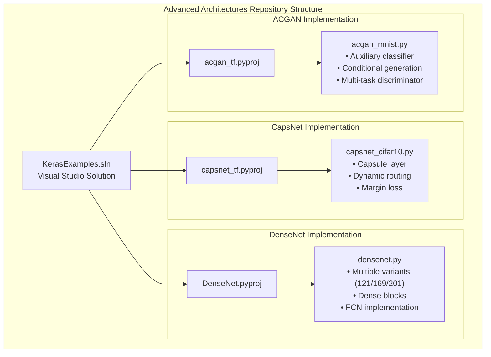
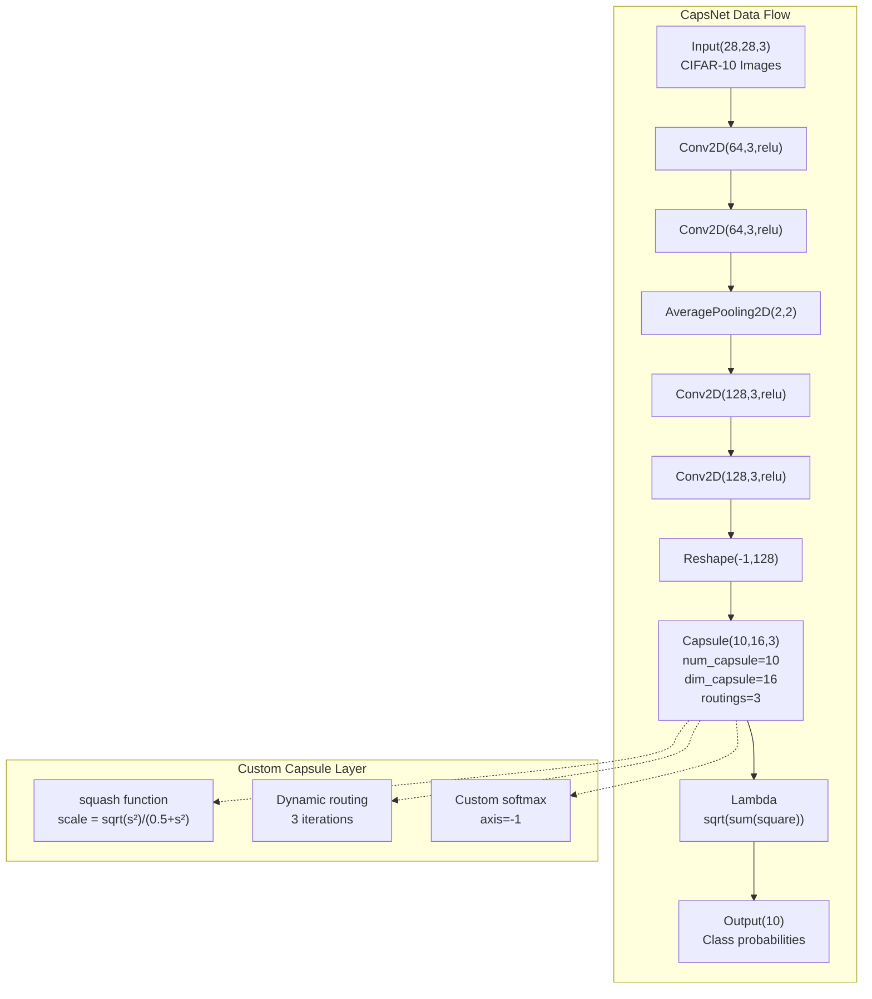
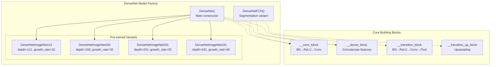
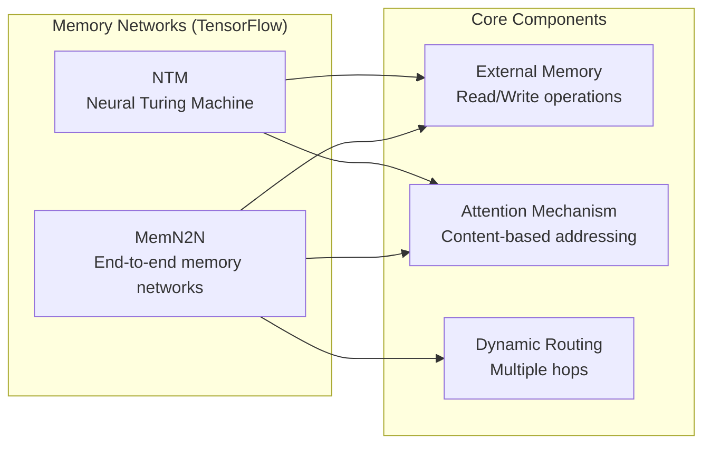

<!-- source: DeepWiki mcp.deepwiki.com · repo microsoft/samples-for-ai · extra page Advanced Architectures · fetched 2026-10-26 -->

# Advanced Architectures

Relevant source files

The following files were used as context for generating this wiki page:

- [examples/cntk/python/ptb/data_reader.py](examples/cntk/python/ptb/data_reader.py)
- [examples/keras/DenseNet/densenet.py](examples/keras/DenseNet/densenet.py)
- [examples/keras/KerasExamples.sln](examples/keras/KerasExamples.sln)
- [examples/keras/acgan_tf/acgan_mnist.py](examples/keras/acgan_tf/acgan_mnist.py)
- [examples/keras/acgan_tf/acgan_tf.pyproj](examples/keras/acgan_tf/acgan_tf.pyproj)
- [examples/keras/capsnet_tf/capsnet_cifar10.py](examples/keras/capsnet_tf/capsnet_cifar10.py)
- [examples/keras/capsnet_tf/capsnet_tf.pyproj](examples/keras/capsnet_tf/capsnet_tf.pyproj)
- [examples/tensorflow/MemN2N/model.py](examples/tensorflow/MemN2N/model.py)
- [examples/tensorflow/NTM/ops.py](examples/tensorflow/NTM/ops.py)
- [examples/tensorflow/NTM/tasks/recall.py](examples/tensorflow/NTM/tasks/recall.py)

This page covers the implementation of cutting-edge neural network architectures in the Keras examples collection. These examples demonstrate sophisticated architectural innovations that go beyond standard convolutional and recurrent networks, including Capsule Networks, Dense Networks, and Auxiliary Classifier GANs. For basic neural network models and generative adversarial networks, see [Generative Adversarial Networks](#3.3.1).

## Architecture Overview

The advanced architectures collection includes implementations of three major architectural innovations:

- **CapsNet**: Capsule Networks with dynamic routing for CIFAR-10 classification
- **DenseNet**: Densely Connected Convolutional Networks with multiple variants 
- **ACGAN**: Auxiliary Classifier Generative Adversarial Networks for MNIST

Sources: [examples/keras/KerasExamples.sln:12-16](), [examples/keras/capsnet_tf/capsnet_tf.pyproj:9](), [examples/keras/DenseNet/DenseNet.pyproj](), [examples/keras/acgan_tf/acgan_tf.pyproj:9]()

## CapsNet: Capsule Networks Implementation

The Capsule Network implementation provides a Keras version of the "Dynamic Routing Between Capsules" architecture for CIFAR-10 classification. The implementation includes custom layers and routing algorithms.

### CapsNet Architecture Components

The `Capsule` class implements the core capsule functionality with dynamic routing:

| Component | Implementation | Parameters |
|-----------|---------------|------------|
| Squash Function | `squash(x, axis=-1)` | Scale factor: 0.5 instead of 1.0 |
| Dynamic Routing | 3 iterations | Updates coupling coefficients |
| Margin Loss | `margin_loss(y_true, y_pred)` | λ=0.5, margin=0.1 |

Sources: [examples/keras/capsnet_tf/capsnet_cifar10.py:51-142](), [examples/keras/capsnet_tf/capsnet_cifar10.py:26-48]()

### CapsNet Training Configuration

The implementation uses specific training parameters optimized for CIFAR-10:

- **Batch Size**: 128
- **Epochs**: 100  
- **Data Augmentation**: ImageDataGenerator with rotation and shifts
- **Validation Accuracy**: 75% at 10 epochs, 79% at 15 epochs, 83% at 30 epochs

Sources: [examples/keras/capsnet_tf/capsnet_cifar10.py:144-219]()

## DenseNet: Densely Connected Networks

The DenseNet implementation provides multiple architectural variants including standard DenseNet and Fully Convolutional DenseNet (FCN) for segmentation tasks.

### DenseNet Architecture Variants

### DenseNet Dense Block Implementation

The core innovation of DenseNet lies in the dense connectivity pattern implemented in `__dense_block`:

| Parameter | Purpose | Default Value |
|-----------|---------|---------------|
| `growth_rate` | Feature maps added per layer | 12 |
| `nb_layers` | Layers per dense block | Variable |
| `bottleneck` | 1x1 conv before 3x3 | False |
| `compression` | Feature map reduction | 1.0 - reduction |

The dense block concatenates feature maps from all previous layers: [examples/keras/DenseNet/densenet.py:479-511]()

Sources: [examples/keras/DenseNet/densenet.py:77-240](), [examples/keras/DenseNet/densenet.py:364-447]()

### DenseNet Weight Loading

Pre-trained weights are available for ImageNet variants with automatic downloading:

- **DenseNet-121**: [DENSENET_121_WEIGHTS_PATH]() 
- **DenseNet-161**: [DENSENET_161_WEIGHTS_PATH]()
- **DenseNet-169**: [DENSENET_169_WEIGHTS_PATH]()

Sources: [examples/keras/DenseNet/densenet.py:30-35](), [examples/keras/DenseNet/densenet.py:176-238]()

## ACGAN: Auxiliary Classifier GAN

The ACGAN implementation extends the GAN framework with an auxiliary classifier that predicts class labels, enabling class-conditional generation.

### ACGAN Architecture Design

```mermaid
graph TB
    subgraph "ACGAN Generator Flow"
        LATENT["latent<br/>Input(latent_size=100)"]
        CLASS_INPUT["image_class<br/>Input(1, int32)"]
        EMBEDDING["Embedding(10, 100)<br/>Class embeddings"]
        MULTIPLY["Hadamard Product<br/>latent ⊙ class_emb"]
        
        subgraph "Generator CNN"
            DENSE_G["Dense(3×3×384)"]
            RESHAPE_G["Reshape(3,3,384)"]
            CONV_T1["Conv2DTranspose(192,5)<br/>→(7,7,192)"]
            CONV_T2["Conv2DTranspose(96,5,stride=2)<br/>→(14,14,96)"]
            CONV_T3["Conv2DTranspose(1,5,stride=2)<br/>→(28,28,1)"]
        end
    end
    
    subgraph "ACGAN Discriminator Flow"
        IMAGE["image<br/>Input(28,28,1)"]
        
        subgraph "Discriminator CNN"
            CONV_D1["Conv2D(32,3,stride=2)"]
            CONV_D2["Conv2D(64,3)"]
            CONV_D3["Conv2D(128,3,stride=2)"]
            CONV_D4["Conv2D(256,3)"]
            FLATTEN["Flatten()"]
        end
        
        FAKE_OUT["Dense(1,sigmoid)<br/>Real/Fake"]
        AUX_OUT["Dense(10,softmax)<br/>Class prediction"]
    end
    
    LATENT --> MULTIPLY
    CLASS_INPUT --> EMBEDDING --> MULTIPLY
    MULTIPLY --> DENSE_G --> RESHAPE_G
    RESHAPE_G --> CONV_T1 --> CONV_T2 --> CONV_T3
    
    IMAGE --> CONV_D1 --> CONV_D2 --> CONV_D3 --> CONV_D4 --> FLATTEN
    FLATTEN --> FAKE_OUT
    FLATTEN --> AUX_OUT
```

### ACGAN Training Strategy

The ACGAN training implements a sophisticated strategy with sample weighting:

| Component | Configuration | Purpose |
|-----------|---------------|---------|
| Generator Loss | `binary_crossentropy + sparse_categorical_crossentropy` | Fool discriminator + classify correctly |
| Discriminator Loss | Same as generator | Detect fakes + classify correctly |
| Sample Weights | `[np.ones(2*batch_size), [2*ones, zeros]]` | Weight real images 2x for auxiliary loss |
| Soft Labels | real=0.95, fake=0 | Improved training stability |

The discriminator sample weighting prevents the auxiliary classifier from being trained on generated images while preserving the sum of sample weights: [examples/keras/acgan_tf/acgan_mnist.py:184-186]()

Sources: [examples/keras/acgan_tf/acgan_mnist.py:38-116](), [examples/keras/acgan_tf/acgan_mnist.py:172-236]()

## Advanced Architecture Integration

### Memory-Augmented Networks

While the Keras collection focuses on convolutional architectures, the repository also includes TensorFlow implementations of memory-augmented networks:

These implementations demonstrate advanced architectural patterns for sequence modeling and memory-augmented learning.

Sources: [examples/tensorflow/MemN2N/model.py:8-240](), [examples/tensorflow/NTM/tasks/recall.py:16-109]()

### Usage Patterns and Training

All advanced architectures follow consistent patterns for integration with Visual Studio Tools for AI:

- **Project Structure**: Each architecture has a dedicated `.pyproj` file
- **Environment**: `KERAS_BACKEND=tensorflow` for Keras examples
- **Command Line**: Standardized `--input_dir . --output_dir .` arguments
- **Debugging**: Full Visual Studio debugging support with breakpoints

The implementations demonstrate production-ready code with proper error handling, validation, and checkpoint saving capabilities.

Sources: [examples/keras/capsnet_tf/capsnet_tf.pyproj:14-16](), [examples/keras/DenseNet/DenseNet.pyproj](), [examples/keras/acgan_tf/acgan_tf.pyproj:14-16]()

---

