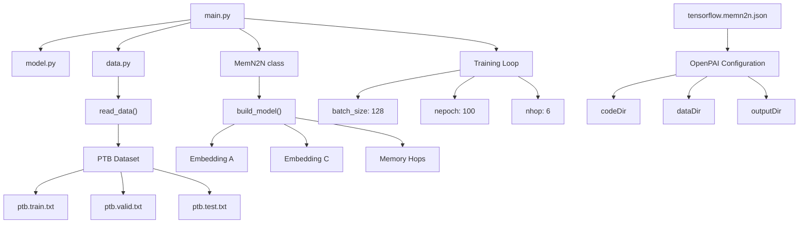
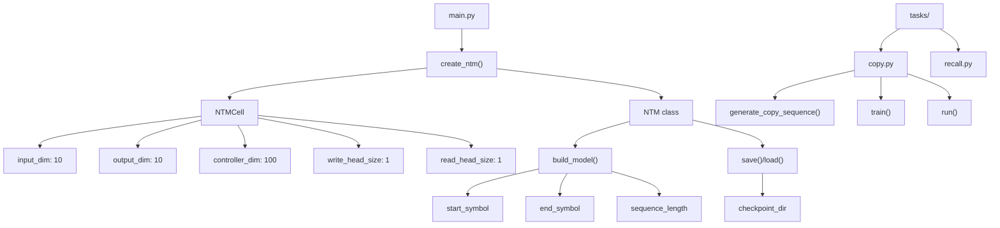
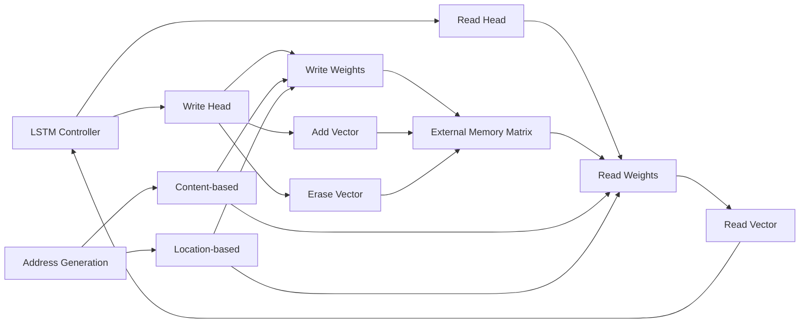
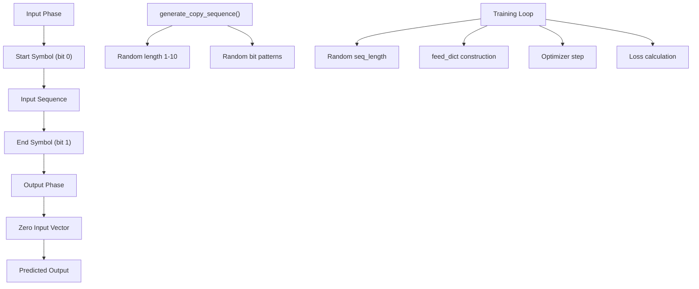

<!-- source: DeepWiki mcp.deepwiki.com · repo microsoft/samples-for-ai · extra page Advanced Models (MemN2N, NTM) · fetched 2026-10-26 -->

# Advanced Models (MemN2N, NTM)

Relevant source files

The following files were used as context for generating this wiki page:

- [examples/tensorflow/MemN2N/MemN2N.pyproj](examples/tensorflow/MemN2N/MemN2N.pyproj)
- [examples/tensorflow/MemN2N/data.py](examples/tensorflow/MemN2N/data.py)
- [examples/tensorflow/MemN2N/main.py](examples/tensorflow/MemN2N/main.py)
- [examples/tensorflow/MemN2N/tensorflow.memn2n.json](examples/tensorflow/MemN2N/tensorflow.memn2n.json)
- [examples/tensorflow/NTM/NTM.pyproj](examples/tensorflow/NTM/NTM.pyproj)
- [examples/tensorflow/NTM/README.md](examples/tensorflow/NTM/README.md)
- [examples/tensorflow/NTM/copydata.sh](examples/tensorflow/NTM/copydata.sh)
- [examples/tensorflow/NTM/main.py](examples/tensorflow/NTM/main.py)
- [examples/tensorflow/NTM/ntm.py](examples/tensorflow/NTM/ntm.py)
- [examples/tensorflow/NTM/tasks/copy.py](examples/tensorflow/NTM/tasks/copy.py)
- [examples/tensorflow/NTM/tensorflow.ntm.json](examples/tensorflow/NTM/tensorflow.ntm.json)

This document covers the implementation of advanced memory-augmented neural network architectures in the TensorFlow examples collection. Specifically, it details Memory Networks (MemN2N) and Neural Turing Machines (NTM), which represent sophisticated approaches to incorporating external memory mechanisms into neural networks for tasks requiring long-term memory and reasoning capabilities.

For basic TensorFlow model implementations, see [Basic TensorFlow Models](#3.1.1). For object detection models, see [Object Detection with YOLO](#3.1.2).

## Memory Networks (MemN2N) Architecture

Memory Networks provide a framework for neural networks to reason over a collection of facts or memories. The implementation follows the End-To-End Memory Networks approach, which allows for differentiable memory access patterns.

### MemN2N System Components

Sources: [examples/tensorflow/MemN2N/main.py:1-68](), [examples/tensorflow/MemN2N/data.py:26-59](), [examples/tensorflow/MemN2N/tensorflow.memn2n.json:1-22](), [examples/tensorflow/MemN2N/MemN2N.pyproj:25-29]()

### MemN2N Training Configuration

The MemN2N implementation uses a comprehensive set of hyperparameters and training configurations:

| Parameter | Default Value | Description |
|-----------|---------------|-------------|
| `edim` | 150 | Internal state dimension |
| `lindim` | 75 | Linear part of the state |
| `nhop` | 6 | Number of memory hops |
| `mem_size` | 100 | Memory size |
| `batch_size` | 128 | Training batch size |
| `nepoch` | 100 | Number of training epochs |
| `init_lr` | 0.01 | Initial learning rate |
| `max_grad_norm` | 50 | Gradient clipping threshold |

Sources: [examples/tensorflow/MemN2N/main.py:13-25]()

## Neural Turing Machine (NTM) Architecture

The Neural Turing Machine extends neural networks with an external memory matrix that can be read from and written to via attention mechanisms, enabling more sophisticated algorithmic reasoning.

### NTM System Architecture

Sources: [examples/tensorflow/NTM/main.py:38-50](), [examples/tensorflow/NTM/ntm.py:18-84](), [examples/tensorflow/NTM/tasks/copy.py:1-111](), [examples/tensorflow/NTM/NTM.pyproj:24-34]()

### NTM Memory Mechanism

Sources: [examples/tensorflow/NTM/ntm_cell.py](), [examples/tensorflow/NTM/ntm.py:85-175]()

## Task Implementations

### Copy Task

The copy task serves as a fundamental benchmark for testing the NTM's ability to store and retrieve arbitrary sequences. The task requires the network to read an input sequence, store it in external memory, and then reproduce it exactly.

Sources: [examples/tensorflow/NTM/tasks/copy.py:106-111](), [examples/tensorflow/NTM/tasks/copy.py:58-104](), [examples/tensorflow/NTM/main.py:75-105]()

### Training and Evaluation Pipeline

The NTM training pipeline supports both training and testing modes with different sequence lengths:

| Training Parameter | Value | Purpose |
|-------------------|-------|---------|
| `min_length` | 1 | Minimum sequence length |
| `max_length` | 10 | Maximum training sequence length |
| `test_max_length` | 120 | Maximum testing sequence length |
| `epoch` | 100,000 | Training iterations |
| `controller_layer_size` | 1 | LSTM controller layers |

Sources: [examples/tensorflow/NTM/main.py:16-26]()

## Model Training and Optimization

### MemN2N Training Process

The MemN2N model uses the Penn TreeBank dataset for language modeling tasks. The training process involves:

1. Data preprocessing with `read_data()` function
2. Word-to-index mapping creation
3. Batch processing with configurable batch sizes
4. Memory hop optimization across multiple epochs

Sources: [examples/tensorflow/MemN2N/main.py:36-67](), [examples/tensorflow/MemN2N/data.py:26-59]()

### NTM Training Process

The NTM training focuses on algorithmic tasks:

1. Task-specific sequence generation
2. Dynamic sequence length training
3. Gradient clipping for stability
4. Checkpoint saving every 100 iterations

The training loop in `train()` function handles variable sequence lengths and provides detailed progress reporting.

Sources: [examples/tensorflow/NTM/tasks/copy.py:58-104](), [examples/tensorflow/NTM/ntm.py:148-169]()

## OpenPAI Integration

Both models include OpenPAI configuration files for distributed training:

### MemN2N OpenPAI Configuration
- Job name: `tensorflow-memn2n`
- Resource allocation: 8 CPUs, 32GB memory
- Command: `pip --quiet install future && cd code && python main.py`

### NTM OpenPAI Configuration  
- Job name: `tensorflow-ntm`
- Resource allocation: 1 CPU, 32GB memory
- Command includes data copying: `chmod +x code/copydata.sh && ./code/copydata.sh $PAI_DATA_DIR && cd code && python main.py`

Sources: [examples/tensorflow/MemN2N/tensorflow.memn2n.json:1-22](), [examples/tensorflow/NTM/tensorflow.ntm.json:1-22](), [examples/tensorflow/NTM/copydata.sh:1-2]()

## Visual Studio Integration

Both projects are integrated into Visual Studio through `.pyproj` files:

- **MemN2N Project**: Includes `main.py`, `data.py`, `model.py`, and `utils.py`
- **NTM Project**: Includes `main.py`, `ntm.py`, `ntm_cell.py`, `ops.py`, and task modules

The project configurations specify Python launcher settings and include data files for local development.

Sources: [examples/tensorflow/MemN2N/MemN2N.pyproj:1-41](), [examples/tensorflow/NTM/NTM.pyproj:1-42]()

---

