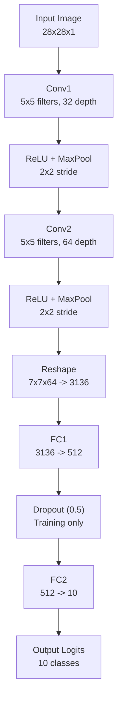
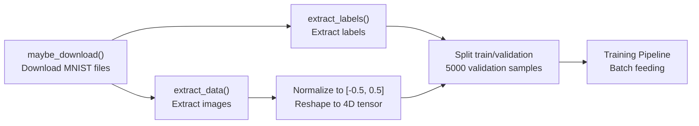
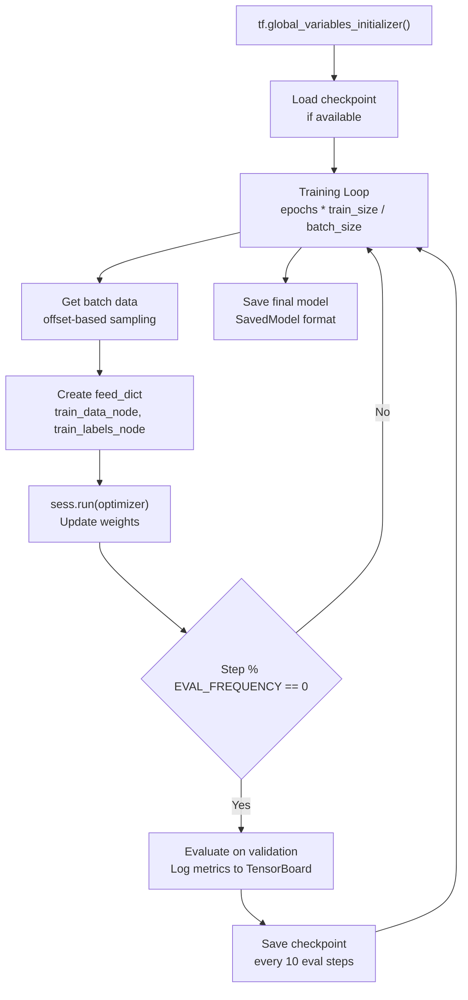
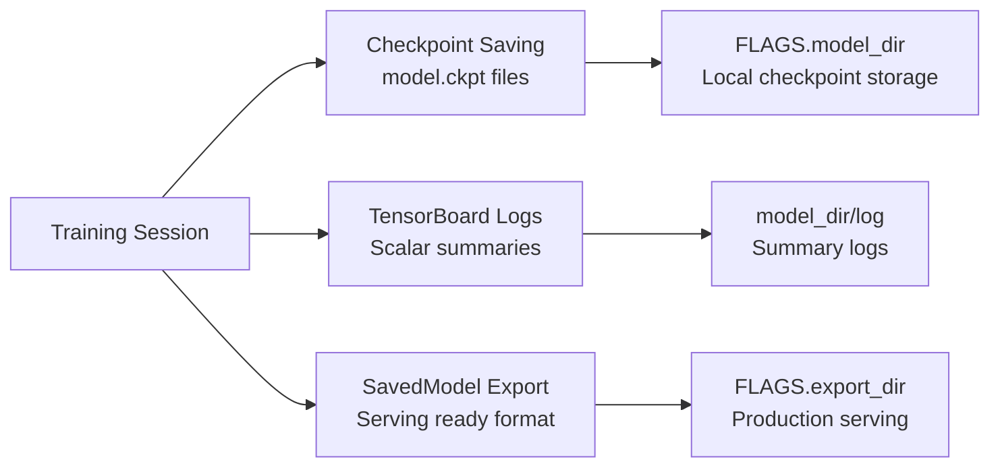

<!-- source: DeepWiki mcp.deepwiki.com · repo microsoft/samples-for-ai · extra page Basic TensorFlow Models · fetched 2026-10-26 -->

# Basic TensorFlow Models

Relevant source files

The following files were used as context for generating this wiki page:

- [examples/cntk/brainscript/README.md](examples/cntk/brainscript/README.md)
- [examples/cntk/python/NumpyExperiment/README.md](examples/cntk/python/NumpyExperiment/README.md)
- [examples/cntk/python/README.md](examples/cntk/python/README.md)
- [examples/keras/README.md](examples/keras/README.md)
- [examples/pytorch/README.md](examples/pytorch/README.md)
- [examples/tensorflow/MNIST/MNIST.pyproj](examples/tensorflow/MNIST/MNIST.pyproj)
- [examples/tensorflow/MNIST/mnist.py](examples/tensorflow/MNIST/mnist.py)
- [examples/tensorflow/README.md](examples/tensorflow/README.md)

## Purpose and Scope

This document covers the basic TensorFlow model implementations in the samples-for-ai repository, specifically focusing on MNIST digit recognition and CIFAR-10 image classification examples. These implementations serve as foundational examples for learning TensorFlow's core concepts including model definition, training loops, and model persistence.

For advanced TensorFlow models like memory networks and object detection, see [Advanced Models (MemN2N, NTM)](#3.1.3) and [Object Detection with YOLO](#3.1.2).

## Model Overview

The basic TensorFlow examples demonstrate two fundamental computer vision tasks using convolutional neural networks:

| Model | Dataset | Task | Architecture | Input Size | Classes |
|-------|---------|------|--------------|------------|---------|
| MNIST CNN | MNIST | Digit Recognition | LeNet-5-like CNN | 28x28x1 | 10 |
| CIFAR-10 CNN | CIFAR-10 | Image Classification | Multi-layer CNN | 32x32x3 | 10 |

Sources: [examples/tensorflow/README.md:1-95]()

## MNIST Model Architecture

### Model Definition

The MNIST implementation uses a LeNet-5-inspired architecture defined in the `model` function. The network consists of two convolutional layers followed by two fully connected layers:

### Key Model Components

The model implementation defines several critical variables and operations:

- **Convolutional Layers**: `conv1_weights`, `conv1_biases`, `conv2_weights`, `conv2_biases`
- **Fully Connected Layers**: `fc1_weights`, `fc1_biases`, `fc2_weights`, `fc2_biases`  
- **Model Function**: `model(data, train=False)` with conditional dropout
- **Loss Function**: `tf.nn.sparse_softmax_cross_entropy_with_logits` with L2 regularization

Sources: [examples/tensorflow/MNIST/mnist.py:167-231]()

### Training Configuration

The training setup uses several key hyperparameters and configurations:

| Parameter | Value | Variable |
|-----------|-------|----------|
| Batch Size | 64 | `BATCH_SIZE` |
| Learning Rate | 0.01 (exponential decay) | `learning_rate` |
| Epochs | 10 | `NUM_EPOCHS` |
| Optimizer | Momentum (0.9) | `tf.train.MomentumOptimizer` |
| Regularization | L2 (5e-4) | Applied to FC layers |

Sources: [examples/tensorflow/MNIST/mnist.py:48-53](), [examples/tensorflow/MNIST/mnist.py:248-257]()

## Data Pipeline and Preprocessing

### Data Loading Workflow

### Key Data Functions

The data pipeline implements several utility functions:

- **`maybe_download(filename)`**: Downloads MNIST data from Yann LeCun's website
- **`extract_data(filename, num_images)`**: Extracts and normalizes image data to 4D tensors
- **`extract_labels(filename, num_images)`**: Extracts label data as int64 vectors
- **`fake_data(num_images)`**: Generates synthetic data for self-testing

Sources: [examples/tensorflow/MNIST/mnist.py:64-112]()

## Training and Evaluation Loop

### Training Workflow

The training process follows TensorFlow 1.x session-based execution:

### Key Training Functions

- **`eval_in_batches(data, sess)`**: Evaluates model on large datasets by batching
- **`error_rate(predictions, labels)`**: Computes classification error percentage
- **Session management**: Uses `tf.Session` with device placement logging disabled

Sources: [examples/tensorflow/MNIST/mnist.py:268-377]()

## Model Persistence and Export

### Checkpoint and SavedModel Export

The implementation includes comprehensive model saving capabilities:

### Export Configuration

The model export uses TensorFlow's SavedModel format with serving signatures:

- **Input Signature**: `train_data_node` placeholder for image input
- **Output Signature**: `predict_op` for class predictions  
- **Serving Signature**: Named "Infer" for inference serving
- **Assets**: Includes asset file paths for complete model export

Sources: [examples/tensorflow/MNIST/mnist.py:288-369]()

## CIFAR-10 Implementation

While the CIFAR-10 implementation follows similar patterns to MNIST, it addresses the increased complexity of natural image classification:

### Key Differences

| Aspect | MNIST | CIFAR-10 |
|--------|-------|----------|
| Input Size | 28x28x1 (grayscale) | 32x32x3 (RGB) |
| Complexity | Handwritten digits | Natural images |
| Architecture | 2 conv + 2 FC layers | Deeper CNN architecture |
| Training | CPU-optimized | GPU-recommended |

The CIFAR-10 example demonstrates convolutional neural network training on a more challenging computer vision benchmark, serving as a stepping stone to more complex image recognition tasks.

Sources: [examples/tensorflow/README.md:16-22]()

## Project Structure and Integration

### Visual Studio Integration

The TensorFlow examples are organized as Visual Studio projects with specific configurations:

- **Project File**: `MNIST.pyproj` defines the Visual Studio Python project
- **Startup File**: `mnist.py` set as the main execution script
- **Command Line Args**: Pre-configured with `--input_dir input/ --output_dir output/`
- **Working Directory**: Set to project root for relative path resolution

Sources: [examples/tensorflow/MNIST/MNIST.pyproj:1-38]()

### Framework Integration

These basic models serve as building blocks for the broader TensorFlow ecosystem in the repository, providing foundational patterns for data loading, model definition, training loops, and model export that are extended in more advanced examples.

Sources: [examples/tensorflow/README.md:1-95]()

---

