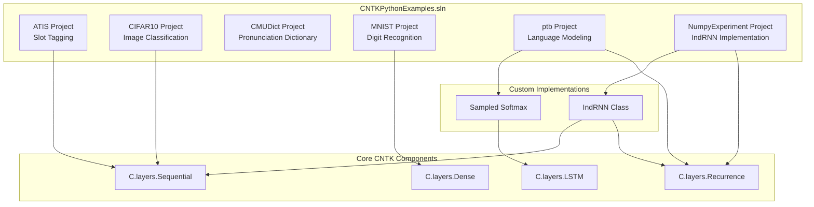
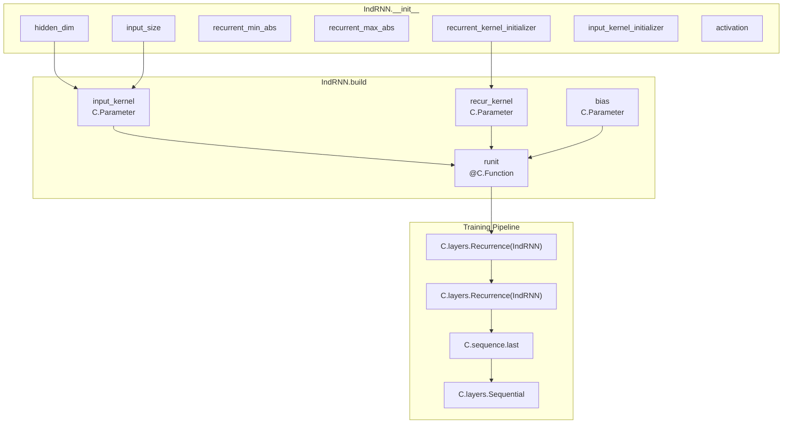
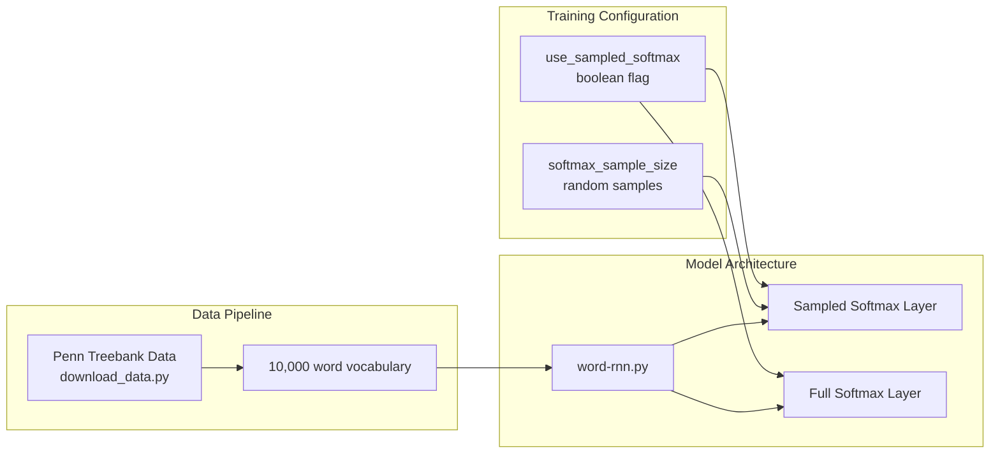

<!-- source: DeepWiki mcp.deepwiki.com · repo microsoft/samples-for-ai · extra page CNTK Python Examples · fetched 2026-10-26 -->

# CNTK Python Examples

Relevant source files

The following files were used as context for generating this wiki page:

- [examples/cntk/python/CNTKPythonExamples.sln](examples/cntk/python/CNTKPythonExamples.sln)
- [examples/cntk/python/NumpyExperiment/IndRNN.py](examples/cntk/python/NumpyExperiment/IndRNN.py)
- [examples/cntk/python/NumpyExperiment/NumpyExperiment.pyproj](examples/cntk/python/NumpyExperiment/NumpyExperiment.pyproj)
- [examples/cntk/python/ptb/README.md](examples/cntk/python/ptb/README.md)

This document covers the Python-based examples for Microsoft Cognitive Toolkit (CNTK) within the samples-for-ai repository. These examples demonstrate advanced neural network architectures and training techniques using CNTK's Python API, including Independent Recurrent Neural Networks (IndRNN) and neural language modeling with sampled softmax optimization.

For BrainScript-based CNTK examples and broader CNTK framework coverage, see [CNTK Examples](#3.4). For general framework comparison and selection guidance, see [Framework Examples](#3).

## Project Structure and Organization

The CNTK Python examples are organized as a Visual Studio solution containing multiple specialized projects, each demonstrating different aspects of neural network implementation and training optimization.

### CNTK Python Projects Architecture

Sources: [examples/cntk/python/CNTKPythonExamples.sln:1-44]()

## Independent Recurrent Neural Network Implementation

The `NumpyExperiment` project contains a complete implementation of Independent Recurrent Neural Networks (IndRNN), a novel RNN architecture that addresses gradient vanishing and exploding problems through independent recurrent connections.

### IndRNN Class Architecture

Sources: [examples/cntk/python/NumpyExperiment/IndRNN.py:12-45]()

### IndRNN Parameter Constraints

The `IndRNN` class implements specific parameter constraints to ensure training stability:

| Parameter | Purpose | Implementation |
|-----------|---------|----------------|
| `recurrent_min_abs` | Minimum absolute value for recurrent weights | `C.element_max(C.abs(recur_kernel), recurrent_min_abs)` |
| `recurrent_max_abs` | Maximum absolute value clipping | `C.clip(recur_kernel, -recurrent_max_abs, recurrent_max_abs)` |
| `recurrent_kernel_initializer` | Diagonal recurrent weight initialization | Default: `1.0` |
| `input_kernel_initializer` | Input weight initialization | Default: `normal(0.001)` |

The recurrent computation is performed element-wise: `h_t = C.times(x, input_kernel) + bias + recur_kernel*h`, where `recur_kernel` contains diagonal elements only.

Sources: [examples/cntk/python/NumpyExperiment/IndRNN.py:33-44]()

## Neural Language Modeling with Sampled Softmax

The `ptb` project demonstrates neural language modeling using the Penn Treebank dataset with sampled softmax optimization to handle large vocabulary sizes efficiently.

### Language Model Training Pipeline

Sources: [examples/cntk/python/ptb/README.md:1-25]()

The sampled softmax technique reduces computational cost during training by approximating the full softmax computation using a subset of vocabulary samples. The `softmax_sample_size` parameter controls the number of random samples used for this approximation.

## Training Examples and Comparisons

The `IndRNN.py` file includes comparative training between IndRNN and LSTM architectures on a sequence summation task.

### Training Configuration

```mermaid
graph TB
    subgraph "IndRNN Model"
        INDRNN_SEQ["C.layers.Sequential"]
        INDRNN_REC1["C.layers.Recurrence(IndRNN(128, 2))"]
        INDRNN_REC2["C.layers.Recurrence(IndRNN(1, 128))"]
        INDRNN_LAST["C.sequence.last"]
    end
    
    subgraph "LSTM Model"
        LSTM_SEQ["C.layers.Sequential"]
        LSTM_REC["C.layers.Recurrence(C.layers.LSTM(128))"]
        LSTM_LAST["C.sequence.last"]
        LSTM_DENSE["C.layers.Dense(1, activation=C.relu)"]
    end
    
    subgraph "Training Setup"
        LR_SCHEDULE["learning_parameter_schedule<br/>[(1,0.02), (300,0.002), (600,0.0001)]"]
        ADAM_LEARNER["C.learners.adam"]
        TRAINER["C.Trainer"]
        PROGRESS["ProgressPrinter(5)"]
    end
    
    INDRNN_REC1 --> INDRNN_REC2
    INDRNN_REC2 --> INDRNN_LAST
    INDRNN_LAST --> INDRNN_SEQ
    
    LSTM_REC --> LSTM_LAST
    LSTM_LAST --> LSTM_DENSE
    LSTM_DENSE --> LSTM_SEQ
    
    LR_SCHEDULE --> ADAM_LEARNER
    ADAM_LEARNER --> TRAINER
    PROGRESS --> TRAINER
```

Sources: [examples/cntk/python/NumpyExperiment/IndRNN.py:54-102]()

Both models are trained on a synthetic sequence summation task where the input is a sequence of shape `(20, 2000, 2)` and the target is the sum across both sequence and feature dimensions. The training uses a learning rate schedule with three phases and Adam optimization.

## Visual Studio Integration

The CNTK Python examples integrate with Visual Studio through project files that specify startup scripts, command line arguments, and debugging configurations.

| Project | Startup File | Command Line Arguments | Purpose |
|---------|-------------|----------------------|---------|
| NumpyExperiment | `IndRNN.py` | `--input_dir input/ --output_dir output/` | IndRNN research and comparison |
| ptb | `word-rnn.py` | Dataset-specific parameters | Language modeling experiments |
| ATIS | Custom slot tagging script | NLP-specific arguments | Sequence labeling tasks |

The `NumpyExperiment.pyproj` configuration demonstrates the Visual Studio Python project structure for CNTK development, including MSBuild integration and Python Tools compatibility.

Sources: [examples/cntk/python/NumpyExperiment/NumpyExperiment.pyproj:1-22]()

---

