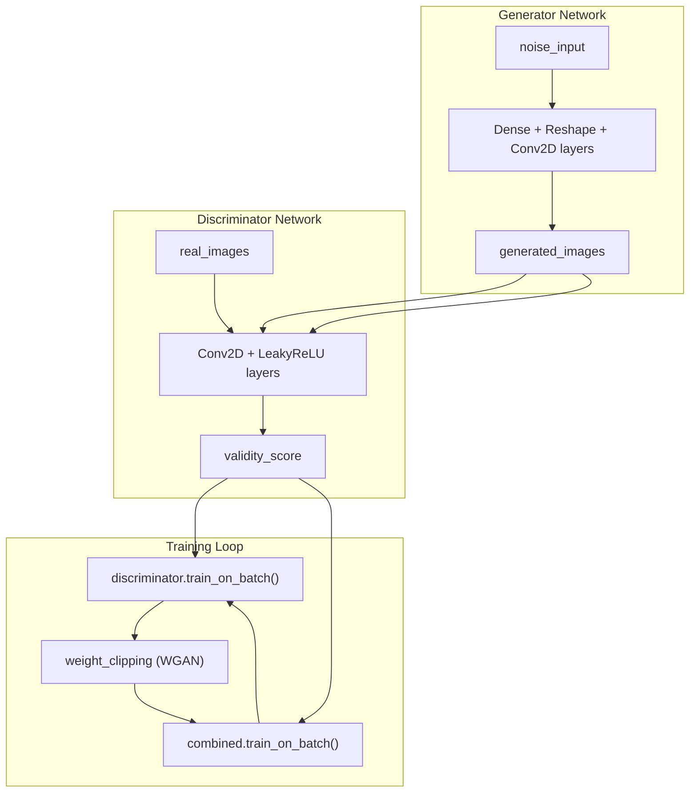
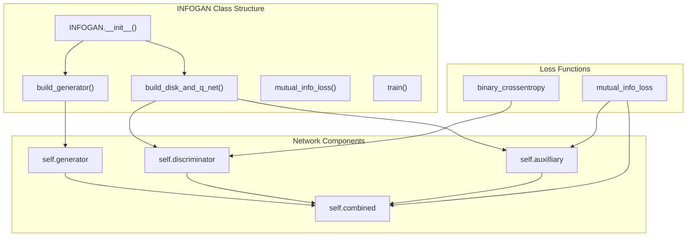
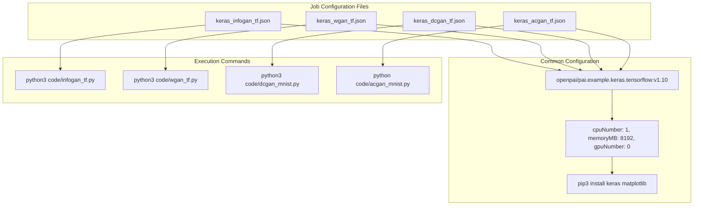

<!-- source: DeepWiki mcp.deepwiki.com · repo microsoft/samples-for-ai · extra page Generative Adversarial Networks · fetched 2026-10-26 -->

# Generative Adversarial Networks

<details>
<summary>Relevant source files</summary>

The following files were used as context for generating this wiki page:

- [examples/cntk/python/ptb/README.md](examples/cntk/python/ptb/README.md)
- [examples/keras/DenseNet/DenseNet.pyproj](examples/keras/DenseNet/DenseNet.pyproj)
- [examples/keras/DenseNet/keras_densenet.json](examples/keras/DenseNet/keras_densenet.json)
- [examples/keras/acgan_tf/keras_acgan_tf.json](examples/keras/acgan_tf/keras_acgan_tf.json)
- [examples/keras/capsnet_tf/keras_capsnet_tf.json](examples/keras/capsnet_tf/keras_capsnet_tf.json)
- [examples/keras/cifar10_tf/keras_cifar10_tf.json](examples/keras/cifar10_tf/keras_cifar10_tf.json)
- [examples/keras/dcgan_tf/keras_dcgan_tf.json](examples/keras/dcgan_tf/keras_dcgan_tf.json)
- [examples/keras/infogan_tf/infogan_tf.py](examples/keras/infogan_tf/infogan_tf.py)
- [examples/keras/infogan_tf/keras_infogan_tf.json](examples/keras/infogan_tf/keras_infogan_tf.json)
- [examples/keras/wgan_tf/keras_wgan_tf.json](examples/keras/wgan_tf/keras_wgan_tf.json)
- [examples/keras/wgan_tf/wgan_tf.py](examples/keras/wgan_tf/wgan_tf.py)

</details>


This document covers the comprehensive collection of Generative Adversarial Network (GAN) implementations available in the Keras examples section. The examples demonstrate various GAN architectures including Deep Convolutional GANs (DCGAN), Auxiliary Classifier GANs (ACGAN), Information Maximizing GANs (InfoGAN), and Wasserstein GANs (WGAN). Each implementation provides complete training pipelines, model architectures, and OpenPAI integration for distributed training.

For basic Keras model examples and other neural architectures, see [Advanced Architectures](#3.3.2). For PyTorch GAN implementations, refer to [PyTorch Examples](#3.2).

## Overview

The Keras GAN examples provide reference implementations of state-of-the-art generative models, each addressing specific challenges in adversarial training. All implementations use the MNIST dataset for consistency and comparability, with modular architectures that can be adapted to other datasets.

### Available GAN Implementations

| GAN Type | File Path | Key Innovation | Training Approach |
|----------|-----------|----------------|-------------------|
| InfoGAN | `examples/keras/infogan_tf/infogan_tf.py` | Disentangled representation learning | Mutual information maximization |
| WGAN | `examples/keras/wgan_tf/wgan_tf.py` | Improved training stability | Wasserstein distance, weight clipping |
| DCGAN | `examples/keras/dcgan_tf/` | Convolutional architecture | Standard adversarial loss |
| ACGAN | `examples/keras/acgan_tf/` | Class-conditional generation | Auxiliary classifier |

**GAN Architecture Overview**


Sources: [examples/keras/infogan_tf/infogan_tf.py:27-74](), [examples/keras/wgan_tf/wgan_tf.py:31-68]()

## InfoGAN Implementation

InfoGAN extends the standard GAN framework with an additional network that learns disentangled representations by maximizing mutual information between generated data and a subset of latent variables.

**InfoGAN Architecture Components**


The `INFOGAN` class implements the core architecture with three main networks:

- **Generator**: Transforms concatenated noise and categorical labels into images
- **Discriminator**: Distinguishes real from generated images  
- **Auxiliary Network**: Predicts categorical codes to maximize mutual information

### Key Implementation Details

The generator network architecture uses transpose convolution layers for upsampling:

```python
# Generator structure from build_generator()
Dense(128 * 7 * 7) -> Reshape(7, 7, 128) -> BatchNormalization -> 
UpSampling2D -> Conv2D(128) -> BatchNormalization -> 
UpSampling2D -> Conv2D(64) -> Conv2D(channels)
```

The mutual information loss function enforces disentanglement:

```python
def mutual_info_loss(self, c, c_given_x):
    conditional_entropy = K.mean(- K.sum(K.log(c_given_x + eps) * c, axis=1))
    entropy = K.mean(- K.sum(K.log(c + eps) * c, axis=1))
    return conditional_entropy + entropy
```

Sources: [examples/keras/infogan_tf/infogan_tf.py:27-74](), [examples/keras/infogan_tf/infogan_tf.py:76-99](), [examples/keras/infogan_tf/infogan_tf.py:139-145]()

## WGAN Implementation

The Wasserstein GAN addresses training instability issues by using the Wasserstein distance instead of the Jensen-Shannon divergence. This implementation includes weight clipping to enforce the Lipschitz constraint.

**WGAN Training Process**

```mermaid
graph TB
    subgraph "WGAN Training Loop"
        epoch_start["epoch_start"]
        critic_loop["for _ in range(n_critic=5)"]
        
        subgraph "Discriminator Training"
            sample_real["sample_real_images"]
            gen_fake["generator.predict(noise)"]
            train_real["discriminator.train_on_batch(real, -1)"]
            train_fake["discriminator.train_on_batch(fake, +1)"]
            clip_weights["clip_discriminator_weights(-0.01, +0.01)"]
        end
        
        subgraph "Generator Training"
            gen_noise["sample_noise"]
            train_gen["combined.train_on_batch(noise, -1)"]
        end
    end
    
    epoch_start --> critic_loop
    critic_loop --> sample_real
    sample_real --> gen_fake
    gen_fake --> train_real
    train_real --> train_fake
    train_fake --> clip_weights
    clip_weights --> critic_loop
    
    critic_loop --> gen_noise
    gen_noise --> train_gen
    train_gen --> epoch_start
```


### Wasserstein Loss Implementation

The `WGAN` class uses a custom Wasserstein loss function that computes the negative expected value:

```python
def wasserstein_loss(self, y_true, y_pred):
    return K.mean(y_true * y_pred)
```

Key architectural differences from standard GANs:
- **Critic Network**: No sigmoid activation in final layer (linear output)
- **Training Ratio**: 5 discriminator updates per generator update (`n_critic = 5`)
- **Weight Clipping**: Constrains discriminator weights to `[-0.01, 0.01]`
- **Optimizer**: RMSprop with learning rate `0.00005`

The discriminator weight clipping implementation ensures Lipschitz continuity:

```python
# Weight clipping after each discriminator update
for l in self.discriminator.layers:
    weights = l.get_weights()
    weights = [np.clip(w, -self.clip_value, self.clip_value) for w in weights]
    l.set_weights(weights)
```

Sources: [examples/keras/wgan_tf/wgan_tf.py:31-68](), [examples/keras/wgan_tf/wgan_tf.py:69-70](), [examples/keras/wgan_tf/wgan_tf.py:164-168]()

## OpenPAI Integration

All GAN implementations include OpenPAI job configuration files for distributed training on Microsoft's OpenPAI platform. These configurations specify resource requirements, dependencies, and execution commands.

**OpenPAI Job Configuration Structure**


### Job Configuration Example

Each OpenPAI job follows a standard structure with task roles and resource specifications:

```json
{
  "jobName": "keras_infogan_tf",
  "image": "openpai/pai.example.keras.tensorflow:v1.10",
  "taskRoles": [{
    "name": "infogan_tf",
    "taskNumber": 1,
    "cpuNumber": 1,
    "memoryMB": 8192,
    "gpuNumber": 0,
    "command": "pip3 --quiet install keras matplotlib && python3 code/infogan_tf.py"
  }]
}
```

Sources: [examples/keras/infogan_tf/keras_infogan_tf.json:1-22](), [examples/keras/wgan_tf/keras_wgan_tf.json:1-22](), [examples/keras/dcgan_tf/keras_dcgan_tf.json:1-22](), [examples/keras/acgan_tf/keras_acgan_tf.json:1-22]()

## Training and Evaluation

All GAN implementations include standardized training loops with progress monitoring and image generation for visual evaluation.

### Common Training Components

| Component | Purpose | Implementation |
|-----------|---------|----------------|
| `train()` | Main training loop | Alternating discriminator/generator updates |
| `save_imgs()` | Generate sample images | Periodic visualization during training |
| `save_model()` | Model persistence | Save generator, discriminator, and combined models |

### Training Parameters

Standard hyperparameters across implementations:
- **Batch Size**: 128 (InfoGAN), 32 (WGAN)
- **Image Shape**: (28, 28, 1) for MNIST
- **Noise Dimension**: 100 (WGAN), 72 (InfoGAN with categorical codes)
- **Save Interval**: Every 50 epochs

The training progress is monitored through loss values:
```python
print("%d [D loss: %.2f, acc.: %.2f%%] [Q loss: %.2f] [G loss: %.2f]" % 
      (epoch, d_loss[0], 100*d_loss[1], g_loss[1], g_loss[2]))
```

Sources: [examples/keras/infogan_tf/infogan_tf.py:155-212](), [examples/keras/wgan_tf/wgan_tf.py:131-185](), [examples/keras/infogan_tf/infogan_tf.py:230-243]()

---

