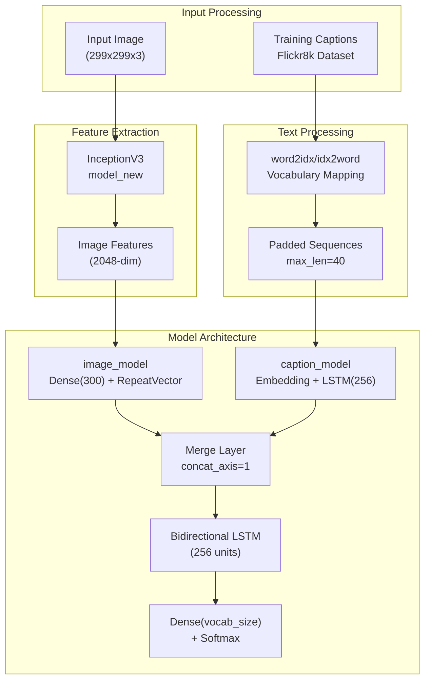
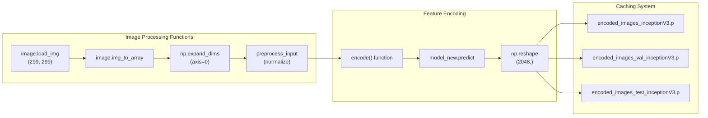
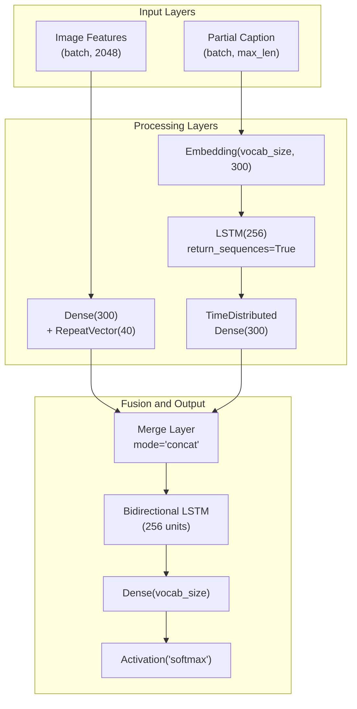
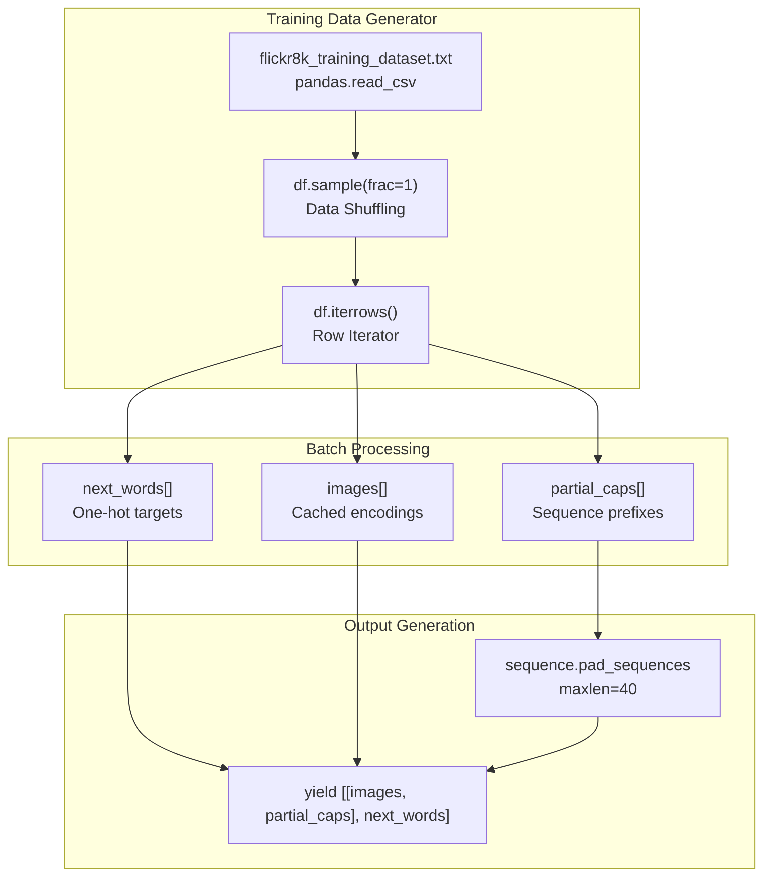
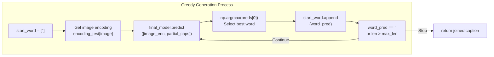
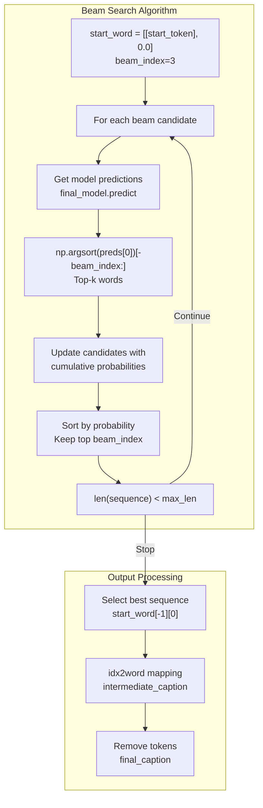

<!-- source: DeepWiki mcp.deepwiki.com · repo microsoft/samples-for-ai · extra page Image Captioning · fetched 2026-10-26 -->

# Image Captioning

Relevant source files

The following files were used as context for generating this wiki page:

- [examples/keras/Image_Captioning/Image_Captioning.py](examples/keras/Image_Captioning/Image_Captioning.py)
- [examples/keras/Image_Captioning/Image_Captioning.pyproj](examples/keras/Image_Captioning/Image_Captioning.pyproj)
- [examples/keras/Image_Captioning/README.md](examples/keras/Image_Captioning/README.md)
- [examples/pytorch/ScreenerNet/ScreenerNet.pyproj](examples/pytorch/ScreenerNet/ScreenerNet.pyproj)

This document covers the neural image captioning system implementation that combines CNN-based image feature extraction with LSTM-based sequence generation to automatically generate natural language descriptions of images. The system uses InceptionV3 for visual encoding and bidirectional LSTM networks for caption generation, trained on the Flickr8k dataset.

For other PyTorch examples including ScreenerNet, see [ScreenerNet Implementation](#3.2.2). For Keras generative models, see [Generative Adversarial Networks](#3.3.1).

## Overview

The image captioning system implements an encoder-decoder architecture where images are encoded using a pre-trained InceptionV3 CNN and captions are generated using LSTM networks. The system supports both greedy decoding and beam search for caption generation.

Sources: [examples/keras/Image_Captioning/Image_Captioning.py:1-487]()

## Dataset and Preprocessing

The system uses the Flickr8k dataset, which contains 8,000 images with 5 captions each. The dataset is split into training, validation, and test sets using predefined file lists.

### Dataset Structure

| Component | File Path | Purpose |
|-----------|-----------|---------|
| Images | `./input/Flicker8k_Dataset/` | 8k JPEG images |
| Captions | `./input/Flickr8k_text/Flickr8k.token.txt` | Image-caption mappings |
| Train Split | `./input/Flickr8k_text/Flickr_8k.trainImages.txt` | Training image list |
| Validation Split | `./input/Flickr8k_text/Flickr_8k.devImages.txt` | Validation image list |
| Test Split | `./input/Flickr8k_text/Flickr_8k.testImages.txt` | Test image list |

### Image Preprocessing Pipeline

The `preprocess_input` function [examples/keras/Image_Captioning/Image_Captioning.py:82-86]() normalizes pixel values to the range [-1, 1], and the `encode` function [examples/keras/Image_Captioning/Image_Captioning.py:114-118]() generates 2048-dimensional feature vectors using InceptionV3.

Sources: [examples/keras/Image_Captioning/Image_Captioning.py:32-151](), [examples/keras/Image_Captioning/README.md:1-17]()

## Model Architecture

The system implements a multimodal encoder-decoder architecture combining visual and textual information processing.

### Component Models

#### Image Feature Processing
- **Input**: 2048-dimensional InceptionV3 features
- **Architecture**: `Dense(300, activation='relu')` followed by `RepeatVector(max_len)`
- **Purpose**: Projects image features to embedding space and replicates across sequence length

#### Caption Processing  
- **Input**: Tokenized word sequences (max_len=40)
- **Architecture**: `Embedding(vocab_size, 300)` → `LSTM(256, return_sequences=True)` → `TimeDistributed(Dense(300))`
- **Purpose**: Encodes partial captions into contextual representations

#### Final Model

The model is compiled with `categorical_crossentropy` loss and `RMSprop` optimizer [examples/keras/Image_Captioning/Image_Captioning.py:415]().

Sources: [examples/keras/Image_Captioning/Image_Captioning.py:393-417]()

## Training Pipeline

### Data Generation Strategy

The training uses custom data generators that create training samples by:
1. Loading image encodings from cached pickle files
2. Creating partial caption sequences and corresponding next-word targets
3. Padding sequences to uniform length using `sequence.pad_sequences`

### Training Configuration

| Parameter | Value | Description |
|-----------|-------|-------------|
| Batch Size | 512 | Training batch size |
| Steps per Epoch | 748 | Calculated from dataset size |
| Validation Steps | 125 | Validation batches per epoch |
| Epochs | 57 | Total training epochs |
| Workers | 4 | Multiprocessing workers |

The `PlotLosses` callback [examples/keras/Image_Captioning/Image_Captioning.py:371-390]() logs training metrics to text files for monitoring.

Sources: [examples/keras/Image_Captioning/Image_Captioning.py:267-425]()

## Inference and Caption Generation

The system provides two inference modes for generating captions from images.

### Greedy Decoding

The `predict_captions` function [examples/keras/Image_Captioning/Image_Captioning.py:429-443]() implements simple greedy decoding:

### Beam Search Decoding

The `beam_search_predictions` function [examples/keras/Image_Captioning/Image_Captioning.py:446-487]() implements beam search with configurable beam width:

The beam search maintains multiple candidate sequences and selects the one with highest cumulative probability.

Sources: [examples/keras/Image_Captioning/Image_Captioning.py:429-487]()

## Key Implementation Details

### Vocabulary Management
- **Word-to-Index Mapping**: `word2idx` dictionary for token encoding
- **Index-to-Word Mapping**: `idx2word` dictionary for decoding
- **Special Tokens**: `<start>` and `<end>` tokens mark sequence boundaries
- **Vocabulary Size**: Calculated as `len(unique)` from all caption words

### Caching Strategy
The system implements efficient caching of image encodings:
- Training encodings: `encoded_images_inceptionV3.p`
- Validation encodings: `encoded_images_val_inceptionV3.p`  
- Test encodings: `encoded_images_test_inceptionV3.p`

This prevents recomputing InceptionV3 features during training.

### Visual Studio Integration
The project includes a `.pyproj` file [examples/keras/Image_Captioning/Image_Captioning.pyproj:1-41]() for Visual Studio integration with the following configuration:
- **Startup File**: `Image_Captioning.py`
- **Project Type**: Python project with Jupyter support
- **Debug Configuration**: Standard Python launcher

Sources: [examples/keras/Image_Captioning/Image_Captioning.py:194-208](), [examples/keras/Image_Captioning/Image_Captioning.py:121-150](), [examples/keras/Image_Captioning/Image_Captioning.pyproj:1-41]()

---

