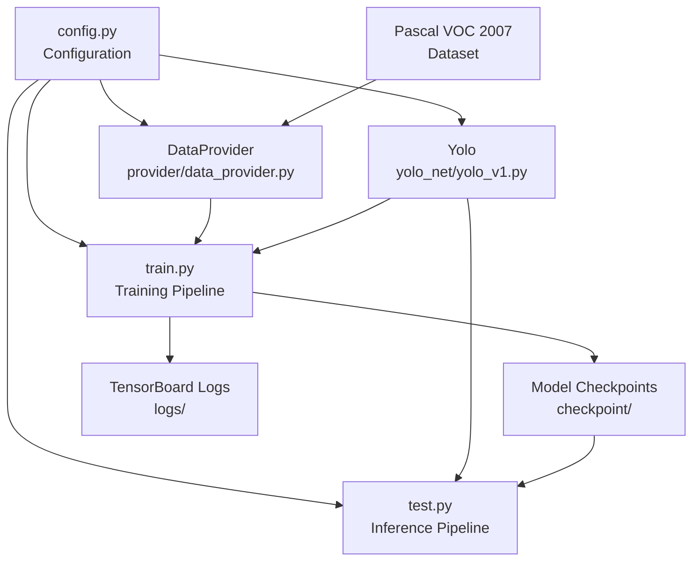
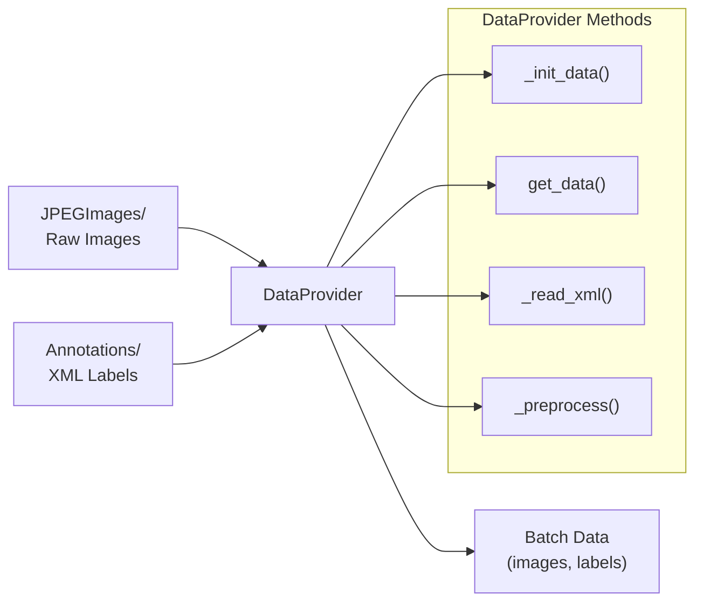
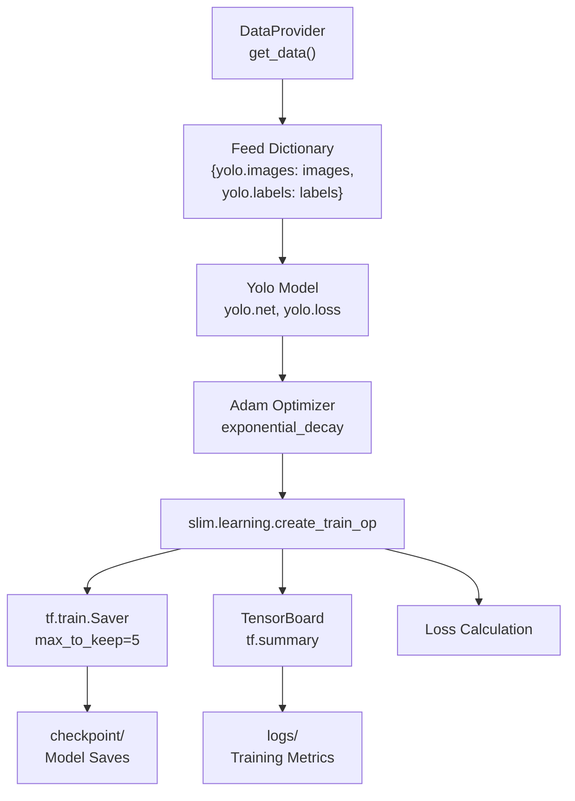
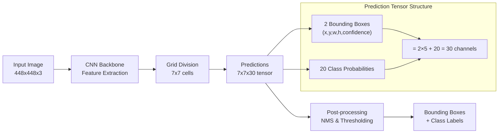
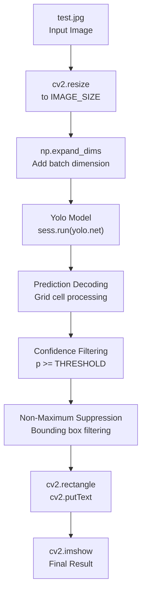

<!-- source: DeepWiki mcp.deepwiki.com · repo microsoft/samples-for-ai · extra page Object Detection with YOLO · fetched 2026-10-26 -->

# Object Detection with YOLO

<details>
<summary>Relevant source files</summary>

The following files were used as context for generating this wiki page:

- [LICENSE](LICENSE)
- [examples/tensorflow/TensorflowExamples.sln](examples/tensorflow/TensorflowExamples.sln)
- [examples/tensorflow/yolo_tensorflow/config.py](examples/tensorflow/yolo_tensorflow/config.py)
- [examples/tensorflow/yolo_tensorflow/gallery/demo1.png](examples/tensorflow/yolo_tensorflow/gallery/demo1.png)
- [examples/tensorflow/yolo_tensorflow/gallery/demo2.png](examples/tensorflow/yolo_tensorflow/gallery/demo2.png)
- [examples/tensorflow/yolo_tensorflow/gallery/loss.png](examples/tensorflow/yolo_tensorflow/gallery/loss.png)
- [examples/tensorflow/yolo_tensorflow/provider/__init__.py](examples/tensorflow/yolo_tensorflow/provider/__init__.py)
- [examples/tensorflow/yolo_tensorflow/provider/data_provider.py](examples/tensorflow/yolo_tensorflow/provider/data_provider.py)
- [examples/tensorflow/yolo_tensorflow/readme.md](examples/tensorflow/yolo_tensorflow/readme.md)
- [examples/tensorflow/yolo_tensorflow/test.jpg](examples/tensorflow/yolo_tensorflow/test.jpg)
- [examples/tensorflow/yolo_tensorflow/test.py](examples/tensorflow/yolo_tensorflow/test.py)
- [examples/tensorflow/yolo_tensorflow/train.py](examples/tensorflow/yolo_tensorflow/train.py)
- [examples/tensorflow/yolo_tensorflow/yolo_tensorflow.pyproj](examples/tensorflow/yolo_tensorflow/yolo_tensorflow.pyproj)

</details>


This document covers the YOLO (You Only Look Once) object detection implementation in TensorFlow, providing real-time object detection capabilities using the Pascal VOC dataset. This implementation demonstrates the complete training and inference pipeline for YOLO v1 architecture.

For basic TensorFlow models and MNIST examples, see [Basic TensorFlow Models](#3.1.1). For advanced memory-augmented networks, see [Advanced Models (MemN2N, NTM)](#3.1.3).

## System Architecture

The YOLO implementation consists of several interconnected components handling data processing, model training, and inference:



**Sources:** [examples/tensorflow/yolo_tensorflow/train.py:1-101](), [examples/tensorflow/yolo_tensorflow/test.py:1-83](), [examples/tensorflow/yolo_tensorflow/config.py:1-48]()

## Configuration Management

The system uses a centralized configuration approach through the `config.py` module:

| Parameter | Value | Purpose |
|-----------|-------|---------|
| `DATA_PATH` | 'VOCdevkit/VOC2007/' | Dataset root directory |
| `CLASSES` | 20 Pascal VOC classes | Object class definitions |
| `IMAGE_SIZE` | 448 | Input image dimensions |
| `CELL_SIZE` | 7 | Grid cell count (7x7) |
| `BOX_PER_CELL` | 2 | Bounding boxes per cell |
| `LEARNING_RATE` | 0.0001 | Initial learning rate |
| `MAX_ITER` | 50000 | Maximum training iterations |

**Sources:** [examples/tensorflow/yolo_tensorflow/config.py:23-48]()

## Data Processing Pipeline

The `DataProvider` class handles Pascal VOC dataset loading and preprocessing:



The `DataProvider` class manages:
- Image loading from JPEG files
- XML annotation parsing for bounding boxes and class labels
- Data augmentation and preprocessing
- Batch generation for training

**Sources:** [examples/tensorflow/yolo_tensorflow/provider/data_provider.py:35-47]()

## Training Pipeline

The training process implements the standard supervised learning workflow with TensorFlow:



Key training components:
- **Learning Rate Decay**: Exponential decay with rate 0.1 every 10,000 steps
- **Checkpointing**: Model saved every 1,000 iterations to `checkpoint/yolo`
- **Monitoring**: Loss and metrics logged to TensorBoard every iteration

**Sources:** [examples/tensorflow/yolo_tensorflow/train.py:34-101]()

## Model Architecture

The YOLO v1 model processes images through the following stages:



**Sources:** [examples/tensorflow/yolo_tensorflow/train.py:28-30](), [examples/tensorflow/yolo_tensorflow/config.py:25-31]()

## Inference Pipeline

The testing script demonstrates real-time object detection on single images:



The inference process includes:
- **Image Preprocessing**: Resize to 448×448 pixels
- **Model Forward Pass**: Generate 7×7×30 prediction tensor
- **Decoding**: Convert grid predictions to bounding boxes
- **Filtering**: Apply confidence threshold and class-specific NMS
- **Visualization**: Draw bounding boxes and class labels

**Sources:** [examples/tensorflow/yolo_tensorflow/test.py:30-83]()

## Pascal VOC Integration

The system integrates with Pascal VOC 2007 dataset structure:

| Directory | Contents | Format |
|-----------|----------|---------|
| `JPEGImages/` | Training images | `.jpg` files |
| `Annotations/` | Object labels | XML format |
| `ImageSets/` | Train/val splits | Text file lists |

The XML annotations contain:
- Bounding box coordinates (`<bndbox>`)
- Object class names (`<name>`)
- Difficulty flags (`<difficult>`)

**Sources:** [examples/tensorflow/yolo_tensorflow/readme.md:9-18](), [examples/tensorflow/yolo_tensorflow/config.py:23-30]()

## Project Structure

The YOLO implementation is organized as a Visual Studio project:

```mermaid
graph TD
    YOLOPROJ["yolo_tensorflow.pyproj<br/>Visual Studio Project"]
    
    subgraph "Python Modules"
        TRAINPY["train.py<br/>Training Script"]
        TESTPY["test.py<br/>Inference Script"] 
        CONFIGPY["config.py<br/>Configuration"]
    end
    
    subgraph "Provider Package"
        PROVIDERINIT["provider/__init__.py"]
        DATAPROVIDER["provider/data_provider.py"]
    end
    
    subgraph "Model Package"
        YOLONETINIT["yolo_net/__init__.py"]
        YOLOV1["yolo_net/yolo_v1.py"]
    end
    
    subgraph "Assets"
        TESTJPG["test.jpg<br/>Sample Image"]
        DEMO1["gallery/demo1.png"]
        DEMO2["gallery/demo2.png"] 
        LOSS["gallery/loss.png"]
    end
    
    YOLOPROJ --> TRAINPY
    YOLOPROJ --> TESTPY
    YOLOPROJ --> CONFIGPY
    YOLOPROJ --> PROVIDERINIT
    YOLOPROJ --> DATAPROVIDER
    YOLOPROJ --> YOLONETINIT
    YOLOPROJ --> YOLOV1
    YOLOPROJ --> TESTJPG
    YOLOPROJ --> DEMO1
    YOLOPROJ --> DEMO2
    YOLOPROJ --> LOSS
```



**Sources:** [examples/tensorflow/yolo_tensorflow/yolo_tensorflow.pyproj:21-40](), [examples/tensorflow/TensorflowExamples.sln:18-18]()

## Usage Instructions

### Dependencies Installation
```bash
pip install tensorflow-gpu opencv-python
```

### Dataset Download
Download Pascal VOC 2007 training data:
```bash
# Linux
wget http://host.robots.ox.ac.uk/pascal/VOC/voc2007/VOCtrainval_06-Nov-2007.tar
tar xvf VOCtrainval_06-Nov-2007.tar

# Windows: Download from website and extract
```

### Training
```bash
python3 train.py
```

### Testing
```bash
python3 test.py
```

**Sources:** [examples/tensorflow/yolo_tensorflow/readme.md:3-31]()

---

