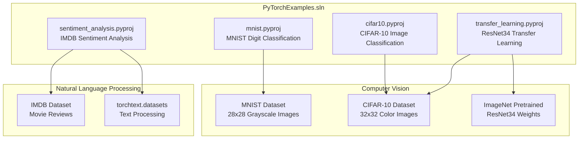
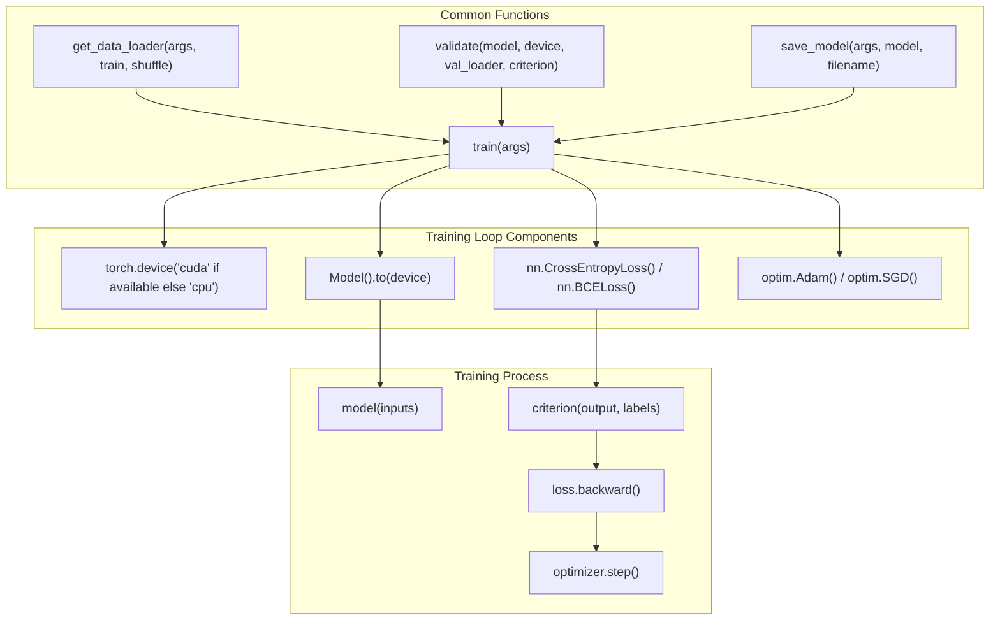
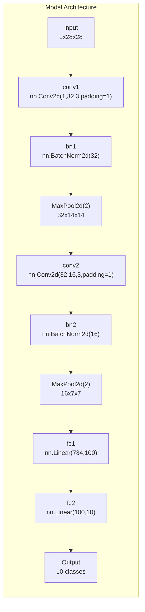
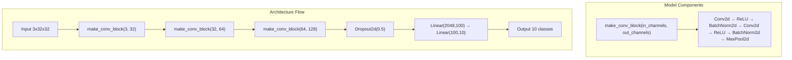
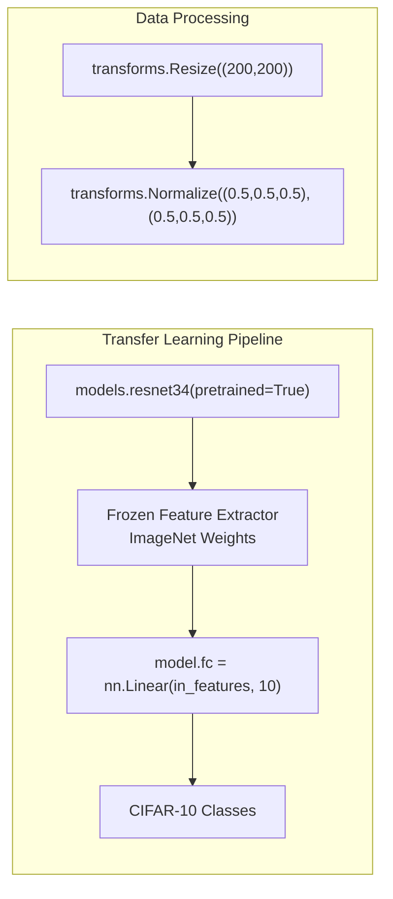
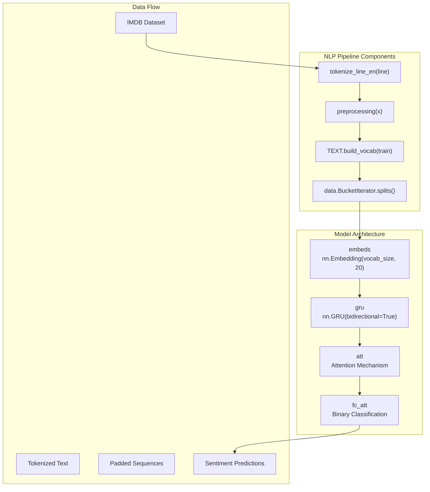
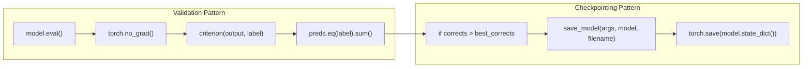

<!-- source: DeepWiki mcp.deepwiki.com · repo microsoft/samples-for-ai · extra page PyTorch Fundamentals · fetched 2026-10-26 -->

# PyTorch Fundamentals

Relevant source files

The following files were used as context for generating this wiki page:

- [examples/pytorch/PyTorchExamples.sln](examples/pytorch/PyTorchExamples.sln)
- [examples/pytorch/cifar10/cifar10.py](examples/pytorch/cifar10/cifar10.py)
- [examples/pytorch/cifar10/cifar10.pyproj](examples/pytorch/cifar10/cifar10.pyproj)
- [examples/pytorch/mnist/mnist.py](examples/pytorch/mnist/mnist.py)
- [examples/pytorch/mnist/mnist.pyproj](examples/pytorch/mnist/mnist.pyproj)
- [examples/pytorch/sentiment_analysis/sentiment_analysis.py](examples/pytorch/sentiment_analysis/sentiment_analysis.py)
- [examples/pytorch/sentiment_analysis/sentiment_analysis.pyproj](examples/pytorch/sentiment_analysis/sentiment_analysis.pyproj)
- [examples/pytorch/transfer_learning/transfer_learning.py](examples/pytorch/transfer_learning/transfer_learning.py)
- [examples/pytorch/transfer_learning/transfer_learning.pyproj](examples/pytorch/transfer_learning/transfer_learning.pyproj)

This document covers the fundamental PyTorch examples that demonstrate core deep learning concepts including image classification (MNIST, CIFAR-10), transfer learning, and natural language processing (sentiment analysis). These examples provide a foundation for understanding PyTorch's programming model, training workflows, and neural network architectures.

For advanced PyTorch implementations including ScreenerNet curriculum learning, see [ScreenerNet Implementation](#3.2.2). For neural image captioning systems, see [Image Captioning](#3.2.3).

## Project Structure

The PyTorch fundamentals are organized as a Visual Studio solution containing four core example projects that demonstrate different aspects of deep learning with PyTorch.

Sources: [examples/pytorch/PyTorchExamples.sln:1-39]()

## Training Pipeline Architecture

All fundamental examples follow a consistent training pipeline pattern with standardized function signatures and workflow components.

Sources: [examples/pytorch/mnist/mnist.py:82-124](), [examples/pytorch/cifar10/cifar10.py:94-136](), [examples/pytorch/transfer_learning/transfer_learning.py:68-110]()

## Computer Vision Examples

### MNIST Digit Classification

The MNIST example demonstrates basic convolutional neural network architecture for grayscale image classification using the `Model` class with two convolutional layers followed by fully connected layers.

| Component | Implementation | Details |
|-----------|---------------|---------|
| Model Architecture | `Model(nn.Module)` | Conv2D → BatchNorm → LeakyReLU → MaxPool |
| Input Processing | `transforms.Normalize((0.13,), (0.31,))` | Grayscale normalization |
| Optimizer | `optim.SGD(lr=0.01, momentum=0.6)` | Stochastic gradient descent |
| Loss Function | `nn.CrossEntropyLoss()` | Multi-class classification |

Sources: [examples/pytorch/mnist/mnist.py:30-47]()

### CIFAR-10 Image Classification

The CIFAR-10 example implements a deeper convolutional network for color image classification using the `make_conv_block` function to create modular convolutional blocks.

Sources: [examples/pytorch/cifar10/cifar10.py:28-59]()

## Transfer Learning Implementation

The transfer learning example demonstrates how to adapt pre-trained models using `models.resnet34(pretrained=True)` with custom classification heads via the `create_resnet` function.

| Component | Implementation | Purpose |
|-----------|---------------|---------|
| Base Model | `models.resnet34(pretrained=True)` | ImageNet pre-trained features |
| Custom Head | `model.fc = nn.Linear(model.fc.in_features, 10)` | CIFAR-10 classification |
| Input Resize | `transforms.Resize((200, 200))` | Match ImageNet input size |
| Optimizer | `optim.Adam(lr=0.001)` | Lower learning rate for fine-tuning |

Sources: [examples/pytorch/transfer_learning/transfer_learning.py:34-39](), [examples/pytorch/transfer_learning/transfer_learning.py:44-47]()

## Natural Language Processing

### Sentiment Analysis with Attention

The sentiment analysis example implements a bidirectional GRU with attention mechanism for binary classification of movie reviews using the `Model` class with embedding, recurrent, and attention layers.

| Component | Implementation | Details |
|-----------|---------------|---------|
| Embeddings | `nn.Embedding(vocab_size, idim, padding_idx=1)` | Word vector representations |
| Recurrent Layer | `nn.GRU(bidirectional=True, dropout=0.5)` | Bidirectional sequence processing |
| Attention | `nn.Linear(hdim * ndirections + idim, 1)` | Attention weight computation |
| Classification | `nn.Linear(hdim * ndirections, 100)` | Binary sentiment prediction |

Sources: [examples/pytorch/sentiment_analysis/sentiment_analysis.py:33-61](), [examples/pytorch/sentiment_analysis/sentiment_analysis.py:78-91]()

## Common Design Patterns

### Argument Parsing and Configuration

All examples use consistent argument parsing patterns with `argparse.ArgumentParser()` for hyperparameter configuration:

| Parameter | MNIST Default | CIFAR-10 Default | Transfer Learning | Sentiment Analysis |
|-----------|---------------|------------------|-------------------|-------------------|
| Learning Rate | 0.01 | 0.01 | 0.001 | 0.002 |
| Batch Size | 1000 | 256 | 128 | 128 |
| Epochs | 20 | 20 | 20 | 20 |
| Data Directory | 'data' | 'data' | 'data' | 'data' |
| Model Directory | 'model' | 'model' | 'model' | 'model' |

Sources: [examples/pytorch/mnist/mnist.py:114-122](), [examples/pytorch/cifar10/cifar10.py:127-133](), [examples/pytorch/transfer_learning/transfer_learning.py:100-107](), [examples/pytorch/sentiment_analysis/sentiment_analysis.py:173-181]()

### Model Validation and Checkpointing

The `validate` function implements consistent evaluation logic across all examples using `model.eval()` and `torch.no_grad()` context managers. Best model checkpointing uses the `save_model` function with `torch.save(model.state_dict())` for state persistence.

Sources: [examples/pytorch/mnist/mnist.py:69-80](), [examples/pytorch/cifar10/cifar10.py:81-92](), [examples/pytorch/sentiment_analysis/sentiment_analysis.py:98-112]()

---

