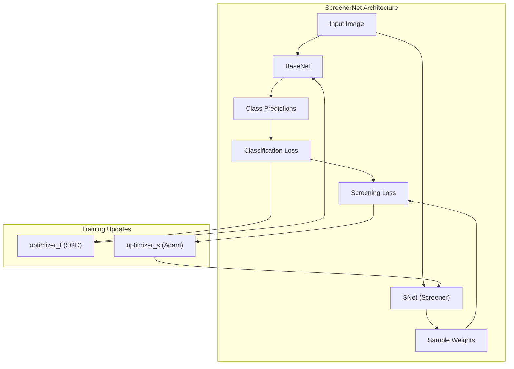
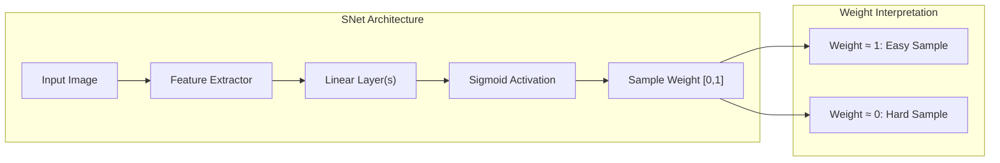
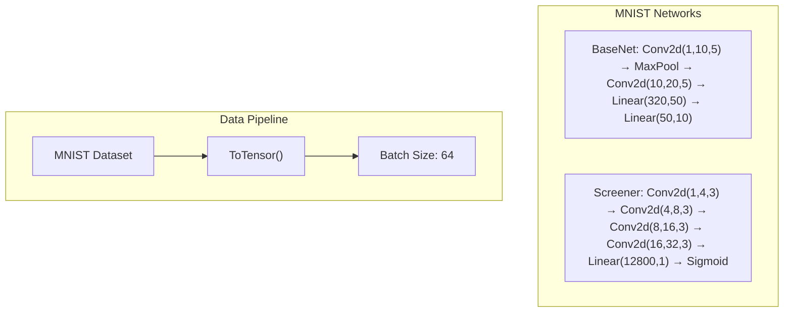
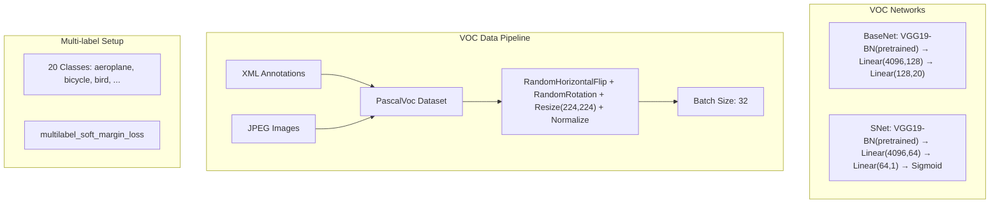
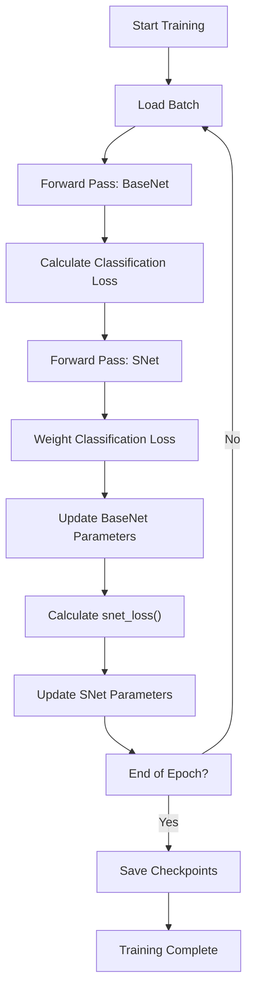

<!-- source: DeepWiki mcp.deepwiki.com · repo microsoft/samples-for-ai · extra page ScreenerNet Implementation · fetched 2026-10-26 -->

# ScreenerNet Implementation

<details>
<summary>Relevant source files</summary>

The following files were used as context for generating this wiki page:

- [examples/pytorch/ScreenerNet/Readme.md](examples/pytorch/ScreenerNet/Readme.md)
- [examples/pytorch/ScreenerNet/helpers.py](examples/pytorch/ScreenerNet/helpers.py)
- [examples/pytorch/ScreenerNet/snet.py](examples/pytorch/ScreenerNet/snet.py)
- [examples/pytorch/ScreenerNet/snet_cifar.py](examples/pytorch/ScreenerNet/snet_cifar.py)
- [examples/pytorch/ScreenerNet/snet_mnist.py](examples/pytorch/ScreenerNet/snet_mnist.py)
- [examples/pytorch/ScreenerNet/snet_voc.py](examples/pytorch/ScreenerNet/snet_voc.py)

</details>


## Purpose and Scope

This page documents the PyTorch implementation of ScreenerNet, a self-paced curriculum learning system that automatically determines training sample difficulty to improve neural network training efficiency. The implementation supports MNIST digit recognition, CIFAR-10 image classification, and Pascal VOC multi-label classification tasks.

For other PyTorch examples including basic models and transfer learning, see [PyTorch Fundamentals](#3.2.1). For image captioning implementations, see [Image Captioning](#3.2.3).

## Architecture Overview

ScreenerNet employs a dual-network architecture consisting of a base classifier network and a screening network that learns to weight training samples based on their difficulty.



Sources: [examples/pytorch/ScreenerNet/snet.py:52-141]()

## Core Components

### Base Network (BaseNet)

The `BaseNet` class implements the primary classification network, with dataset-specific architectures:

| Dataset | Architecture | Output Classes |
|---------|-------------|----------------|
| MNIST | CNN with 2 conv layers + 2 FC layers | 10 |
| CIFAR-10 | CNN with 2 conv layers + 2 FC layers | 10 |
| Pascal VOC | VGG19-BN backbone + custom classifier | 20 |

### Screening Network (SNet/Screener)

The screening network outputs sample weights between 0 and 1, indicating training difficulty:



Sources: [examples/pytorch/ScreenerNet/snet_mnist.py:46-60](), [examples/pytorch/ScreenerNet/snet_cifar.py:42-45](), [examples/pytorch/ScreenerNet/snet_voc.py:79-99]()

### Screening Loss Function

The `snet_loss()` function implements the self-paced learning objective:

```python
def snet_loss(snet_out, cls_err, variables, M, alpha):
    # L1 regularization on screener parameters
    l1 = F.l1_loss(w, torch.zeros_like(w))
    
    # Self-paced learning loss
    loss = torch.pow((1-snet_out),2) * cls_err
    loss = loss + torch.pow(snet_out,2) * torch.clamp(M-cls_err, min=0)
    
    return torch.sum(loss) + alpha*l1
```

Where:
- `M`: Difficulty threshold parameter
- `alpha`: L1 regularization weight
- `snet_out`: Screening network output weights
- `cls_err`: Per-sample classification errors

Sources: [examples/pytorch/ScreenerNet/snet.py:14-23]()

## Dataset-Specific Implementations

### Configuration Parameters

| Dataset | M (Threshold) | Alpha (L1 Weight) | Optimizer Settings |
|---------|---------------|-------------------|-------------------|
| MNIST | 1.0 | 0.01 | BaseNet: SGD(lr=0.01), SNet: Adam(lr=0.0001) |
| CIFAR-10 | 10.0 | 0.01 | BaseNet: SGD(lr=0.01), SNet: Adam(lr=0.001) |
| Pascal VOC | 1.0 | 0.001 | BaseNet: SGD(lr=0.001), SNet: Adam(lr=0.0025) |

### MNIST Implementation



Sources: [examples/pytorch/ScreenerNet/snet_mnist.py:13-25](), [examples/pytorch/ScreenerNet/snet_mnist.py:27-60]()

### Pascal VOC Implementation



Sources: [examples/pytorch/ScreenerNet/snet_voc.py:16-57](), [examples/pytorch/ScreenerNet/snet_voc.py:60-99](), [examples/pytorch/ScreenerNet/snet_voc.py:117-134]()

## Training Process

### Dual-Network Training Loop

The training alternates between updating the base network and screening network:



### Training Function Flow

The `train()` function coordinates the dual-network training:

1. **Initialization**: Load dataset-specific models and optimizers
2. **Forward Pass**: Compute base network predictions and screening weights  
3. **Base Network Update**: Weighted loss backpropagation using `loss_w = torch.mean(loss*x_w)`
4. **Screening Network Update**: Custom `snet_loss()` optimization
5. **Checkpointing**: Save models every 10,000 epochs

Sources: [examples/pytorch/ScreenerNet/snet.py:52-141](), [examples/pytorch/ScreenerNet/snet.py:84-140]()

## Usage Examples

### Command Line Interface

The implementation provides a command-line interface supporting training and testing:

```bash
# Training examples
python snet.py train mnist --max_epoch 100 --gpu
python snet.py train cifar --download --gpu --max_epoch 200
python snet.py train voc --modelpath ./models --max_epoch 50

# Testing examples  
python snet.py test mnist --modelname mnist_net.pm
python snet.py test voc --modelname voc_model.pm --gpu

# Training without screening network (baseline)
python snet.py train mnist --no_snet --max_epoch 100
```

### Programmatic Usage

```python
# Import dataset-specific module
modellib = importlib.import_module('snet_mnist')
net, snet = modellib.create_net()
trainloader = modellib.getLoader('train', download=True)

# Training configuration
M = modellib.M          # Difficulty threshold
alpha = modellib.alpha  # L1 regularization weight
optimizer_f = optim.SGD(net.parameters(), lr=0.01, momentum=0.9)
optimizer_s = optim.Adam(snet.parameters(), lr=0.0001)
```

### Evaluation Metrics

| Dataset | Metric | Implementation |
|---------|--------|----------------|
| MNIST/CIFAR-10 | Accuracy | Top-1 classification accuracy |
| Pascal VOC | mAP | Mean Average Precision across 20 classes |

Sources: [examples/pytorch/ScreenerNet/snet.py:225-249](), [examples/pytorch/ScreenerNet/snet.py:142-219]()

---

