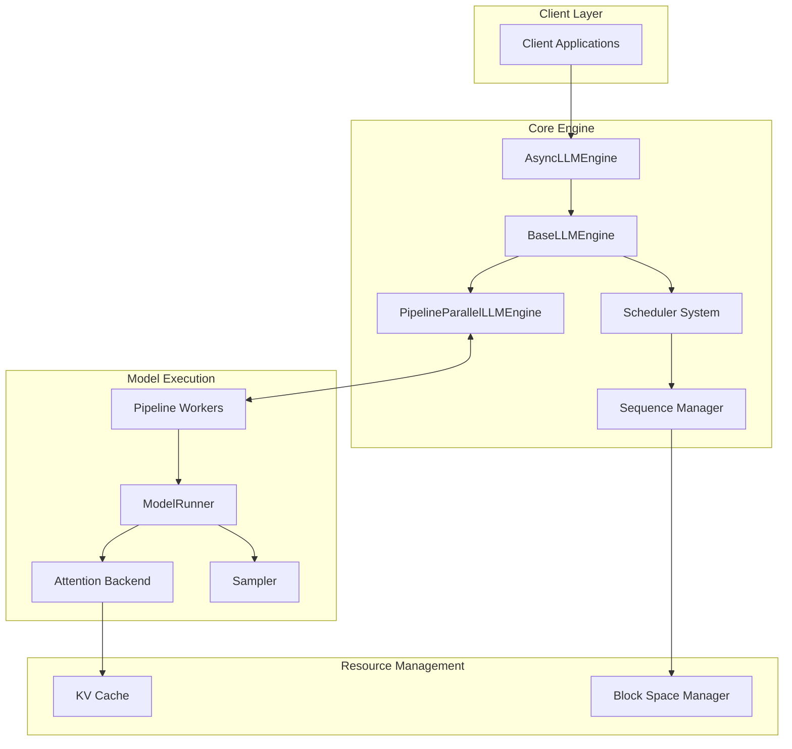
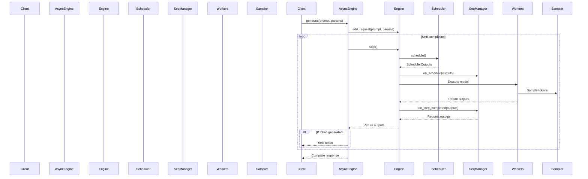

<!-- source: DeepWiki mcp.deepwiki.com · repo microsoft/sarathi-serve · page 1 Overview · fetched 2026-10-26 -->

# Overview

<details>
<summary>Relevant source files</summary>

The following files were used as context for generating this wiki page:

- [README.md](README.md)

</details>


Sarathi-Serve is a high-throughput, low-latency framework designed specifically for serving Large Language Models (LLMs). It originated as a research-focused fork of the vLLM project, optimized for faster research iterations in LLM serving technology. The system specializes in optimizing the throughput-latency tradeoff in LLM inference through innovative scheduling and resource management techniques.

For detailed installation instructions, see [Installation](#1.1). For a quick start guide, refer to [Getting Started](#1.2).

Sources: [README.md:1-3](), [README.md:55-57]()

## System Architecture

Sarathi-Serve employs a modular architecture with several key components that work together to provide efficient LLM inference. The following diagram illustrates the high-level architecture:



Sources: [README.md:3]()

## Key Components

### Engine Components

1. **AsyncLLMEngine**: Provides an asynchronous interface to the LLM engine, enabling non-blocking request handling for clients.

2. **BaseLLMEngine**: The core engine component that manages the execution of model inference requests.

3. **PipelineParallelLLMEngine**: Extends the base engine to support pipeline parallelism, allowing model layers to be distributed across multiple GPUs for improved performance.

For more detailed information on these components, see [Engine Components](#2.1).

### Scheduler System

The Scheduler is responsible for determining which sequences to process in each engine step, optimizing for both throughput and latency. Sarathi-Serve implements several scheduler strategies:

- **VllmScheduler**: Based on the original vLLM scheduling approach
- **SimpleChunkingScheduler**: Implements basic sequence chunking for efficiency
- **OrcaScheduler**: Based on the Orca scheduling algorithm
- **FasterTransformerScheduler**: Implements scheduling optimized for the FasterTransformer backend
- **SarathiScheduler**: The system's namesake scheduler that optimizes the throughput-latency tradeoff

For detailed information on schedulers, see [Scheduler Configuration](#4.1).

### Sequence Management

The Sequence Manager tracks and manages the lifecycle of all active sequences (requests) in the system, handling their state transitions from prefill to decode phases and eventual completion.

For more on sequence management, see [Sequence Management](#2.3).

### Memory Management

Sarathi-Serve uses an efficient block-based memory management system for the KV cache:

1. **KV Cache**: Stores key-value pairs for attention mechanisms to avoid redundant computation
2. **Block Space Manager**: Allocates and deallocates memory blocks for sequences, managing the physical memory resources

For more details on memory management, see [Memory Management](#2.4).

## Request Processing Flow

The following diagram illustrates how requests flow through the Sarathi-Serve system:



## Parallel Processing

Sarathi-Serve supports two main parallelism approaches:

1. **Tensor Parallelism**: Splits model weights across multiple GPUs, allowing larger models to fit in memory and improving computational efficiency.

2. **Pipeline Parallelism**: Partitions model layers across multiple GPUs, with each GPU handling a subset of the layers, enabling processing of multiple batches simultaneously.

For more details on parallel processing, see [Parallel Processing](#3.3).

## Attention Mechanisms

The system includes optimized attention implementations:

1. **FlashInfer Attention**: High-performance attention implementation
2. **NoOp Attention**: Used for testing and benchmarking

For detailed information about attention mechanisms, see [Attention Mechanisms](#3.1).

## Configuration System

Sarathi-Serve uses a comprehensive configuration system to customize various aspects of the engine:

```mermaid
classDiagram
    class "SystemConfig" {
        +model_config: ModelConfig
        +cache_config: CacheConfig
        +parallel_config: ParallelConfig
        +scheduler_config: BaseSchedulerConfig
    }
    
    class "ModelConfig" {
        +model: str
        +dtype: str
        +max_model_len: int
    }
    
    class "CacheConfig" {
        +block_size: int
        +num_gpu_blocks: int
    }
    
    class "ParallelConfig" {
        +tensor_parallel_size: int
        +pipeline_parallel_size: int
    }
    
    class "BaseSchedulerConfig" {
        +max_num_seqs: int
        +get_type()
    }
    
    SystemConfig *-- ModelConfig
    SystemConfig *-- CacheConfig
    SystemConfig *-- ParallelConfig
    SystemConfig *-- BaseSchedulerConfig
    
    BaseSchedulerConfig <|-- VllmSchedulerConfig
    BaseSchedulerConfig <|-- SarathiSchedulerConfig
```

For detailed information on configuration options, see [Configuration System](#4).

## Benchmarking

Sarathi-Serve includes a comprehensive benchmarking system to measure performance and optimize configurations:

1. **BenchmarkRunner**: Executes benchmarks against the LLM engine
2. **CapacitySearch**: Automatically finds optimal throughput configurations
3. **MetricsStore**: Collects and analyzes performance metrics

For more information on benchmarking, see [Benchmarking](#5).

## Hardware Requirements

Sarathi-Serve has been tested with CUDA 12.3 on H100 and A100 GPUs.

Sources: [README.md:7-9]()

## Origins and Research

Sarathi-Serve was developed as part of research on optimizing the throughput-latency tradeoff in LLM inference. The system's design and performance are detailed in the OSDI'24 paper "Taming Throughput-Latency Tradeoff in LLM Inference with Sarathi-Serve."

Sources: [README.md:3](), [README.md:42-53]()

## Installation and Setup

To set up Sarathi-Serve, you need to:

1. Clone the repository
2. Set up a Python 3.10 environment
3. Install the package with required dependencies

Detailed installation instructions can be found in the [Installation](#1.1) page.

Sources: [README.md:11-36]()

---

