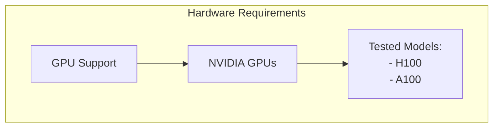
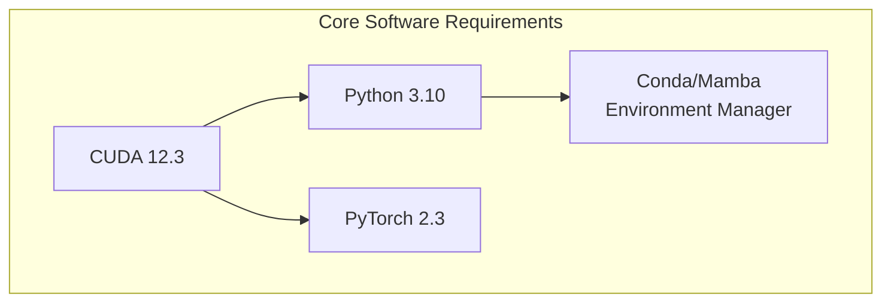
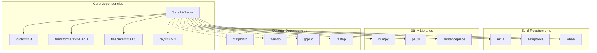
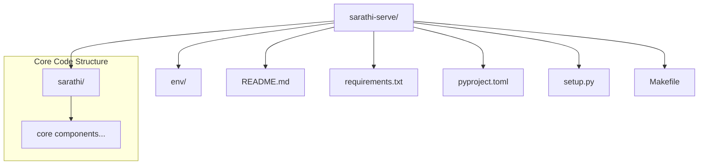
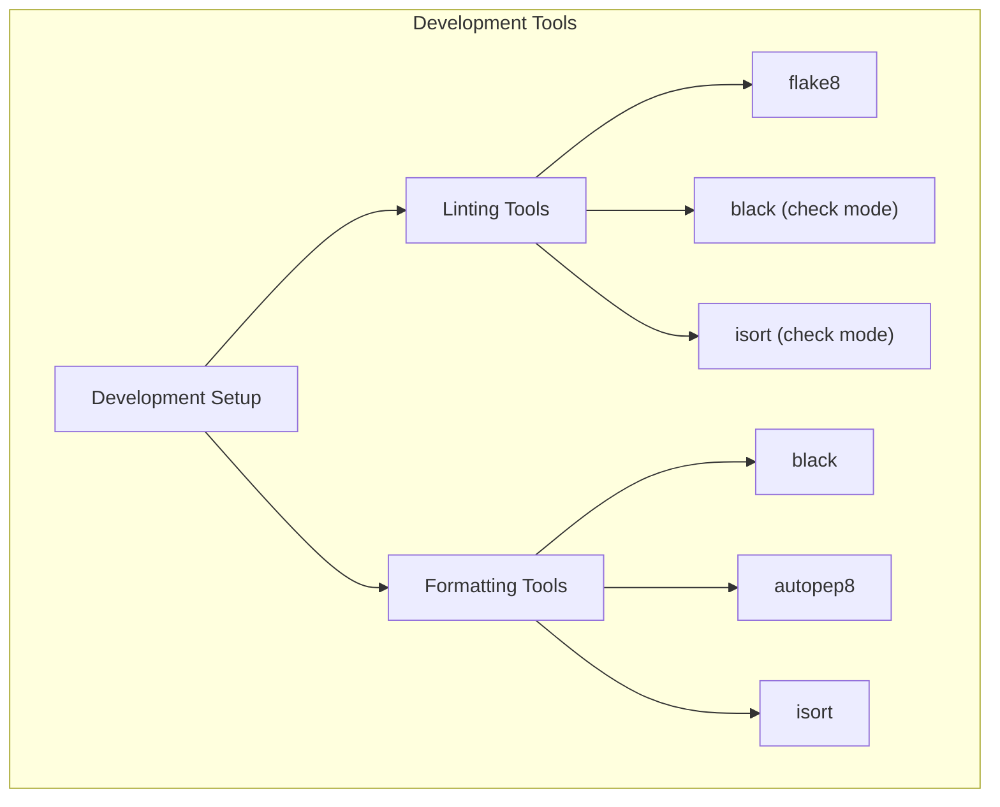

<!-- source: DeepWiki mcp.deepwiki.com · repo microsoft/sarathi-serve · page 1.1 Installation · fetched 2026-10-26 -->

# Installation

<details>
<summary>Relevant source files</summary>

The following files were used as context for generating this wiki page:

- [Makefile](Makefile)
- [README.md](README.md)
- [pyproject.toml](pyproject.toml)
- [requirements.txt](requirements.txt)

</details>


This document provides comprehensive instructions for installing Sarathi-Serve, a high-throughput, low-latency framework for serving Large Language Models (LLMs). For basic usage after installation, please refer to [Getting Started](#1.2).

## System Requirements

### Hardware Requirements

Sarathi-Serve has specific hardware requirements to ensure optimal performance.



Sources: [README.md:7-9]()

### Software Prerequisites

Before installing Sarathi-Serve, ensure your system meets the following software requirements:



Sources: [README.md:7-9](), [README.md:21-30](), [requirements.txt:8]()

## Installation Process

The installation process involves four main steps:


### 1. Setting up CUDA

Sarathi-Serve has been tested with CUDA 12.3 on H100 and A100 GPUs. Make sure you have the appropriate CUDA toolkit installed on your system.

Sources: [README.md:7-9]()

### 2. Cloning the Repository

Clone the Sarathi-Serve repository from GitHub:

```bash
git clone git@github.com:microsoft/sarathi-serve.git
```

Sources: [README.md:13-15]()

### 3. Creating a Python Environment

Sarathi-Serve recommends using Mamba to create a Python 3.10 environment. If you don't already have Mamba installed, you can set it up with:

```bash
wget https://github.com/conda-forge/miniforge/releases/latest/download/Mambaforge-Linux-x86_64.sh
bash Mambaforge-Linux-x86_64.sh # follow the instructions from there
```

Then create a Python 3.10 environment:

```bash
mamba create -p ./env python=3.10
```

Sources: [README.md:17-30]()

### 4. Installing Sarathi-Serve

Once you've set up the Python environment, install Sarathi-Serve:

```bash
pip install -e . --extra-index-url https://flashinfer.ai/whl/cu121/torch2.3/
```

This command installs Sarathi-Serve in development mode (`-e`) and uses the FlashInfer wheel repository as an additional index.

Sources: [README.md:32-36]()

## Dependencies

Sarathi-Serve relies on multiple dependencies to function properly. Below is a comprehensive view of the key dependencies:



The full list of dependencies can be found in the requirements.txt file.

Sources: [requirements.txt:1-24](), [pyproject.toml:2-8]()

## Installation Verification

After installing Sarathi-Serve, you can verify the installation by running a simple inference test. The verification process is detailed in the [Getting Started](#1.2) page.

## Installation Directory Structure

After installation, the Sarathi-Serve directory structure will look like this:



Sources: [README.md:13-36]()

## Common Installation Issues

### CUDA Compatibility

Make sure your CUDA version (12.3) is compatible with the installed GPU drivers. Incompatible CUDA versions may result in runtime errors.

### FlashInfer Dependency

The installation command includes a specific extra index URL for FlashInfer. If you encounter issues with this dependency, ensure the URL is accessible and the wheel is available for your specific CUDA and PyTorch configuration.

### Python Version

Sarathi-Serve is specifically tested with Python 3.10. Using different Python versions may lead to compatibility issues with certain dependencies.

Sources: [README.md:7-9](), [README.md:32-36](), [requirements.txt:17]()

## Advanced Installation Options

For development purposes, you might want to consider additional tools:



These tools can be used through the provided Makefile with commands like `make lint` and `make format`.

Sources: [Makefile:1-24]()

## Acknowledgment

Sarathi-Serve originated as a fork of the vLLM project, designed as a research prototype for faster iterations in LLM serving research. It maintains only the most critical features needed for research purposes.

Sources: [README.md:55-57]()

---

