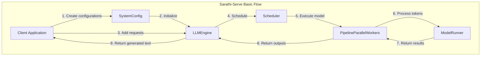
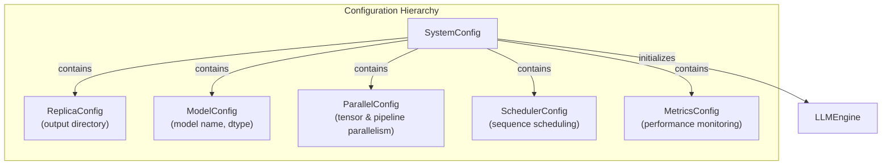
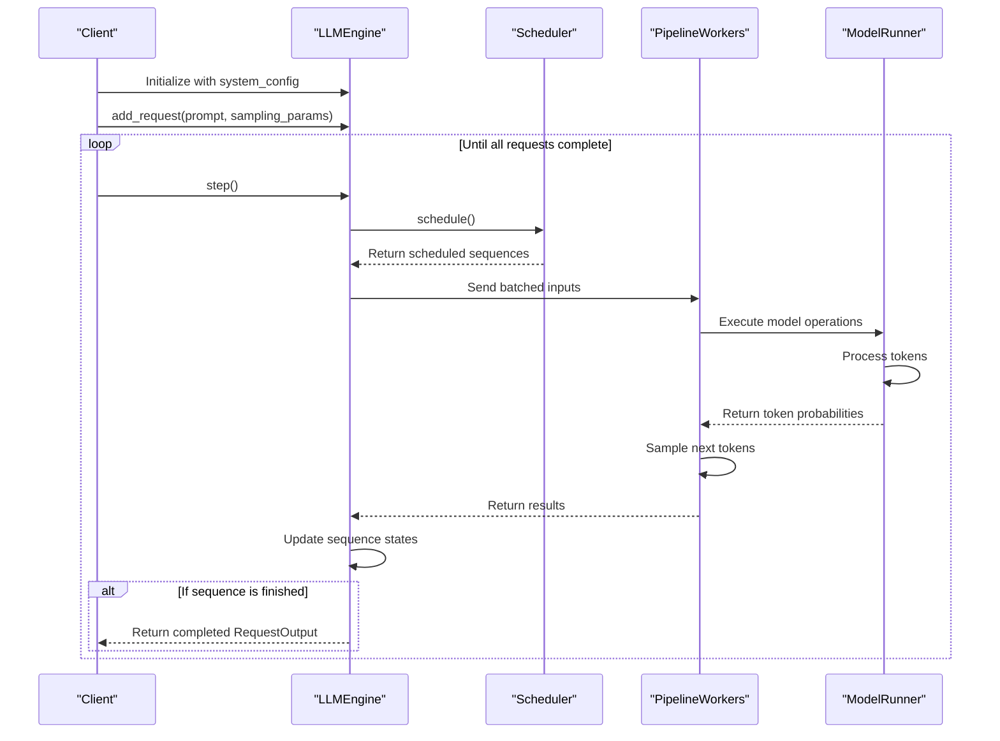

<!-- source: DeepWiki mcp.deepwiki.com · repo microsoft/sarathi-serve · page 1.2 Getting Started · fetched 2026-10-26 -->

# Getting Started

<details>
<summary>Relevant source files</summary>

The following files were used as context for generating this wiki page:

- [README.md](README.md)
- [examples/offline_inference.py](examples/offline_inference.py)

</details>


This guide provides step-by-step instructions for setting up Sarathi-Serve and running your first LLM inference. The document covers basic installation, configuration, and executing a simple inference example. For more advanced topics, please refer to [System Architecture](#2) or [Performance Tuning](#7.1).

## Prerequisites

Before getting started with Sarathi-Serve, ensure you have:

- A CUDA-compatible GPU (tested with H100 and A100 GPUs)
- CUDA 12.3 installed
- Basic familiarity with Python and command-line operations

## System Architecture Overview



Sources: [examples/offline_inference.py:5-6](), [examples/offline_inference.py:58-86]()

## Installation

### 1. Clone the Repository

```bash
git clone git@github.com:microsoft/sarathi-serve.git
cd sarathi-serve
```

### 2. Create a Python Environment

Using Mamba (recommended for faster dependency resolution):

```bash
wget https://github.com/conda-forge/miniforge/releases/latest/download/Mambaforge-Linux-x86_64.sh
bash Mambaforge-Linux-x86_64.sh

# After installation completes
mamba create -p ./env python=3.10
mamba activate ./env
```

### 3. Install Sarathi-Serve

```bash
pip install -e . --extra-index-url https://flashinfer.ai/whl/cu121/torch2.3/
```

Sources: [README.md:8-36]()

## Configuration Components

Before running inference, you need to configure several components that control Sarathi-Serve's behavior:



Sources: [examples/offline_inference.py:5](), [examples/offline_inference.py:28-57]()

### Basic Configuration Setup

Here's how to create a minimal configuration for inference:

```python
from sarathi.config import ModelConfig, ParallelConfig, SarathiSchedulerConfig, MetricsConfig, SystemConfig, ReplicaConfig
from sarathi import LLMEngine, SamplingParams

# Output directory configuration
replica_config = ReplicaConfig(
    output_dir="./output",
)

# Model configuration
model_config = ModelConfig(
    model="mistralai/Mixtral-8x7B-Instruct-v0.1",  # Example model
)

# Parallelism configuration (adjust based on available hardware)
parallel_config = ParallelConfig(
    tensor_parallel_size=1,  # Number of GPUs for tensor parallelism
    pipeline_parallel_size=4,  # Number of GPUs for pipeline parallelism
)

# Scheduler configuration
scheduler_config = SarathiSchedulerConfig(
    chunk_size=100,
    max_num_seqs=10,  # Maximum concurrent sequences
)

# Metrics configuration
metrics_config = MetricsConfig(
    write_metrics=True,
    enable_chrome_trace=True,  # Enables detailed performance tracing
)

# Create the system configuration
system_config = SystemConfig(
    replica_config=replica_config,
    model_config=model_config,
    parallel_config=parallel_config,
    scheduler_config=scheduler_config,
    metrics_config=metrics_config,
)
```

Sources: [examples/offline_inference.py:28-57]()

## Running Your First Inference

Once your configuration is ready, follow these steps to run inference:

### 1. Initialize the LLM Engine

```python
llm_engine = LLMEngine.from_system_config(system_config)
```

### 2. Prepare Prompts and Sampling Parameters

```python
# Example prompts
prompts = [
    "Hello, my name is",
    "The president of the United States is",
    "The capital of France is",
]

# Configure text generation behavior
sampling_params = SamplingParams(
    temperature=0.8,  # Controls randomness (higher = more random)
    top_p=0.95,       # Nucleus sampling parameter
    max_tokens=100    # Maximum number of tokens to generate
)
```

### 3. Generate Text

Here's a function that processes prompts through the LLM engine:

```python
def generate(llm_engine, prompts, sampling_params):
    # Add all prompts to the engine queue
    for prompt in prompts:
        llm_engine.add_request(prompt, sampling_params)
    
    # Track progress
    num_requests = llm_engine.get_num_unfinished_requests()
    
    # Process all requests until completion
    outputs = []
    while llm_engine.has_unfinished_requests():
        step_outputs = llm_engine.step()
        for output in step_outputs:
            if output.finished:
                outputs.append(output)
    
    # Sort outputs by sequence ID
    outputs = sorted(outputs, key=lambda x: int(x.seq_id))
    return outputs

# Run the generation
outputs = generate(llm_engine, prompts, sampling_params)
```

### 4. Process the Results

```python
# Print the generated text for each prompt
for output in outputs:
    prompt = output.prompt
    generated_text = output.text
    print(f"Prompt: {prompt!r}")
    print(f"Generated text: {generated_text!r}")
```

Sources: [examples/offline_inference.py:62-100]()

## Inference Process Flow

The following sequence diagram shows how requests flow through Sarathi-Serve:



Sources: [examples/offline_inference.py:62-87]()

## Analyzing Performance

After running inference, you can collect and visualize performance metrics:

```python
# Collect metrics from workers
llm_engine.pull_worker_metrics()

# Generate visualization plots
llm_engine.plot_metrics()
```

Sources: [examples/offline_inference.py:103-104]()

## Complete Example

Here's a complete example script that puts everything together:

```python
import datetime
from typing import List

from sarathi.config import ModelConfig, ParallelConfig, SarathiSchedulerConfig, MetricsConfig, SystemConfig, ReplicaConfig
from sarathi import LLMEngine, SamplingParams, RequestOutput

# Set up output directory
output_dir = f"./output/{datetime.datetime.now().strftime('%Y-%m-%d_%H-%M-%S')}"

# Configuration
replica_config = ReplicaConfig(output_dir=output_dir)
model_config = ModelConfig(model="mistralai/Mixtral-8x7B-Instruct-v0.1")
parallel_config = ParallelConfig(tensor_parallel_size=1, pipeline_parallel_size=4)
scheduler_config = SarathiSchedulerConfig(chunk_size=100, max_num_seqs=10)
metrics_config = MetricsConfig(write_metrics=True, enable_chrome_trace=True)

system_config = SystemConfig(
    replica_config=replica_config,
    model_config=model_config,
    parallel_config=parallel_config,
    scheduler_config=scheduler_config,
    metrics_config=metrics_config,
)

# Initialize engine
llm_engine = LLMEngine.from_system_config(system_config)

# Prepare prompts and sampling parameters
prompts = [
    "Hello, my name is",
    "The president of the United States is",
    "The capital of France is",
]
sampling_params = SamplingParams(temperature=0.8, top_p=0.95, max_tokens=100)

# Generate text
def generate(
    llm_engine: LLMEngine,
    prompts: List[str],
    sampling_params: SamplingParams,
) -> List[RequestOutput]:
    for prompt in prompts:
        llm_engine.add_request(prompt, sampling_params)
    
    outputs = []
    while llm_engine.has_unfinished_requests():
        step_outputs = llm_engine.step()
        for output in step_outputs:
            if output.finished:
                outputs.append(output)
    
    outputs = sorted(outputs, key=lambda x: int(x.seq_id))
    return outputs

outputs = generate(llm_engine, prompts, sampling_params)

# Print results
for output in outputs:
    print(f"Prompt: {output.prompt!r}")
    print(f"Generated text: {output.text!r}")

# Analyze performance
llm_engine.pull_worker_metrics()
llm_engine.plot_metrics()
```

Sources: [examples/offline_inference.py]()

## Next Steps

Now that you've run your first inference with Sarathi-Serve, you can explore:

- For understanding the system architecture in more detail, see [System Architecture](#2)
- To learn about available model configurations, see [Supported Models](#3.4)
- For optimizing performance, see [Performance Tuning](#7.1)
- To run performance evaluations, see [Running Benchmarks](#5.1)

For more complex inference scenarios, check [Offline Inference](#6.1) which provides additional examples and workflows.

---

