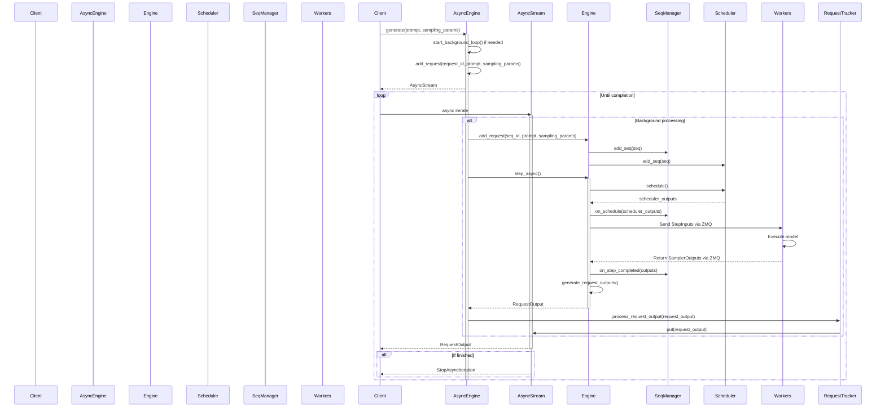
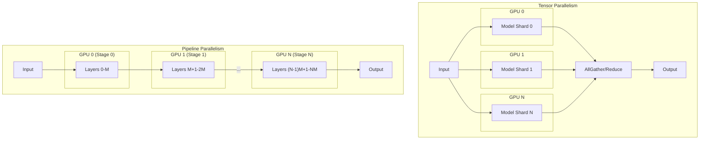

<!-- source: DeepWiki mcp.deepwiki.com · repo microsoft/sarathi-serve · page 2 System Architecture · fetched 2026-10-26 -->

# System Architecture

<details>
<summary>Relevant source files</summary>

The following files were used as context for generating this wiki page:

- [sarathi/engine/async_llm_engine.py](sarathi/engine/async_llm_engine.py)
- [sarathi/engine/base_llm_engine.py](sarathi/engine/base_llm_engine.py)
- [sarathi/engine/pipeline_parallel_llm_engine.py](sarathi/engine/pipeline_parallel_llm_engine.py)
- [sarathi/utils/__init__.py](sarathi/utils/__init__.py)
- [sarathi/worker/pipeline_parallel_worker.py](sarathi/worker/pipeline_parallel_worker.py)

</details>


This document provides a high-level overview of Sarathi-Serve's system architecture, detailing the core components and how they interact with each other to deliver high-throughput, low-latency LLM inference. Sarathi-Serve is designed as a distributed serving system that optimizes the throughput-latency tradeoff through innovative scheduling and resource management techniques.

For information about specific engine components, see [Engine Components](#2.1). For details about worker implementation, see [Worker Architecture](#2.2).

## Engine Hierarchy

Sarathi-Serve implements a tiered engine architecture with different layers of abstraction to support various execution modes and parallelism strategies.

```mermaid
classDiagram
    class "BaseLLMEngine" {
        +init(config: SystemConfig)
        +add_request(prompt, sampling_params)
        +step(): List[RequestOutput]
        +get_model_config(): ModelConfig
        -_init_workers_ray()
        -_init_cache()
        -_on_step_completed()
    }
    
    class "PipelineParallelLLMEngine" {
        -scheduler_output_queue: Queue
        -output_queue: Queue
        -pending_step_outputs: List
        +start_execution_loops()
        -_schedule_loop()
        -_output_loop()
        -_microbatch_watch_loop()
    }
    
    class "AsyncLLMEngine" {
        -engine: _AsyncLLMEngine
        -request_tracker: RequestTracker
        -background_loop: Future
        +generate(prompt, sampling_params): AsyncIterator
        +add_request(request_id, prompt, sampling_params): AsyncStream
        +abort(request_id)
        -run_engine_loop()
    }
    
    class "_AsyncLLMEngine" {
        -engine: LLMEngine
        +add_request(seq_id, prompt, sampling_params)
        +step_async(): List[RequestOutput]
    }
    
    class "RequestTracker" {
        -_request_streams: Dict[str, AsyncStream]
        -_finished_requests: Queue
        -_new_requests: Queue
        +add_request(request_id, **kwargs): AsyncStream
        +abort_request(request_id)
        +process_request_output(request_output)
    }
    
    class "AsyncStream" {
        -request_id: str
        -_queue: Queue
        -_finished: bool
        +put(item)
        +finish()
    }
    
    BaseLLMEngine <|-- PipelineParallelLLMEngine
    AsyncLLMEngine *-- "_AsyncLLMEngine"
    "_AsyncLLMEngine" *-- BaseLLMEngine
    AsyncLLMEngine *-- "RequestTracker"
    "RequestTracker" *-- "AsyncStream"
```

The engine hierarchy forms the central component of Sarathi-Serve, with `BaseLLMEngine` providing core functionality and specialized implementations for different use cases:

1. **BaseLLMEngine** ([sarathi/engine/base_llm_engine.py]()) - The foundation class that handles:
   - Worker initialization and management
   - Memory profiling and cache initialization
   - Scheduling and execution of generation steps
   - Request processing and output generation

2. **PipelineParallelLLMEngine** ([sarathi/engine/pipeline_parallel_llm_engine.py]()) - Extends `BaseLLMEngine` to support pipeline-parallel model execution across multiple GPUs with:
   - Asynchronous scheduling and execution loops
   - Queue-based communication between scheduling and output processing
   - Microbatch management for pipeline parallelism

3. **AsyncLLMEngine** ([sarathi/engine/async_llm_engine.py]()) - Provides an asynchronous API wrapper around the engine:
   - Non-blocking request handling through `AsyncStream`
   - Background processing loop for continuous request handling
   - Request tracking and management through `RequestTracker`
   - Asynchronous token generation through Python's async iterators

Sources: [sarathi/engine/base_llm_engine.py:34-487](), [sarathi/engine/pipeline_parallel_llm_engine.py:31-197](), [sarathi/engine/async_llm_engine.py:238-512]()

## Request Processing Flow

The request processing flow in Sarathi-Serve follows a multi-stage pipeline from client input to generated output.



The request processing stages include:

1. **Request Submission**:
   - Client calls `generate()` on `AsyncLLMEngine`
   - Request is added to the engine with a unique ID
   - An `AsyncStream` is returned for asynchronous iteration

2. **Request Scheduling**:
   - Request is tokenized and added to scheduler queue
   - Scheduler determines which sequences to process in each step
   - `SequenceManager` tracks sequence state and allocates resources

3. **Model Execution**:
   - Scheduled sequences are sent to workers for processing
   - Workers execute the model (prefill or decode steps)
   - Results are returned from workers to engine

4. **Output Processing**:
   - Generated tokens are processed by `SequenceManager`
   - `RequestOutput` objects are created for completed steps
   - Results are yielded to client via `AsyncStream`

5. **Request Completion**:
   - Request is marked as finished when stop conditions are met
   - Final results are delivered to client
   - Resources are released for other requests

Sources: [sarathi/engine/async_llm_engine.py:392-462](), [sarathi/engine/base_llm_engine.py:364-398](), [sarathi/engine/pipeline_parallel_llm_engine.py:114-180]()

## Communication Architecture

Sarathi-Serve uses ZeroMQ (ZMQ) for efficient communication between engine and workers, supporting both local and distributed deployment patterns.

```mermaid
graph TD
    subgraph "Engine Component"
        EnqueueSocket["enqueue_socket (PUB)"]
        OutputSocket["output_socket (PULL)"]
        MicrobatchSocket["microbatch_socket (PULL)"]
    end

    subgraph "Worker Components"
        Worker1["Worker 1"]
        Worker2["Worker 2"]
        WorkerN["Worker N"]
        
        Worker1 --> EnqueueListener1["enqueue_socket (SUB)"]
        Worker1 --> OutputSender1["output_socket (PUSH)"]
        Worker1 --> MBSender1["microbatch_socket (PUSH)"]
        
        Worker2 --> EnqueueListener2["enqueue_socket (SUB)"]
        Worker2 --> OutputSender2["output_socket (PUSH)"]
        Worker2 --> MBSender2["microbatch_socket (PUSH)"]
        
        WorkerN --> EnqueueListenerN["enqueue_socket (SUB)"]
        WorkerN --> OutputSenderN["output_socket (PUSH)"]
        WorkerN --> MBSenderN["microbatch_socket (PUSH)"]
    end
    
    EnqueueSocket -->|"StepInputs"| EnqueueListener1
    EnqueueSocket -->|"StepInputs"| EnqueueListener2
    EnqueueSocket -->|"StepInputs"| EnqueueListenerN
    
    OutputSender1 -->|"SamplerOutputs"| OutputSocket
    OutputSender2 -->|"SamplerOutputs"| OutputSocket
    OutputSenderN -->|"SamplerOutputs"| OutputSocket
    
    MBSender1 -->|"Microbatch signals"| MicrobatchSocket
    MBSender2 -->|"Microbatch signals"| MicrobatchSocket
    MBSenderN -->|"Microbatch signals"| MicrobatchSocket
```



The ZMQ-based communication system includes:

1. **Socket Initialization**:
   - Engine initializes ZMQ context and sockets in `_init_zmq_sockets()`
   - Workers connect to engine's sockets at startup

2. **Message Types**:
   - `StepInputs`: Contains scheduler outputs and new sequences
   - `SamplerOutputs`: Contains model execution results
   - Microbatch signals: Used for pipeline parallelism coordination

3. **Communication Patterns**:
   - Publish-Subscribe: Engine publishes step inputs to all workers
   - Push-Pull: Workers push results to engine's output socket
   - Pipeline parallel stages use microbatch sockets for coordination

4. **Socket Types**:
   - `PUB`/`SUB`: For broadcasting step inputs to workers
   - `PUSH`/`PULL`: For collecting outputs and microbatch signals

For pipeline parallel execution, the microbatch socket enables coordination between pipeline stages, allowing the engine to schedule new batches when previous ones are completed.

Sources: [sarathi/engine/base_llm_engine.py:117-122](), [sarathi/engine/pipeline_parallel_llm_engine.py:68-73](), [sarathi/worker/pipeline_parallel_worker.py:26-32]()

## Parallel Processing

Sarathi-Serve supports both tensor parallelism and pipeline parallelism to efficiently distribute large models across multiple GPUs.



The parallelism implementation includes:

1. **Tensor Parallelism**:
   - Splits individual layers across multiple GPUs
   - Each GPU holds a portion of the model weights
   - Operations like matrix multiplications are distributed
   - Results are aggregated through AllGather or Reduce operations

2. **Pipeline Parallelism**:
   - Divides model into stages executed on different GPUs
   - Each GPU processes a subset of model layers
   - `PipelineParallelLLMEngine` manages the execution flow
   - Uses `PipelineParallelWorker` for processing individual stages
   - Microbatch signaling coordinates between stages

3. **Worker Initialization and Management**:
   - Workers are initialized through Ray ([sarathi/engine/base_llm_engine.py:136-196]())
   - Each worker is assigned a specific GPU and model partition
   - Communication between workers uses distributed process groups
   - Workers report their model parallel ranks for routing

4. **Execution Flow**:
   - Engine sends step inputs to all workers
   - Workers process their portion of the model
   - Results are passed between pipeline stages
   - Final stage sends outputs back to engine

In pipeline parallel mode, each worker executes a portion of the model and passes intermediate activations to the next worker in the pipeline. The process continues until the last worker completes processing and returns final outputs to the engine.

Sources: [sarathi/engine/base_llm_engine.py:136-196](), [sarathi/engine/pipeline_parallel_llm_engine.py:31-66](), [sarathi/worker/pipeline_parallel_worker.py:18-79]()

## Configuration System

Sarathi-Serve uses a comprehensive configuration system to control all aspects of system behavior.

```mermaid
classDiagram
    class "SystemConfig" {
        +replica_config: ReplicaConfig
        +model_config: ModelConfig
        +worker_config: WorkerConfig
        +cache_config: CacheConfig
        +parallel_config: ParallelConfig
        +scheduler_config: BaseSchedulerConfig
        +metrics_config: MetricsConfig
    }
    
    class "ModelConfig" {
        +model: str
        +trust_remote_code: bool
        +dtype: str
        +max_model_len: int
        +seed: int
        +revision: str
    }
    
    class "ParallelConfig" {
        +tensor_parallel_size: int
        +pipeline_parallel_size: int
        +world_size: int
    }
    
    class "CacheConfig" {
        +block_size: int
        +num_gpu_blocks: int
    }
    
    class "BaseSchedulerConfig" {
        <<abstract>>
        +max_num_seqs: int
        +get_max_num_batched_tokens()
        +get_type()
    }
    
    class "WorkerConfig" {
        +gpu_memory_utilization: float
    }
    
    class "ReplicaConfig" {
        +replica_id: int
        +get_resource_mapping()
    }
    
    class "MetricsConfig" {
        +enable_metrics: bool
    }
    
    SystemConfig *-- ModelConfig
    SystemConfig *-- ParallelConfig
    SystemConfig *-- CacheConfig
    SystemConfig *-- BaseSchedulerConfig
    SystemConfig *-- WorkerConfig
    SystemConfig *-- ReplicaConfig
    SystemConfig *-- MetricsConfig
```

The configuration components include:

1. **SystemConfig**: Central configuration class that contains all configuration components:
   - Used to initialize the engine and workers
   - Passed to various system components during initialization

2. **ModelConfig**: Controls model-specific parameters:
   - `model`: HuggingFace model ID or local path
   - `max_model_len`: Maximum sequence length
   - `dtype`: Model precision (float16, bfloat16, etc.)

3. **ParallelConfig**: Defines parallelism strategy:
   - `tensor_parallel_size`: Number of GPUs for tensor parallelism
   - `pipeline_parallel_size`: Number of pipeline stages
   - `world_size`: Total number of GPUs

4. **CacheConfig**: Controls KV cache parameters:
   - `block_size`: Size of KV cache blocks
   - `num_gpu_blocks`: Number of blocks per GPU

5. **SchedulerConfig**: Defines scheduling behavior:
   - Various scheduler implementations with different strategies
   - Controls batch formation and sequence prioritization

6. **ReplicaConfig**: Manages deployment configuration:
   - Maps processes to specific hardware resources
   - Controls replica identification in distributed settings

The configuration system provides fine-grained control over all aspects of model serving, allowing users to optimize for their specific hardware and workload requirements.

Sources: [sarathi/engine/base_llm_engine.py:45-69](), [sarathi/engine/pipeline_parallel_llm_engine.py:45-64](), [sarathi/engine/async_llm_engine.py:263-268]()

## Sequence Management

The sequence management system tracks and manages request states throughout their lifecycle, from initial submission to completion.

```mermaid
graph TD
    subgraph "Sequence Lifecycle"
        NewRequest["New Request"]
        ScheduledSeq["Scheduled Sequence"]
        ProcessingSeq["Processing Sequence"]
        CompletedSeq["Completed Sequence"]
        
        NewRequest -->|"add_request()"| ScheduledSeq
        ScheduledSeq -->|"schedule()"| ProcessingSeq
        ProcessingSeq -->|"on_step_completed()"| ProcessingSeq
        ProcessingSeq -->|"Stop criteria met"| CompletedSeq
    end
    
    subgraph "SequenceManager Components"
        EngineSeqManager["EngineSequenceManager"]
        WorkerSeqManager["WorkerSequenceManager"]
        BlockManager["BlockSpaceManager"]
        Sequence["Sequence"]
        
        EngineSeqManager -->|"manages"| Sequence
        WorkerSeqManager -->|"manages"| Sequence
        EngineSeqManager -->|"allocates blocks via"| BlockManager
        WorkerSeqManager -->|"uses blocks via"| BlockManager
    end
    
    subgraph "Sequence Data"
        SeqData["Sequence"]
        SeqMetadata["SequenceMetadata"]
        SamplerOut["SamplerOutputs"]
        RequestOut["RequestOutput"]
        
        SeqData -->|"contains"| SeqMetadata
        SamplerOut -->|"updates"| SeqData
        SeqData -->|"generates"| RequestOut
    end
```



The sequence management components include:

1. **Sequence** ([sarathi/core/datatypes/sequence.py]()): Core data structure representing a request:
   - Contains prompt, token ids, and generation parameters
   - Tracks sequence state, generated tokens, and completion status
   - Manages sequence logical blocks and physical block mappings

2. **EngineSequenceManager** ([sarathi/core/sequence_manager/engine_sequence_manager.py]()): Manages sequences in the engine:
   - Handles sequence creation and resource allocation
   - Maps between logical and physical blocks
   - Processes model outputs and updates sequence states
   - Generates `RequestOutput` objects for completed steps

3. **WorkerSequenceManager** ([sarathi/core/sequence_manager/worker_sequence_manager.py]()): Manages sequences in workers:
   - Maintains worker-side view of sequence states
   - Provides access to sequence data for model execution
   - Updates sequences with model outputs

4. **BlockSpaceManager** ([sarathi/core/block_manager/block_space_manager.py]()): Manages memory blocks:
   - Allocates and deallocates physical blocks
   - Maps logical to physical blocks
   - Tracks block usage and availability

The sequence management process flows through:

1. **Sequence Creation**:
   - `add_request()` creates a new `Sequence`
   - Sequence is added to `SequenceManager` and scheduler

2. **Scheduling**:
   - Scheduler selects sequences for processing
   - `on_schedule()` prepares sequences for execution

3. **Execution and Processing**:
   - Model generates outputs for scheduled sequences
   - `on_step_completed()` updates sequences with new tokens
   - Sequence state is updated (finished or continuing)

4. **Output Generation**:
   - `generate_request_outputs()` creates outputs for clients
   - Completed sequences are removed and resources freed

Sources: [sarathi/engine/base_llm_engine.py:257-283](), [sarathi/engine/base_llm_engine.py:288-342](), [sarathi/engine/pipeline_parallel_llm_engine.py:171-180]()

## Worker Implementation

Workers are responsible for executing the model on GPUs and managing associated resources.

```mermaid
classDiagram
    class "BaseWorker" {
        +init_worker(config, local_rank, global_rank, comm_info)
        +init_model()
        +init_cache_engine(cache_config)
        +execute_model(scheduler_outputs): SamplerOutputs
        +profile_num_available_blocks(block_size)
        -_execution_loop()
        -_init_zmq_sockets()
    }
    
    class "PipelineParallelWorker" {
        -microbatch_socket: zmq.Socket
        +on_step_completed()
        +on_sampling_completed()
        -_execution_loop()
        +get_model_parallel_ranks(): Tuple[int, int]
    }
    
    class "ModelRunner" {
        -model: PreTrainedModel
        -model_executor: ModelExecutor
        +execute_model()
    }
    
    class "RayWorker" {
        +execute_method(method_name, *args, **kwargs)
    }
    
    BaseWorker <|-- PipelineParallelWorker
    BaseWorker *-- ModelRunner
    RayWorker *-- BaseWorker
```

The worker components include:

1. **BaseWorker** ([sarathi/worker/base_worker.py]()): Base worker implementation:
   - Initializes model, cache, and communication channels
   - Manages sequence state on the worker side
   - Executes the model on input data
   - Handles communication with the engine

2. **PipelineParallelWorker** ([sarathi/worker/pipeline_parallel_worker.py]()): Specialized worker for pipeline parallelism:
   - Manages pipeline stage execution
   - Coordinates with other stages through microbatch signaling
   - Passes intermediate activations between stages
   - Handles completion notification for pipeline stages

3. **RayWorker** ([sarathi/engine/ray_utils.py]()): Ray-based wrapper for distributed execution:
   - Provides remote execution capabilities through Ray
   - Allows method execution across distributed workers
   - Manages resource allocation and scheduling

The worker execution flow includes:

1. **Initialization**:
   - Create worker instances via Ray
   - Initialize distributed process groups
   - Load model weights and prepare cache

2. **Execution Loop**:
   - Receive step inputs from engine
   - Process input sequences through model
   - Generate outputs (tokens for last stage, activations for intermediate stages)
   - Send results back to engine

3. **Resource Management**:
   - Profile available GPU memory for cache blocks
   - Manage KV cache on worker side
   - Track sequence states and allocated memory

Sources: [sarathi/worker/pipeline_parallel_worker.py:18-79](), [sarathi/engine/base_llm_engine.py:136-196](), [sarathi/engine/base_llm_engine.py:400-457]()

## Summary

Sarathi-Serve implements a sophisticated system architecture for high-performance LLM serving with the following key components:

1. **Engine Hierarchy**: Layered engine design with specialized implementations for different parallelism strategies and execution modes
2. **Request Processing**: Multi-stage pipeline from request submission to token generation and output delivery
3. **Communication**: ZMQ-based messaging system for efficient communication between engine and workers
4. **Parallel Processing**: Support for both tensor and pipeline parallelism to scale models across multiple GPUs
5. **Configuration**: Comprehensive configuration system to control all aspects of system behavior
6. **Sequence Management**: Tracking and management of request states throughout their lifecycle
7. **Worker Implementation**: Specialized workers for model execution and resource management

This architecture enables Sarathi-Serve to provide high-throughput, low-latency LLM inference for various deployment scenarios and hardware configurations.

---

