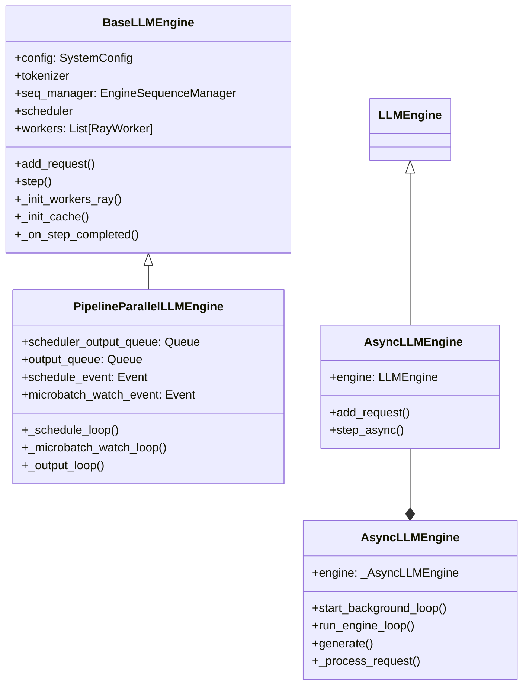
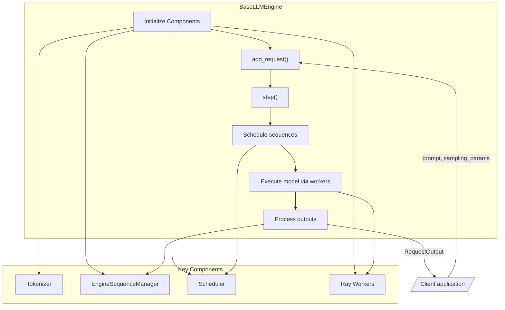
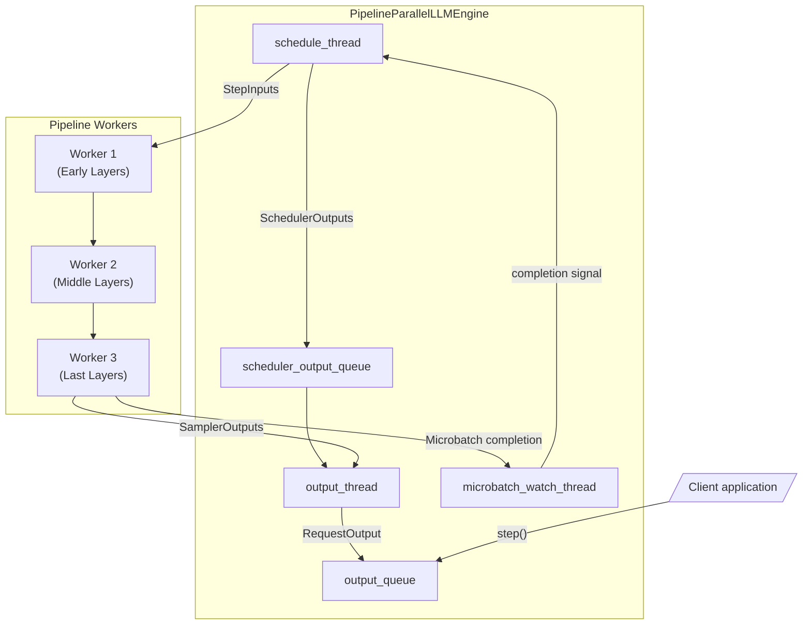
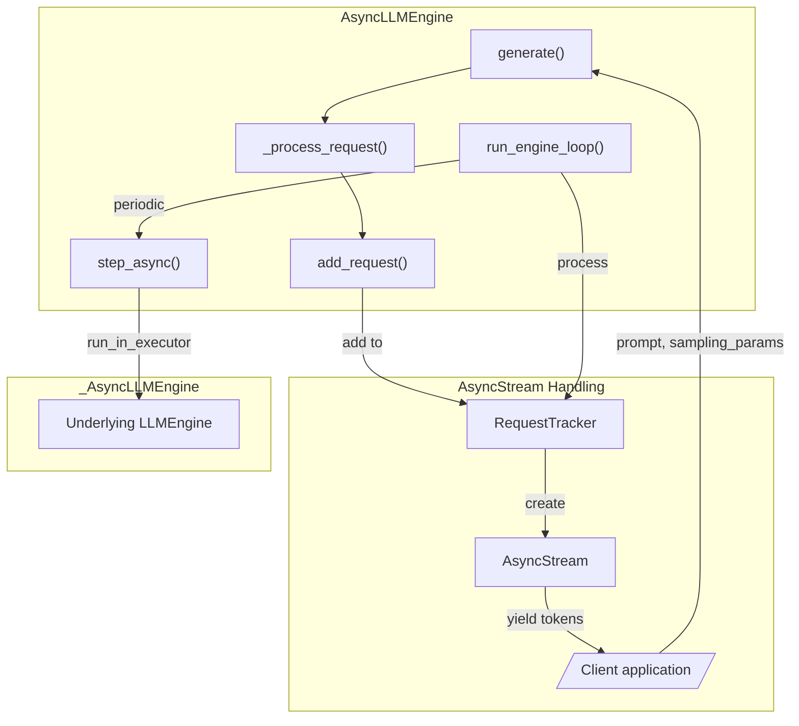
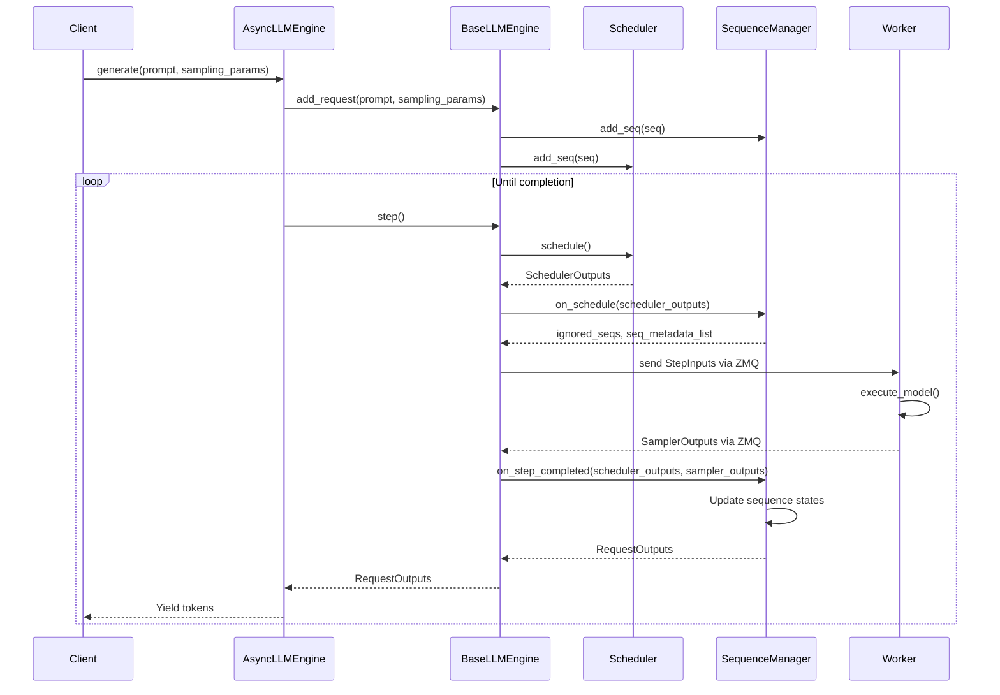
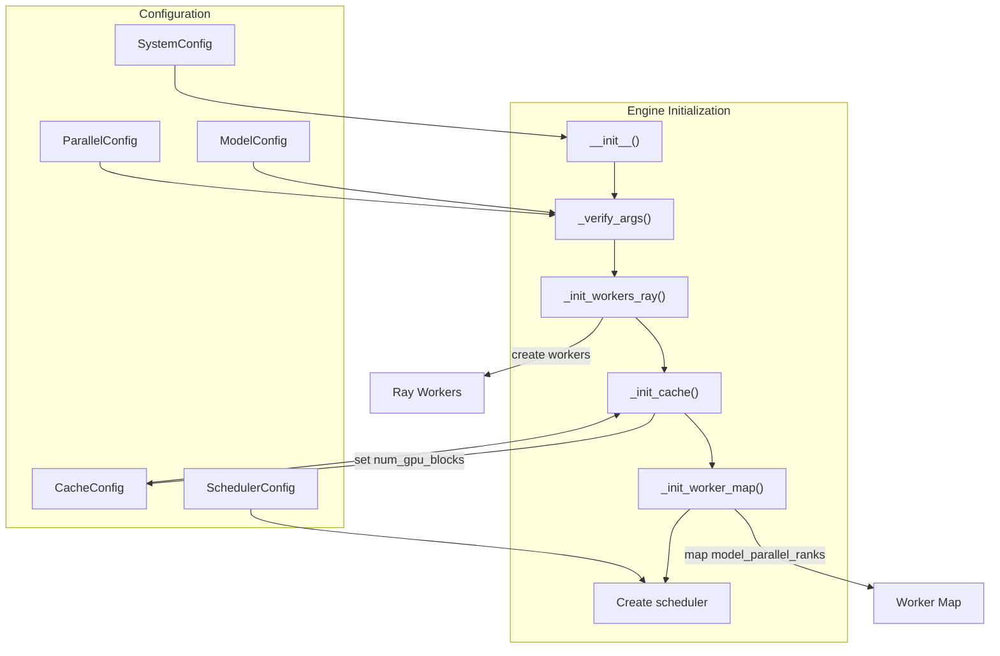
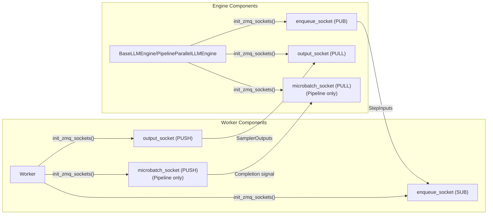

<!-- source: DeepWiki mcp.deepwiki.com · repo microsoft/sarathi-serve · page 2.1 Engine Components · fetched 2026-10-26 -->

# Engine Components

Relevant source files

The following files were used as context for generating this wiki page:

- [sarathi/engine/async_llm_engine.py](sarathi/engine/async_llm_engine.py)
- [sarathi/engine/base_llm_engine.py](sarathi/engine/base_llm_engine.py)
- [sarathi/engine/pipeline_parallel_llm_engine.py](sarathi/engine/pipeline_parallel_llm_engine.py)
- [sarathi/utils/__init__.py](sarathi/utils/__init__.py)
- [sarathi/worker/pipeline_parallel_worker.py](sarathi/worker/pipeline_parallel_worker.py)

This document details the core engine components of the Sarathi-Serve framework, which are responsible for orchestrating the LLM inference process. The engine components serve as the central coordination mechanism for handling requests, scheduling batches, managing model execution, and processing outputs. For worker architecture details, see [Worker Architecture](#2.2).

## Engine Hierarchy

Sarathi implements a hierarchical engine architecture with three main engine implementations that serve different deployment scenarios:

Sources: [sarathi/engine/base_llm_engine.py:34-487](), [sarathi/engine/pipeline_parallel_llm_engine.py:31-197](), [sarathi/engine/async_llm_engine.py:238-512]()

## Engine Implementations

### BaseLLMEngine

The `BaseLLMEngine` is the foundation of the engine hierarchy, providing core functionality for request processing, model execution coordination, and output handling. It's designed for simple single-stage inference workloads.

Key responsibilities:
- Initializing workers via Ray
- Setting up ZMQ communication channels
- Managing the token cache
- Coordinating with schedulers
- Processing model outputs

Sources: [sarathi/engine/base_llm_engine.py:34-487]()

### PipelineParallelLLMEngine

The `PipelineParallelLLMEngine` extends the base engine to support pipeline parallelism, a technique that distributes model layers across multiple GPUs to handle larger models. This implementation uses a multi-threaded architecture with dedicated threads for scheduling, output processing, and microbatch coordination.

Key features:
- Thread-based asynchronous scheduling
- ZMQ-based communication with workers
- Pipeline stage coordination using events and queues

Sources: [sarathi/engine/pipeline_parallel_llm_engine.py:31-197](), [sarathi/worker/pipeline_parallel_worker.py:18-79]()

### AsyncLLMEngine

The `AsyncLLMEngine` provides an asynchronous API for non-blocking request handling, making it suitable for web server integration. It runs a background loop that continuously processes requests, allowing clients to submit jobs without waiting for completion.

Key features:
- Non-blocking request handling via asyncio
- Streaming token generation
- Background processing loop

Sources: [sarathi/engine/async_llm_engine.py:27-512]()

## Request Processing Flow

The engine components process requests through several distinct stages, from initial submission to final output generation.

Sources: [sarathi/engine/async_llm_engine.py:392-462](), [sarathi/engine/base_llm_engine.py:364-398]()

## Engine Initialization and Configuration

The engine components rely on a comprehensive configuration system to correctly initialize all required resources and parameters.

Sources: [sarathi/engine/base_llm_engine.py:48-106]()

## Engine-Worker Communication

The engine components communicate with workers using ZeroMQ (ZMQ) sockets for efficient message passing.

Sources: [sarathi/engine/base_llm_engine.py:117-122](), [sarathi/engine/pipeline_parallel_llm_engine.py:68-72](), [sarathi/worker/pipeline_parallel_worker.py:26-32]()

## Key Data Structures

The engine components utilize several key data structures to manage the inference process:

| Data Structure | Purpose | Key Properties |
|----------------|---------|---------------|
| `Sequence` | Represents a single request | Prompt, token IDs, sampling parameters, state |
| `SchedulerOutputs` | Represents the scheduler's decisions | Prefill batch, decode batch, ignored sequences |
| `StepInputs` | Input to workers for each step | Scheduler outputs, new sequences, pending step outputs |
| `SamplerOutputs` | Results from token sampling | Next tokens, logprobs, finished flags |
| `RequestOutput` | Response sent to client | Generated text, token IDs, finish reason |

Sources: [sarathi/engine/base_llm_engine.py:257-283](), [sarathi/engine/pipeline_parallel_llm_engine.py:143-180]()

## Engine-Specific Optimizations

### BaseLLMEngine Optimizations
- Direct synchronous execution flow
- Efficient memory usage tracking and block allocation
- Worker coordination via Ray

### PipelineParallelLLMEngine Optimizations
- Multi-threaded execution for higher throughput
- Microbatch completion signaling for continuous execution
- Asynchronous scheduling loop

### AsyncLLMEngine Optimizations
- Non-blocking request handling
- Token streaming capability
- Background processing to maximize throughput

Sources: [sarathi/engine/base_llm_engine.py:364-398](), [sarathi/engine/pipeline_parallel_llm_engine.py:113-180](), [sarathi/engine/async_llm_engine.py:355-366]()

---

