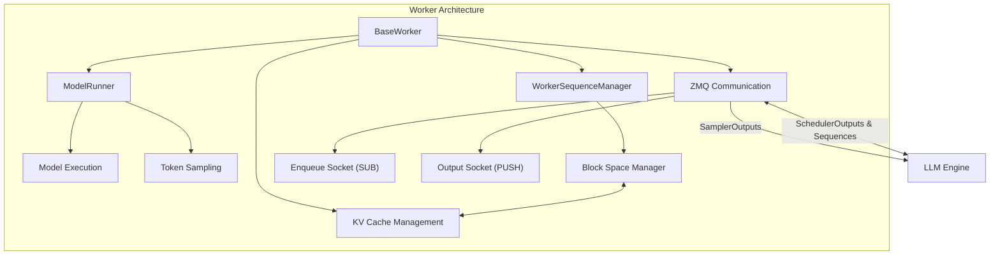
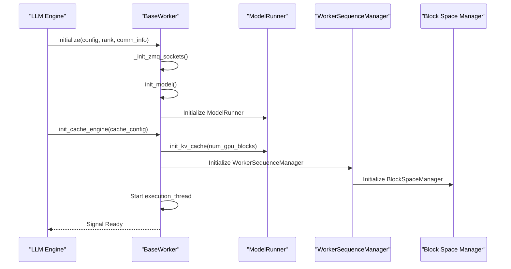
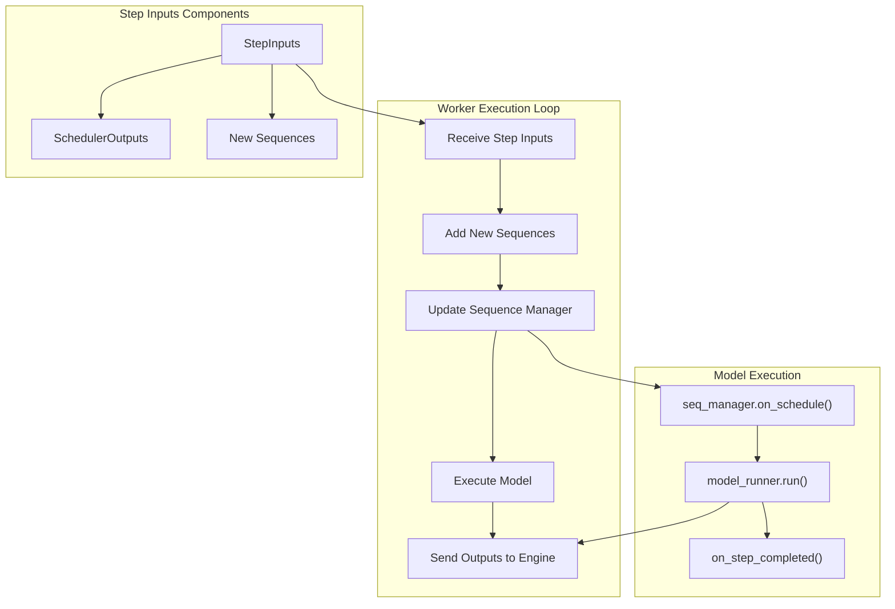
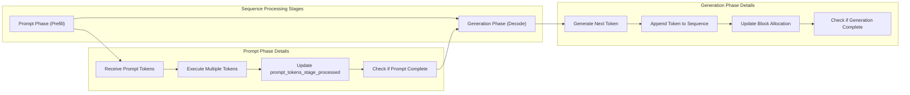
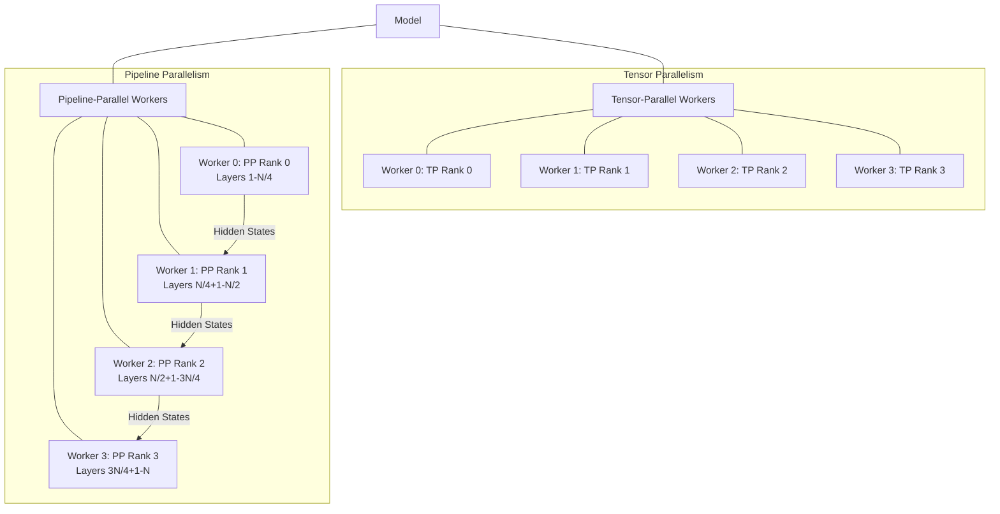

<!-- source: DeepWiki mcp.deepwiki.com · repo microsoft/sarathi-serve · page 2.2 Worker Architecture · fetched 2026-10-26 -->

# Worker Architecture

Relevant source files

The following files were used as context for generating this wiki page:

- [sarathi/core/datatypes/comm_info.py](sarathi/core/datatypes/comm_info.py)
- [sarathi/core/datatypes/sequence.py](sarathi/core/datatypes/sequence.py)
- [sarathi/core/datatypes/step_inputs.py](sarathi/core/datatypes/step_inputs.py)
- [sarathi/core/scheduler/simple_chunking_scheduler.py](sarathi/core/scheduler/simple_chunking_scheduler.py)
- [sarathi/core/sequence_manager/worker_sequence_manager.py](sarathi/core/sequence_manager/worker_sequence_manager.py)
- [sarathi/worker/base_worker.py](sarathi/worker/base_worker.py)

This page documents the worker architecture in Sarathi-Serve, focusing on how worker components process model requests and interact with the engine. For information about engine components, see [Engine Components](#2.1).

## Overview

In Sarathi-Serve, workers are responsible for executing model inference on individual GPUs. Each worker is associated with a single GPU and manages the key-value (KV) cache, executes the model, and maintains sequence information for request processing. In distributed inference scenarios, workers collaborate to process model partitions in parallel.

Sources: [sarathi/worker/base_worker.py:34-68](), [sarathi/worker/base_worker.py:75-85]()

## Worker Components

### BaseWorker

The `BaseWorker` class serves as the foundation of worker functionality. Each worker:

1. Initializes a GPU device
2. Sets up communication channels with the engine
3. Manages sequence processing
4. Handles model execution
5. Tracks metrics

The worker initialization follows a two-phase process:
1. First, initialize the core components and model
2. Then, initialize the cache engine with the specified configuration

Sources: [sarathi/worker/base_worker.py:42-72](), [sarathi/worker/base_worker.py:92-139](), [sarathi/worker/base_worker.py:143-154]()

### Communication System

Workers communicate with the engine using ZeroMQ (ZMQ) sockets:

1. **Enqueue Socket (SUB)**: Receives step inputs from the engine
2. **Output Socket (PUSH)**: Sends sampler outputs back to the engine

The communication flow is unidirectional for each socket, creating a clean pipeline for request processing.

Sources: [sarathi/worker/base_worker.py:75-85](), [sarathi/core/datatypes/comm_info.py:4-12]()

### WorkerSequenceManager

The `WorkerSequenceManager` tracks and manages sequences assigned to the worker. It:

1. Maintains the mapping between sequence IDs and sequence objects
2. Handles block allocation and deallocation for sequences
3. Updates sequence status and metadata

The sequence manager uses a block space manager which is responsible for memory allocation in the KV cache.

Sources: [sarathi/core/sequence_manager/worker_sequence_manager.py:11-60]()

## Execution Flow

The worker's main execution loop runs in a dedicated thread and performs the following steps:

1. Receive step inputs via ZMQ
2. Add new sequences to the sequence manager
3. Execute the model based on scheduler outputs
4. Send the resulting sampler outputs back to the engine

Sources: [sarathi/worker/base_worker.py:200-217](), [sarathi/worker/base_worker.py:164-198](), [sarathi/core/datatypes/step_inputs.py:8-21]()

## Request Processing Stages

Workers process two types of requests:

1. **Prompt Processing (Prefill)**: Process multiple tokens from the prompt at once
2. **Token Generation (Decode)**: Generate one token at a time based on previous output

The scheduler determines whether to perform prefill or decode operations for each sequence in a given step.

Sources: [sarathi/core/datatypes/sequence.py:11-216](), [sarathi/core/sequence_manager/worker_sequence_manager.py:41-52](), [sarathi/core/datatypes/sequence.py:220-277]()

## Memory Management

Workers manage GPU memory primarily through the block space manager. Each sequence is allocated logical token blocks which map to physical GPU memory blocks for the KV cache.

The allocation process:
1. When a sequence is scheduled, check if it already has memory allocated
2. If not, allocate new blocks from the block space manager
3. If already allocated, append a new slot for the next token
4. When a sequence is completed or preempted, free its allocated blocks

Sources: [sarathi/core/sequence_manager/worker_sequence_manager.py:28-40](), [sarathi/core/sequence_manager/worker_sequence_manager.py:41-52]()

## Parallel Processing Support

Sarathi-Serve workers support two forms of parallelism:

1. **Tensor Parallelism**: Distributing model weights across multiple GPUs
2. **Pipeline Parallelism**: Distributing model layers across multiple GPUs

Each worker is initialized with its tensor and pipeline parallel ranks, which determine its role in the distributed inference process.

The distributed environment is initialized during worker startup:

1. Initialize torch.distributed process group
2. Set tensor and pipeline parallel ranks
3. Initialize model parallel state
4. Load appropriate model partitions based on the rank

Sources: [sarathi/worker/base_worker.py:110-130](), [sarathi/worker/base_worker.py:259-285]()

## Interaction with Scheduler

The scheduler determines which sequences should be processed in each step and communicates this to workers through `SchedulerOutputs`. The worker processes these instructions by:

1. Updating sequence states based on scheduler decisions
2. Allocating or freeing blocks as needed
3. Processing the scheduled sequences in the current batch

Schedulers like `SimpleChunkingScheduler` alternate between prefill and decode operations to maximize throughput while maintaining reasonable latency.

| Operation Type | Characteristics | When Used |
|----------------|----------------|-----------|
| Prefill        | Process multiple tokens at once | For new prompts or partial prompt processing |
| Decode         | Generate one token at a time | For continuing generation after prompt processing |

Sources: [sarathi/core/scheduler/simple_chunking_scheduler.py:28-205](), [sarathi/worker/base_worker.py:164-198]()

## Worker Metrics Collection

Workers track various metrics during execution:

1. Batch processing time
2. Memory usage
3. Token generation throughput
4. Model execution latency

These metrics are stored in a `MetricsStore` instance and can be accessed for performance analysis and optimization.

Sources: [sarathi/worker/base_worker.py:189-198](), [sarathi/worker/base_worker.py:219-228]()

---

