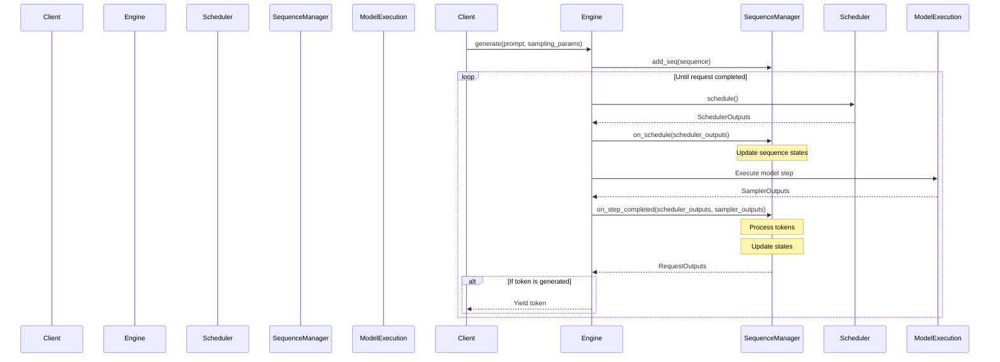
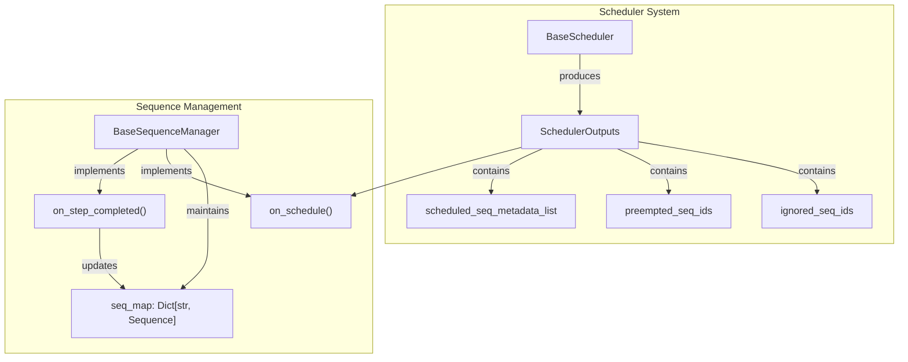

<!-- source: DeepWiki mcp.deepwiki.com · repo microsoft/sarathi-serve · page 2.3 Sequence Management · fetched 2026-10-26 -->

# Sequence Management

<details>
<summary>Relevant source files</summary>

The following files were used as context for generating this wiki page:

- [sarathi/core/datatypes/scheduler_output.py](sarathi/core/datatypes/scheduler_output.py)
- [sarathi/core/scheduler/base_scheduler.py](sarathi/core/scheduler/base_scheduler.py)
- [sarathi/core/sequence_manager/base_sequence_manager.py](sarathi/core/sequence_manager/base_sequence_manager.py)
- [sarathi/entrypoints/openai/serving_completion.py](sarathi/entrypoints/openai/serving_completion.py)

</details>


## Purpose and Scope

This document describes the Sequence Management system in Sarathi-Serve, which is responsible for tracking and managing sequences (representing user inference requests) throughout their lifecycle. The Sequence Manager handles sequence state transitions, token processing, and coordinates with the Scheduler and Block Space Manager components. For information about memory management of these sequences, see [Memory Management](#2.4).

## Sequence Lifecycle

A sequence in Sarathi-Serve represents a text generation request and goes through multiple states during its lifetime. The `SequenceStatus` enum defines these states.

```mermaid
stateDiagram-v2
    [*] --> "WAITING"
    "WAITING" --> "RUNNING": scheduled
    "RUNNING" --> "PAUSED": after step completed
    "PAUSED" --> "RUNNING": rescheduled
    "RUNNING" --> "FINISHED": generation complete
    "WAITING" --> "FINISHED_IGNORED": constraints not met
    "PAUSED" --> "WAITING": preempted
    "FINISHED" --> [*]
    "FINISHED_IGNORED" --> [*]
```

Sources: [sarathi/core/sequence_manager/base_sequence_manager.py:14-145]()

## BaseSequenceManager Architecture

The sequence management system is built around the abstract `BaseSequenceManager` class, which defines the interface and core functionality for managing sequences.

```mermaid
classDiagram
    class "BaseSequenceManager" {
        +Dict[str, Sequence] seq_map
        +add_seq(seq: Sequence)
        +on_schedule(scheduler_outputs: SchedulerOutputs)
        +on_step_completed(scheduler_outputs, sampler_outputs)
        +generate_request_outputs(ignored_seqs, seq_metadata_list)
        -_free_seq(seq_id: str)
        -_preempt_seq(seq_id: str)
        -_pause_seq(seq_id: str)
        -_resume_seq(seq_id: str)
        -_on_seq_scheduled(seq_sched_metadata)
        -_process_seq_output(seq, sample)
        #_get_block_table(seq)* abstract
        #_on_append_token(seq)* abstract
    }
    
    class "Sequence" {
        +str seq_id
        +List[int] token_ids
        +bool prompt_processing_finished
        +SequenceStatus status
        +append_token_id(token_id)
        +check_stop()
        +is_finished()
        +is_running()
        +is_waiting()
        +is_executing()
        +is_paused()
        +reset_for_recompute()
        +set_status(status)
    }
    
    class "SchedulerOutputs" {
        +List[str] ignored_seq_ids
        +List[str] preempted_seq_ids
        +List[SequenceScheduleMetadata] scheduled_seq_metadata_list
        +bool is_empty()
        +bool has_no_output()
        +List[str] seq_ids
    }
    
    class "SequenceMetadata" {
        +Sequence seq
        +List[int] block_table
        +int num_prompt_tokens
    }
    
    class "SamplerOutput" {
        +str seq_id
        +int output_token
        +bool is_prompt_processed
    }
    
    "BaseSequenceManager" "1" -- "many" "Sequence": manages
    "BaseSequenceManager" -- "SchedulerOutputs": processes
    "BaseSequenceManager" .. "SequenceMetadata": creates
    "BaseSequenceManager" .. "SamplerOutput": processes
```

Sources: [sarathi/core/sequence_manager/base_sequence_manager.py:18-152](), [sarathi/core/datatypes/scheduler_output.py:6-54]()

## Sequence Management Workflow

The sequence management system follows a specific workflow for processing sequences, interacting with the scheduler, and handling token generation.



Sources: [sarathi/core/sequence_manager/base_sequence_manager.py:58-151](), [sarathi/entrypoints/openai/serving_completion.py:50-282]()

## Key Operations

### Sequence Addition

New sequences are added to the `seq_map` dictionary using the `add_seq` method. This method is synchronized to ensure thread safety.

```python
@synchronized
def add_seq(self, seq: Sequence) -> None:
    assert seq.seq_id not in self.seq_map
    self.seq_map[seq.seq_id] = seq
```

Sources: [sarathi/core/sequence_manager/base_sequence_manager.py:23-26]()

### Scheduling Process

The `on_schedule` method processes scheduler outputs to determine which sequences to execute next:

1. Free ignored sequences (remove from management)
2. Preempt sequences as needed (reset for recomputation)
3. Prepare metadata for scheduled sequences (resume paused sequences)

```python
@synchronized
def on_schedule(
    self,
    scheduler_outputs: SchedulerOutputs,
) -> Tuple[List[Sequence], List[SequenceMetadata]]:
    ignored_seqs: List[Sequence] = []
    for seq_id in scheduler_outputs.ignored_seq_ids:
        assert seq_id in self.seq_map
        seq = self.seq_map[seq_id]
        ignored_seqs.append(seq)
        self._free_seq(seq_id)

    for seq_id in scheduler_outputs.preempted_seq_ids:
        self._preempt_seq(seq_id)

    seq_metadata_list: List[SequenceMetadata] = []

    for seq_sched_metadata in scheduler_outputs.scheduled_seq_metadata_list:
        self._on_seq_scheduled(seq_sched_metadata)
        seq = self.seq_map[seq_sched_metadata.seq_id]
        seq_metadata_list.append(
            SequenceMetadata(
                seq,
                self._get_block_table(seq),
                seq_sched_metadata.num_prompt_tokens,
            )
        )

    return ignored_seqs, seq_metadata_list
```

Sources: [sarathi/core/sequence_manager/base_sequence_manager.py:58-86]()

### Processing Results

The `on_step_completed` method handles the results from a model execution step:

1. Process each scheduled sequence's output from the sampler
2. Update sequence states and metadata
3. Process generated tokens
4. Check for sequence completion

```python
@synchronized
def on_step_completed(
    self,
    scheduler_outputs: SchedulerOutputs,
    sampler_outputs: Optional[SamplerOutputs],
) -> None:
    for scheduled_seq_metadata, sampler_output in zip(
        scheduler_outputs.scheduled_seq_metadata_list, sampler_outputs
    ):
        assert scheduled_seq_metadata.seq_id == sampler_output.seq_id
        seq = self.seq_map[scheduled_seq_metadata.seq_id]
        if seq.is_waiting():
            # seq is preempted
            continue

        if not seq.prompt_processing_finished:
            seq.update_prompt_tokens_stage_processed(
                scheduled_seq_metadata.prompt_chunk_len
            )
            seq.update_prompt_tokens_processed(
                scheduled_seq_metadata.prompt_chunk_len
            )

        self._pause_seq(scheduled_seq_metadata.seq_id)

        self._process_seq_output(
            seq,
            sampler_output,
        )
```

Sources: [sarathi/core/sequence_manager/base_sequence_manager.py:111-143]()

### Token Processing

When a token is generated, the `_process_seq_output` method:

1. Appends the token to the sequence
2. Calls the abstract `_on_append_token` method for implementation-specific handling
3. Checks if stop conditions are met
4. Frees the sequence if it's finished

```python
def _process_seq_output(
    self,
    seq: Sequence,
    sample: SamplerOutput,
) -> None:
    # at this point, the seq should be in paused state
    assert not seq.is_finished()

    if not seq.prompt_processing_finished:
        return

    seq.append_token_id(sample.output_token)
    self._on_append_token(seq)
    # this function will update the seq status
    # to finished if the stop condition is met
    seq.check_stop()
    if seq.is_finished():
        self._free_seq(seq.seq_id)
```

Sources: [sarathi/core/sequence_manager/base_sequence_manager.py:92-109]()

## Integration with Other Components

### Scheduler Integration

The Sequence Manager closely interacts with the Scheduler component, which determines which sequences to process in each step. The Scheduler's decisions are communicated through the `SchedulerOutputs` class.



Sources: [sarathi/core/scheduler/base_scheduler.py:17-134](), [sarathi/core/datatypes/scheduler_output.py:6-54]()

### Block Space Manager Integration

The abstract `_get_block_table` method must be implemented by concrete sequence managers to interact with a block space manager, which allocates memory for sequences.

## Abstract Methods for Implementation

The `BaseSequenceManager` class defines two abstract methods that must be implemented by concrete subclasses:

1. `_get_block_table(seq: Sequence) -> List[int]`: Returns the memory block table for a sequence
2. `_on_append_token(seq: Sequence) -> None`: Handles token appending logic specific to the implementation

These methods allow for flexibility in how different implementations manage memory and handle token generation.

Sources: [sarathi/core/sequence_manager/base_sequence_manager.py:54-56](), [sarathi/core/sequence_manager/base_sequence_manager.py:88-90]()

## Thread Safety

The Sequence Manager uses the `@synchronized` decorator on critical methods to ensure thread safety when managing sequences. This includes:

- `add_seq`: Adding new sequences
- `on_schedule`: Processing scheduler outputs
- `on_step_completed`: Processing model execution results

This synchronization is essential since the sequence manager can be accessed from multiple threads in the async processing environment.

Sources: [sarathi/core/sequence_manager/base_sequence_manager.py:23-26](), [sarathi/core/sequence_manager/base_sequence_manager.py:58-86](), [sarathi/core/sequence_manager/base_sequence_manager.py:111-143]()

---

