<!-- source: DeepWiki mcp.deepwiki.com · repo microsoft/sarathi-serve · page 2.4 Memory Management · fetched 2026-10-26 -->

# Memory Management

Relevant source files

The following files were used as context for generating this wiki page:

- [sarathi/core/datatypes/block.py](sarathi/core/datatypes/block.py)
- [sarathi/model_executor/attention/attention_backend_registry.py](sarathi/model_executor/attention/attention_backend_registry.py)
- [sarathi/model_executor/attention/flashinfer_attention_wrapper.py](sarathi/model_executor/attention/flashinfer_attention_wrapper.py)

This document provides a technical overview of the memory management system in Sarathi-Serve, focusing on how Key-Value (KV) cache and token blocks are managed to optimize memory usage during LLM inference. For information about sequence management implementation, see [Sequence Management](#2.3).

## Overview

Sarathi-Serve employs a sophisticated memory management system that is critical for achieving high throughput and low latency. The system organizes tokens into blocks to efficiently manage the GPU memory allocated for the KV cache, which stores intermediate attention states of tokens during generation.

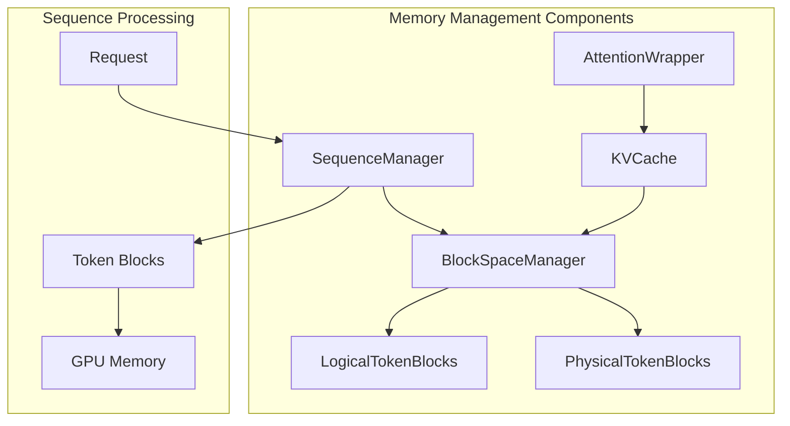

Sources: [sarathi/core/datatypes/block.py:1-69](), [sarathi/model_executor/attention/flashinfer_attention_wrapper.py:1-271]()

## Token Block Architecture

The memory management system is built around the concept of token blocks, which come in two forms:

### Logical Token Blocks

Logical token blocks represent the content and state of token sequences, tracking which tokens are stored in which memory locations. They provide a high-level abstraction for managing token collections.

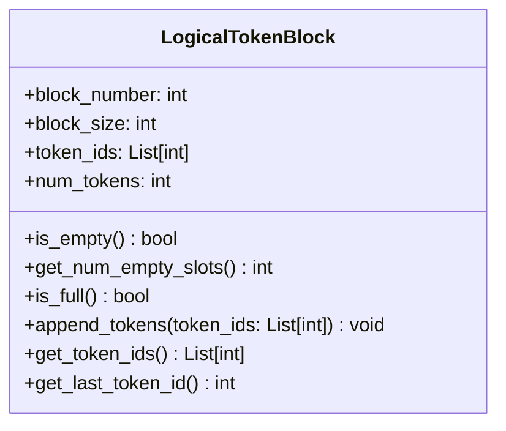

Sources: [sarathi/core/datatypes/block.py:12-51]()

### Physical Token Blocks

Physical token blocks correspond to actual memory blocks in the GPU's KV cache. They represent the physical storage location for the token state information retained during generation.

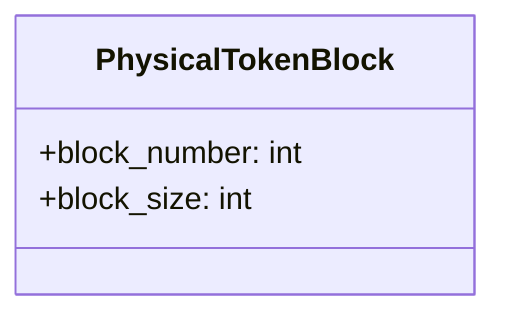

Sources: [sarathi/core/datatypes/block.py:53-68]()

## KV Cache System

The KV Cache (Key-Value Cache) is a critical component for efficient LLM inference, storing intermediate attention states to avoid redundant computation during autoregressive generation.

### Structure and Implementation

In Sarathi-Serve, the KV cache is implemented as a paged memory system, where tokens are organized into fixed-size blocks. This approach allows for efficient memory allocation and retrieval.

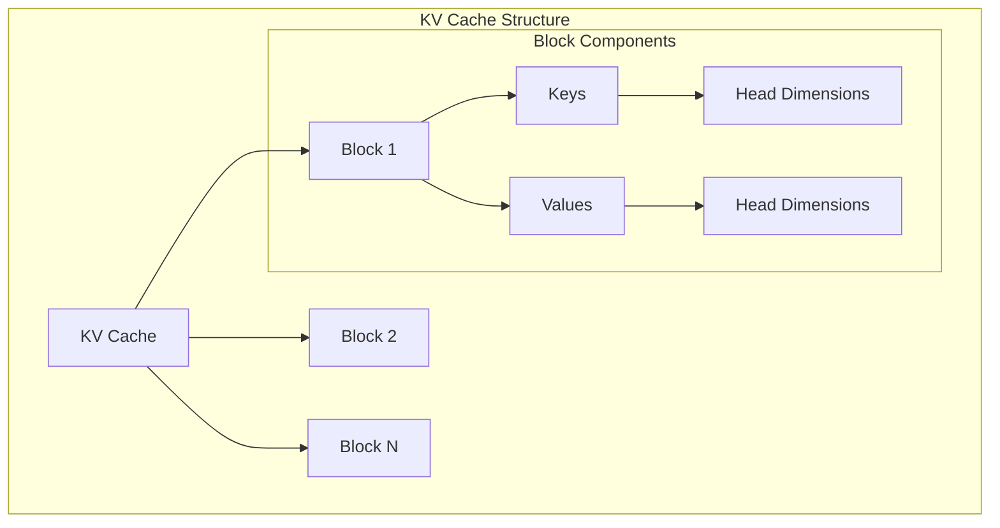

Sources: [sarathi/model_executor/attention/flashinfer_attention_wrapper.py:52-72]()

### GPU Cache Initialization

The KV cache is initialized in GPU memory for optimal performance. The code below shows how the FlashinferAttentionWrapper initializes the GPU cache:

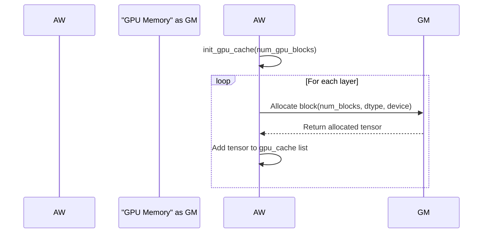

Sources: [sarathi/model_executor/attention/flashinfer_attention_wrapper.py:52-72]()

## Attention and Memory Interaction

The attention mechanism is a key consumer of memory in Sarathi-Serve. The framework supports multiple attention backends, with FlashInfer being a primary implementation.

### Attention Backends

Sarathi-Serve provides a registry for different attention backends, allowing for flexibility in implementation:

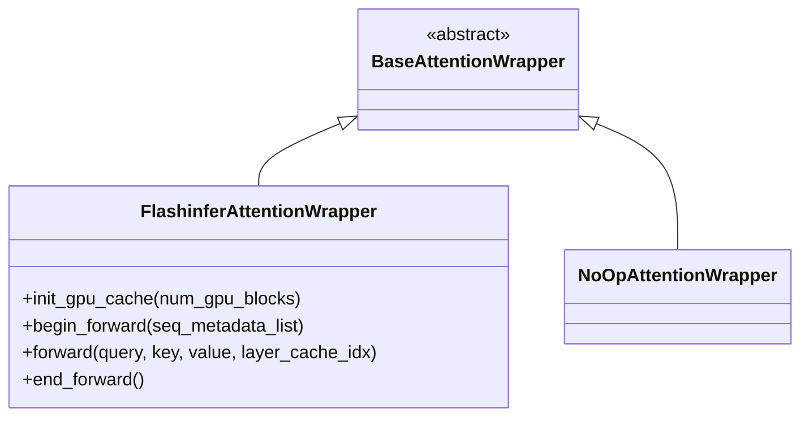

Sources: [sarathi/model_executor/attention/attention_backend_registry.py:1-19]()

### Memory Layout for Attention

The attention mechanism uses a specialized memory layout for efficient computation:

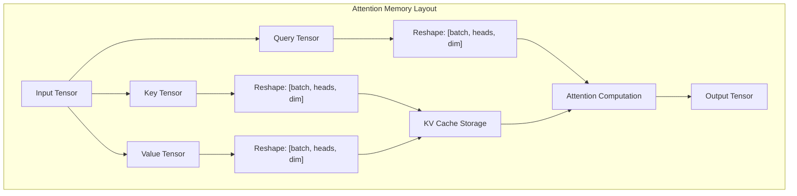

Sources: [sarathi/model_executor/attention/flashinfer_attention_wrapper.py:214-271]()

## Paged KV Cache

Sarathi-Serve implements a paged KV cache system that allows for efficient memory utilization, particularly when handling multiple sequences of varying lengths.

### Page Management

The paged KV cache system manages blocks of memory as pages, with each sequence allocated one or more pages as needed. This approach provides flexibility in memory allocation and efficient memory reuse.

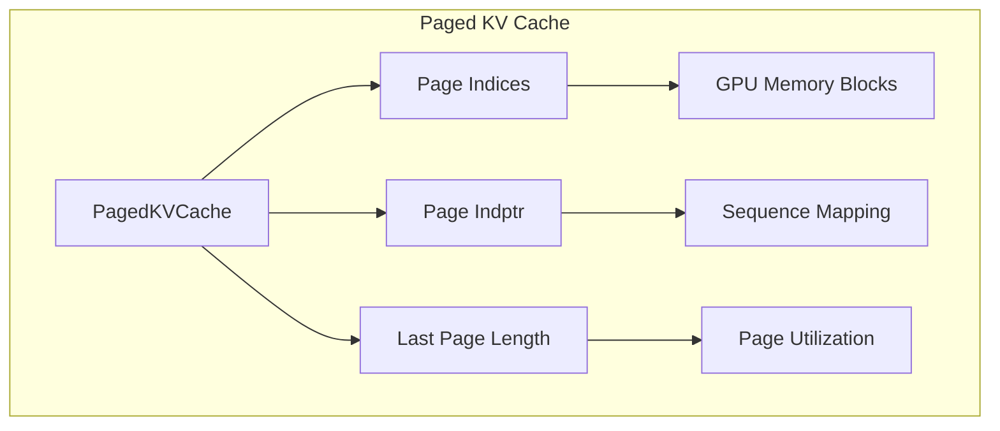

Sources: [sarathi/model_executor/attention/flashinfer_attention_wrapper.py:87-103]()

### Memory Layout Optimization

The FlashInfer attention wrapper uses an optimized memory layout for both prefill (processing new tokens) and decode (generating next tokens) operations:

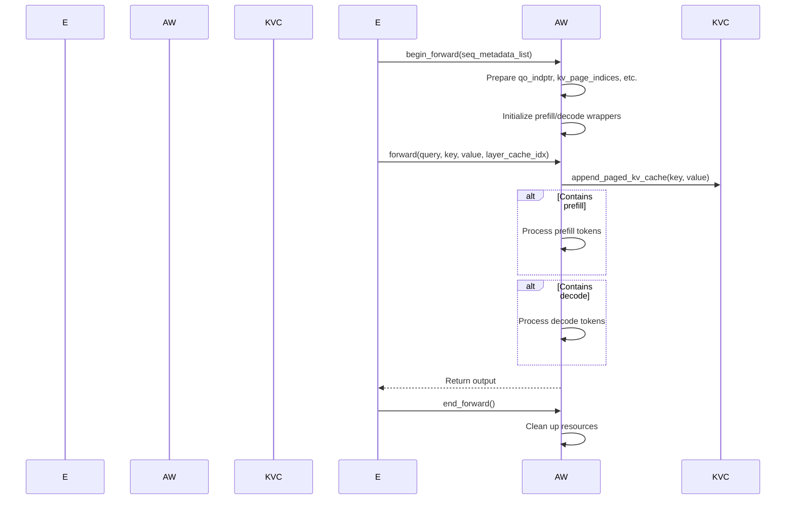

Sources: [sarathi/model_executor/attention/flashinfer_attention_wrapper.py:74-212]()

## Memory Management Workflow

Below is a comprehensive view of how memory is managed during the inference process:

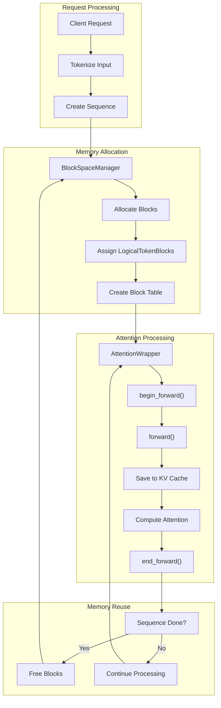

Sources: [sarathi/model_executor/attention/flashinfer_attention_wrapper.py:1-271](), [sarathi/core/datatypes/block.py:1-69]()

## Memory Efficiency Strategies

Sarathi-Serve employs several strategies to optimize memory usage:

1. **Block-based allocation**: Memory is allocated in fixed-size blocks, reducing fragmentation
2. **Paged KV cache**: Efficient organization of memory for attention operations
3. **Memory reuse**: Blocks are freed and reused when sequences complete
4. **Optimized memory layouts**: Specialized layouts for prefill and decode operations

### Block Size Configuration

The block size is a critical parameter that affects memory efficiency and is configured through the `CacheConfig`:

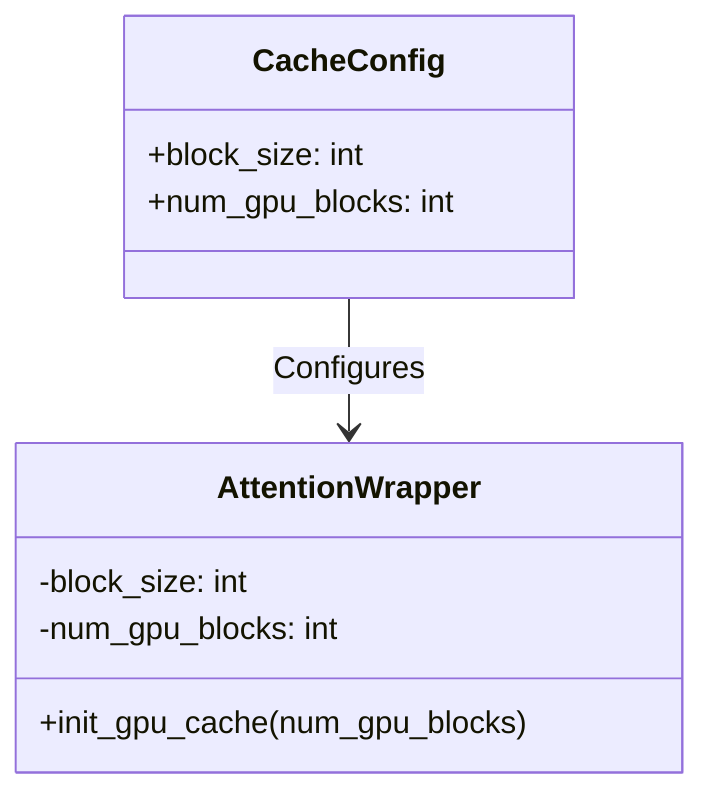

Sources: [sarathi/model_executor/attention/flashinfer_attention_wrapper.py:14-21]()

## Conclusion

The memory management system in Sarathi-Serve is a sophisticated component that enables efficient LLM inference. By organizing memory into blocks, implementing paged KV cache, and optimizing memory layouts for attention operations, Sarathi-Serve achieves high throughput and low latency while maintaining memory efficiency.

The system's design allows for flexibility in handling variable-length sequences and efficient memory reuse, making it well-suited for production LLM serving environments.

---

