<!-- source: DeepWiki mcp.deepwiki.com · repo microsoft/sarathi-serve · page 3 Model Execution · fetched 2026-10-26 -->

# Model Execution

Relevant source files

The following files were used as context for generating this wiki page:

- [sarathi/model_executor/model_runner.py](sarathi/model_executor/model_runner.py)
- [sarathi/model_executor/models/mistral.py](sarathi/model_executor/models/mistral.py)
- [sarathi/model_executor/models/mixtral.py](sarathi/model_executor/models/mixtral.py)

This document explains how Sarathi-Serve executes language models during inference, covering the model execution workflow, model implementations, and key optimization mechanisms. For information about attention mechanisms specifically, see [Attention Mechanisms](#3.1). For details on parallel processing configurations, see [Parallel Processing](#3.3).

## Model Execution Overview

Model execution in Sarathi-Serve refers to the process of running inference on a language model, from preparing input tokens to generating output tokens. The framework supports various model architectures (like Mistral and Mixtral) and employs optimizations for high-throughput, low-latency inference.

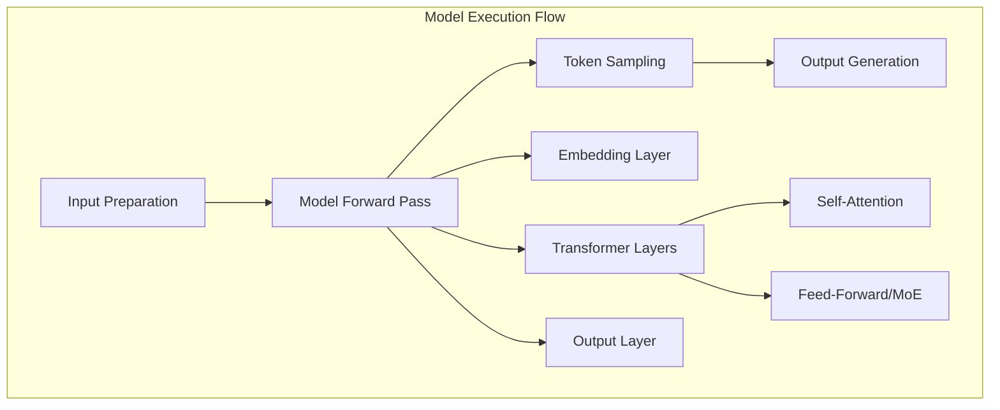

Sources: [sarathi/model_executor/model_runner.py:225-257]()

## ModelRunner

The `ModelRunner` class is the central component responsible for model execution, handling input preparation, model initialization, and inference.

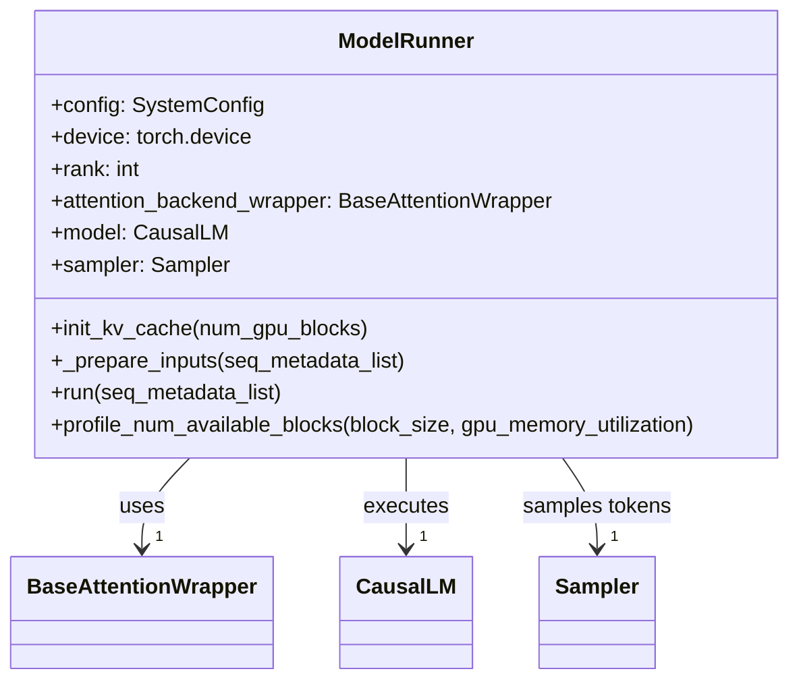

Sources: [sarathi/model_executor/model_runner.py:24-66]()

### Input Preparation

Before executing the model, `ModelRunner` prepares inputs by:
1. Collecting tokens from prompt sequences (for prefill phase)
2. Collecting last tokens from generation sequences (for decode phase)
3. Converting inputs to tensors and optimizing for GPU execution

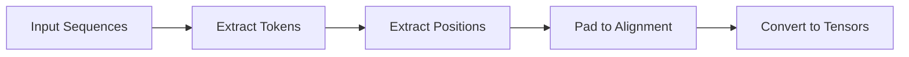

Sources: [sarathi/model_executor/model_runner.py:67-117]()

### Model Execution Process

The `run` method in `ModelRunner` is the main entry point for model execution:

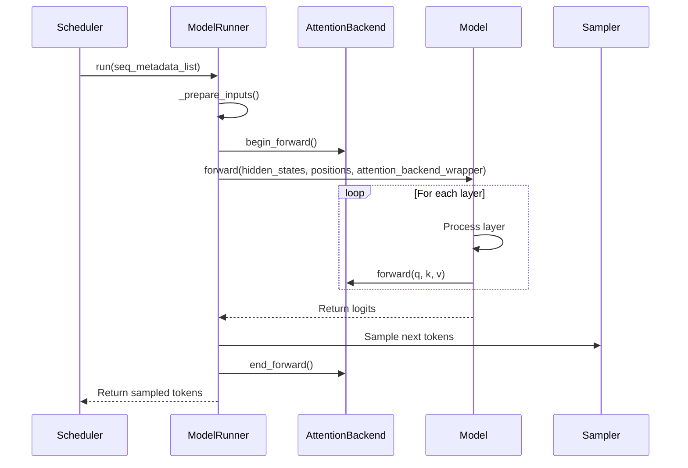

Sources: [sarathi/model_executor/model_runner.py:225-257]()

## Model Implementations

Sarathi-Serve supports different model architectures, each with its own implementation. The model implementations follow a similar structure, with architecture-specific differences.

### Common Model Structure

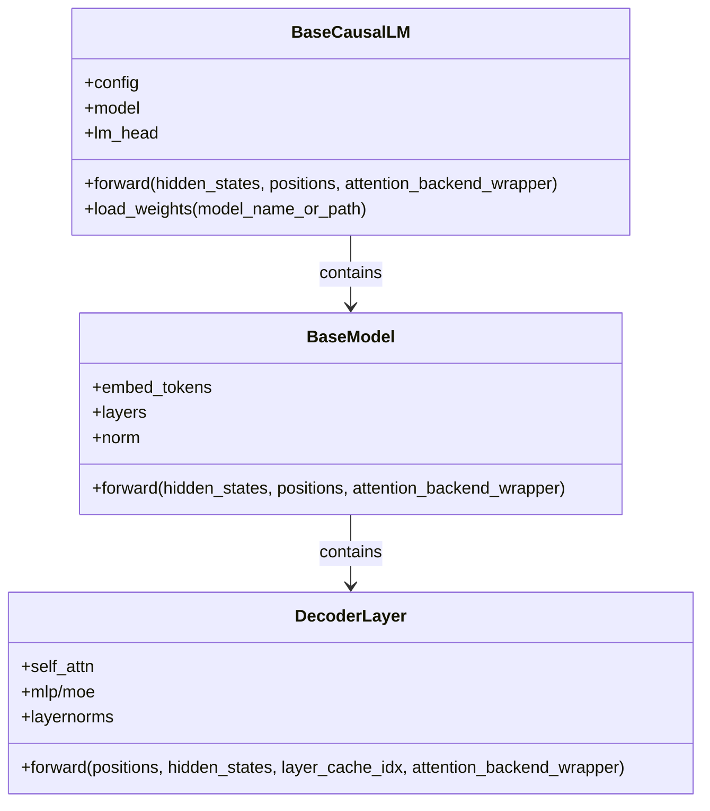

Sources: [sarathi/model_executor/models/mistral.py:292-316](), [sarathi/model_executor/models/mixtral.py:317-341]()

### Model-Specific Implementations

#### Mistral Model

The Mistral model uses a standard feed-forward MLP in each decoder layer:

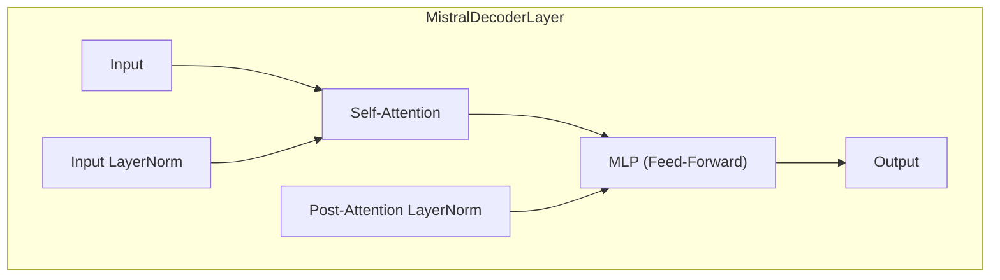

Sources: [sarathi/model_executor/models/mistral.py:180-232]()

#### Mixtral Model

The Mixtral model uses a Mixture of Experts (MoE) architecture in place of the standard MLP:

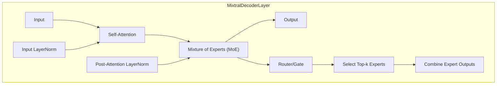

Sources: [sarathi/model_executor/models/mixtral.py:194-258]()

## Parallelism in Model Execution

Sarathi-Serve implements two forms of parallelism for model execution:

### Tensor Parallelism

Tensor parallelism splits individual tensors across multiple GPUs:

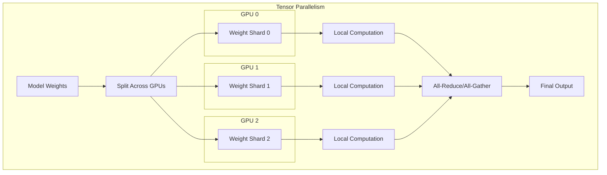

Sources: [sarathi/model_executor/models/mistral.py:128-177](), [sarathi/model_executor/models/mixtral.py:146-191]()

### Pipeline Parallelism

Pipeline parallelism splits the model layers across multiple GPUs:

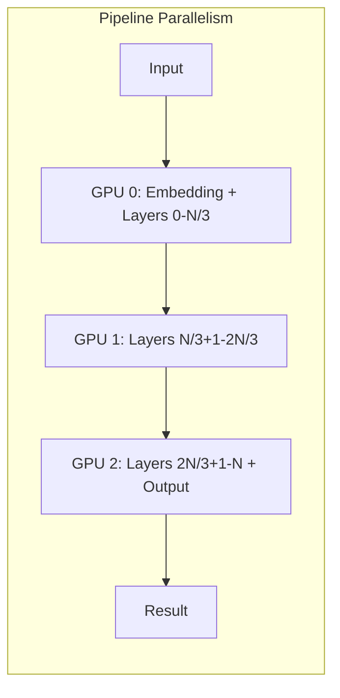

Sources: [sarathi/model_executor/models/mistral.py:235-289](), [sarathi/model_executor/models/mixtral.py:261-316]()

## Memory Optimization

Model execution in Sarathi-Serve incorporates several memory optimizations:

1. **KV Cache Management**: Stores key-value pairs to avoid recomputing them for already processed tokens
2. **Tensor Alignment**: Pads tensors to optimize for hardware acceleration (tensor cores)
3. **Memory Profiling**: Profiles memory usage to allocate optimal number of blocks for KV cache

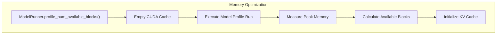

Sources: [sarathi/model_executor/model_runner.py:119-223]()

## Token Sampling

After model execution, Sarathi-Serve uses a sampling mechanism to select the next token:

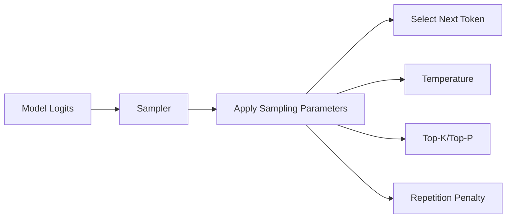

Sources: [sarathi/model_executor/model_runner.py:250-252]()

## Model Execution Workflow

The complete model execution workflow combines all these components:

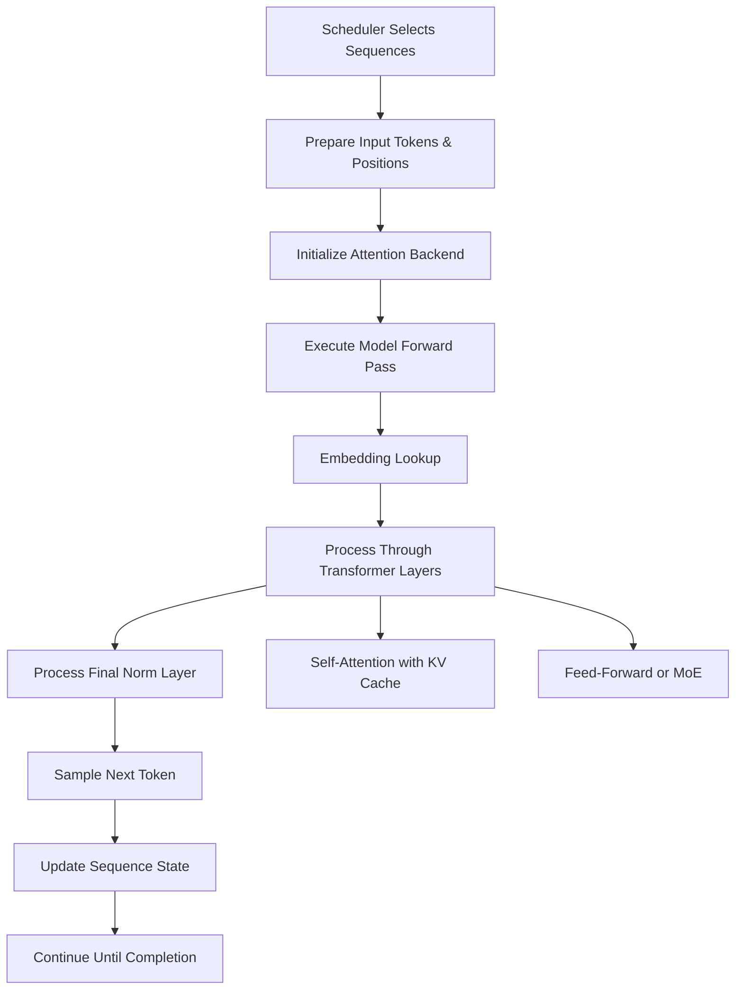

Sources: [sarathi/model_executor/model_runner.py:225-257](), [sarathi/model_executor/models/mistral.py:292-316](), [sarathi/model_executor/models/mixtral.py:317-341]()

---

