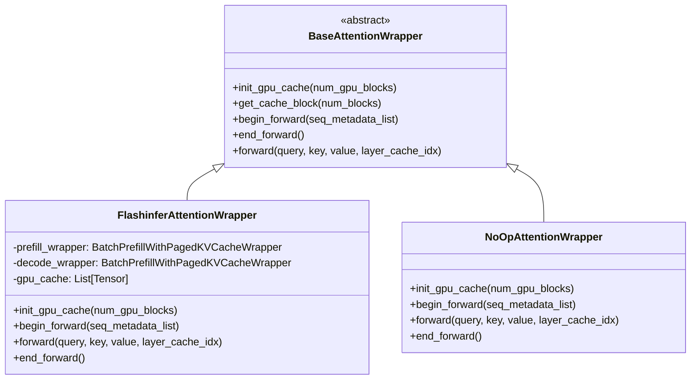
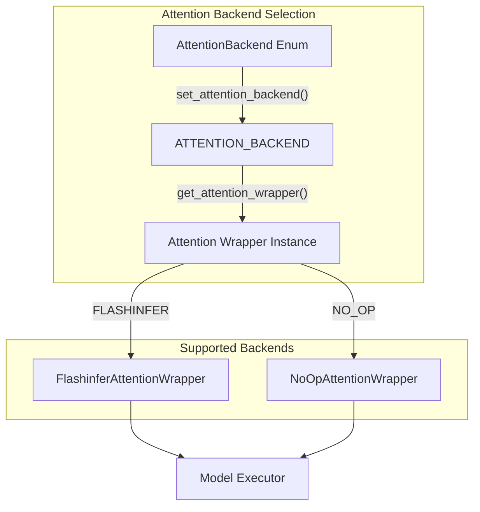
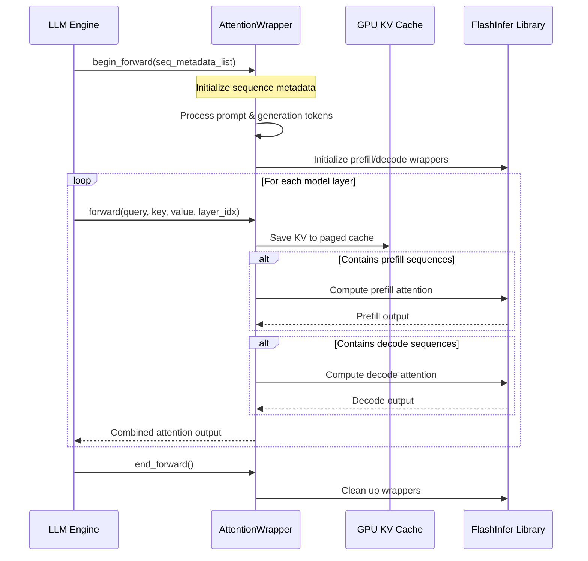
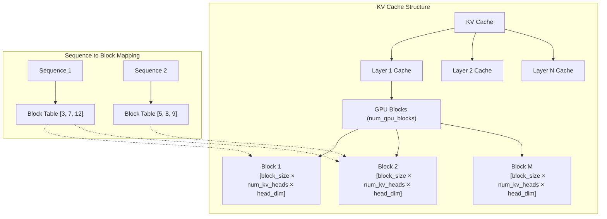
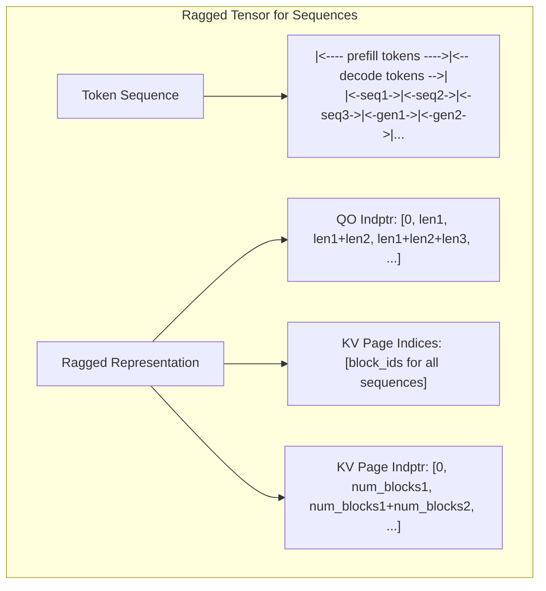
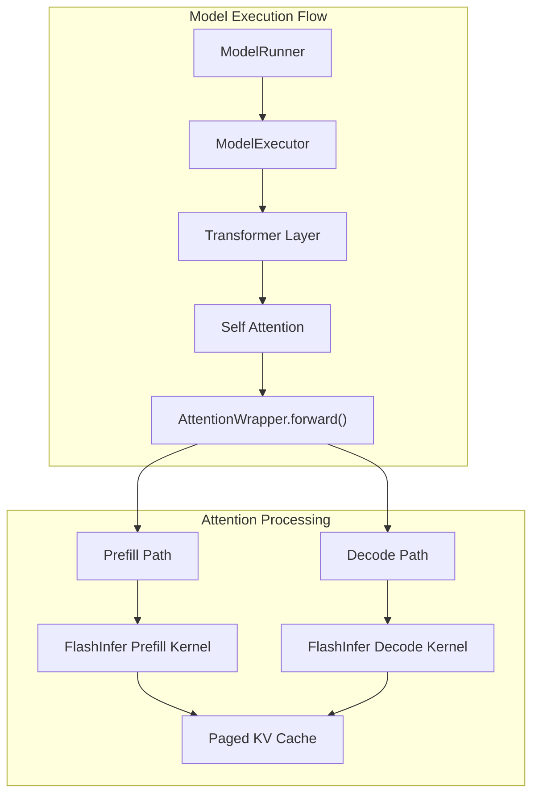

<!-- source: DeepWiki mcp.deepwiki.com · repo microsoft/sarathi-serve · page 3.1 Attention Mechanisms · fetched 2026-10-26 -->

# Attention Mechanisms

<details>
<summary>Relevant source files</summary>

The following files were used as context for generating this wiki page:

- [sarathi/model_executor/attention/__init__.py](sarathi/model_executor/attention/__init__.py)
- [sarathi/model_executor/attention/base_attention_wrapper.py](sarathi/model_executor/attention/base_attention_wrapper.py)
- [sarathi/model_executor/attention/flashinfer_attention_wrapper.py](sarathi/model_executor/attention/flashinfer_attention_wrapper.py)
- [sarathi/model_executor/attention/no_op_attention_wrapper.py](sarathi/model_executor/attention/no_op_attention_wrapper.py)

</details>


This page documents the attention mechanism implementations in Sarathi-Serve, which are critical components for efficient LLM inference. Attention mechanisms are responsible for computing token interactions and managing the key-value (KV) cache during both prefill and decode operations. 

For information about sampling mechanisms used after attention computation, see [Sampling Mechanism](#3.2).

## 1. Attention System Overview

Sarathi-Serve implements a flexible attention backend system that allows different attention implementations to be used. The system is designed around a common interface, with specialized implementations optimized for different use cases.



Sources:
- [sarathi/model_executor/attention/base_attention_wrapper.py:12-80]()
- [sarathi/model_executor/attention/flashinfer_attention_wrapper.py:12-271]()
- [sarathi/model_executor/attention/no_op_attention_wrapper.py:10-48]()

## 2. Attention Backends

Sarathi-Serve currently supports two attention backends:

1. **FlashInfer Attention** - A high-performance attention implementation using the FlashInfer library, optimized for both prefill and decode operations with paged KV cache.
2. **NoOp Attention** - A no-operation implementation that returns empty tensors, primarily used for testing and benchmarking purposes.

The active attention backend is configured through an enum-based system:



Sources:
- [sarathi/model_executor/attention/__init__.py:1-34]()
- [sarathi/types.py]() (referenced but not shown)

## 3. FlashInfer Attention Implementation

The primary attention implementation used in Sarathi-Serve is the `FlashinferAttentionWrapper`, which leverages the FlashInfer library to optimize attention computation.

### 3.1 Key Components

- **GPU Cache Management**: Allocates and manages the KV cache blocks in GPU memory
- **Paged KV Cache**: Implements a paged memory system for efficient KV cache storage
- **Sequence Metadata Handling**: Processes sequence information for both prefill and decode operations
- **Performance Timing**: Tracks performance metrics for different attention operations

### 3.2 Attention Flow

The attention mechanism operates in several distinct phases:



Sources:
- [sarathi/model_executor/attention/flashinfer_attention_wrapper.py:74-211]()
- [sarathi/model_executor/attention/flashinfer_attention_wrapper.py:214-271]()

## 4. Memory Management for Attention

The attention mechanism is closely tied to memory management through the KV cache, which stores past key and value tensors to avoid recomputing them during generation.

### 4.1 Paged KV Cache

Sarathi-Serve implements a paged KV cache system, where tokens are organized into fixed-size blocks:



Sources:
- [sarathi/model_executor/attention/flashinfer_attention_wrapper.py:52-72]()
- [sarathi/model_executor/attention/base_attention_wrapper.py:43-49]()

### 4.2 Ragged Tensor Representation

FlashInfer uses a ragged tensor representation to handle variable-length sequences efficiently:



Sources:
- [sarathi/model_executor/attention/flashinfer_attention_wrapper.py:79-103]()

## 5. Performance Optimization

The attention implementation includes several performance optimizations:

1. **Separate Prefill and Decode Paths**: Optimized computation paths for prefill (multi-token) and decode (single-token) operations
2. **Performance Timing**: Detailed performance metrics for different attention operations using `CudaTimer`
3. **Batched Processing**: Efficient batching of operations for better GPU utilization
4. **Workspace Buffers**: Pre-allocated workspace buffers to avoid memory allocations during inference

### 5.1 Performance Metrics Collected

| Operation Metric | Description |
| ---------------- | ----------- |
| `ATTN_INPUT_RESHAPE` | Time spent reshaping input tensors |
| `ATTN_KV_CACHE_SAVE` | Time spent saving key-value pairs to cache |
| `ATTN_PREFILL` | Time spent on prefill attention computation |
| `ATTN_DECODE` | Time spent on decode attention computation |
| `ATTN_OUTPUT_RESHAPE` | Time spent reshaping output tensors |

Sources:
- [sarathi/model_executor/attention/flashinfer_attention_wrapper.py:229-269]()
- [sarathi/model_executor/attention/base_attention_wrapper.py:36-41]()

## 6. Configuring Attention Backends

To use a specific attention backend in Sarathi-Serve, you can set it through the `set_attention_backend` function:

```python
from sarathi.model_executor.attention import set_attention_backend
from sarathi.types import AttentionBackend

# Use FlashInfer attention backend
set_attention_backend(AttentionBackend.FLASHINFER)

# Or use the string representation
set_attention_backend("FLASHINFER")
```

The default backend is `NO_OP` as defined in the initialization file.

Sources:
- [sarathi/model_executor/attention/__init__.py:12-26]()

## 7. Integration with Model Execution

The attention mechanism is integrated into the model execution pipeline, where it's used to compute the attention component of transformer layers:



Sources:
- [sarathi/model_executor/attention/flashinfer_attention_wrapper.py:214-271]()

## Summary

The attention mechanisms in Sarathi-Serve provide a flexible and high-performance system for computing attention in LLM inference. The primary implementation leverages the FlashInfer library to optimize performance, with a focus on efficient memory usage through paged KV cache and separate optimized paths for prefill and decode operations.

---

