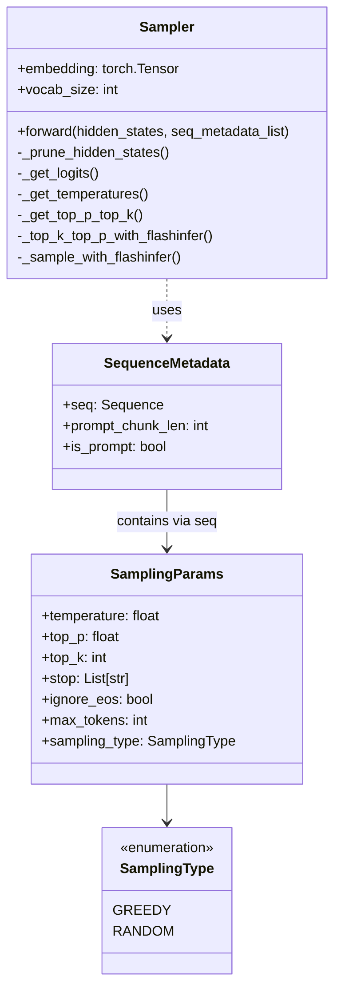
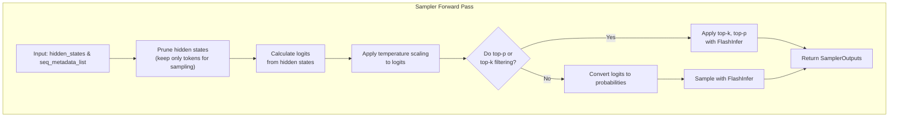
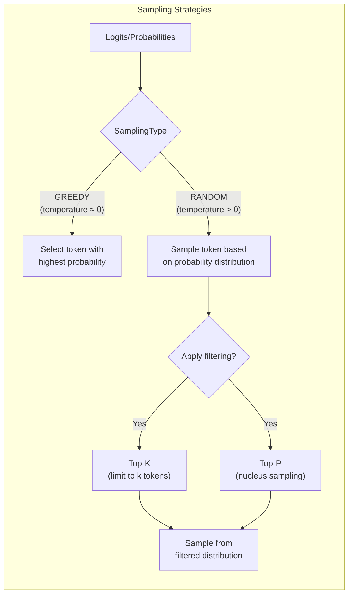
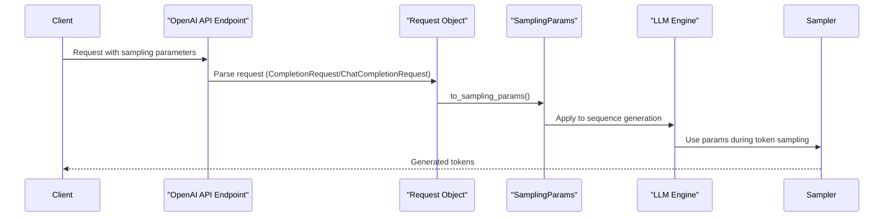

<!-- source: DeepWiki mcp.deepwiki.com · repo microsoft/sarathi-serve · page 3.2 Sampling Mechanism · fetched 2026-10-26 -->

# Sampling Mechanism

Relevant source files

The following files were used as context for generating this wiki page:

- [sarathi/core/datatypes/sampling_params.py](sarathi/core/datatypes/sampling_params.py)
- [sarathi/core/scheduler/orca_scheduler.py](sarathi/core/scheduler/orca_scheduler.py)
- [sarathi/core/scheduler/vllm_scheduler.py](sarathi/core/scheduler/vllm_scheduler.py)
- [sarathi/entrypoints/openai/protocol.py](sarathi/entrypoints/openai/protocol.py)
- [sarathi/model_executor/layers/sampler.py](sarathi/model_executor/layers/sampler.py)

## Purpose and Scope

This document describes the token sampling mechanism in Sarathi-Serve, which is responsible for generating the next token in sequence during LLM inference. Sampling determines how the model selects the next token from the probability distribution over the vocabulary, balancing between deterministic and stochastic outputs based on configurable parameters.

This page focuses on the implementation and workflows of the token sampling components. For information about schedulers that determine which sequences to process, see [Scheduler Configuration](#4.1).

## Sampling Parameters

Sarathi-Serve uses a `SamplingParams` class to encapsulate the configuration for text generation. These parameters control the token selection strategy during inference.

### Key Sampling Parameters

| Parameter | Type | Default | Description |
|-----------|------|---------|-------------|
| temperature | float | 1.0 | Controls randomness of sampling. Lower values make outputs more deterministic. |
| top_p | float | 1.0 | Nucleus sampling parameter - considers tokens with cumulative probability ≤ top_p. |
| top_k | int | -1 | Considers only the top k tokens. -1 disables top-k truncation. |
| stop | list[str] | [] | Sequences that stop token generation when generated. |
| ignore_eos | bool | False | Whether to ignore the EOS token and continue generation. |
| max_tokens | int | 2048 | Maximum number of tokens to generate per output sequence. |

The sampling type is determined automatically:
- If temperature < 1e-5, greedy sampling is used
- Otherwise, random sampling with appropriate parameters is used

Sources: [sarathi/core/datatypes/sampling_params.py:15-91]()

### Parameter Validation

The `SamplingParams` class validates input parameters to ensure they meet requirements:
- temperature must be non-negative
- top_p must be in (0, 1]
- top_k must be -1 (disable) or ≥ 1
- When using greedy sampling (temperature ≈ 0), top_p must be 1 and top_k must be -1

Sources: [sarathi/core/datatypes/sampling_params.py:57-76]()

## Sampler Implementation

The `Sampler` class implements the token sampling mechanism. It is part of the model executor layer and is responsible for selecting the next token at each generation step.

Sources: [sarathi/model_executor/layers/sampler.py:27-47](), [sarathi/core/datatypes/sampling_params.py:10-15](), [sarathi/core/datatypes/sampling_params.py:77-81]()

### Sampling Process Flow

Sources: [sarathi/model_executor/layers/sampler.py:47-86]()

### Key Steps in Sampling Process

1. **Hidden State Pruning**: For each sequence, only the last token is used for sampling in decode phase, or the last token of prompt in prefill phase.

2. **Logit Calculation**: Compute logits by multiplying hidden states with the embedding matrix transpose.

3. **Temperature Scaling**: Scale logits by dividing with temperature, affecting randomness of outputs.

4. **Top-p and Top-k Filtering**:
   - If top-p < 1.0 or top-k != vocab_size, apply filtering to restrict token selection
   - Uses FlashInfer library for efficient implementation

5. **Token Selection**: Sample final tokens from the filtered probability distribution.

Sources: [sarathi/model_executor/layers/sampler.py:100-176]()

## Sampling Strategies

### Greedy Sampling vs. Random Sampling

Sources: [sarathi/core/datatypes/sampling_params.py:77-81](), [sarathi/model_executor/layers/sampler.py:68-81]()

### Top-K and Top-P Implementation Details

For top-k sampling, the algorithm:
1. Sorts token probabilities in descending order
2. Selects only the top k tokens with highest probabilities
3. Renormalizes the probabilities of selected tokens
4. Samples from this truncated distribution

For top-p (nucleus) sampling, the algorithm:
1. Sorts token probabilities in descending order
2. Selects tokens until their cumulative probability exceeds top-p threshold
3. Renormalizes the probabilities of selected tokens
4. Samples from this truncated distribution

The implementation uses FlashInfer for optimized performance.

Sources: [sarathi/model_executor/layers/sampler.py:152-169]()

## Integration with System Components

### API Parameter Mapping

Sarathi-Serve provides OpenAI-compatible API endpoints that map request parameters to sampling parameters:

The OpenAI-compatible API adapts parameters from requests into the internal `SamplingParams` format:

| OpenAI API Parameter | Internal Parameter |
|----------------------|-------------------|
| temperature | temperature |
| top_p | top_p |
| top_k | top_k |
| stop | stop |
| ignore_eos | ignore_eos |
| max_tokens | max_tokens |

Sources: [sarathi/entrypoints/openai/protocol.py:169-177](), [sarathi/entrypoints/openai/protocol.py:216-226]()

### Scheduler Integration

Schedulers use sampling parameters to determine resource allocation for sequences. The schedulers enforce limits on prompt lengths and decide which sequences to execute based partly on the sampling parameters they use.

Sources: [sarathi/core/scheduler/vllm_scheduler.py:35-78](), [sarathi/core/scheduler/orca_scheduler.py:30-74]()

## Performance Considerations

The sampling implementation utilizes the FlashInfer library for high-performance token sampling, providing optimized implementations for:

1. Basic sampling from probability distributions
2. Combined top-k and top-p sampling from logits

This allows for efficient batch processing of sampling operations across multiple sequences with different sampling parameters.

Sources: [sarathi/model_executor/layers/sampler.py:8-11](), [sarathi/model_executor/layers/sampler.py:152-176]()

---

