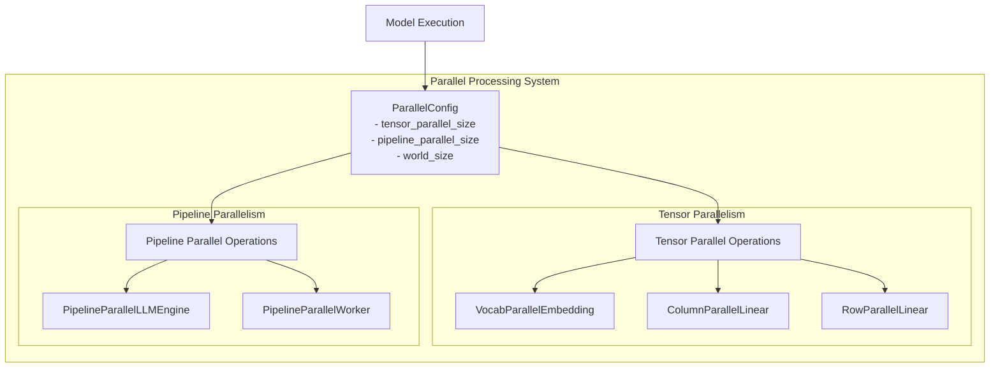
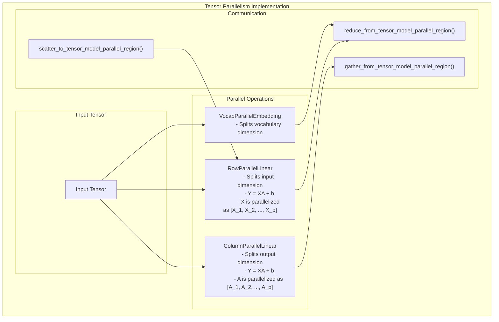
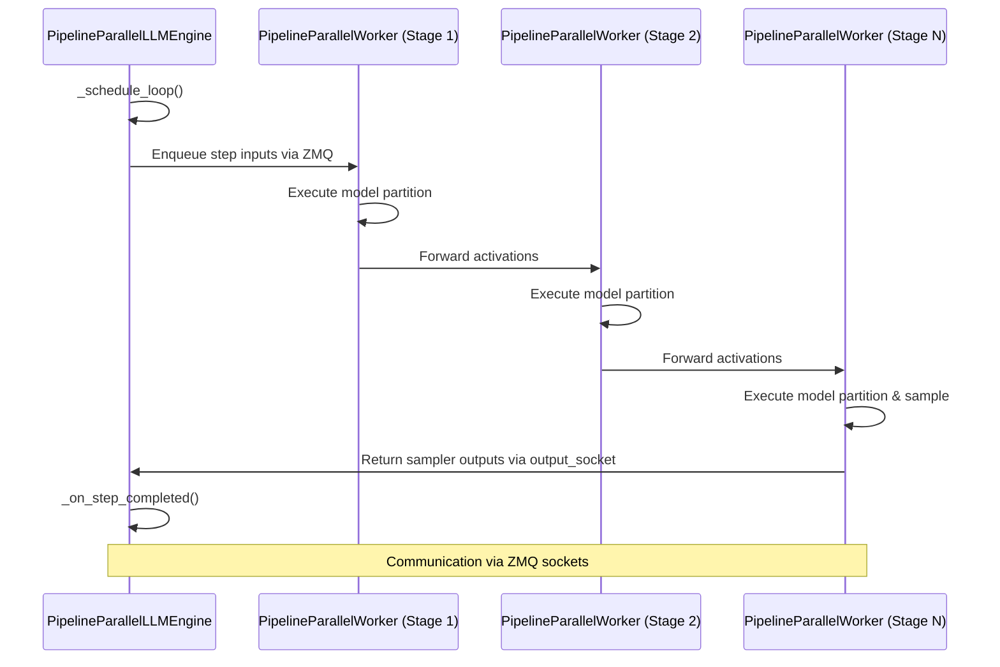
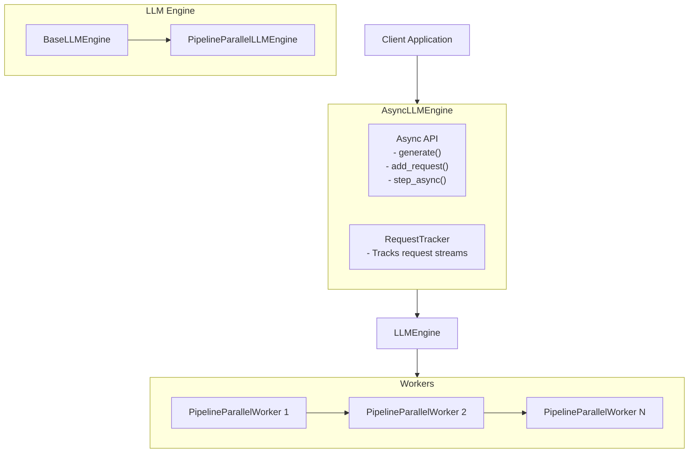

<!-- source: DeepWiki mcp.deepwiki.com · repo microsoft/sarathi-serve · page 3.3 Parallel Processing · fetched 2026-10-26 -->

# Parallel Processing

<details>
<summary>Relevant source files</summary>

The following files were used as context for generating this wiki page:

- [sarathi/benchmark/capacity_search/search_manager.py](sarathi/benchmark/capacity_search/search_manager.py)
- [sarathi/engine/async_llm_engine.py](sarathi/engine/async_llm_engine.py)
- [sarathi/engine/pipeline_parallel_llm_engine.py](sarathi/engine/pipeline_parallel_llm_engine.py)
- [sarathi/model_executor/parallel_utils/tensor_parallel/layers.py](sarathi/model_executor/parallel_utils/tensor_parallel/layers.py)
- [sarathi/transformers_utils/tokenizer.py](sarathi/transformers_utils/tokenizer.py)
- [sarathi/utils/__init__.py](sarathi/utils/__init__.py)
- [sarathi/worker/pipeline_parallel_worker.py](sarathi/worker/pipeline_parallel_worker.py)

</details>


This document details the parallel processing capabilities of Sarathi-Serve, which enable efficient execution of large language models across multiple GPUs. Sarathi-Serve implements two primary forms of parallelism for model execution: tensor parallelism and pipeline parallelism. These techniques can be used individually or combined to achieve optimal performance depending on model size and hardware configuration.

For information on scheduling algorithms that work with parallel processing, see [Scheduler Configuration](#4.1).

## Overview of Parallel Processing in Sarathi-Serve

Large language models (LLMs) often exceed the memory capacity of a single GPU, necessitating distributed execution across multiple devices. Sarathi-Serve supports two complementary parallelization strategies:

1. **Tensor Parallelism**: Splits individual tensors across multiple GPUs, allowing for parallel computation of matrix operations.
2. **Pipeline Parallelism**: Divides the model layers across multiple GPUs, with each GPU responsible for a specific segment of the network.

These approaches can be configured through the `ParallelConfig` component of the system configuration.



Sources:
- [sarathi/config.py]() - System configuration definitions including ParallelConfig
- [sarathi/engine/pipeline_parallel_llm_engine.py:31-65]() - PipelineParallelLLMEngine class definition
- [sarathi/worker/pipeline_parallel_worker.py:18-36]() - PipelineParallelWorker class definition
- [sarathi/model_executor/parallel_utils/tensor_parallel/layers.py:72-454]() - Tensor parallel layer implementations

## Tensor Parallelism

Tensor parallelism partitions individual tensors (weights, activations) across multiple GPUs, allowing for parallel computation of neural network operations. This approach is particularly effective for large models with significant memory requirements for their parameters.

### Implementation in Sarathi-Serve

Sarathi-Serve implements tensor parallelism based on techniques from NVIDIA's Megatron-LM, with three key component types:



Sources:
- [sarathi/model_executor/parallel_utils/tensor_parallel/layers.py:72-177]() - VocabParallelEmbedding implementation
- [sarathi/model_executor/parallel_utils/tensor_parallel/layers.py:180-308]() - ColumnParallelLinear implementation
- [sarathi/model_executor/parallel_utils/tensor_parallel/layers.py:311-454]() - RowParallelLinear implementation

### Key Components

1. **VocabParallelEmbedding**: Partitions the embedding table across the vocabulary dimension, with each GPU handling a subset of the vocabulary.

2. **ColumnParallelLinear**: Implements linear layers with column parallelism where the weight matrix is partitioned along its second dimension.
   - Each GPU performs a smaller matrix multiplication with its partition of weights.
   - Results are gathered across GPUs when the `gather_output` flag is True.

3. **RowParallelLinear**: Implements linear layers with row parallelism where the weight matrix is partitioned along its first dimension.
   - Input is optionally scattered across GPUs.
   - Each GPU performs a smaller matrix multiplication.
   - Results are reduced (summed) across GPUs when the `reduce_results` flag is True.

### Communication Patterns

Tensor parallelism relies on three communication primitives:

| Operation | Description | Used In |
|-----------|-------------|---------|
| `reduce_from_tensor_model_parallel_region` | Performs an all-reduce operation across GPUs | VocabParallelEmbedding, RowParallelLinear |
| `gather_from_tensor_model_parallel_region` | Gathers tensors from all GPUs | ColumnParallelLinear |
| `scatter_to_tensor_model_parallel_region` | Scatters input to all GPUs | RowParallelLinear |

Sources:
- [sarathi/model_executor/parallel_utils/tensor_parallel/layers.py:22-25]() - Import statements for mapping functions
- [sarathi/model_executor/parallel_utils/tensor_parallel/mappings.py]() - Implementation of communication primitives

## Pipeline Parallelism

Pipeline parallelism splits a model's layers across multiple GPUs, allowing each GPU to handle a specific segment of the neural network. This approach is effective for models with many layers that benefit from distributing computation but may not have individual tensor operations large enough to benefit from tensor parallelism.

### Implementation in Sarathi-Serve

Sarathi-Serve implements pipeline parallelism through a specialized engine and worker architecture:



Sources:
- [sarathi/engine/pipeline_parallel_llm_engine.py:113-151]() - _schedule_loop method
- [sarathi/engine/pipeline_parallel_llm_engine.py:161-180]() - _output_loop method
- [sarathi/worker/pipeline_parallel_worker.py:50-76]() - _execution_loop method

### Key Components

1. **PipelineParallelLLMEngine**: Extends the base LLM engine to handle pipeline parallelism.
   - Manages communication between pipeline stages via ZMQ sockets.
   - Schedules execution across pipeline stages.
   - Handles coordination of microbatch processing.

2. **PipelineParallelWorker**: Worker class that executes a partition of the model.
   - Processes assigned model layers on its GPU.
   - Communicates with other pipeline stages via ZMQ.
   - Only the final stage performs token sampling.

### Communication Infrastructure

Pipeline parallelism in Sarathi-Serve uses ZeroMQ (ZMQ) for efficient communication between stages:

| Socket | Purpose | Direction |
|--------|---------|-----------|
| `enqueue_socket` | Sends model inputs to first stage | Engine → Worker |
| `output_socket` | Returns sampler outputs from last stage | Worker → Engine |
| `microbatch_socket` | Signals microbatch completion | Worker → Engine |

These sockets enable asynchronous communication between the engine and workers, allowing for efficient pipeline execution.

Sources:
- [sarathi/engine/pipeline_parallel_llm_engine.py:68-72]() - _init_zmq_sockets method for the engine
- [sarathi/worker/pipeline_parallel_worker.py:26-32]() - _init_zmq_sockets method for the worker

## Parallel Configuration

The parallel processing approach in Sarathi-Serve is configured through the `ParallelConfig` component of the system configuration:

```python
class ParallelConfig:
    tensor_parallel_size: int  # Number of GPUs for tensor parallelism
    pipeline_parallel_size: int  # Number of GPUs for pipeline parallelism
    world_size: int  # Total number of GPUs (tensor_parallel_size * pipeline_parallel_size)
```

Important configuration considerations:

1. For tensor parallelism only: Set `tensor_parallel_size > 1` and `pipeline_parallel_size = 1`
2. For pipeline parallelism only: Set `pipeline_parallel_size > 1` and `tensor_parallel_size = 1`
3. For combined parallelism: Set both `tensor_parallel_size > 1` and `pipeline_parallel_size > 1`

Sources:
- [sarathi/config.py]() - ParallelConfig definition

## Integration with AsyncLLMEngine

The parallel processing capabilities are exposed to clients through the `AsyncLLMEngine`, which provides an asynchronous interface for generating text with LLMs:



Sources:
- [sarathi/engine/async_llm_engine.py:238-512]() - AsyncLLMEngine implementation
- [sarathi/engine/pipeline_parallel_llm_engine.py:31-197]() - PipelineParallelLLMEngine implementation

## Performance Considerations

### Tensor vs Pipeline Parallelism

| Parallelism Type | Best Used When | Advantages | Limitations |
|------------------|----------------|------------|-------------|
| Tensor Parallelism | Model has large individual layers | Lower communication overhead for large matrices | Limited by matrix sizes in the model |
| Pipeline Parallelism | Model has many layers | Can scale to more GPUs | Introduces pipeline bubbles and latency |
| Combined | Very large models on many GPUs | Maximizes parallelization potential | Most complex to configure and optimize |

### Common Bottlenecks

1. **Communication Overhead**: The cost of transferring data between GPUs can become a bottleneck, especially in pipeline parallelism.

2. **Load Balancing**: Uneven distribution of computation across GPUs can lead to inefficient resource utilization.

3. **Pipeline Bubbles**: In pipeline parallelism, waiting for earlier stages to complete can create idle time (bubbles).

## Conclusion

The parallel processing capabilities in Sarathi-Serve provide flexible options for distributing large language models across multiple GPUs. By leveraging tensor parallelism, pipeline parallelism, or a combination of both, users can optimize for their specific hardware configuration and model characteristics.

For guidance on optimal configuration of parallel processing for specific models and hardware setups, see [Performance Tuning](#7.1).

Sources:
- [sarathi/engine/pipeline_parallel_llm_engine.py]()
- [sarathi/worker/pipeline_parallel_worker.py]()
- [sarathi/model_executor/parallel_utils/tensor_parallel/layers.py]()

---

