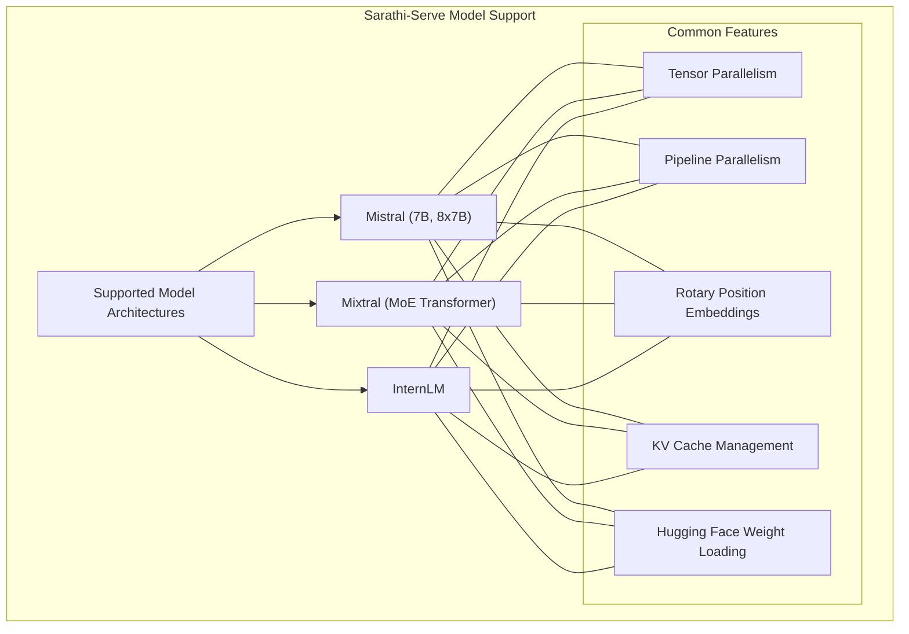
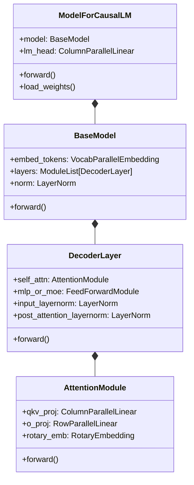
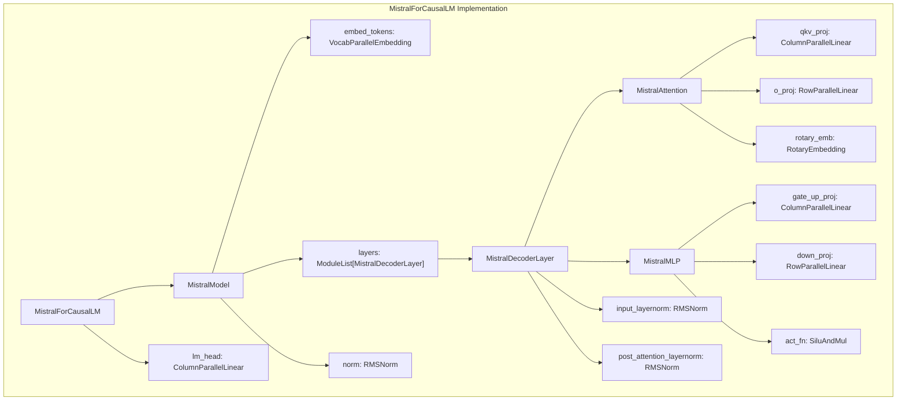
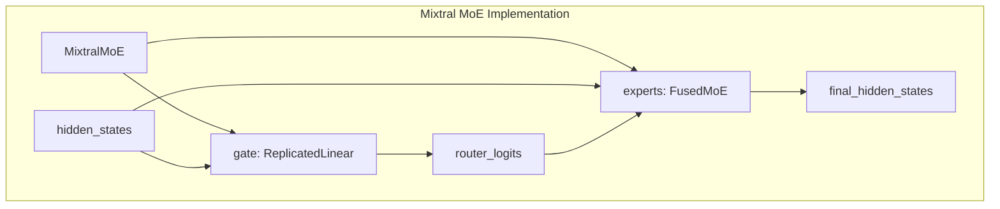
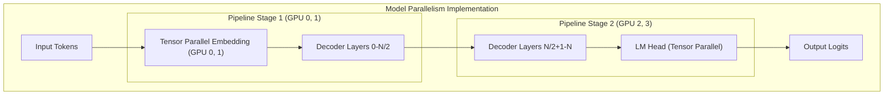

<!-- source: DeepWiki mcp.deepwiki.com · repo microsoft/sarathi-serve · page 3.4 Supported Models · fetched 2026-10-26 -->

# Supported Models

Relevant source files

The following files were used as context for generating this wiki page:

- [sarathi/model_executor/models/internlm.py](sarathi/model_executor/models/internlm.py)
- [sarathi/model_executor/models/mistral.py](sarathi/model_executor/models/mistral.py)
- [sarathi/model_executor/models/mixtral.py](sarathi/model_executor/models/mixtral.py)

This page documents the model architectures currently supported by Sarathi-Serve, their implementations, and key features. For information about parallelization strategies used with these models, see [Parallel Processing](#3.3).

## Overview

Sarathi-Serve is designed to efficiently serve various Large Language Model (LLM) architectures with optimized inference capabilities. The framework currently supports several state-of-the-art decoder-only transformer architectures, focusing on high-throughput, low-latency inference.

Sources: [sarathi/model_executor/models/mixtral.py](), [sarathi/model_executor/models/mistral.py](), [sarathi/model_executor/models/internlm.py]()

## Common Architecture Implementation

All supported models in Sarathi-Serve follow a similar implementation pattern while preserving their unique architectural features. Each model is implemented with optimized components for inference and supports distributed execution.

Sources: [sarathi/model_executor/models/mixtral.py:317-364](), [sarathi/model_executor/models/mistral.py:292-340](), [sarathi/model_executor/models/internlm.py:232-255]()

## Supported Model Architectures

### Mistral

Mistral is a decoder-only transformer architecture with optimized attention through Grouped-Query Attention (GQA). Key components:

- **MistralMLP**: Feed-forward network with SiLU activation
- **MistralAttention**: Implements GQA with rotary position embeddings
- **MistralDecoderLayer**: Combines attention and MLP with residual connections
- **MistralModel**: Full model with token embedding and decoder layers
- **MistralForCausalLM**: Top-level model with language modeling head

Mistral's implementation in Sarathi-Serve supports both tensor and pipeline parallelism, allowing efficient distribution across multiple GPUs.

Sources: [sarathi/model_executor/models/mistral.py:60-101](), [sarathi/model_executor/models/mistral.py:104-177](), [sarathi/model_executor/models/mistral.py:180-232](), [sarathi/model_executor/models/mistral.py:235-289](), [sarathi/model_executor/models/mistral.py:292-340]()

### Mixtral

Mixtral is a Mixture of Experts (MoE) architecture that combines multiple expert networks with a router mechanism. Key components:

- **MixtralMoE**: Implements the MoE layer with tensor-parallel experts
- **MixtralAttention**: Attention implementation with rotary position embeddings
- **MixtralDecoderLayer**: Combines attention and MoE with residual connections
- **MixtralModel**: Full model with token embedding and decoder layers
- **MixtralForCausalLM**: Top-level model with language modeling head

The MoE implementation in Sarathi-Serve shards each expert across all ranks, using a fused MoE kernel for the forward pass.

Sources: [sarathi/model_executor/models/mixtral.py:58-108](), [sarathi/model_executor/models/mixtral.py:111-191](), [sarathi/model_executor/models/mixtral.py:194-258](), [sarathi/model_executor/models/mixtral.py:261-315](), [sarathi/model_executor/models/mixtral.py:317-364]()

### InternLM

InternLM is another decoder-only transformer architecture with a structure similar to LLaMA. Key components:

- **InternLMMLP**: Feed-forward network with SiLU activation
- **InternLMAttention**: Multi-head attention with rotary position embeddings
- **InternLMDecoderLayer**: Combines attention and MLP with residual connections
- **InternLMModel**: Full model with token embedding and decoder layers
- **InternLMForCausalLM**: Top-level model with language modeling head

The implementation in Sarathi-Serve provides tensor parallelism support for efficient distribution.

Sources: [sarathi/model_executor/models/internlm.py:31-71](), [sarathi/model_executor/models/internlm.py:74-145](), [sarathi/model_executor/models/internlm.py:148-196](), [sarathi/model_executor/models/internlm.py:199-229](), [sarathi/model_executor/models/internlm.py:232-255]()

## Model Implementation Features

### Parallelism Support

All models in Sarathi-Serve implement two forms of parallelism:

1. **Tensor Parallelism**: Shards model layers across GPUs, with each GPU processing a portion of the hidden dimensions
   - Implemented via `ColumnParallelLinear`, `RowParallelLinear`, and `VocabParallelEmbedding`
   
2. **Pipeline Parallelism**: Distributes model layers across GPUs, with each GPU handling a subset of the model's layers
   - Managed through `pipeline_model_parallel_rank` and `pipeline_model_parallel_world_size`

Sources: [sarathi/model_executor/models/mixtral.py:272-296](), [sarathi/model_executor/models/mistral.py:246-268](), [sarathi/model_executor/models/internlm.py:206-214]()

### Weight Loading

All models implement a custom `load_weights` method that handles:

1. Loading weights from Hugging Face model repositories
2. Distributing weights according to tensor parallelism configuration
3. Special handling for attention weights, embedding layers, and expert weights (for Mixtral)

The implementation properly handles model sharding to ensure each GPU has the correct portion of the model weights.

| Model Type | Special Weight Handling |
|------------|-------------------------|
| Mistral    | Attention weights, gate/up projection weights |
| Mixtral    | Attention weights, expert weights (w1, w2, w3) |
| InternLM   | Attention weights, gate/up projection weights |

Sources: [sarathi/model_executor/models/mixtral.py:367-518](), [sarathi/model_executor/models/mistral.py:341-464](), [sarathi/model_executor/models/internlm.py:259-332]()

### Attention Mechanisms

All supported models implement optimized attention mechanisms:

- **Mistral and InternLM**: Standard multi-head attention with rotary position embeddings
- **Mixtral**: Similar attention mechanism with support for varying number of KV heads

The attention implementations interface with `BaseAttentionWrapper`, allowing various backend implementations to be used (e.g., FlashAttention).

Sources: [sarathi/model_executor/models/mixtral.py:111-191](), [sarathi/model_executor/models/mistral.py:104-177](), [sarathi/model_executor/models/internlm.py:74-145]()

## Adding New Models

To support a new model architecture in Sarathi-Serve, you need to:

1. Create a new model implementation file following the patterns shown in existing models
2. Implement the key classes (Attention, MLP/MoE, DecoderLayer, Model, ForCausalLM)
3. Ensure proper support for tensor and pipeline parallelism
4. Implement the `load_weights` method for your model

The implementation should follow the common pattern used by existing models, with adaptations for any architecture-specific features.

---

