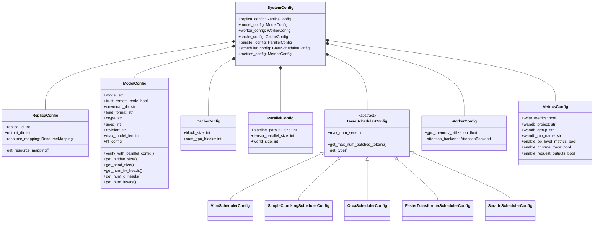
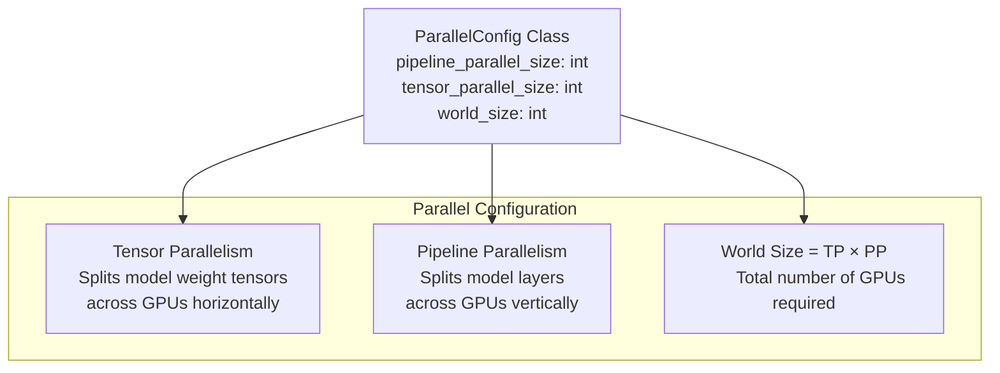
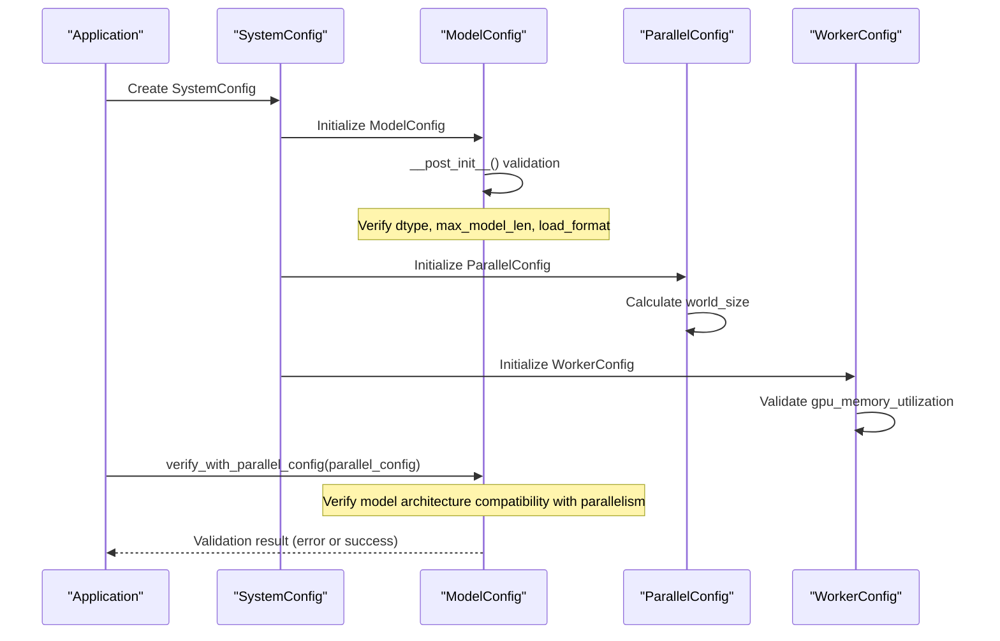
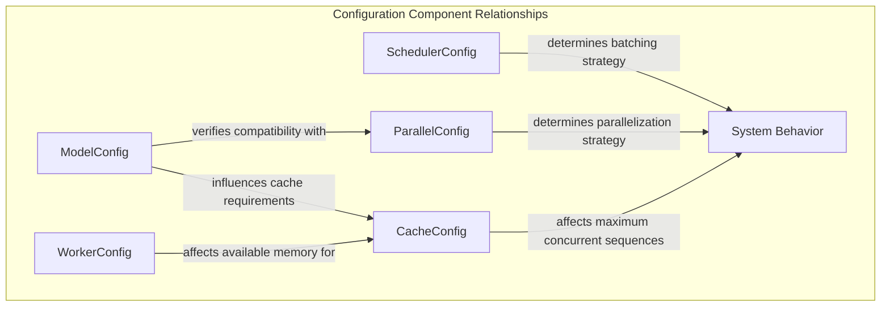

<!-- source: DeepWiki mcp.deepwiki.com · repo microsoft/sarathi-serve · page 4 Configuration System · fetched 2026-10-26 -->

# Configuration System

<details>
<summary>Relevant source files</summary>

The following files were used as context for generating this wiki page:

- [sarathi/config/config.py](sarathi/config/config.py)

</details>


The Configuration System in Sarathi-Serve provides a structured way to define and manage all the parameters that control the behavior of the LLM serving framework. It uses a hierarchical approach with specialized configuration classes for different system components.

This page covers the structure and components of the configuration system. For information about specific scheduler configurations, see [Scheduler Configuration](#4.1), and for benchmark configuration details, see [Benchmark Configuration](#4.2).

## Configuration System Overview

The configuration system in Sarathi-Serve uses Python dataclasses to create a type-safe, hierarchical structure of configuration parameters. The `SystemConfig` class serves as the central configuration container that incorporates specialized configurations for different aspects of the system.



Sources: [sarathi/config/config.py:360-370]()

## System Configuration Components

The Sarathi-Serve configuration system is composed of several specialized components, each responsible for configuring a specific aspect of the system. Let's examine each component in detail.

### Model Configuration

The `ModelConfig` component manages settings related to the LLM model itself. It includes parameters for model selection, data types, and maximum sequence length. After initialization, it loads the Hugging Face model config and performs validation of parameters.

Key parameters include:
- `model`: Hugging Face model name or path
- `trust_remote_code`: Whether to trust remote code when loading the model
- `dtype`: Data type for model weights and activations
- `max_model_len`: Maximum sequence length

The configuration also provides utility methods for accessing model-specific information:
- `get_hidden_size()`: Returns the model's hidden dimension size
- `get_head_size()`: Returns the size of each attention head
- `get_num_kv_heads()`: Returns the number of key-value heads per tensor parallel rank
- `get_num_layers()`: Returns the number of layers per pipeline parallel rank

Sources: [sarathi/config/config.py:16-149]()

### Cache Configuration

The `CacheConfig` component configures the KV-cache system that stores attention key and value tensors during inference. It has two primary parameters:

- `block_size`: The number of tokens in each cache block (default: 16)
- `num_gpu_blocks`: The number of GPU blocks allocated for the KV cache

Sources: [sarathi/config/config.py:151-162]()

### Parallel Processing Configuration

The `ParallelConfig` component defines the parallel processing strategy. It has two main parameters:

- `pipeline_parallel_size`: Number of pipeline parallel groups (default: 2)
- `tensor_parallel_size`: Number of tensor parallel groups (default: 1)

After initialization, it calculates the `world_size` as the product of pipeline_parallel_size and tensor_parallel_size.



Sources: [sarathi/config/config.py:164-175]()

### Scheduler Configuration

The `BaseSchedulerConfig` is an abstract base class for all scheduler configurations. Schedulers determine how sequences are batched and processed by the LLM engine.

Key concrete implementations include:
- `VllmSchedulerConfig`: Uses a continuous batching approach similar to vLLM
- `SimpleChunkingSchedulerConfig`: Processes requests in fixed-size chunks
- `OrcaSchedulerConfig`: Implementation of the Orca scheduling algorithm
- `FasterTransformerSchedulerConfig`: Uses FasterTransformer-style scheduling
- `SarathiSchedulerConfig`: Sarathi's optimized scheduling algorithm (the default)

Each scheduler configuration implements the `get_max_num_batched_tokens()` method, which returns the maximum number of tokens that can be batched in a single execution step.

```mermaid
graph TD
    subgraph "Scheduler Configuration Hierarchy"
        direction BT
        Base["BaseSchedulerConfig
        max_num_seqs: int
        get_max_num_batched_tokens()
        get_type()"]
        
        Vllm["VllmSchedulerConfig
        max_batched_tokens: int"]
        
        SimpleChunking["SimpleChunkingSchedulerConfig
        chunk_size: int"]
        
        Orca["OrcaSchedulerConfig"]
        
        FT["FasterTransformerSchedulerConfig"]
        
        Sarathi["SarathiSchedulerConfig
        chunk_size: int
        enable_dynamic_chunking_schedule: bool
        low_chunk_size: int
        high_chunk_size: int"]
        
        Base <|-- Vllm
        Base <|-- SimpleChunking
        Base <|-- Orca
        Base <|-- FT
        Base <|-- Sarathi
    end
```

Sources: [sarathi/config/config.py:177-275]()

### Worker Configuration

The `WorkerConfig` component manages worker-specific settings:

- `gpu_memory_utilization`: What fraction of GPU memory to use (0.0 to 1.0)
- `attention_backend`: Which attention implementation to use (default: FLASHINFER)

This configuration includes validation to ensure the gpu_memory_utilization is within a valid range.

Sources: [sarathi/config/config.py:339-357]()

### Metrics Configuration

The `MetricsConfig` component controls metrics collection and reporting:

- Weights & Biases integration (`wandb_project`, `wandb_group`, etc.)
- Operation-level metrics (`enable_op_level_metrics`)
- Chrome trace for performance visualization (`enable_chrome_trace`)
- Request output storage (`enable_request_outputs`)

This configuration is essential for benchmarking and performance analysis.

Sources: [sarathi/config/config.py:278-315]()

### Replica Configuration

The `ReplicaConfig` component defines settings for a specific replica (instance) of the system:

- `replica_id`: Unique identifier for the replica
- `output_dir`: Directory for outputs
- `resource_mapping`: Assignment of GPUs to the replica

The `get_resource_mapping()` method provides a list of tuples mapping node IPs to GPU IDs.

Sources: [sarathi/config/config.py:317-336]()

## Configuration Usage and Integration

### SystemConfig Creation

The `SystemConfig` class combines all the component configurations into a unified system configuration. It is typically created either directly or through the `BaseEndpointConfig.create_system_config()` method.

```python
system_config = SystemConfig(
    replica_config=replica_config,
    model_config=model_config,
    worker_config=worker_config,
    cache_config=cache_config,
    parallel_config=parallel_config,
    scheduler_config=scheduler_config,
    metrics_config=metrics_config
)
```

Sources: [sarathi/config/config.py:360-370](), [sarathi/config/config.py:404-413]()

### Configuration Validation

Several configuration components perform validation during initialization:

1. `ModelConfig.__post_init__()` verifies the model's dtype and maximum length
2. `ModelConfig.verify_with_parallel_config()` ensures compatibility between model architecture and parallel configuration
3. `WorkerConfig._verify_args()` validates worker-specific parameters

This validation helps prevent runtime errors by catching configuration issues early.



Sources: [sarathi/config/config.py:60-96](), [sarathi/config/config.py:348-357]()

### EndpointConfig

The `BaseEndpointConfig` class serves as a base for configuring various endpoints in the system. It provides methods for:

1. Creating a configuration from command-line arguments
2. Converting the configuration to a dictionary
3. Creating a `SystemConfig` instance

This is useful for applications that need to create system configurations from external inputs like command-line arguments or configuration files.

Sources: [sarathi/config/config.py:372-413]()

## Configuration Component Relationships

The configuration components have important relationships that determine system behavior:

1. The `ModelConfig` must be compatible with the `ParallelConfig`
   - Number of attention heads must be divisible by tensor_parallel_size
   - Number of hidden layers must be divisible by pipeline_parallel_size

2. The `SchedulerConfig` determines how many tokens can be processed in a batch
   - This affects throughput and latency tradeoffs
   - Different schedulers have different batching strategies

3. The `CacheConfig` is influenced by the `ModelConfig` and available GPU memory
   - Larger models require more cache space per token
   - The `WorkerConfig.gpu_memory_utilization` affects available cache space



Sources: [sarathi/config/config.py:76-96](), [sarathi/config/config.py:186-189]()

## Conclusion

The Sarathi-Serve configuration system provides a comprehensive way to control all aspects of the LLM serving framework. By organizing configuration into specialized components, it enables fine-grained control while maintaining type safety and validation. This approach is essential for a complex system that must balance throughput, latency, and resource utilization across multiple GPUs and various model architectures.

For more detailed information about specific scheduler configurations, refer to [Scheduler Configuration](#4.1), and for benchmark configuration details, see [Benchmark Configuration](#4.2).

---

