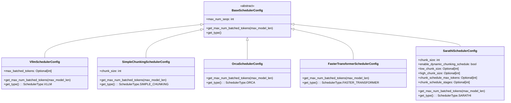
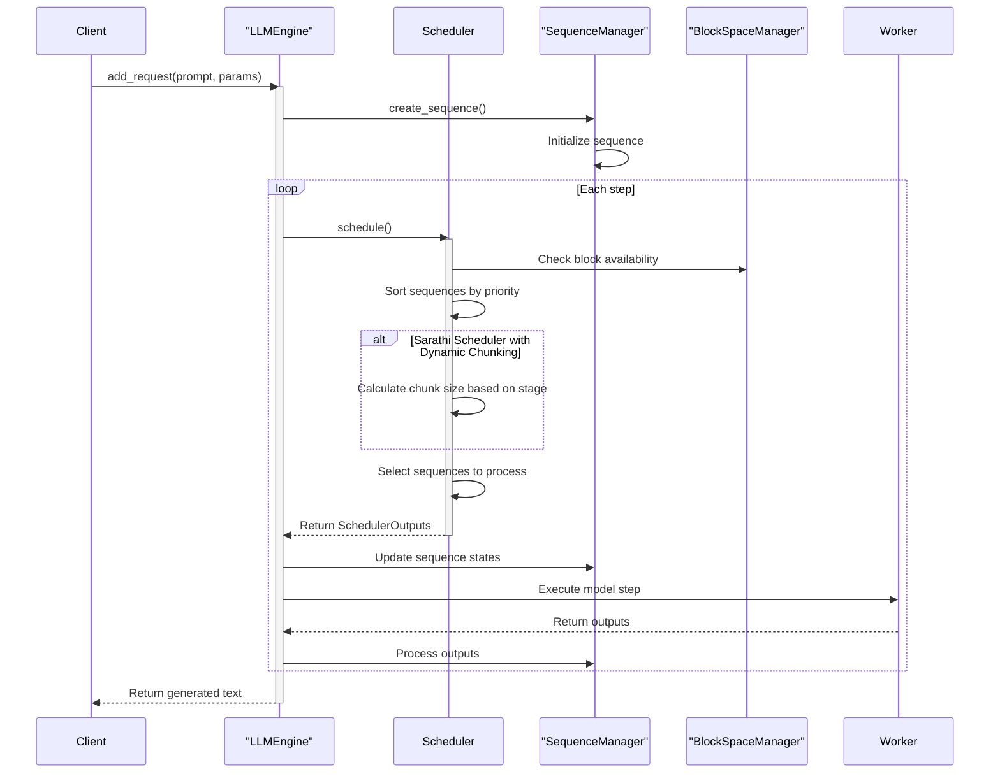
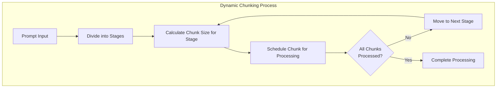
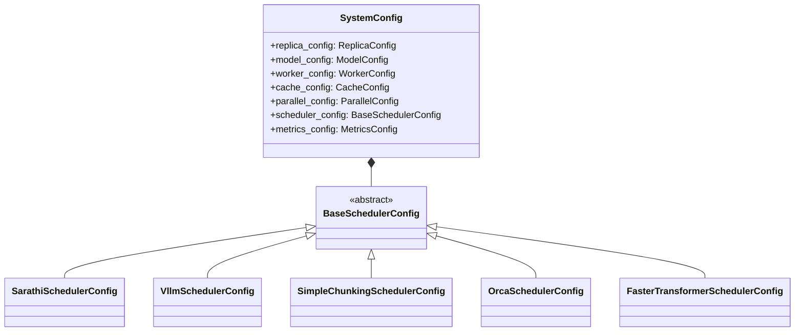

<!-- source: DeepWiki mcp.deepwiki.com · repo microsoft/sarathi-serve · page 4.1 Scheduler Configuration · fetched 2026-10-26 -->

# Scheduler Configuration

<details>
<summary>Relevant source files</summary>

The following files were used as context for generating this wiki page:

- [sarathi/config/config.py](sarathi/config/config.py)
- [sarathi/core/scheduler/sarathi_scheduler.py](sarathi/core/scheduler/sarathi_scheduler.py)

</details>


## Purpose and Scope

This document details the configuration options for the various schedulers available in Sarathi-Serve. Schedulers are responsible for determining which sequences (inference requests) to process in each execution step and how to batch them efficiently. The scheduler is a critical component that directly impacts the throughput-latency tradeoff of the system.

For information about the general system configuration, see [Configuration System](#4). For benchmarking configuration details, see [Benchmark Configuration](#4.2).

## Scheduler Types and Configuration Hierarchy

Sarathi-Serve implements multiple scheduler types, each with its own specific configuration parameters. All scheduler configurations inherit from a common base class.



Sources: [sarathi/config/config.py:178-275]()

## Common Configuration Parameters

All scheduler configurations share the following common parameter:

| Parameter | Type | Default | Description |
|-----------|------|---------|-------------|
| `max_num_seqs` | int | 128 | Maximum number of sequences to be processed in a single iteration (batch size) |

Sources: [sarathi/config/config.py:178-185]()

## Scheduler-Specific Configurations

### VLLM Scheduler

The VLLM scheduler is based on the original vLLM implementation and processes sequences in their entirety.

| Parameter | Type | Default | Description |
|-----------|------|---------|-------------|
| `max_batched_tokens` | Optional[int] | None | Maximum number of tokens to batch in a single iteration |

If `max_batched_tokens` is not specified, it defaults to the maximum model length.

Sources: [sarathi/config/config.py:192-204]()

### Simple Chunking Scheduler

The Simple Chunking scheduler processes inputs in fixed-size chunks.

| Parameter | Type | Default | Description |
|-----------|------|---------|-------------|
| `chunk_size` | int | 512 | Size of each chunk for processing |

Sources: [sarathi/config/config.py:208-219]()

### Orca Scheduler

The Orca scheduler implements the scheduling strategy described in the Orca paper, optimizing for throughput by batching as many tokens as possible.

The Orca scheduler does not have additional parameters beyond the common ones. It calculates the maximum number of batched tokens as `max_num_seqs * max_model_len`.

Sources: [sarathi/config/config.py:223-230]()

### FasterTransformer Scheduler

Similar to the Orca scheduler, the FasterTransformer scheduler does not have additional parameters beyond the common ones. It also calculates the maximum number of batched tokens as `max_num_seqs * max_model_len`.

Sources: [sarathi/config/config.py:234-241]()

### Sarathi Scheduler

The Sarathi scheduler is the most feature-rich scheduler, offering additional optimizations like dynamic chunking.

| Parameter | Type | Default | Description |
|-----------|------|---------|-------------|
| `chunk_size` | int | 512 | Size of each chunk for processing |
| `enable_dynamic_chunking_schedule` | bool | False | Enable dynamic chunking schedule |
| `low_chunk_size` | Optional[int] | None | Minimum chunk size for dynamic chunking |
| `high_chunk_size` | Optional[int] | None | Maximum chunk size for dynamic chunking |
| `chunk_schedule_max_tokens` | Optional[int] | None | Maximum number of tokens for chunk scheduling |
| `chunk_schedule_stages` | Optional[int] | None | Number of stages for chunk scheduling |

Sources: [sarathi/config/config.py:245-275](), [sarathi/core/scheduler/sarathi_scheduler.py:25-52]()

## Scheduler Operation Flow

The following diagram illustrates how the scheduler interacts with other components in the system to determine which sequences to process:



Sources: [sarathi/core/scheduler/sarathi_scheduler.py:98-246]()

## Dynamic Chunking in Sarathi Scheduler

The Sarathi scheduler features a unique dynamic chunking capability that adapts chunk sizes based on prompt processing stages. This is especially beneficial for handling long prompts efficiently.

### How Dynamic Chunking Works

When enabled, the dynamic chunking mechanism:

1. Divides the total prompt processing into stages
2. Uses larger chunk sizes at the beginning of prompt processing
3. Gradually reduces chunk size as the prompt is processed

This approach balances throughput and latency by processing more tokens in the initial stages and then focusing on smaller batches for better responsiveness.



Sources: [sarathi/core/scheduler/sarathi_scheduler.py:35-69]()

### Dynamic Chunking Configuration

To enable dynamic chunking in the Sarathi scheduler, you need to set the following parameters:

```python
scheduler_config = SarathiSchedulerConfig(
    enable_dynamic_chunking_schedule=True,
    low_chunk_size=128,           # Minimum chunk size (must be multiple of 32)
    high_chunk_size=1024,         # Maximum chunk size (must be multiple of 32)
    chunk_schedule_max_tokens=8192, # Maximum tokens to consider for scheduling
    chunk_schedule_stages=5       # Number of stages to divide processing into
)
```

The chunk sizes are computed during initialization to create a schedule of decreasing chunk sizes, each aligned to multiples of 32 (or `low_chunk_size` if smaller).

Sources: [sarathi/core/scheduler/sarathi_scheduler.py:44-69]()

## Scheduler Selection Guidelines

Here are some guidelines for selecting the appropriate scheduler:

| Scheduler Type | Best For | Considerations |
|----------------|----------|----------------|
| VLLM | General-purpose serving with moderate batch sizes | Default option from the original vLLM project |
| Simple Chunking | Fixed-size chunking of inputs | Simpler implementation with less overhead |
| Orca | Maximum throughput with large batch sizes | May increase latency for individual requests |
| FasterTransformer | Similar to Orca, focused on throughput | Compatible with FasterTransformer-style models |
| Sarathi | Optimized for long prompts with variable chunking | Most feature-rich with dynamic chunk sizing |

The default scheduler in Sarathi-Serve is the Sarathi scheduler, configured with a fixed chunk size of 512 tokens.

Sources: [sarathi/config/config.py:366-368]()

## Integrating Scheduler Configuration with System Config

The scheduler configuration is integrated into the overall system configuration as part of the `SystemConfig` class:



Sources: [sarathi/config/config.py:360-369]()

## Example Configuration

Here's an example of configuring the Sarathi scheduler with dynamic chunking:

```python
from sarathi.config import SystemConfig, SarathiSchedulerConfig

# Create a Sarathi scheduler config with dynamic chunking
scheduler_config = SarathiSchedulerConfig(
    max_num_seqs=256,                   # Handle up to 256 sequences in parallel
    chunk_size=512,                     # Base chunk size
    enable_dynamic_chunking_schedule=True,
    low_chunk_size=128,                 # Smallest chunk size
    high_chunk_size=1024,               # Largest chunk size
    chunk_schedule_max_tokens=8192,     # Token threshold for scheduling
    chunk_schedule_stages=5             # Number of stages
)

# Create system config with the scheduler config
system_config = SystemConfig(
    # Other configurations...
    scheduler_config=scheduler_config
)
```

Sources: [sarathi/config/config.py:245-275]()

---

