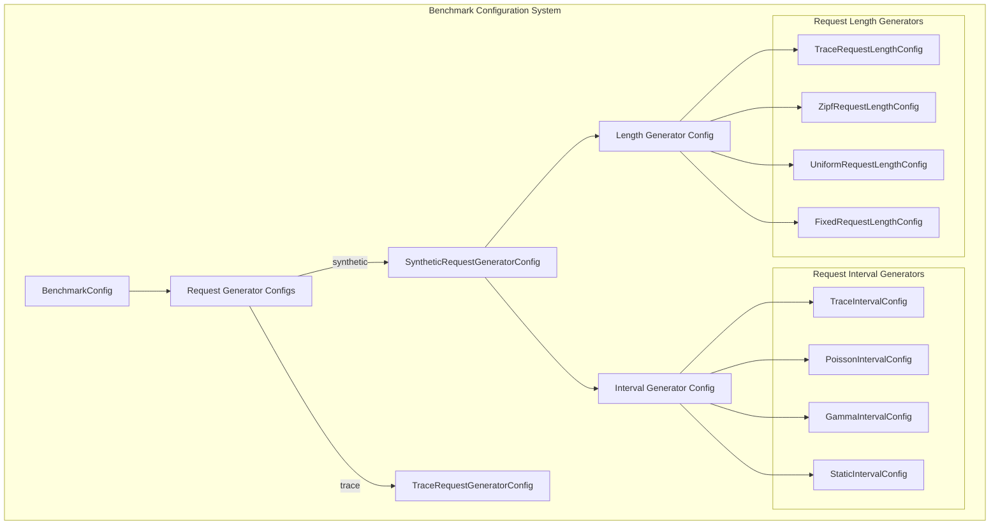
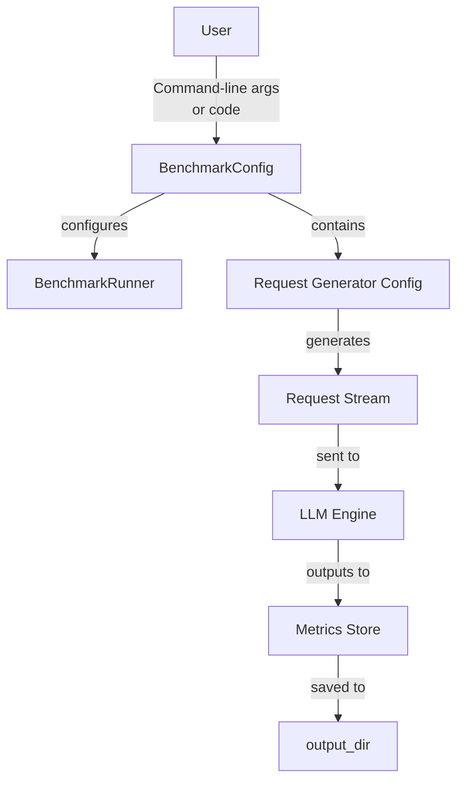
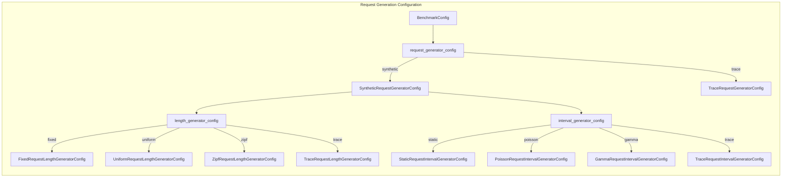
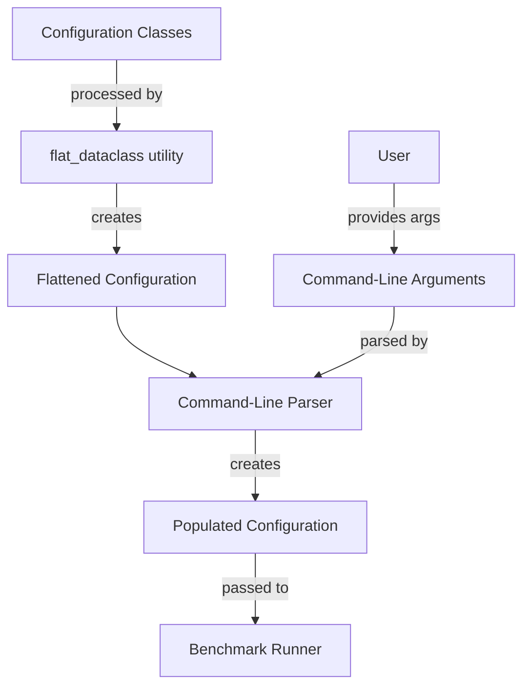

<!-- source: DeepWiki mcp.deepwiki.com · repo microsoft/sarathi-serve · page 4.2 Benchmark Configuration · fetched 2026-10-26 -->

# Benchmark Configuration

<details>
<summary>Relevant source files</summary>

The following files were used as context for generating this wiki page:

- [sarathi/benchmark/config.py](sarathi/benchmark/config.py)
- [sarathi/config/flat_dataclass.py](sarathi/config/flat_dataclass.py)
- [sarathi/entrypoints/config.py](sarathi/entrypoints/config.py)
- [sarathi/entrypoints/openai/config.py](sarathi/entrypoints/openai/config.py)

</details>


## Purpose and Scope

This page documents the benchmark configuration system in Sarathi-Serve, detailing how to configure benchmarks for testing LLM inference performance. The configuration system allows users to control various benchmark parameters including request generation patterns, test duration, output formats, and more. For information about running benchmarks, see [Running Benchmarks](#5.1), and for metrics collection details, see [Metrics Collection](#5.3).

## Overview

The benchmark configuration system in Sarathi-Serve provides a structured way to define how benchmarks are executed, what kind of requests are generated, and how results are collected. Configurations are implemented as dataclasses with sensible defaults, allowing users to easily customize benchmarking scenarios through either code or command-line arguments.



Sources: [sarathi/benchmark/config.py:19-243]()

## Main Benchmark Configuration

The `BenchmarkConfig` class is the main entry point for configuring benchmarks. It inherits from `BaseEndpointConfig` and provides configuration options for overall benchmark execution.

### Core Parameters

| Parameter | Type | Default | Description |
|-----------|------|---------|-------------|
| seed | int | 42 | Random seed for reproducibility |
| output_dir | str | "benchmark_output" | Directory to store benchmark output |
| write_json_trace | bool | True | Whether to write JSON trace output |
| enable_profiling | bool | False | Whether to enable profiling |
| time_limit | Optional[int] | None | Time limit for the benchmark in seconds (None = unlimited) |
| num_replicas | int | 1 | Number of replicas to use |
| replica_resource_mapping | Optional[ReplicaResourceMapping] | None | Mapping of replicas to resources |
| request_generator_config | BaseRequestGeneratorConfig | SyntheticRequestGeneratorConfig | Configuration for request generation |

Sources: [sarathi/benchmark/config.py:219-248]()



Sources: [sarathi/benchmark/config.py:219-248]()

## Request Generation Configuration

Request generation is a critical aspect of benchmarking. Sarathi-Serve provides two main types of request generators:

1. **Synthetic Request Generator** - Generates synthetic requests using configurable patterns
2. **Trace Request Generator** - Replays requests from a trace file

### Synthetic Request Generator

The `SyntheticRequestGeneratorConfig` allows configuration of synthetic request generation with control over:

| Parameter | Type | Default | Description |
|-----------|------|---------|-------------|
| length_generator_config | BaseRequestLengthGeneratorConfig | FixedRequestLengthGeneratorConfig | Configuration for generating request lengths |
| interval_generator_config | BaseRequestIntervalGeneratorConfig | PoissonRequestIntervalGeneratorConfig | Configuration for generating intervals between requests |
| num_requests | int | 64 | Number of requests to generate |
| duration | float | None | Duration of the synthetic request generation |

Sources: [sarathi/benchmark/config.py:172-188]()

#### Request Length Generators

Four different request length generators are available:

1. **Fixed** - Generates requests with fixed prefill and decode token counts
   
   | Parameter | Type | Default | Description |
   |-----------|------|---------|-------------|
   | prefill_tokens | int | 4096 | Number of prefill tokens |
   | decode_tokens | int | 512 | Number of decode tokens |

   Sources: [sarathi/benchmark/config.py:151-161]()

2. **Uniform** - Generates request lengths from a uniform distribution
   
   | Parameter | Type | Default | Description |
   |-----------|------|---------|-------------|
   | min_tokens | int | 1024 | Minimum number of tokens |
   | max_tokens | int | 4096 | Maximum number of tokens |
   | prefill_to_decode_ratio | float | 20.0 | Ratio of prefill tokens to decode tokens |

   Sources: [sarathi/benchmark/config.py:134-147]()

3. **Zipf** - Generates request lengths from a Zipf distribution
   
   | Parameter | Type | Default | Description |
   |-----------|------|---------|-------------|
   | theta | float | 0.6 | Theta parameter for the Zipf distribution |
   | scramble | bool | False | Whether to scramble the Zipf distribution |
   | min_tokens | int | 1024 | Minimum number of tokens |
   | max_tokens | int | 4096 | Maximum number of tokens |
   | prefill_to_decode_ratio | float | 20.0 | Ratio of prefill tokens to decode tokens |

   Sources: [sarathi/benchmark/config.py:111-130]()

4. **Trace** - Generates request lengths based on a trace file
   
   | Parameter | Type | Default | Description |
   |-----------|------|---------|-------------|
   | trace_file | str | "data/processed_traces/sharegpt_8k_filtered_stats_llama2_tokenizer.csv" | Path to the trace file |
   | prefill_scale_factor | float | 1 | Scale factor for prefill tokens |
   | decode_scale_factor | float | 1 | Scale factor for decode tokens |
   | max_tokens | int | 4096 | Maximum number of tokens allowed |

   Sources: [sarathi/benchmark/config.py:90-107]()

#### Request Interval Generators

Four different request interval generators are available:

1. **Static** - Generates requests at a fixed interval
   
   (No additional parameters)

   Sources: [sarathi/benchmark/config.py:83-86]()

2. **Poisson** - Generates request intervals from a Poisson distribution
   
   | Parameter | Type | Default | Description |
   |-----------|------|---------|-------------|
   | qps | float | 1.0 | Queries per second for the Poisson distribution |

   Sources: [sarathi/benchmark/config.py:56-64]()

3. **Gamma** - Generates request intervals from a Gamma distribution
   
   | Parameter | Type | Default | Description |
   |-----------|------|---------|-------------|
   | qps | float | 1.0 | Queries per second for the Gamma distribution |
   | cv | float | 0.5 | Coefficient of variation for the Gamma distribution |

   Sources: [sarathi/benchmark/config.py:68-79]()

4. **Trace** - Generates request intervals based on a trace file
   
   | Parameter | Type | Default | Description |
   |-----------|------|---------|-------------|
   | trace_file | str | "data/processed_traces/AzureFunctionsInvocationTraceForTwoWeeksJan2021Processed.csv" | Path to the trace file |
   | start_time | str | "1970-01-04 12:00:00" | Start time for the trace |
   | end_time | str | "1970-01-04 15:00:00" | End time for the trace |
   | time_scale_factor | float | 0.3 | Factor to scale the time intervals |

   Sources: [sarathi/benchmark/config.py:34-52]()

### Trace Request Generator

The `TraceRequestGeneratorConfig` replays requests from a trace file, with the following configuration options:

| Parameter | Type | Default | Description |
|-----------|------|---------|-------------|
| trace_file | str | "data/processed_traces/sydney_enterprise.csv" | Path to the trace file |
| date | str | "2023-08-21" | Date for the trace data |
| prefill_scale_factor | float | 0.3 | Scale factor for prefill tokens |
| decode_scale_factor | float | 1 | Scale factor for decode tokens |
| time_scale_factor | float | 0.04 | Scale factor for time intervals |
| max_tokens | int | 4096 | Maximum number of tokens allowed |

Sources: [sarathi/benchmark/config.py:192-215]()



Sources: [sarathi/benchmark/config.py:19-215]()

## Using the Configuration System

The benchmark configuration system in Sarathi-Serve is designed to be flexible and extensible. The configuration classes are implemented as dataclasses with defaults, making them easy to use both programmatically and through command-line arguments.

### Programmatic Configuration

To create a benchmark configuration programmatically:

```python
from sarathi.benchmark.config import (
    BenchmarkConfig,
    PoissonRequestIntervalGeneratorConfig,
    FixedRequestLengthGeneratorConfig,
    SyntheticRequestGeneratorConfig,
)

# Create a request length generator config for fixed token lengths
length_config = FixedRequestLengthGeneratorConfig(
    prefill_tokens=1024,  
    decode_tokens=256
)

# Create a request interval generator config for Poisson-distributed intervals
interval_config = PoissonRequestIntervalGeneratorConfig(
    qps=5.0  # 5 queries per second on average
)

# Create a synthetic request generator config
request_generator_config = SyntheticRequestGeneratorConfig(
    length_generator_config=length_config,
    interval_generator_config=interval_config,
    num_requests=1000
)

# Create the main benchmark config
benchmark_config = BenchmarkConfig(
    seed=12345,
    output_dir="my_benchmark_results",
    write_json_trace=True,
    time_limit=300,  # 5 minutes
    request_generator_config=request_generator_config
)
```

### Command-Line Configuration

Sarathi-Serve uses the `flat_dataclass` utility to flatten nested configuration structures, making them accessible through command-line arguments. This allows specifying configuration options directly when running benchmarks.



Sources: [sarathi/config/flat_dataclass.py:1-238]()

Examples of command-line arguments for common benchmark configurations:

1. Basic synthetic benchmark with Poisson arrivals:
   ```
   --seed 12345 
   --output_dir benchmark_results 
   --time_limit 300 
   --request_generator_config_type synthetic 
   --interval_generator_config_type poisson 
   --poisson_request_interval_generator_config_qps 5.0 
   --length_generator_config_type fixed 
   --fixed_request_length_generator_config_prefill_tokens 1024 
   --fixed_request_length_generator_config_decode_tokens 256
   ```

2. Trace-based benchmark:
   ```
   --seed 12345 
   --output_dir trace_results 
   --time_limit 300 
   --request_generator_config_type trace 
   --trace_request_generator_config_trace_file my_trace.csv 
   --trace_request_generator_config_time_scale_factor 0.5
   ```

## Best Practices

When configuring benchmarks, consider the following best practices:

1. **Reproducibility**: Always set a specific seed value to ensure reproducible results.

2. **Request Distribution**: Choose request generators that match your expected workload characteristics:
   - For steady-state testing, use Poisson or Gamma generators
   - For production-like workloads, use trace-based generators
   - For stress testing, consider using fixed intervals with increasing rates

3. **Duration**: Set appropriate time limits based on your benchmarking goals:
   - For quick system validation, 1-5 minutes is typically sufficient
   - For performance stability testing, consider longer durations (30+ minutes)

4. **Output Management**: Use the `output_dir` parameter to organize benchmark results, especially when running multiple configurations.

5. **System Monitoring**: Enable profiling for detailed system performance analysis when diagnosing issues.

---

