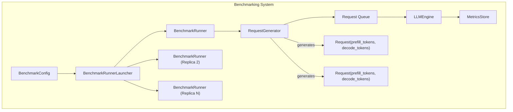
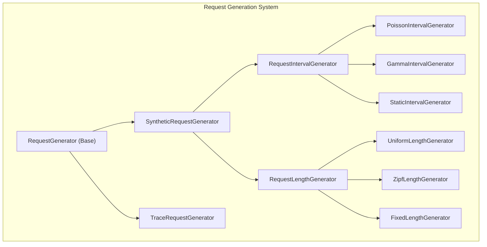
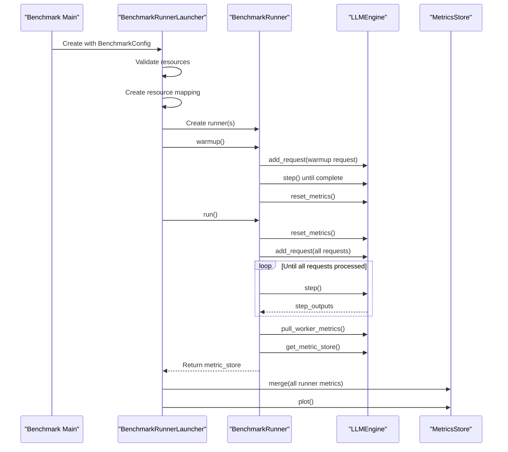
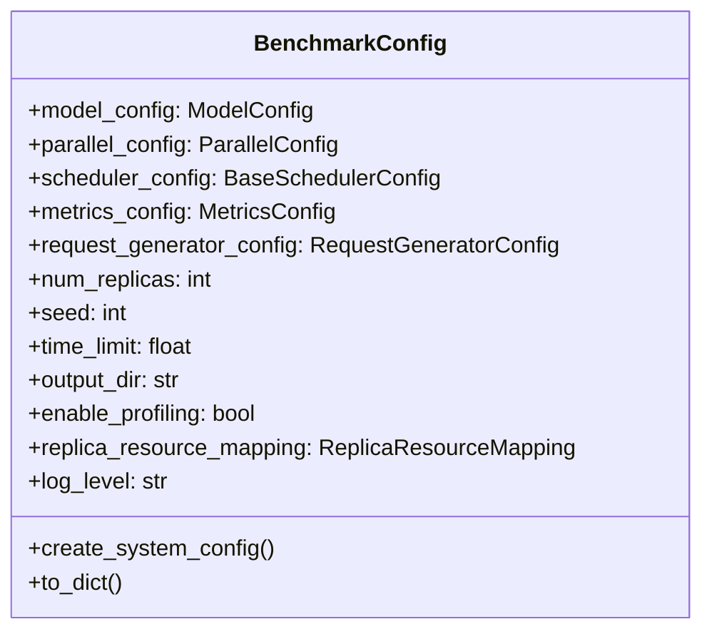

<!-- source: DeepWiki mcp.deepwiki.com · repo microsoft/sarathi-serve · page 5 Benchmarking · fetched 2026-10-26 -->

# Benchmarking

<details>
<summary>Relevant source files</summary>

The following files were used as context for generating this wiki page:

- [sarathi/benchmark/benchmark_runner.py](sarathi/benchmark/benchmark_runner.py)
- [sarathi/benchmark/main.py](sarathi/benchmark/main.py)
- [sarathi/types.py](sarathi/types.py)

</details>


## Overview

The benchmarking system in Sarathi-Serve provides tools for measuring and evaluating the performance of LLM serving across various configurations and workloads. This page provides an overview of the benchmarking architecture, components, and capabilities. For specific instructions on running benchmarks, see [Running Benchmarks](#5.1), for capacity search functionality see [Capacity Search](#5.2), and for details on metrics collection see [Metrics Collection](#5.3).

The benchmarking system is designed to:

1. Simulate realistic or synthetic workloads
2. Measure throughput, latency, and resource utilization
3. Support single and multi-replica deployments
4. Collect and visualize performance metrics
5. Identify optimal configuration parameters

Sources: [sarathi/benchmark/benchmark_runner.py:22-144](), [sarathi/benchmark/main.py:15-36]()

## Benchmarking Architecture



The benchmarking system is built around the `BenchmarkRunner` and `BenchmarkRunnerLauncher` classes. The architecture supports both single-replica and multi-replica benchmarking, with Ray being used for distributed execution.

Sources: [sarathi/benchmark/benchmark_runner.py:22-144](), [sarathi/benchmark/benchmark_runner.py:147-279]()

### Request Generation



The request generation system provides flexibility in creating different types of benchmark workloads:

- **Synthetic requests**: Generated programmatically with configurable distributions
- **Trace-based requests**: Derived from real-world usage patterns

Each request defines:
- Number of prefill tokens (context length)
- Number of decode tokens (generation length)
- Arrival time

Sources: [sarathi/benchmark/benchmark_runner.py:41-45](), [sarathi/types.py:18-34]()

## Benchmarking Workflow



The benchmarking process follows these steps:

1. **Initialization**: Configure the benchmark environment and create necessary components
2. **Warmup**: Run a test request to ensure the system is initialized
3. **Request Generation**: Create the workload based on configuration
4. **Execution**: Process all requests through the LLM engine
5. **Metrics Collection**: Gather performance data
6. **Analysis**: Aggregate metrics and generate visualizations

Sources: [sarathi/benchmark/benchmark_runner.py:82-144](), [sarathi/benchmark/main.py:15-36]()

## Key Components

### BenchmarkRunner

The `BenchmarkRunner` is responsible for executing a benchmark on a single replica:

```
BenchmarkRunner
├── Initialize with replica_id, config, resource_mapping
├── Generate requests based on configuration
├── Create LLMEngine instance
├── warmup() - Run initial request to warm up the system
├── run() - Execute all requests and collect metrics
└── Return metrics store for analysis
```

The runner simulates requests with specified token counts rather than actual text prompts, allowing for precise control over workload characteristics.

Sources: [sarathi/benchmark/benchmark_runner.py:22-144]()

### BenchmarkRunnerLauncher

The `BenchmarkRunnerLauncher` coordinates multi-replica benchmarking:

```
BenchmarkRunnerLauncher
├── Initialize with BenchmarkConfig
├── Validate cluster resources
├── Create resource mapping for GPUs across nodes
├── Create BenchmarkRunner instances (local or via Ray)
├── run() - Execute benchmark across all replicas
└── Aggregate metrics from all replicas
```

For multi-replica setups, Ray is used to distribute runners across nodes and coordinate execution.

Sources: [sarathi/benchmark/benchmark_runner.py:147-279]()

### Resource Mapping

The benchmarking system supports sophisticated resource allocation across multiple nodes:

| Component | Purpose |
|-----------|---------|
| `GPULocation` | Tuple of (node_ip, gpu_id) identifying a specific GPU |
| `ResourceMapping` | List of GPULocations for a single replica |
| `ReplicaResourceMapping` | List of ResourceMappings for all replicas |

This enables precise control over which GPUs are used for each replica, supporting both tensor and pipeline parallelism configurations.

Sources: [sarathi/types.py:5-7](), [sarathi/benchmark/benchmark_runner.py:171-221]()

## Benchmark Configuration

The benchmarking system is highly configurable through the `BenchmarkConfig` class:



Key configuration aspects include:
- Model configuration (architecture, size, precision)
- Parallelism strategy (tensor parallel, pipeline parallel)
- Scheduler configuration
- Request generation parameters
- Resource allocation

Sources: [sarathi/benchmark/benchmark_runner.py:33-59](), [sarathi/benchmark/main.py:16-20]()

## Integration with Metrics Collection

The benchmarking system integrates closely with the metrics collection subsystem:

1. Each `BenchmarkRunner` has its own `MetricsStore` instance
2. For multi-replica benchmarks, metrics are aggregated into a central store
3. The metrics can be exported to Weights & Biases (wandb) for visualization
4. Custom plotting functions are available for local analysis

Sources: [sarathi/benchmark/benchmark_runner.py:143-144](), [sarathi/benchmark/benchmark_runner.py:244-278]()

## Related Components

The benchmarking system interfaces with several other components of Sarathi-Serve:

1. **LLM Engine**: The core inference engine being benchmarked
2. **Scheduler System**: Different scheduling algorithms can be evaluated
3. **Memory Management**: KV cache and block management performance can be measured
4. **Metrics Collection**: System for gathering and visualizing performance data
5. **Capacity Search**: Tool for finding optimal throughput settings (see [Capacity Search](#5.2))

Sources: [sarathi/benchmark/benchmark_runner.py:59-63]()

---

