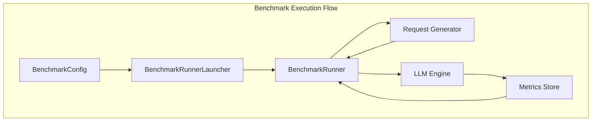
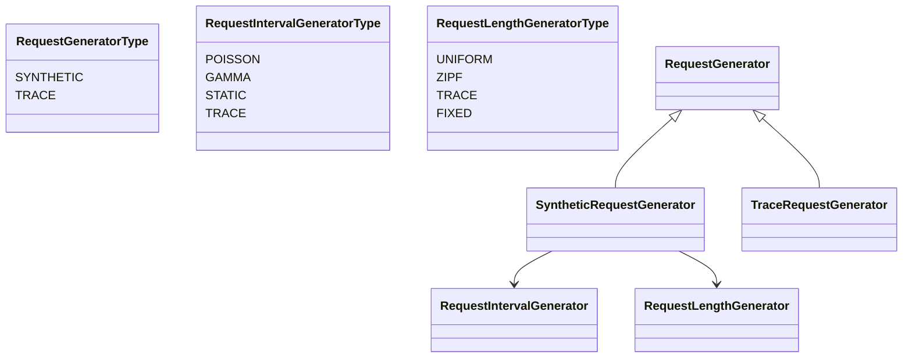
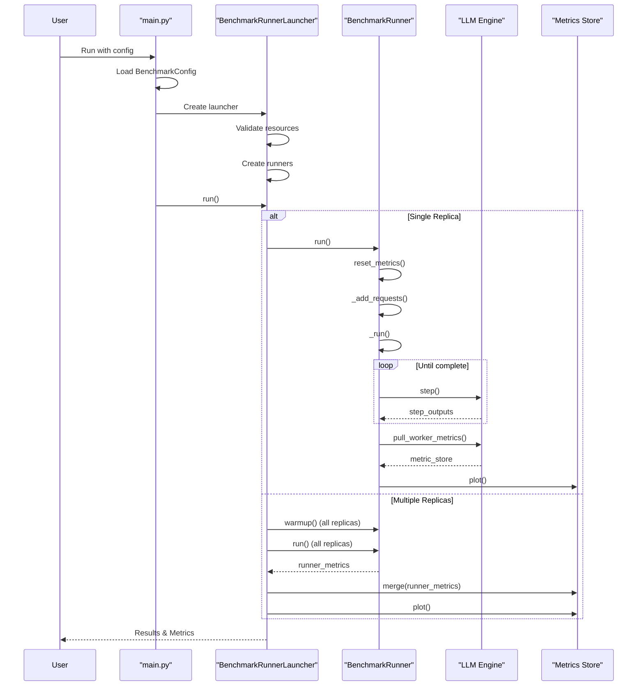
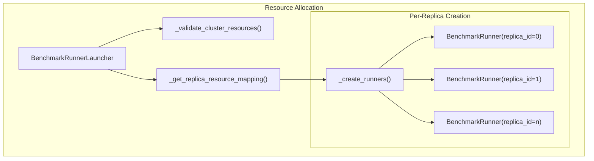
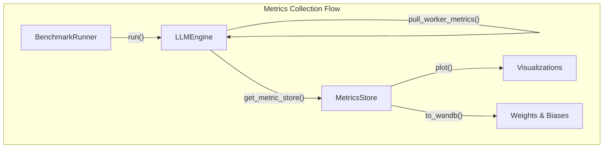

<!-- source: DeepWiki mcp.deepwiki.com · repo microsoft/sarathi-serve · page 5.1 Running Benchmarks · fetched 2026-10-26 -->

# Running Benchmarks

<details>
<summary>Relevant source files</summary>

The following files were used as context for generating this wiki page:

- [sarathi/benchmark/benchmark_runner.py](sarathi/benchmark/benchmark_runner.py)
- [sarathi/benchmark/main.py](sarathi/benchmark/main.py)
- [sarathi/types.py](sarathi/types.py)

</details>


This document provides a comprehensive guide on how to run benchmarks with Sarathi-Serve. The benchmarking system enables you to evaluate LLM serving performance by measuring throughput, latency, and resource utilization under various workloads. For information about specific metrics collected during benchmarks, see [Metrics Collection](#5.3).

## 1. Benchmarking System Overview

The Sarathi-Serve benchmarking system consists of configurable components that work together to simulate real-world LLM serving workloads. It supports both single-GPU and distributed multi-GPU benchmarks.



Sources: [sarathi/benchmark/benchmark_runner.py:147-280](), [sarathi/benchmark/main.py:15-36]()

## 2. Benchmark Configuration

Benchmarks are controlled through a `BenchmarkConfig` object, which can be created from command-line arguments or a YAML configuration file.

### 2.1 Core Configuration Options

| Parameter | Description | Default |
|-----------|-------------|---------|
| `model_config` | Model configuration (model name, dtype, etc.) | Required |
| `num_replicas` | Number of replica instances to run in parallel | 1 |
| `request_generator_config` | Configuration for generating test requests | Required |
| `scheduler_config` | Configuration for the scheduler | Required |
| `parallel_config` | Configuration for tensor/pipeline parallelism | Required |
| `time_limit` | Maximum time to run the benchmark in seconds | 300 |
| `output_dir` | Directory for outputting results | Required |
| `seed` | Random seed for reproducibility | 42 |
| `enable_profiling` | Whether to enable profiling | False |

Sources: [sarathi/benchmark/benchmark_runner.py:22-144](), [sarathi/benchmark/main.py:15-36]()

### 2.2 Request Generator Configuration

The benchmark system supports different request generators to simulate various workload patterns:



Sources: [sarathi/types.py:18-34]()

## 3. Running a Benchmark

Benchmarks can be run with a single command after creating a configuration file or providing command-line arguments.

### 3.1 Basic Benchmark Execution

To run a benchmark, use the `main.py` script in the benchmark module:

```bash
python -m sarathi.benchmark.main --config path/to/config.yaml
```

The script handles:
1. Loading the configuration
2. Setting up the benchmark environment
3. Launching the benchmark runner
4. Collecting and reporting metrics

Sources: [sarathi/benchmark/main.py:15-36]()

### 3.2 Benchmark Execution Flow



Sources: [sarathi/benchmark/benchmark_runner.py:137-279](), [sarathi/benchmark/main.py:15-36]()

## 4. Multi-Replica Benchmarks

Sarathi-Serve supports running benchmarks across multiple GPUs and even multiple nodes simultaneously, which is useful for testing distributed serving scenarios.

### 4.1 Resource Allocation

The benchmark runner automatically handles resource allocation for multi-replica benchmarks:



Sources: [sarathi/benchmark/benchmark_runner.py:161-241]()

The system supports:
- Manual resource mapping specification
- Automatic resource discovery and allocation
- Distribution of requests across replicas
- Aggregation of metrics from all replicas

### 4.2 Running Multi-Replica Benchmarks

To run a multi-replica benchmark:

1. Set `num_replicas` in your benchmark configuration to the desired number of replicas
2. Configure `parallel_config` with appropriate tensor and pipeline parallelism settings
3. Optionally specify `replica_resource_mapping` for custom GPU allocation

When running with multiple replicas, the system:
- Performs round-robin scheduling of requests across replicas
- Distributes the computation using Ray
- Aggregates metrics from all replicas for unified reporting

Sources: [sarathi/benchmark/benchmark_runner.py:262-279]()

## 5. Benchmark Requests

The benchmarking system generates synthetic requests or uses trace-based requests to simulate workloads.

### 5.1 Request Parameters

Each benchmark request includes:
- `num_prefill_tokens`: Number of tokens in the initial prompt
- `num_decode_tokens`: Number of tokens to generate
- `arrived_at`: When the request arrives relative to the start of the benchmark

Sources: [sarathi/benchmark/benchmark_runner.py:64-80]()

### 5.2 Request Execution

The benchmark runner:
1. Creates requests according to the generator configuration
2. Distributes requests among replicas (for multi-replica benchmarks)
3. Sends requests to the LLM Engine at the specified arrival times
4. Monitors progress and collects metrics

Sources: [sarathi/benchmark/benchmark_runner.py:92-126](), [sarathi/benchmark/benchmark_runner.py:128-136]()

## 6. Understanding Benchmark Results

After running a benchmark, metrics are collected and can be analyzed to understand system performance.

### 6.1 Metric Collection

The benchmark runner collects metrics throughout the benchmark execution:



Sources: [sarathi/benchmark/benchmark_runner.py:137-144](), [sarathi/benchmark/benchmark_runner.py:262-279]()

### 6.2 Output Locations

Benchmark results are stored in:
- The specified `output_dir` directory
- Weights & Biases (if configured)

Sources: [sarathi/benchmark/benchmark_runner.py:245-260]()

## 7. Common Benchmark Scenarios

### 7.1 Throughput Testing

To measure maximum throughput:
1. Configure a synthetic request generator with appropriate token distributions
2. Set high request rate
3. Run the benchmark for a sufficient duration (e.g., 5+ minutes)
4. Examine throughput metrics in the results

### 7.2 Latency Testing

To measure request latency:
1. Configure a fixed interval between requests
2. Set consistent request sizes
3. Run the benchmark
4. Analyze p50, p90, and p99 latency metrics

For advanced throughput optimization techniques, see [Capacity Search](#5.2).

## 8. Example Configuration

Here's a minimal example configuration for running a benchmark:

```yaml
# Example benchmark configuration
model_config:
  model: "meta-llama/Llama-2-7b-hf"
  trust_remote_code: true
  dtype: "half"
  max_model_len: 4096

num_replicas: 1
time_limit: 300  # 5 minutes
output_dir: "./benchmark_results"
seed: 42

request_generator_config:
  type: "SYNTHETIC"
  num_requests: 100
  request_interval_generator_config:
    type: "POISSON"
    mean_interval: 0.5  # seconds
  request_length_generator_config:
    type: "FIXED"
    prefill_tokens: 512
    decode_tokens: 128

scheduler_config:
  type: "SARATHI"
  max_num_seqs: 128
  max_num_batched_tokens: 4096

parallel_config:
  tensor_parallel_size: 1
  pipeline_parallel_size: 1
```

Sources: [sarathi/benchmark/main.py:15-36]()

This configuration would run a benchmark with 100 synthetic requests, each with 512 prefill tokens and 128 decode tokens, arriving according to a Poisson process with a mean interval of 0.5 seconds.

---

