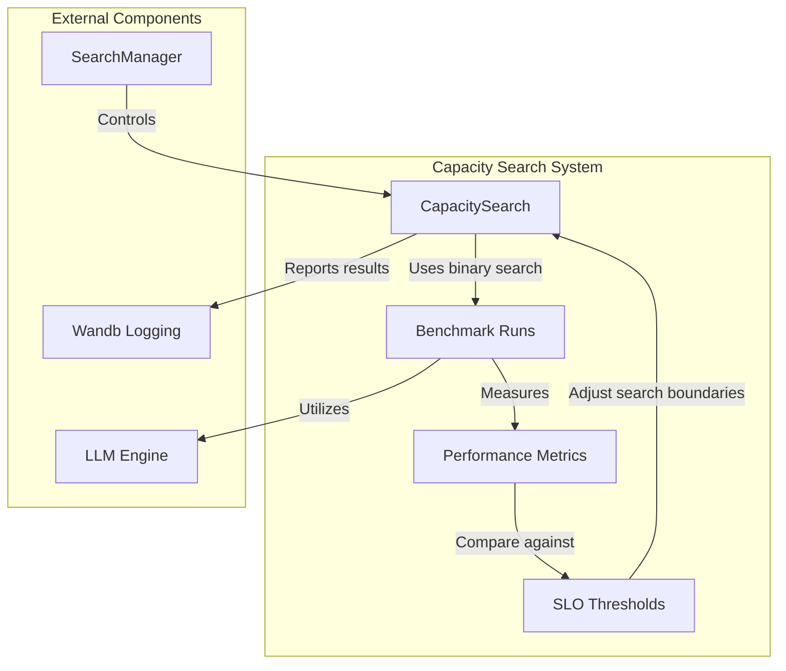
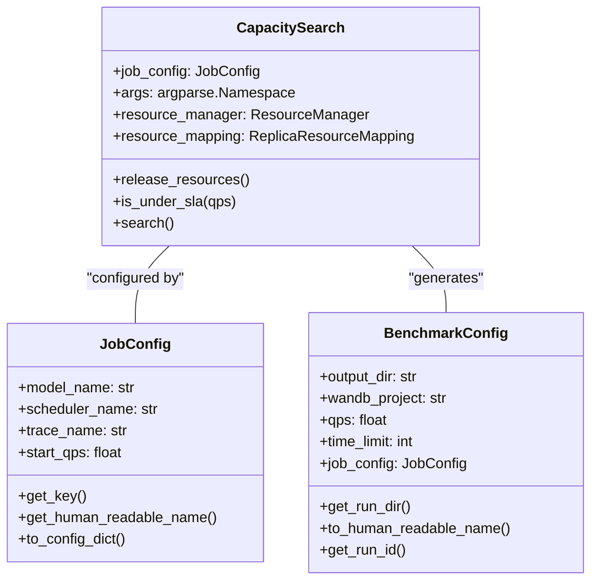
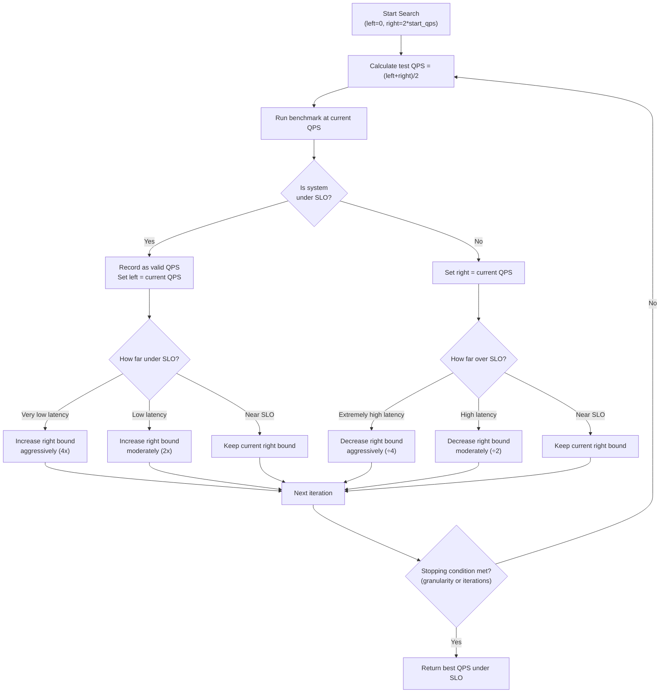
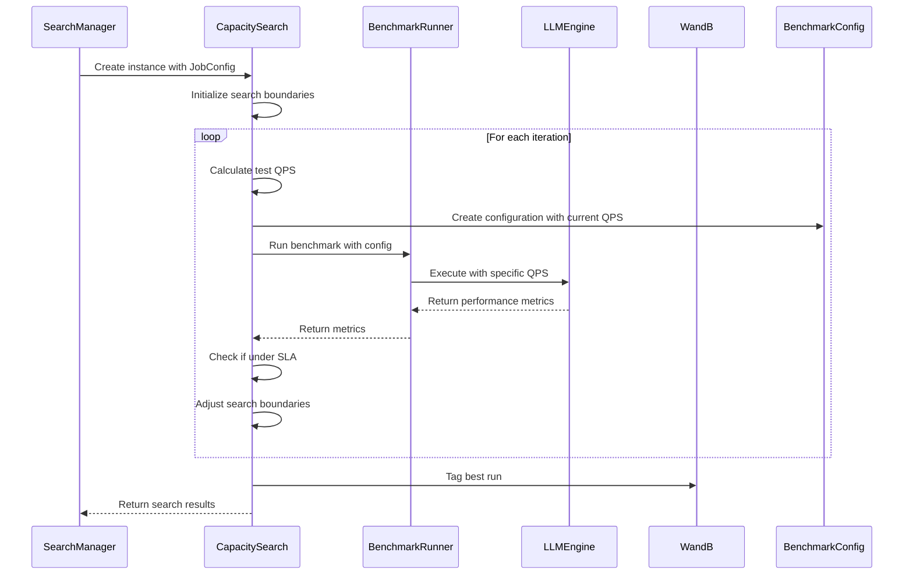

<!-- source: DeepWiki mcp.deepwiki.com · repo microsoft/sarathi-serve · page 5.2 Capacity Search · fetched 2026-10-26 -->

# Capacity Search

<details>
<summary>Relevant source files</summary>

The following files were used as context for generating this wiki page:

- [sarathi/benchmark/capacity_search/capacity_search.py](sarathi/benchmark/capacity_search/capacity_search.py)
- [sarathi/benchmark/capacity_search/main.py](sarathi/benchmark/capacity_search/main.py)

</details>


## Purpose and Scope

The Capacity Search system is a crucial benchmarking component of Sarathi-Serve that automatically identifies the maximum throughput (QPS - Queries Per Second) a model serving configuration can sustain while meeting specified Service Level Objectives (SLOs). This tool helps users optimize their LLM serving deployments by scientifically determining performance boundaries. For information about running standard benchmarks without capacity searching, see [Running Benchmarks](#5.1).

## System Overview

Capacity Search employs a binary search algorithm to efficiently find the highest sustainable QPS while maintaining specified latency SLOs. It tests various QPS values, measures the resulting performance metrics, and systematically narrows down to the optimal throughput.



Sources: [sarathi/benchmark/capacity_search/capacity_search.py:152-238](), [sarathi/benchmark/capacity_search/main.py:1-8]()

## Key Components

### CapacitySearch Class

The core component that implements the binary search algorithm for finding optimal throughput.



Sources: [sarathi/benchmark/capacity_search/capacity_search.py:32-45]()

### Service Level Objectives (SLOs)

Capacity Search evaluates system performance based on two primary metrics:

1. **Request Scheduling Delay**: Time between request arrival and when it gets scheduled for processing (measures queue wait time)
2. **Token Blocking Time (TBT)**: Time to process each token, including any preemption periods (measures token generation speed)

These metrics are evaluated at configurable quantiles to determine SLO compliance.

Sources: [sarathi/benchmark/capacity_search/capacity_search.py:72-103]()

## Search Algorithm

Capacity Search employs a modified binary search algorithm to efficiently find the optimal QPS:



Key algorithm features:

1. **Adaptive Boundaries**: Adjusts search boundaries based on observed performance
2. **Aggressive Exploration**: Rapidly expands QPS when far below SLO thresholds
3. **Granularity Control**: Stops when search range narrows to a configurable granularity percentage
4. **Maximum Iterations**: Limits search to prevent excessive benchmark runs

Sources: [sarathi/benchmark/capacity_search/capacity_search.py:152-238]()

## Configuration Options

The Capacity Search system accepts numerous configuration parameters:

| Parameter | Description | Default Value |
|-----------|-------------|---------------|
| `min-search-granularity` | Minimum search granularity percentage | 2.5% |
| `output-dir` | Directory for storing results | Required |
| `config-path` | Path to config YAML file | Required |
| `scheduling-delay-slo-value` | Maximum allowable scheduling delay (ms) | 2.0 |
| `scheduling-delay-slo-quantile` | Quantile at which to evaluate scheduling delay | 0.50 (P50) |
| `tbt-slo-value` | Maximum allowable token blocking time (ms) | 0.2 |
| `tbt-slo-quantile` | Quantile at which to evaluate TBT | 0.99 (P99) |
| `max-iterations` | Maximum search iterations | 20 |
| `time-limit` | Time limit per benchmark run (minutes) | 30 |
| `wandb-project` | Weights & Biases project for logging | None |
| `wandb-sweep-name` | Name for W&B sweep | None |
| `wandb-sweep-id` | ID for W&B sweep | None |

Sources: [sarathi/benchmark/capacity_search/main.py:24-56]()

## Internal Workflow

The internal workflow of a capacity search operation:



Sources: [sarathi/benchmark/capacity_search/capacity_search.py:105-150](), [sarathi/benchmark/capacity_search/capacity_search.py:152-238]()

## Usage

Capacity Search can be invoked through the main.py script with appropriate configuration:

1. Create a YAML configuration file specifying the models, schedulers, and traces to test
2. Run the capacity search script with appropriate parameters
3. Review results in the output directory and Weights & Biases (if configured)

A basic invocation might look like:

```bash
python -m sarathi.benchmark.capacity_search.main \
  --output-dir /path/to/results \
  --config-path /path/to/config.yaml \
  --scheduling-delay-slo-value 2.0 \
  --tbt-slo-value 0.2 \
  --wandb-project "sarathi-capacity-search" \
  --wandb-sweep-name "my-capacity-sweep"
```

Sources: [sarathi/benchmark/capacity_search/main.py:59-99]()

## Integration with Metrics Collection

Capacity Search integrates with the metrics collection system (described in [Metrics Collection](#5.3)) to gather and analyze performance data. It specifically examines:

1. `request_scheduling_delay` - measured at the specified quantile (default P50)
2. `decode_token_execution_plus_preemption_time` - measured at the specified quantile (default P99)

These metrics are collected from CSV files generated by benchmark runs and compared against SLO thresholds to determine if a given QPS is sustainable.

Sources: [sarathi/benchmark/capacity_search/capacity_search.py:65-70](), [sarathi/benchmark/capacity_search/capacity_search.py:72-103]()

## Results Interpretation

The system outputs several key results for each configuration tested:

1. **Maximum QPS Under SLO**: The highest throughput that maintains SLO compliance
2. **Scheduling Delay at Max QPS**: The observed scheduling delay at the maximum QPS
3. **TBT at Max QPS**: The observed token blocking time at the maximum QPS

These values help users understand the maximum practical throughput their configuration can achieve while maintaining acceptable latency.

Sources: [sarathi/benchmark/capacity_search/capacity_search.py:225-238]()

---

