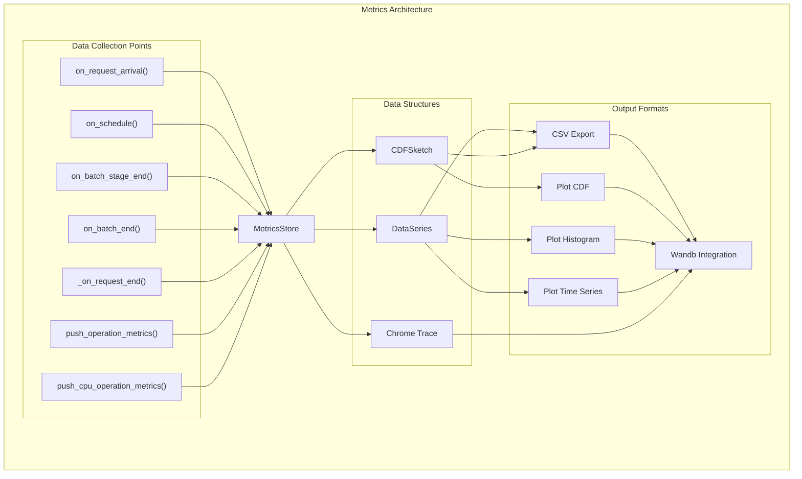
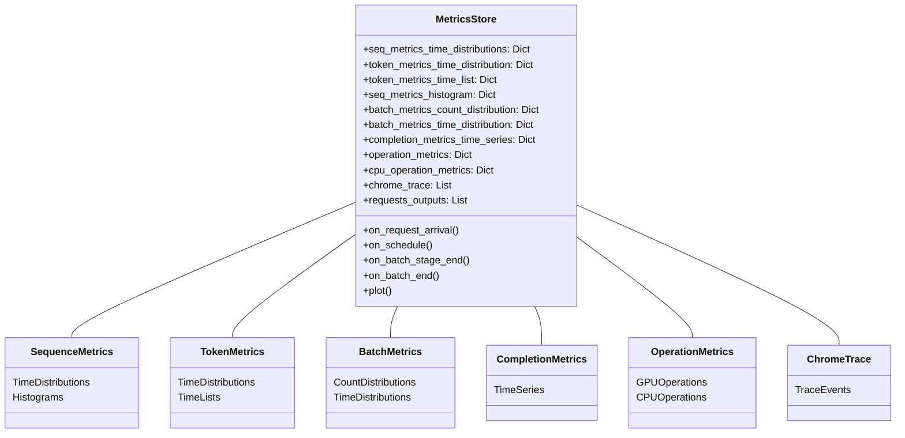
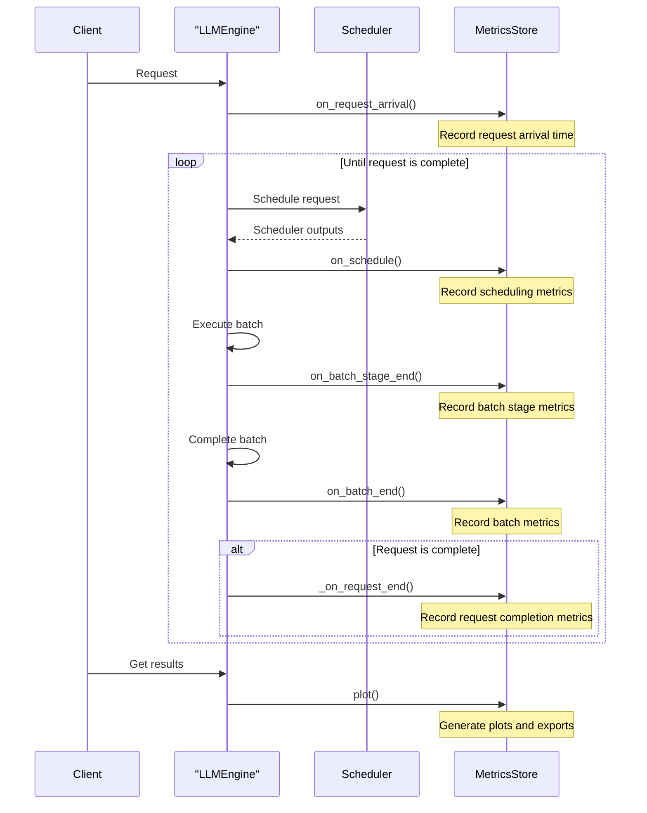
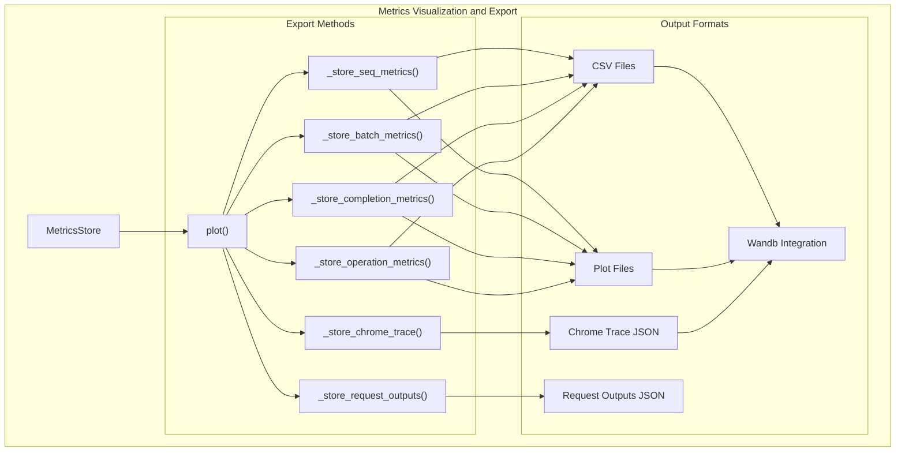
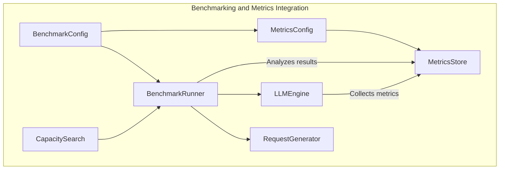

<!-- source: DeepWiki mcp.deepwiki.com · repo microsoft/sarathi-serve · page 5.3 Metrics Collection · fetched 2026-10-26 -->

# Metrics Collection

<details>
<summary>Relevant source files</summary>

The following files were used as context for generating this wiki page:

- [.github/workflows/codeql.yml](.github/workflows/codeql.yml)
- [sarathi/metrics/cdf_sketch.py](sarathi/metrics/cdf_sketch.py)
- [sarathi/metrics/data_series.py](sarathi/metrics/data_series.py)
- [sarathi/metrics/metrics_store.py](sarathi/metrics/metrics_store.py)

</details>


## Purpose and Overview

The Metrics Collection system in Sarathi-Serve provides comprehensive performance monitoring capabilities for LLM serving operations. It tracks a wide range of metrics, from individual token generation times to complete request lifecycles, enabling detailed performance analysis and optimization. These metrics are essential for understanding and optimizing the throughput-latency tradeoff in LLM serving scenarios.

This document details the metrics architecture, categories of metrics collected, collection process, visualization capabilities, and integration with the benchmarking system. For related information about running benchmarks with these metrics, see [Running Benchmarks](#5.1), and for information about capacity search tools that utilize these metrics, see [Capacity Search](#5.2).

## Metrics Architecture

The Sarathi-Serve metrics architecture is centered around the `MetricsStore` class, which serves as the central component for collecting, storing, and visualizing metrics. The system uses specialized data structures to efficiently store and analyze different types of metrics data.



Sources: [sarathi/metrics/metrics_store.py:65-102](), [sarathi/metrics/cdf_sketch.py:12-35](), [sarathi/metrics/data_series.py:11-29]()

### Key Components:

1. **MetricsStore**: Central class that manages metrics collection, storage, and visualization. 

2. **Data Structures**:
   - **DataSeries**: Stores time series data where each datapoint has an x (typically time or ID) and y (metric value).
   - **CDFSketch**: Efficiently computes cumulative distribution functions of metrics using DDSketch, useful for analyzing percentiles.

3. **Collection Points**: Methods in MetricsStore called at different points in the request processing flow.

4. **Visualization and Export**: Methods for exporting metrics to CSV files and generating various types of plots.

## Metrics Categories

The metrics collection system tracks several categories of metrics, each providing insights into different aspects of system performance.



Sources: [sarathi/metrics/metrics_store.py:136-246](), [sarathi/metrics/constants.py]()

### Sequence Metrics

Track performance metrics for individual sequences (requests):

#### Time Distributions
- REQUEST_E2E_TIME: End-to-end time for request processing
- REQUEST_E2E_TIME_NORMALIZED: Normalized end-to-end time (per token)
- REQUEST_SCHEDULING_DELAY: Time spent waiting for scheduling
- REQUEST_EXECUTION_TIME: Time spent in execution
- PREFILL_TIME_E2E: End-to-end time for prefill processing
- DECODE_TIME_EXECUTION_PLUS_PREEMPTION_NORMALIZED: Normalized time for decode processing

#### Histograms
- REQUEST_NUM_TOKENS: Total number of tokens in the request
- REQUEST_PREFILL_TOKENS: Number of prefill tokens
- REQUEST_DECODE_TOKENS: Number of decode tokens
- REQUEST_PD_RATIO: Ratio of prefill to decode tokens
- REQUEST_NUM_RESTARTS: Number of times a request was restarted
- REQUEST_NUM_PAUSES: Number of times a request was paused

Sources: [sarathi/metrics/metrics_store.py:322-334](), [sarathi/metrics/metrics_store.py:343-408]()

### Token Metrics

Track performance metrics for individual token generation:

#### Time Distributions
- DECODE_TOKEN_EXECUTION_PLUS_PREEMPTION_TIME: Time taken for decode token execution

#### Time Lists
- DECODE_TOKEN_EXECUTION_PLUS_PREEMPTION_TIME_LIST: List of time taken for decode token execution

Sources: [sarathi/metrics/metrics_store.py:428-443]()

### Batch Metrics

Track performance metrics for batched operations:

#### Count Distributions
- BATCH_NUM_TOKENS: Total number of tokens in the batch
- BATCH_NUM_PREFILL_TOKENS: Number of prefill tokens in the batch
- BATCH_NUM_DECODE_TOKENS: Number of decode tokens in the batch
- BATCH_SIZE: Number of sequences in the batch

#### Time Distributions
- BATCH_EXECUTION_TIME: Time taken to execute the batch
- INTER_BATCH_DELAY: Delay between batches

Sources: [sarathi/metrics/metrics_store.py:523-543]()

### Completion Metrics

Track time series data for request and token completions:

- REQUEST_ARRIVAL: Time series of request arrivals
- REQUEST_COMPLETION: Time series of request completions
- PREFILL_COMPLETIONS: Time series of prefill completions
- DECODE_COMPLETIONS: Time series of decode completions

Sources: [sarathi/metrics/metrics_store.py:289-299](), [sarathi/metrics/metrics_store.py:307-309](), [sarathi/metrics/metrics_store.py:421-426](), [sarathi/metrics/metrics_store.py:435-437]()

### Operation Metrics

Track performance metrics for specific operations:

#### GPU Operations
- ATTENTION_FORWARD: Time for attention forward pass
- MLP_FORWARD: Time for MLP forward pass
- RESIDUAL: Time for residual connections
- LAYERNORM: Time for layer normalization
- RMS_NORM: Time for RMS normalization
- ROTARY_EMBEDDING: Time for rotary embeddings
- VOCAB_PARALLEL_EMBEDDING: Time for vocabulary parallel embeddings
- COLUMN_PARALLEL_LINEAR: Time for column parallel linear operations
- ROW_PARALLEL_LINEAR: Time for row parallel linear operations

#### CPU Operations
- SCHEDULE: Time for scheduling
- PREPARE_INPUTS_E2E: End-to-end time for preparing inputs
- MODEL_EXECUTION_E2E: End-to-end time for model execution
- SAMPLER_E2E: End-to-end time for sampling
- PROCESS_MODEL_OUTPUTS: Time for processing model outputs

Sources: [sarathi/metrics/metrics_store.py:217-245](), [sarathi/metrics/metrics_store.py:604-639]()

### Chrome Trace Metrics

Provide detailed timing information in Chrome trace format, which can be visualized in Chrome's tracing tool.

Sources: [sarathi/metrics/metrics_store.py:545-588](), [sarathi/metrics/metrics_store.py:846-862]()

## Metrics Collection Process

The metrics collection process is integrated into the request processing flow. Metrics are collected at various points in the flow, providing comprehensive performance monitoring.



Sources: [sarathi/metrics/metrics_store.py:288-324](), [sarathi/metrics/metrics_store.py:447-466](), [sarathi/metrics/metrics_store.py:469-494](), [sarathi/metrics/metrics_store.py:498-543]()

### Collection Points:

1. **Request Arrival** (`on_request_arrival`):
   - Records the request arrival time
   - Records inter-arrival delay between requests

2. **Scheduling** (`on_schedule`):
   - Records Chrome trace information for scheduling
   - Records CPU operation metrics for scheduling

3. **Batch Stage End** (`on_batch_stage_end`):
   - Processes individual batch metrics
   - Records Chrome trace information for batch stages

4. **Batch End** (`on_batch_end`):
   - Records batch execution time
   - Records inter-batch delay
   - Records batch token counts
   - Records token execution times
   - Updates request completion metrics for completed requests

5. **Request End** (`_on_request_end`):
   - Records request completion time
   - Records request metrics (e.g., end-to-end time, number of tokens)
   - Records request outputs if enabled

6. **Operation Metrics** (`push_operation_metrics`, `push_cpu_operation_metrics`):
   - Records time for specific GPU and CPU operations

## Metrics Visualization and Export

The metrics collection system provides several methods for visualizing and exporting metrics. The `plot` method in the `MetricsStore` class generates all plots and CSV files for all metric categories.



Sources: [sarathi/metrics/metrics_store.py:641-863](), [sarathi/metrics/data_series.py:174-309](), [sarathi/metrics/cdf_sketch.py:126-161]()

### Visualization Types:

1. **CDF Plots**: Show the cumulative distribution function of a metric, useful for understanding percentiles.
2. **Histogram Plots**: Show the frequency distribution of a metric.
3. **Time Series Plots**: Show how a metric changes over time.
4. **Chrome Trace Visualization**: Detailed timeline view of system behavior.
5. **Wandb Integration**: Remote visualization and tracking through Weights & Biases.

## Configuration

The metrics collection system is configured via the `MetricsConfig` class, which provides several options for controlling metrics collection and visualization.

### Key Configuration Options:

| Option | Description |
|--------|-------------|
| write_metrics | Enable or disable metrics collection |
| enable_request_outputs | Enable or disable storing request outputs |
| enable_op_level_metrics | Enable or disable operation-level metrics |
| enable_cpu_op_level_metrics | Enable or disable CPU operation-level metrics |
| enable_chrome_trace | Enable or disable Chrome trace metrics |
| keep_individual_batch_metrics | Enable or disable keeping individual batch metrics |
| wandb_project | Project name for Wandb integration |
| wandb_group | Group name for Wandb integration |
| wandb_run_name | Run name for Wandb integration |

Sources: [sarathi/metrics/metrics_store.py:74-87](), [sarathi/metrics/metrics_store.py:250-269]()

## Integration with Benchmarking System

The metrics collection system is tightly integrated with the benchmarking system in Sarathi-Serve. The `BenchmarkRunner` class uses the `MetricsStore` to collect and analyze performance metrics during benchmark runs.



The integration allows for:

- Automatic metrics collection during benchmark runs
- Performance analysis based on collected metrics
- Comparison of different system configurations
- Capacity search based on performance metrics

Sources: [sarathi/metrics/metrics_store.py:65-102]()

## Example Usage

Here's an example of how to configure and use the metrics collection system:

```python
from sarathi.config import MetricsConfig, ReplicaConfig, ModelConfig
from sarathi.metrics.metrics_store import MetricsStore

# Configure metrics collection
metrics_config = MetricsConfig(
    write_metrics=True,
    enable_request_outputs=True,
    enable_op_level_metrics=True,
    enable_cpu_op_level_metrics=True,
    enable_chrome_trace=True,
    keep_individual_batch_metrics=True,
    wandb_project="sarathi",
    wandb_group="experiment",
    wandb_run_name="test_run"
)

replica_config = ReplicaConfig(
    replica_id=0,
    output_dir="./output"
)

model_config = ModelConfig(
    model="gpt2",
    max_model_len=1024
)

# Create metrics store
metrics_store = MetricsStore(
    replica_config=replica_config,
    model_config=model_config,
    metrics_config=metrics_config
)

# Metrics will be collected automatically during request processing

# Generate plots and exports
metrics_store.plot()
```

Sources: [sarathi/metrics/metrics_store.py:64-937]()

## Common Use Cases

The metrics collection system enables several important use cases:

1. **Performance Analysis**: Analyze system performance under different load conditions.
2. **Bottleneck Identification**: Identify performance bottlenecks in the system.
3. **Load Testing**: Understand system behavior under high load.
4. **A/B Testing**: Compare performance of different system configurations.
5. **Regression Testing**: Ensure performance doesn't degrade with code changes.
6. **Throughput-Latency Analysis**: Optimize the throughput-latency tradeoff.

---

