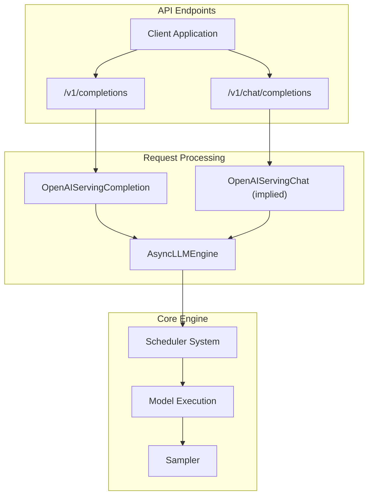
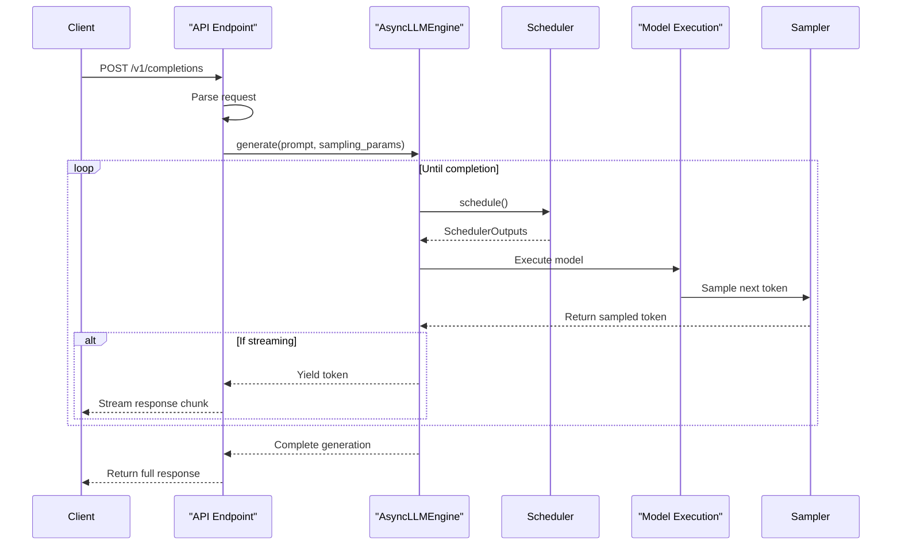
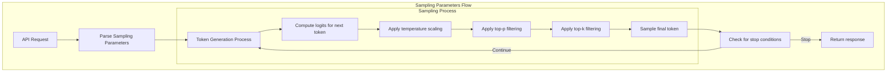
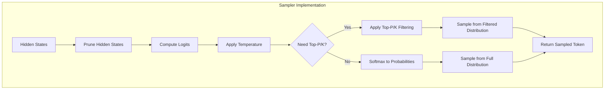
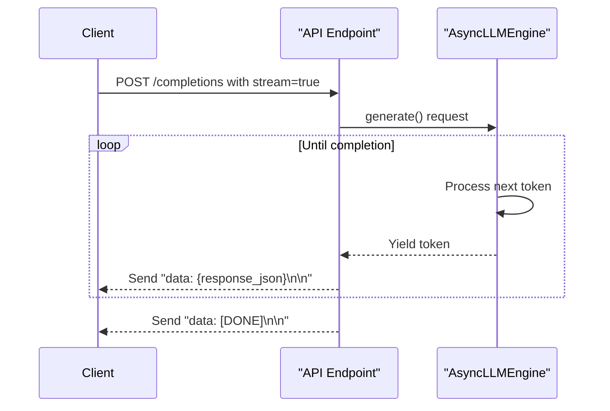
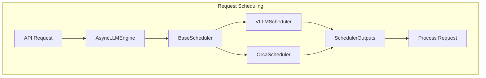

<!-- source: DeepWiki mcp.deepwiki.com · repo microsoft/sarathi-serve · page 6 API and Integrations · fetched 2026-10-26 -->

# API and Integrations

<details>
<summary>Relevant source files</summary>

The following files were used as context for generating this wiki page:

- [sarathi/core/datatypes/sampling_params.py](sarathi/core/datatypes/sampling_params.py)
- [sarathi/core/datatypes/scheduler_output.py](sarathi/core/datatypes/scheduler_output.py)
- [sarathi/core/scheduler/orca_scheduler.py](sarathi/core/scheduler/orca_scheduler.py)
- [sarathi/core/scheduler/vllm_scheduler.py](sarathi/core/scheduler/vllm_scheduler.py)
- [sarathi/entrypoints/openai/protocol.py](sarathi/entrypoints/openai/protocol.py)
- [sarathi/entrypoints/openai/serving_completion.py](sarathi/entrypoints/openai/serving_completion.py)
- [sarathi/model_executor/layers/sampler.py](sarathi/model_executor/layers/sampler.py)

</details>


This page documents the API interfaces and integration options provided by Sarathi-Serve for accessing and utilizing the LLM serving capabilities. It covers the available endpoints, request/response formats, and processing pipelines to help developers integrate with the system. For information about offline inference specifically, see [Offline Inference](#6.1).

## API Overview

Sarathi-Serve provides a set of HTTP API endpoints that are compatible with the OpenAI API format, allowing for familiar integration patterns for developers already using OpenAI's services.

### OpenAI Compatible API

The system implements OpenAI-compatible endpoints for text generation:

- `/v1/completions` - For standard text completion
- `/v1/chat/completions` - For chat-based interactions (referenced in protocol but not shown in the provided code)

These endpoints accept parameters that control the generation process, such as temperature, top-p, and top-k values for sampling.



Sources: [sarathi/entrypoints/openai/serving_completion.py:58-143](), [sarathi/entrypoints/openai/protocol.py:197-226]()

## Request Processing Flow

When a client sends a request to the API, it follows a specific flow through the system:

1. The API server receives the request and parses the parameters
2. The request is converted into appropriate sampling parameters
3. The AsyncLLMEngine schedules the request for processing
4. The scheduler determines when to process the request
5. The model performs inference (prefill and decoding)
6. The sampler generates the next tokens
7. Results are streamed back to the client if streaming is enabled, or returned as a complete response



Sources: [sarathi/entrypoints/openai/serving_completion.py:145-234](), [sarathi/core/datatypes/scheduler_output.py:6-53]()

## Request and Response Format

Sarathi-Serve uses a standardized format for request and response following OpenAI's API conventions.

### Completion Request

```
{
  "model": "model_name",
  "prompt": "Your text prompt here",
  "max_tokens": 100,
  "temperature": 0.7,
  "top_p": 1.0,
  "top_k": -1,
  "stream": false,
  "stop": ["END"],
  "ignore_eos": false
}
```

### Completion Response

```
{
  "id": "cmpl-123abc",
  "object": "text_completion",
  "created": 1677858242,
  "model": "model_name",
  "choices": [
    {
      "text": "Generated text response",
      "index": 0,
      "finish_reason": "stop"
    }
  ],
  "usage": {
    "prompt_tokens": 10,
    "completion_tokens": 20,
    "total_tokens": 30
  }
}
```

Sources: [sarathi/entrypoints/openai/protocol.py:197-226](), [sarathi/entrypoints/openai/protocol.py:236-249]()

## Sampling Parameters

The API allows fine-grained control over text generation through sampling parameters. These parameters affect how the next tokens are selected during the generation process.

| Parameter | Description | Default |
|-----------|-------------|---------|
| `temperature` | Controls randomness in generation. Higher values make output more random, lower values make it more deterministic. 0 means greedy sampling. | 1.0 |
| `top_p` | Nucleus sampling parameter. Selects from the smallest set of tokens whose cumulative probability exceeds this value. | 1.0 |
| `top_k` | Limits token selection to the top k most likely next tokens. -1 disables this limit. | -1 |
| `stop` | List of strings that stop generation when encountered. | [] |
| `ignore_eos` | Whether to ignore the EOS token and continue generation. | false |
| `max_tokens` | Maximum number of tokens to generate. | 2048 |



Sources: [sarathi/core/datatypes/sampling_params.py:15-91](), [sarathi/model_executor/layers/sampler.py:27-86]()

## Sampling Implementation

The Sampler component is responsible for selecting the next tokens during text generation. It follows these steps:

1. Prunes hidden states to get only the relevant tokens for sampling
2. Computes logits (unnormalized probabilities) for all possible next tokens
3. Applies temperature scaling to control randomness
4. Applies top-p and top-k filtering to narrow down token options
5. Samples the next token from the filtered distribution



Sources: [sarathi/model_executor/layers/sampler.py:47-176]()

## Streaming Support

Sarathi-Serve supports streaming responses, which allows for returning generated tokens incrementally as they are produced. This is useful for creating more responsive interfaces where text appears progressively.



The streaming implementation uses Server-Sent Events (SSE) format, with each event being a JSON object containing the generated text so far or just the new token, depending on the implementation.

Sources: [sarathi/entrypoints/openai/serving_completion.py:145-234]()

## Scheduler Integration

The API endpoints integrate with Sarathi-Serve's scheduler system to manage concurrent requests and optimize resource utilization. The scheduler determines which requests to process based on factors like arrival time, priority, and available resources.



When a request is scheduled, it receives a `SchedulerOutputs` object that contains:
- The sequence IDs being processed
- Any ignored or preempted sequence IDs
- Metadata about the scheduled sequences
- Token counts for batched processing

Sources: [sarathi/core/scheduler/vllm_scheduler.py:16-134](), [sarathi/core/scheduler/orca_scheduler.py:16-81]()

## Client Integration Examples

To use the Sarathi-Serve API, clients can make standard HTTP requests to the appropriate endpoints. Here's a basic example of how to integrate with the completions endpoint:

```python
import requests

def generate_text(prompt, model="model_name", max_tokens=100):
    url = "http://your-sarathi-serve-instance/v1/completions"
    
    data = {
        "model": model,
        "prompt": prompt,
        "max_tokens": max_tokens,
        "temperature": 0.7,
        "top_p": 1.0
    }
    
    response = requests.post(url, json=data)
    return response.json()

# Example usage
result = generate_text("Once upon a time")
print(result["choices"][0]["text"])
```

For streaming responses:

```python
import requests

def stream_text(prompt, model="model_name", max_tokens=100):
    url = "http://your-sarathi-serve-instance/v1/completions"
    
    data = {
        "model": model,
        "prompt": prompt,
        "max_tokens": max_tokens,
        "temperature": 0.7,
        "stream": True
    }
    
    response = requests.post(url, json=data, stream=True)
    
    for line in response.iter_lines():
        if line:
            # Each line is in the format "data: {json_data}\n\n"
            line = line.decode('utf-8')
            if line.startswith("data: "):
                data = line[6:]
                if data == "[DONE]":
                    break
                # Process streaming data
                print(data)

# Example usage
stream_text("Once upon a time")
```

Sources: [sarathi/entrypoints/openai/serving_completion.py:58-144]()

## OpenAI Client Compatibility

Since Sarathi-Serve implements OpenAI-compatible endpoints, you can use the OpenAI client libraries to interact with it:

```python
from openai import OpenAI

# Initialize the client with your Sarathi-Serve endpoint
client = OpenAI(
    base_url="http://your-sarathi-serve-instance",
    api_key="dummy-key"  # The key might not be needed depending on configuration
)

# Make a completion request
completion = client.completions.create(
    model="model_name",
    prompt="Write a short story about AI:",
    max_tokens=150
)

print(completion.choices[0].text)
```

This compatibility allows for easy migration from OpenAI services to Sarathi-Serve without changing client code significantly.

---

