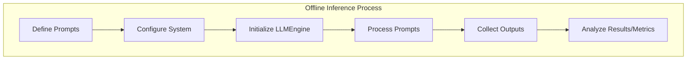
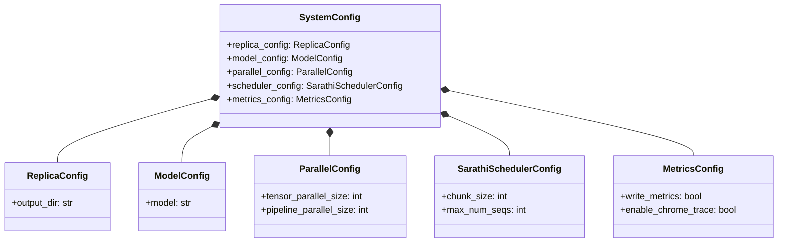
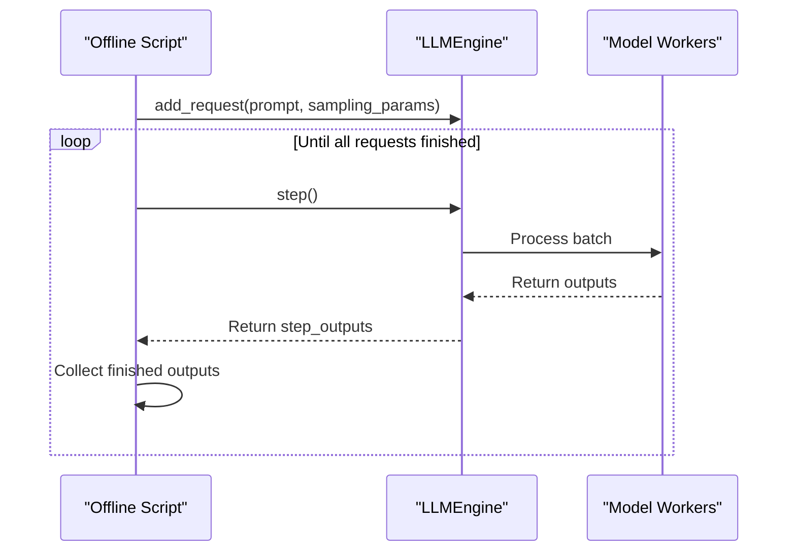

<!-- source: DeepWiki mcp.deepwiki.com · repo microsoft/sarathi-serve · page 6.1 Offline Inference · fetched 2026-10-26 -->

# Offline Inference

<details>
<summary>Relevant source files</summary>

The following files were used as context for generating this wiki page:

- [examples/offline_inference.py](examples/offline_inference.py)

</details>


## Purpose and Scope

This document explains how to use Sarathi-Serve for offline inference tasks - running inference on predefined prompts as a batch process rather than through an API service. Offline inference is useful for processing large sets of prompts, running benchmarks, or generating content without setting up a server.

For information about API-based inference and integrations, see [API and Integrations](#6).

## Overview of Offline Inference

Offline inference in Sarathi-Serve allows you to run LLM inference as a standalone script to process a collection of prompts and generate corresponding outputs. This approach offers several advantages:

- Simplified setup without server infrastructure
- Batch processing of multiple prompts
- Easy collection of performance metrics
- Ability to save and analyze results



Sources: [examples/offline_inference.py:11-22](), [examples/offline_inference.py:90-101]()

## Configuration Setup

To run offline inference with Sarathi-Serve, you need to configure several components that define how the system will operate.

### System Configuration

The `SystemConfig` combines all other configuration components to initialize the LLM engine for offline inference.



Sources: [examples/offline_inference.py:28-57]()

### Key Configuration Components

1. **Replica Configuration**: Defines output directories for results and metrics.
   ```python
   replica_config = ReplicaConfig(
       output_dir="./offline_inference_output/[timestamp]",
   )
   ```

2. **Model Configuration**: Specifies which model to use for inference.
   ```python
   model_config = ModelConfig(
       model="mistralai/Mixtral-8x7B-Instruct-v0.1",
   )
   ```

3. **Parallel Configuration**: Sets up parallel processing parameters for distributing model computation.
   ```python
   parallel_config = ParallelConfig(
       tensor_parallel_size=1,
       pipeline_parallel_size=4,
   )
   ```

4. **Scheduler Configuration**: Controls how requests are batched and processed.
   ```python
   scheduler_config = SarathiSchedulerConfig(
       chunk_size=100,
       max_num_seqs=10,
   )
   ```

5. **Metrics Configuration**: Enables performance metrics collection and tracing.
   ```python
   metrics_config = MetricsConfig(
       write_metrics=True,
       enable_chrome_trace=True,
   )
   ```

Sources: [examples/offline_inference.py:28-49]()

## Implementing Offline Inference

### Setting Up the LLM Engine

After defining your configurations, initialize the LLM engine:

```python
llm_engine = LLMEngine.from_system_config(system_config)
```

Sources: [examples/offline_inference.py:59]()

### Preparing Input Prompts

Define the prompts you want to process and the sampling parameters to control generation:

```python
prompts = [
    "The immediate reaction in some circles of the archeological community was...",
    "The breakthrough technique developed by University of Oxford researchers...",
    # Additional prompts...
]

sampling_params = SamplingParams(temperature=0.8, top_p=0.95, max_tokens=100)
```

Sources: [examples/offline_inference.py:11-24]()

### Processing Requests

The generation process involves:
1. Adding all prompts to the engine as requests
2. Running the engine step by step until all requests are completed
3. Collecting and organizing the outputs



Sources: [examples/offline_inference.py:62-87]()

### The Generation Function

The following function handles the entire generation process:

```python
def generate(
    llm_engine: LLMEngine,
    prompts: List[str],
    sampling_params: SamplingParams,
) -> List[RequestOutput]:
    # Add all requests to the engine queue
    for prompt in prompts:
        llm_engine.add_request(prompt, sampling_params)

    # Setup progress tracking
    num_requests = llm_engine.get_num_unfinished_requests()
    pbar = tqdm(total=num_requests, desc="Processed prompts")

    # Run the engine until all requests are finished
    outputs: List[RequestOutput] = []
    while llm_engine.has_unfinished_requests():
        step_outputs = llm_engine.step()
        for output in step_outputs:
            if output.finished:
                outputs.append(output)
                pbar.update(1)

    # Sort outputs by request ID for consistent ordering
    outputs = sorted(outputs, key=lambda x: int(x.seq_id))
    return outputs
```

Sources: [examples/offline_inference.py:62-87]()

### Executing Inference and Handling Results

After setting up the engine and generation function, run inference and process the results:

```python
# Run inference
outputs = generate(llm_engine, prompts, sampling_params)

# Process and display results
for output in outputs:
    prompt = output.prompt
    generated_text = output.text
    print(f"Prompt: {prompt!r}")
    print(f"Generated text: {generated_text!r}")
```

Sources: [examples/offline_inference.py:90-101]()

## Metrics Collection and Analysis

Sarathi-Serve provides built-in metrics collection and visualization capabilities for analyzing offline inference performance:

```python
# Pull metrics from workers and plot
llm_engine.pull_worker_metrics()
llm_engine.plot_metrics()
```

The metrics and traces are stored in the output directory specified in the `ReplicaConfig`. These can include:

- Throughput (tokens/second)
- Latency per request
- Memory usage
- Model execution time
- Chrome trace files for detailed performance analysis

Sources: [examples/offline_inference.py:103-104]()

## Best Practices for Offline Inference

### Optimizing Parallel Configurations

- **Tensor Parallelism**: Increases when you have large models that don't fit on a single GPU
- **Pipeline Parallelism**: Helpful for distributing model layers across multiple GPUs

### Batch Size and Memory Considerations

- Adjust `chunk_size` and `max_num_seqs` in the scheduler configuration based on available GPU memory
- Larger batch sizes generally improve throughput but may increase latency for individual requests

### Processing Large Datasets

For very large sets of prompts:
1. Process prompts in manageable batches
2. Save results incrementally
3. Consider implementing checkpointing if processing could be interrupted

## Complete Example

The complete offline inference process involves:

1. Importing required Sarathi modules
2. Defining configuration components
3. Creating the LLM engine
4. Preparing input prompts
5. Running inference
6. Processing and storing results
7. Collecting metrics

For a full implementation example, refer to [examples/offline_inference.py]().

---

